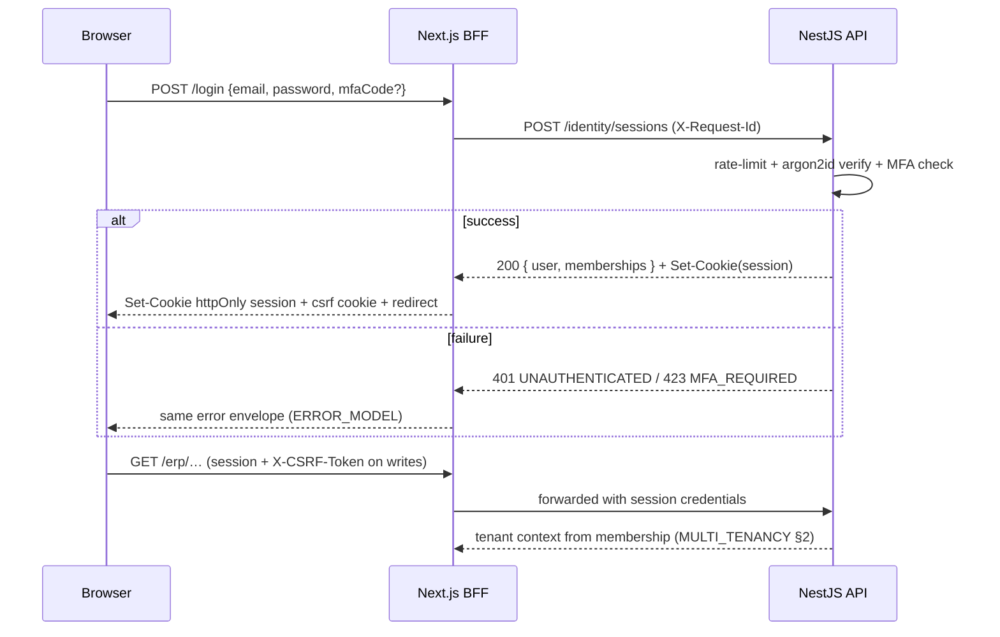

# Authentication

> **Status:** STABLE · **Owner:** Offline & API Architecture · **Updated:** 2026-10-27

API specification of the identity surface per
[ADR-0015](../architecture/ADR/ADR-0015-authentication.md): argon2id passwords, opaque
server-side sessions for web (via the BFF, [ADR-0003](../architecture/ADR/ADR-0003-nextjs-nestjs.md)),
per-device tokens for desktop/Android, TOTP MFA, and recovery flows. Transport and error
conventions: [API_CONVENTIONS.md](API_CONVENTIONS.md) · [ERROR_MODEL.md](ERROR_MODEL.md).
Device-side security: [../offline/SECURITY_AND_DEVICE_MANAGEMENT.md](../offline/SECURITY_AND_DEVICE_MANAGEMENT.md).
Implemented in PHASE-003 (+devices schema), used for sync from PHASE-016/020.

## 1. Web sessions (BFF path)

The browser never talks to the API with raw tokens; it holds one `httpOnly`, `Secure`,
`SameSite=Lax` session cookie against Next.js, and the BFF forwards to the API
([ADR-0003](../architecture/ADR/ADR-0003-nextjs-nestjs.md)).

| Endpoint (via BFF) | Method | Notes |
|---------------------|--------|-------|
| `/api/v1/identity/sessions` | POST | login: `{ email, password, mfaCode? }` → session cookie + CSRF token |
| `/api/v1/identity/sessions/current` | GET | session introspection (user, tenant memberships, active tenant, permissions) |
| `/api/v1/identity/sessions/current` | DELETE | logout (revokes server session row) |
| `/api/v1/identity/sessions/refresh` | POST | rotate session id (BFF-internal; sliding window within absolute lifetime) |
| `/api/v1/identity/sessions/switch-tenant` | POST | switch active membership (server verifies target membership) |

Rules: session ids are opaque, rotating, stored **hashed** server-side
(`sessions.token_hash`, [../database/ENTITY_CATALOG.md](../database/ENTITY_CATALOG.md));
absolute timeout 12 h + idle timeout 30 min; server-side revocation list per user;
passwords verified with argon2id (params per-hash, [ADR-0015](../architecture/ADR/ADR-0015-authentication.md) §1).

**CSRF scheme (double-submit + SameSite)**: the login response issues a CSRF token
(non-`httpOnly` readable cookie + echoed in `meta`); every unsafe BFF request must echo it
in `X-CSRF-Token` (header/cookie match enforced server-side). Failure → `403 FORBIDDEN`
(`details: csrf`). The API proper (token-authenticated, no cookies) is CSRF-exempt by
construction.



## 2. Device tokens (native clients)

Desktop and Android authenticate with **per-device credentials** issued at registration
and rotated continuously. Endpoints (called with a user session/token for enrollment,
then with device credentials afterwards):

| Endpoint | Method | Notes |
|----------|--------|-------|
| `/api/v1/devices` | POST | register device (permission `devices.register`); attestation-lite challenge inside ([../offline/SYNC_PROTOCOL.md](../offline/SYNC_PROTOCOL.md) §1) |
| `/api/v1/devices/current` | GET | device introspection (id, capabilities, trust flags, contract version) |
| `/api/v1/devices/current/tokens` | POST | exchange refresh token → access token (rotation; one-time-use) |
| `/api/v1/devices/current` | DELETE | self-revocation |
| `/api/v1/users/{id}/devices`, `/api/v1/tenants/devices` | GET / PATCH | list + revoke (admin) |

**Rotation rules** ([ADR-0015](../architecture/ADR/ADR-0015-authentication.md) §3):
refresh tokens are one-time-use and rotate on every exchange; each is bound to
`device_id`; a **reused rotated token is treated as theft** → device revoked +
`device.refresh_token_reuse_detected` audit + alarm. Access tokens live 15 min, memory
only. Revocation effect (kill switch) on pull/push is specified in
[../offline/SECURITY_AND_DEVICE_MANAGEMENT.md](../offline/SECURITY_AND_DEVICE_MANAGEMENT.md) §4.

```mermaid
sequenceDiagram
  participant D as Native client (new install)
  participant A as API
  D->>A: POST /devices (user credential; {platform, key, capabilities})
  A->>A: permission + membership + nonce challenge
  D->>A: nonce signature (attestation-lite)
  A-->>D: { deviceId, refreshToken, accessToken(15m) }
  Note over D: secrets → OS keychain/keystore only
  loop every ≈15 min
    D->>A: POST /devices/current/tokens {refreshToken}
    A-->>D: { refreshToken', accessToken' } (old refresh one-time-used)
  end
```

## 3. MFA (TOTP)

| Endpoint | Method | Notes |
|----------|--------|-------|
| `/api/v1/identity/mfa/totp/enroll` | POST | start enrollment → secret + otpauth URI (shown as QR); status PENDING |
| `/api/v1/identity/mfa/totp/verify` | POST | confirm with a valid code → ACTIVE |
| `/api/v1/identity/mfa/recovery-codes` | POST | (re)generate single-use recovery codes (hashed at rest) |
| `/api/v1/identity/mfa/totp` | DELETE | disable (requires valid code or recovery code) |

Rules: RFC 6238, per-user `mfa_factors` row, secret encrypted at rest
([../security/SECRETS_MANAGEMENT.md](../security/SECRETS_MANAGEMENT.md)); login with an
enrolled factor and no/invalid code → `423 MFA_REQUIRED` (device-token enrollment
excluded); recovery codes are single-use, timing-safe compared; mandatory-able per
role/plan policy from a later phase (not at enrollment).

## 4. Password policy and reset flows

- **Policy** (enforced at set/change): min length 10; breached-password rejection;
  argon2id hash; no forced rotation; no security questions
  ([ADR-0015](../architecture/ADR/ADR-0015-authentication.md) §1).
- **Reset request**: `POST /identity/password-resets { email }` → always answers 200
  (no account enumeration; same response whether or not the account exists).
- **Reset consume**: `PUT /identity/password-resets/{token}` with `{ newPassword }` —
  token is single-use, short-lived (30 min), stored hashed, compared **timing-safe**;
  consumption revokes all sessions + device tokens of the user (forced re-login
  everywhere), audited.
- **Change (authenticated)**: `POST /identity/password-change { current, next }` →
  revokes other sessions; devices keep their tokens (re-challenge optional per policy).

## 5. Rate limiting, lockout, and their responses

1. Login/reset/exchange endpoints are rate-limited per IP, per email, and per tenant.
2. Repeated failures apply **progressive delays** then a **temporary lock** (never
   permanent without admin action); lock responses are indistinguishable from
   credential failures to avoid oracle abuse (`401 UNAUTHENTICATED` with
   `details.retryAfterSeconds` when the lock is active) — headers still carry
   `Retry-After` ([API_CONVENTIONS.md](API_CONVENTIONS.md) §10).
3. Login notifications (email) on success from a new device/infrastructure; all failures
   audited with correlation ids.
4. Sync endpoints are token-bucketed per device ([../offline/SYNC_PROTOCOL.md](../offline/SYNC_PROTOCOL.md)
   §8) — `DEFERRED`/`429 RATE_LIMITED` with `Retry-After`.

## 6. Lifetime policy table

| Credential / surface | Absolute | Idle | Rotation | Revocation |
|----------------------|----------|------|----------|------------|
| Web session cookie | 12 h | 30 min | id rotates per request (BFF refresh window inside absolute) | logout / user revocation list / password reset / tenant suspension |
| CSRF token | bound to session | — | re-issued with session rotation | with session |
| Device access token | 15 min | — | silent refresh exchange | revocation blocks next exchange |
| Device refresh token | 90 days rolling if used | 30 days unused | one-time-use on every exchange | device revocation / reuse detection / password reset (policy) |
| Password reset token | 30 min | — | single-use | consumed / expired |
| Support access (impersonation) | ≤ 4 h box | — | one grant per incident | explicit end, audited ([GLOSSARY](../GLOSSARY.md) "Support access") |

## 7. Permission enforcement model

1. **Route level**: NestJS permission decorators (`@RequirePermission('sales.invoices.post')`)
   check the membership's effective permissions before the handler runs — every route
   declares one; absence is a review blocker.
2. **Service level**: domain services re-check permission + branch scope + entitlement
   (`feature key`) for the actual action — the route guard is necessary but not
   sufficient (defense in depth; jobs and sync handlers enter below the HTTP layer,
   [../architecture/DATA_FLOW.md](../architecture/DATA_FLOW.md) §7).
3. **UI visibility is never sufficient**: hidden buttons are UX, not security — every
   server-side check is independent ([../security/AUTHORIZATION_MATRIX.md](../security/AUTHORIZATION_MATRIX.md)).
   Offline devices cache the permission snapshot for UI gating only; enforcement is
   server-final ([../offline/SECURITY_AND_DEVICE_MANAGEMENT.md](../offline/SECURITY_AND_DEVICE_MANAGEMENT.md) §5).
4. Cross-tenant access returns `404 NOT_FOUND`, not `403` — no existence leak
   ([ERROR_MODEL.md](ERROR_MODEL.md) §3).
