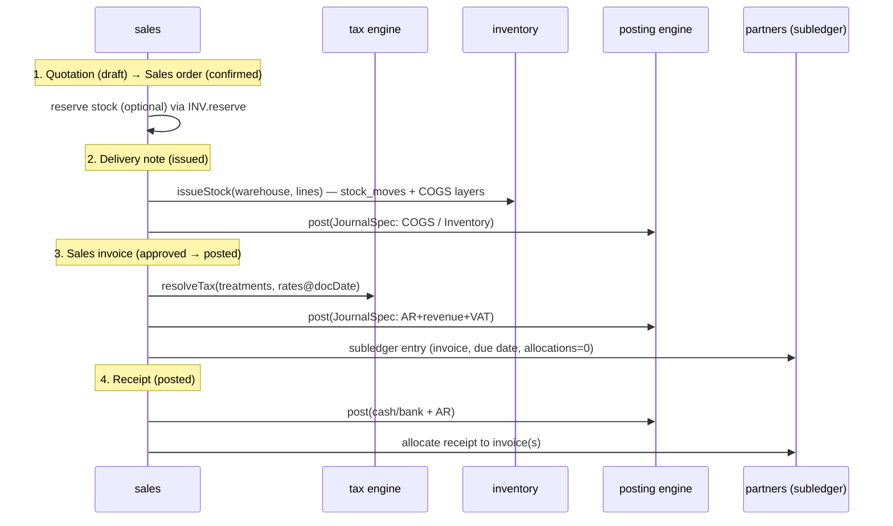
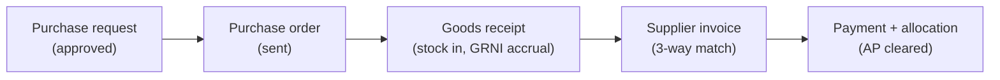
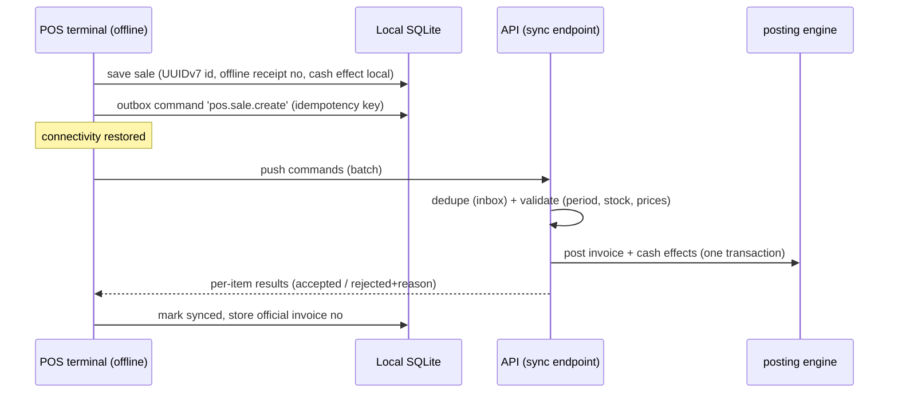

# Data Flow

> **Status:** STABLE · **Owner:** Platform Architecture · **Updated:** 2026-10-27

Canonical flows that phase documents reference. Each flow lists the source document
effect, inventory effect, AR/AP effect, cash/bank effect, GL effect, tax effect, and audit
effect — as required by directive §5.

## 1. Order-to-cash (credit sale, goods)



**Effects of a posted credit sales invoice**: (1) source document immutable `POSTED`;
(2) inventory reduced at delivery (COGS recognized); (3) AR subledger += total;
(4) no cash effect yet; (5) GL: DR AR control / CR revenue / CR VAT payable (if
registered) + DR COGS / CR inventory; (6) tax summary stamped on the document (feeds VAT
return); (7) audit event with before/after. Full rule table:
[../accounting/POSTING_ENGINE.md](../accounting/POSTING_ENGINE.md).

## 2. Procure-to-pay



Effects of posted supplier invoice: inventory/value up (or expense), VAT recoverable
(recoverable input tax recorded as an asset only when registration + pack rules allow;
otherwise expensed), AP subledger += total, GL balanced via posting engine, tax summary
stamped, audit event. Landed costs revalue received stock per
[../accounting/INVENTORY_ACCOUNTING.md](../accounting/INVENTORY_ACCOUNTING.md).

## 3. Cash expense

Employee records expense → approval per policy → posting engine: DR expense account /
CR cash (or petty cash) account; treasury account balance updated; audit event; no
inventory/AR/AP effect.

## 4. Stock count variance

Count session → counted quantities → variance review → adjustment document approved →
inventory module writes stock_moves (±) → posting engine posts shrinkage/gain (DR/CR
inventory vs shrinkage account) → audit event. Never a silent balance overwrite.

## 5. Period close (month)

Lock checklist (all subledgers reconciled) → period soft-closed (warnings) → hard lock →
posting engine rejects any posting into locked periods (INV-011). Year-end: P&L accounts
closed to retained earnings by a system-generated closing entry — reversible as a whole.

## 6. Offline POS sale (disconnected terminal)



Local state is always displayed as "pending sync", never as officially accepted
(ADR-0012). Duplicate pushes are harmless (idempotency + inbox).

## 7. Tenant request context flow (every request)

```
HTTPS request → BFF (web) or API (native)
  → auth middleware (session/device token) → user + membership resolved
  → tenant context from membership (never from payload)
  → AsyncLocalStorage context
  → transaction begin → SET LOCAL erp.tenant_id → RLS active
  → module service → posting engine / repositories
  → commit → audit interceptor flush
```

Missing/spoofed tenant context = request rejection (see
[MULTI_TENANCY.md](MULTI_TENANCY.md), [../security/THREAT_MODEL.md](../security/THREAT_MODEL.md)).

## 8. Report execution flow

Request (report contract params) → permission check → query service (module-owned,
tenant-scoped) → dataset → (small: inline render; large: pg-boss job) → HTML template
(design-system print CSS, RTL) → Chromium PDF / exceljs XLSX / CSV → file stored with
signed URL → audit event (who ran what when, with params) → response/download.
Reports reconcile to GL via [../reporting/REPORT_RECONCILIATION.md](../reporting/REPORT_RECONCILIATION.md).
