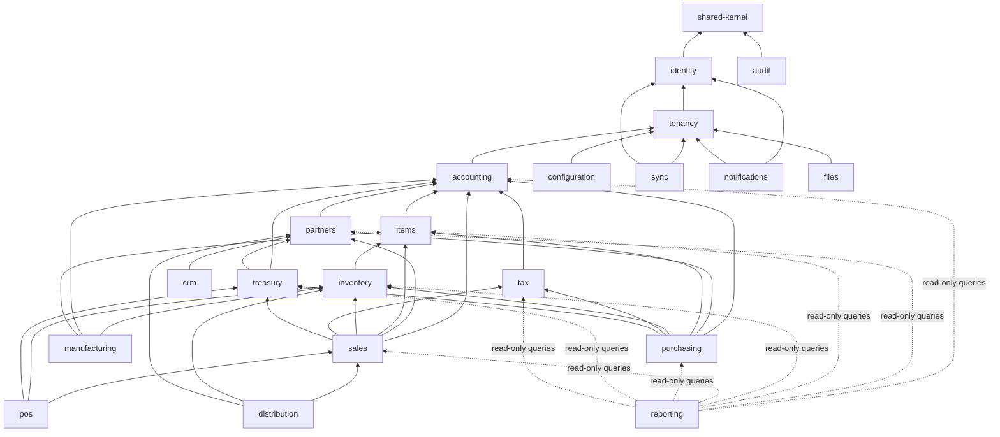

# Dependency Rules

> **Status:** STABLE · **Owner:** Platform Architecture · **Updated:** 2026-10-27

How code is allowed to depend on other code. These rules are enforced mechanically — a
build that violates them fails CI. Manual exceptions are forbidden without a decision
record.

## 1. Layering (inside every module)

```
api/            ← published services + DTOs (the only importable surface for other modules)
application/    ← use-case orchestration (transactions, events)
domain/         ← entities, value objects, domain services, invariants (NO framework imports)
infrastructure/ ← repositories (Drizzle), external adapters, jobs
```

- `domain/` imports nothing from NestJS, Drizzle, HTTP, or other modules — only
  `@erp/domain-core` (shared kernel). This keeps accounting rules unit-testable forever.
- `application/` may import `domain/` and other modules' `api/` surfaces.
- `infrastructure/` implements interfaces declared in `domain/` or `application/`.
- Controllers (HTTP) live in a per-module `presentation/` or the module's controller
  file, importing `application/` only.

## 2. Module dependency direction (allowed imports of another module's `api/`)



Rules:

1. **No cycles**: if a need seems cyclic (e.g., sales ↔ inventory), the shared
   responsibility moves down (inventory exposes `issueStock`; sales orchestrates).
2. **`accounting` depends on almost nothing** (tenancy for context only) — the core stays
   stable while everything else evolves.
3. **`reporting` reads via authorized query services only** — it never joins other
   modules' tables directly in SQL. Read models (materialized views) are owned by the
   source module and exposed as queries.
4. **Cross-module table access is banned** (enforced by ESLint boundary rules +
   dependency-cruiser in CI). The write matrix in
   [MODULE_BOUNDARIES.md](MODULE_BOUNDARIES.md) is the exception list — and it is empty
   beyond module-owned tables.

## 3. Frontend / client rules

- `apps/web`, `apps/desktop` may import `packages/ui`, `packages/contracts`,
  `packages/domain-core`. Never `apps/api` internals.
- `apps/mobile` may import `packages/contracts`, `packages/domain-core` only.
- Client code never re-implements server-validatable rules beyond schema validation
  shipped in `contracts` (ADR-0002).

## 4. Enforced checks in CI (PHASE-001 delivers these)

| Check | Tool |
|-------|------|
| Import boundaries between modules & layers | `eslint-plugin-boundaries` |
| Dependency graph acyclicity | `dependency-cruiser` |
| No `any` / floating money math | ESLint custom rules (`no-restricted-properties` on Math ops with Money, `no-unsafe-any`) |
| No physical direction utilities in `packages/ui` | ESLint regex on class names (`pl-`, `pr-`, `ml-`, `mr-`, `text-left/right` → error) |
| Contracts drift | OpenAPI diff against `packages/contracts` |

## 5. Changing these rules

Any new allowed edge in the graph above requires: justification in a decision record,
updated diagram, updated CI rules, and a regression check that the build still fails on
the old violations.
