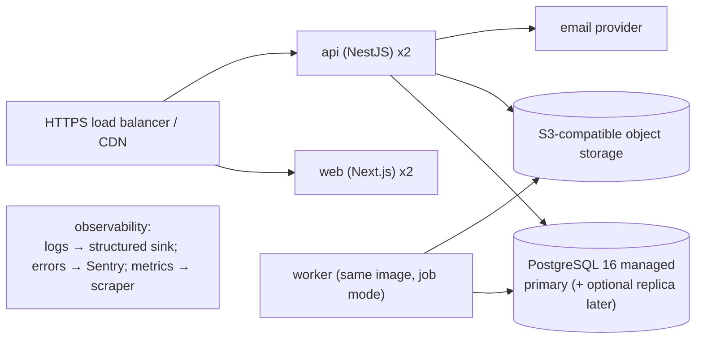

# Deployment Architecture

> **Status:** STABLE · **Owner:** Platform Architecture · **Updated:** 2026-10-27

Environments, topology, and the delivery pipeline. Operational detail (runbooks, restore
drills) lives in [../operations/](../operations/DEPLOYMENT.md).

## Environments

| Env | Purpose | Data | Access |
|-----|---------|------|--------|
| `local` | Developer machines (Docker Compose: postgres 16, minio, mailpit, api, web) | Synthetic seed data | Developer |
| `ci` | Ephemeral, Testcontainers-spun Postgres; Playwright browsers | Fixtures | None |
| `staging` | Pre-release verification, migration rehearsal, UAT | Anonymized/synthetic | Team + invited testers |
| `production` | Live SaaS | Real | On-call, audited |

## Production topology (MVP — matches ADR-0001/0003/0008)

- Stateless `api` + `web` nodes behind LB; sessions live in Postgres (ADR-0015).
- `worker` runs the same image with `WORKER_MODE=1` (pg-boss consumer + Chromium for
  report rendering — ADR-0011).
- Migrations run as a pre-deploy job (`migrate` role), gated: deploy proceeds only if
  migrations succeed; failed migration = abort, not rollback (forward-only with
  expand-contract — [../database/MIGRATION_STRATEGY.md](../database/MIGRATION_STRATEGY.md)).

## Release process

1. CI (GitHub Actions): typecheck → lint (incl. boundary rules) → unit → integration
   (Testcontainers) → E2E (staging-like compose) → build images → SBOM + security scan.
2. Staging auto-deploy on merge to `main`; production deploy via manual approval +
   migration rehearsal on staging first.
3. Rollback = redeploy previous image; database rollbacks are NOT automatic (see
   migration strategy); every phase documents its rollback procedure.
4. Feature flags for risky paths; entitlement-gated features ship dark until enabled.

## Sizing & budgets (initial, revisited per phase)

| Resource | Initial | Trigger to revisit |
|----------|---------|--------------------|
| Postgres | 2 vCPU / 4GB, storage autoscale | CPU > 60% sustained; connection contention |
| API nodes | 2 × 1 vCPU / 1GB | p95 latency budget breach (NFR-006) |
| Worker | 1 × 1 vCPU / 2GB (Chromium headroom) | Report queue depth > SLA |
| Object storage | Pay-per-use | — |

## Availability & recovery targets (MVP, per NFR-007)

- RPO ≤ 15 min via continuous WAL archiving (managed) + nightly full encrypted backup.
- RTO ≤ 4 h via infrastructure-as-code re-provision + restore runbook, **tested** in
  staging drills each quarter ([../operations/BACKUP_RESTORE_RUNBOOK.md](../operations/BACKUP_RESTORE_RUNBOOK.md)).
- Zero-downtime deploys for API via rolling restart + health gates (DB expand-contract
  makes old/new code compatible during the window).

## Scaling path (documented, not premature)

1. Vertical: bigger DB, more API replicas.
2. Read replica for reporting queries (module-owned read models make this surgical).
3. Redis for caching/rate limits when triggers in ADR-0008 fire.
4. Dedicated worker pools for report bursts.
5. Kubernetes only when instance-level orchestration genuinely fails — requires ADR.

## Client distribution

- Web: CDN-served static + Node runtime for BFF routes.
- Desktop (PHASE-021): signed Tauri bundles + updater channel (staged rollouts).
- Android (PHASE-022): Play Store staged rollout + minimum-version enforcement.
