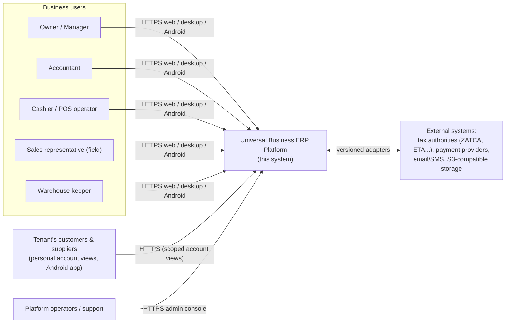
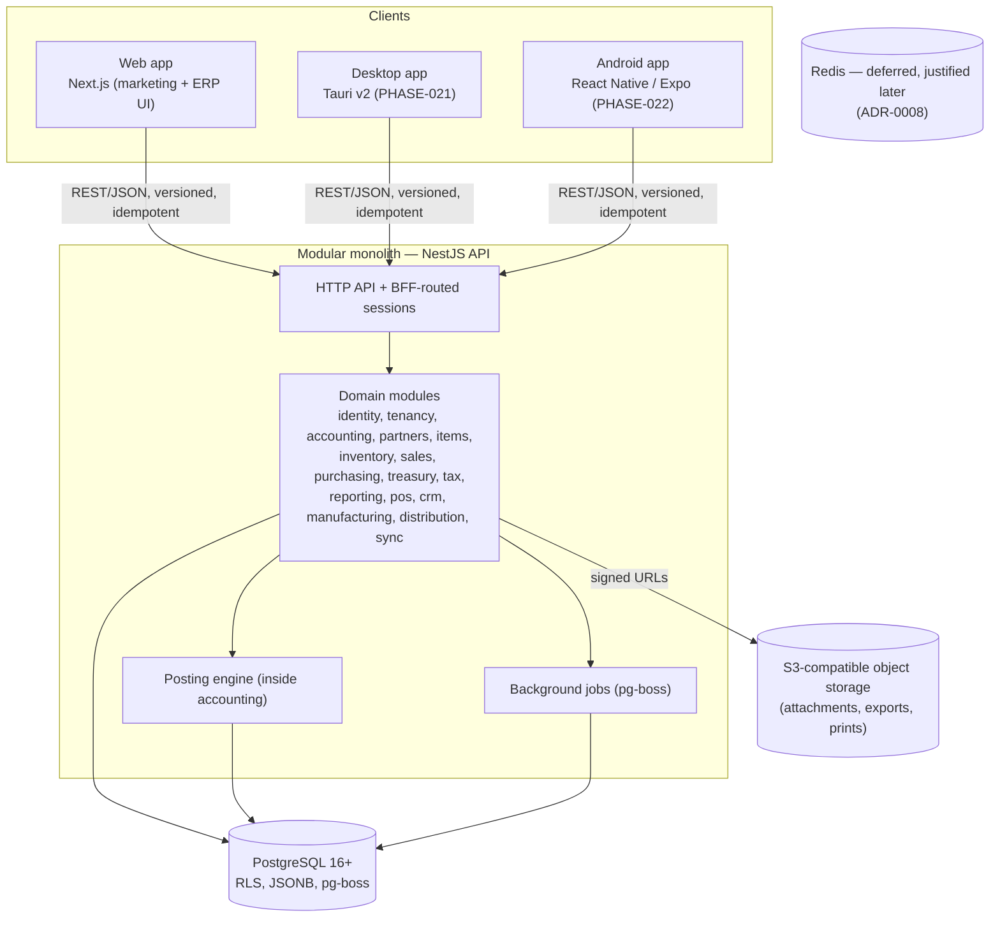

# System Overview

> **Status:** STABLE · **Owner:** Platform Architecture · **Updated:** 2026-10-27

## 1. Context

The Platform is a multi-tenant SaaS ERP serving businesses in MENA/GCC. External actors:
business users (web/desktop/Android), their customers and suppliers (personal-account
views), platform operators, and external systems (tax authorities, payment providers,
storage, email). See [../PROJECT_VISION.md](../PROJECT_VISION.md) for the product context
and [../security/THREAT_MODEL.md](../security/THREAT_MODEL.md) for the security view.

## 2. System context diagram (C4 level 1)



## 3. Containers (C4 level 2)



Key points:

- **One deployable API** (modular monolith, [ADR-0001](ADR/ADR-0001-modular-monolith.md)).
  Modules are enforced boundaries, not services.
- **Web, desktop, and Android are clients only.** All shared business rules live in the
  API domain modules; clients reuse generated TypeScript contracts
  ([ADR-0002](ADR/ADR-0002-typescript-monorepo.md), [ADR-0003](ADR/ADR-0003-nextjs-nestjs.md)).
- **PostgreSQL is the system of record.** Money, documents, stock, jobs, audit — all in
  Postgres ([ADR-0004](ADR/ADR-0004-postgresql-drizzle.md)).
- **The posting engine is the only writer of GL data** ([ADR-0007](ADR/ADR-0007-centralized-posting-engine.md)).
- **Offline clients carry a local SQLite database** and synchronize through the sync
  protocol, never by direct database replication ([ADR-0012](ADR/ADR-0012-offline-sync.md)).

## 4. Runtime topology per environment

| Environment | Topology |
|-------------|----------|
| Development | Docker Compose: `api`, `web`, `postgres:16`, `minio`, `mailpit` |
| Staging | Mirrors production shape, single node, seeded test tenant |
| Production (MVP) | Managed PostgreSQL; 1–2 API nodes behind a load balancer; web served as static/Node; object storage; nightly encrypted backups (see [DEPLOYMENT_ARCHITECTURE.md](DEPLOYMENT_ARCHITECTURE.md)) |

## 5. Module map

See [MODULE_BOUNDARIES.md](MODULE_BOUNDARIES.md) for the authoritative table of modules,
owned tables, exposed services, and the dependency rules that keep them decoupled. Summary
of layering:

1. **Shared kernel** — ids, money/decimal primitives, result types, clock, i18n keys.
2. **Core domains** — accounting (with posting engine), partners, items.
3. **Operations domains** — inventory, sales, purchasing, treasury, tax.
4. **Experience domains** — reporting, pos, crm, manufacturing, distribution, notifications, files.
5. **Platform domains** — identity, tenancy, entitlements, audit, sync.

## 6. Data flow principles

- Writes flow: client → API controller → module application service → domain services
  (posting engine, tax engine, stock engine) → single PostgreSQL transaction.
- Reads flow: API → scoped query services → (where justified) read models. Reports always
  reconcile to authoritative accounting data
  ([../reporting/REPORT_RECONCILIATION.md](../reporting/REPORT_RECONCILIATION.md)).
- Events: in-process domain events for cross-module reactions (e.g., invoice posted →
  notification created). No event sourcing; events are not the record
  ([ADR-0001](ADR/ADR-0001-modular-monolith.md)).
- Tenant context: established from the authenticated session, validated, and propagated
  through AsyncLocalStorage → SQL `SET LOCAL` → RLS ([MULTI_TENANCY.md](MULTI_TENANCY.md)).

## 7. Sequence: posting a sales invoice (illustrative)

```mermaid
sequenceDiagram
  participant U as User (web)
  participant W as Web (Next.js BFF)
  participant A as API (sales module)
  participant TE as Tax engine
  participant PE as Posting engine
  participant DB as PostgreSQL (RLS)

  U->>W: Save & approve invoice
  W->>A: POST /sales/invoices/{id}/approve (Idempotency-Key)
  A->>TE: resolve tax lines (jurisdiction, treatment, rate snapshot)
  A->>PE: post(documentRef, journalSpec)
  PE->>DB: BEGIN; SET LOCAL tenant; validate period open, balance, accounts
  PE->>DB: insert journal_entry (POSTED), journal_lines
  PE->>DB: update invoice status, AR subledger; insert audit_event
  PE->>DB: COMMIT
  A-->>W: 200 {invoice, journalEntryId}
  W-->>U: Invoice posted (immutable; corrections via credit note)
```

## 8. Technology summary

| Concern | Choice | ADR |
|---------|--------|-----|
| Language | TypeScript (strict) everywhere | ADR-0002 |
| Repo | pnpm workspaces + Turborepo | ADR-0002 |
| Backend | NestJS modular monolith | ADR-0001, ADR-0003 |
| Web | Next.js (App Router) + BFF route handlers | ADR-0003 |
| Database | PostgreSQL 16+ with Drizzle ORM | ADR-0004 |
| Tenancy | Shared schema, tenant_id, RLS defense-in-depth | ADR-0005 |
| IDs | UUIDv7 technical + separate official document numbers | ADR-0006 |
| Accounting | Centralized posting engine | ADR-0007 |
| Jobs | pg-boss (Redis deferred) | ADR-0008 |
| Money | NUMERIC(19,4), decimal.js, strings over API | ADR-0009 |
| Tax | Versioned jurisdiction packs + adapters | ADR-0010 |
| Reporting | Report contract; HTML→Chromium PDF; exceljs | ADR-0011 |
| Offline | SQLite local + outbox/inbox sync protocol | ADR-0012 |
| Desktop | Tauri v2 | ADR-0013 |
| Android | React Native + Expo | ADR-0014 |
| Auth | argon2id + session cookies + TOTP MFA; device tokens | ADR-0015 |
| UI | Tailwind CSS v4 + Radix primitives + ERP design system, RTL-first | ADR-0016 |

## 9. Architectural qualities and how they are achieved

| Quality | Mechanism |
|---------|-----------|
| Financial correctness | Posting engine + invariants + invariant test suite ([../accounting/ACCOUNTING_INVARIANTS.md](../accounting/ACCOUNTING_INVARIANTS.md)) |
| Tenant isolation | Scoped queries + RLS + cross-tenant attack tests ([../database/TENANT_ISOLATION.md](../database/TENANT_ISOLATION.md)) |
| Auditability | Immutable audit events; posted-document immutability; reversals |
| Evolvability | Module boundaries linted; expand-contract migrations ([../database/MIGRATION_STRATEGY.md](../database/MIGRATION_STRATEGY.md)) |
| Arabic-first UX | RTL-first design system, bilingual data model from day one ([../ui/RTL_DESIGN_RULES.md](../ui/RTL_DESIGN_RULES.md)) |
| Offline resilience | Local SQLite, outbox, idempotent sync ([../offline/OFFLINE_ARCHITECTURE.md](../offline/OFFLINE_ARCHITECTURE.md)) |
| Operability | Structured logs with tenant + correlation IDs; health checks; tested backups ([OBSERVABILITY.md](OBSERVABILITY.md)) |
