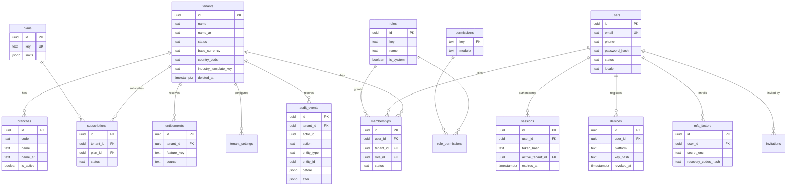

# ERD — Tenancy & Identity Cluster

> **Status:** STABLE · **Owner:** Database Architecture · **Updated:** 2026-10-27 · **Phases:** 002–004

Core attributes only (full column specs: [TABLES/tenancy-identity.md](../TABLES/tenancy-identity.md)).
All tenant-owned tables additionally carry `tenant_id`, `created_at`, `updated_at`,
`version` ([DATABASE_CONVENTIONS.md](../DATABASE_CONVENTIONS.md)).

Note: `sessions.active_tenant_id` is a convenience reference to the user's selected
membership — authorization still derives from `memberships`, never from this column
([../architecture/MULTI_TENANCY.md](../../architecture/MULTI_TENANCY.md)).

> **PHASE-002 note (2026-10-28):** `tenants` minimal + `audit_events`/`file_objects` + `_infra_probe` (composite FK example) are now implemented via `0001_core_infra.sql` / `0002_boss_and_rls_macro.sql`. RLS predicates and tenant-GUC flow are as documented in `../TENANT_ISOLATION.md` §2–4.
