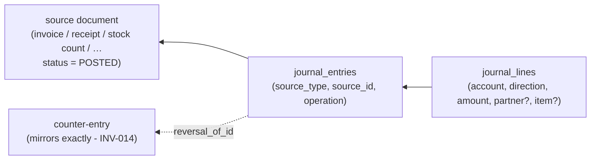

# Relationships — Catalogue Rules

> **Status:** STABLE · **Owner:** Database Architecture · **Updated:** 2026-10-27

How entities relate: the tenant-scoped FK pattern, cascade policy, reversal/provenance
linking, the ledger source chain, subledger linkage rules, read-model relations, and the
catalogue of every documented relationship. Column meanings:
[DATA_DICTIONARY.md](DATA_DICTIONARY.md); per-table specs: [TABLES/](TABLES/); diagrams:
[ERD/](ERD/). ERD files hold the pictures; this file holds the **rules**.

## 1. The composite tenant-scoped FK pattern (mandatory)

Every child→parent FK between tenant-owned tables includes `tenant_id`, referencing a
unique `(id, tenant_id)` on the parent:

```sql
-- parent carries:  UNIQUE (id, tenant_id)
ALTER TABLE sales_invoice_lines
  ADD CONSTRAINT fk_invoice_tenant FOREIGN KEY (invoice_id, tenant_id)
  REFERENCES sales_invoices (id, tenant_id);
```

Why: a cross-tenant dangling reference becomes **structurally impossible even with RLS
off** (belt-and-braces to [TENANT_ISOLATION.md](TENANT_ISOLATION.md) §4); the pattern is
a migration-review checklist item and a PHASE-002 CI check. Global reference tables
(currencies, permissions, jurisdictions) are referenced by plain FK — they have no tenant.

## 2. Cascade policy

| Rule | Applies to |
|------|-----------|
| **`ON DELETE RESTRICT` is the default** for every FK | Financial integrity: nothing cascades away silently |
| `ON DELETE CASCADE` **only for owned child rows** — lines that have no meaning without their parent and no independent lifecycle | `journal_lines → journal_entries`, `sales_invoice_lines → sales_invoices`, `stock_count_lines → stock_counts`, `price_list_items → price_lists`, `role_permissions → roles`, `partner_contacts/partner_addresses → partners` |
| Posted parents are never deleted anyway (lifecycle + no DELETE grants — INV-003), so CASCADE is a draft-time convenience only | — |
| Child tables that are **documents of record** (a credit note referencing an invoice) always RESTRICT | `credit_notes.ref_invoice_id`, `journal_entries.reversal_of_id` |

## 3. Reversal & link patterns

| Pattern | Where | Rule |
|---------|-------|------|
| `reversal_of_id` / `reversed_by_id` | `journal_entries` (bidirectional pair) | A posted entry is negated only by a mirroring counter-entry; **at most one** reversal per entry (INV-014); the pair links both directions; both stay visible (net zero). |
| `ref_invoice_id` | `credit_notes` (and debit notes ↔ supplier invoices) | Correction documents must reference their original; standalone corrections require an explicit policy flag + audit. |
| `reversed_by_doc_id` | Financial documents (e.g., invoices) | Set when a reversal document is posted; the original keeps its number and status `REVERSED` ([DOCUMENT_LIFECYCLE.md](../accounting/DOCUMENT_LIFECYCLE.md) §2). |
| `source_type` + `source_id` | `journal_entries` (→ the posting chain), `stock_moves` (→ originating document), `cash_movements` (→ originating document), `e_invoicing_submissions` (→ document via `doc_type`/`doc_id`) | **Generic provenance**: a polymorphic reference always paired with the operation discriminator on the ledger (`journal_entries.operation` makes `(tenant_id, source_type, source_id, operation)` the idempotency key — INV-013). Consumers never `JOIN` across a polymorphic ref in SQL for business logic — they resolve through owning-module services; the pairs exist for audit, tracing, and idempotency. |

## 4. The source chain (ledger provenance)



Rules: a `POSTED` document with zero journal entries cannot exist (INV-006, same
transaction); the chain is the drill-down path for every report (report → journal lines →
document); append-only on the ledger side (INV-003).

## 5. Partner linkage rules (subledger integrity)

1. Every `journal_lines` row hitting an **AR/AP control purpose** carries `partner_id`
   (engine validation #6 — INV-009a). Other lines may carry it (analysis) but are never
   required to.
2. Σ partner subledger entries (base) = AR/AP control account balance **at all times**
   (INV-009b) — the reconciliation job exists to prove it, and drift is Sev-1.
3. Partners link to documents directly (`sales_invoices.customer_id`,
   `supplier_invoices.supplier_id`, `receipts.customer_id`, `payments.supplier_id`) and
   to the ledger via `journal_lines.partner_id` — the two paths must agree in aggregate.

## 6. Item / batch / serial linkage

1. `sales_invoice_lines` and `stock_moves` carry `item_id`; where the item is
   batch-tracked, `batch_id` (`item_batches`); serial/IMEI-tracked, `serial_id`
   (`item_serials`) — one serial per line for serialized items.
2. `stock_moves` are the **only** writers of quantity truth; `item_stock` and
   `van_stocks` are read models over them (§7).
3. A stock move's journal effect lives in the same transaction (INV-018); its
   `source_type/source_id` points at the originating document (GRN, delivery note,
   transfer, count, production order).

## 7. Read-model relations (derived, never authoritative)

| Read model | Aggregates | Refresh | Rule |
|------------|-----------|---------|------|
| `item_stock` (item × warehouse: `qty`, `avg_cost`) | `stock_moves` | Same transaction as the move (transactional read model) | Never written by user flows; a rebuild job must reproduce identical rows (drift = bug, Sev-1 per INV-010). |
| `partner_balances` (partner balance read model over the subledger; cache columns on `partners` per the catalog) | `journal_lines.partner_id` postings + allocations | Posting transaction + reconciliation job verification | Authoritative balance questions are answered from `journal_lines`; the read model serves lists/queries. |
| `report_runs.output_file` | `file_objects` | Async render | Report outputs are files, not rows — reports never create ledger rows. |

## 8. Relationship catalogue

Cardinality: `1:N` one-to-many, `N:M` via join table, `self` self-referencing.

| Relationship | Cardinality | Via | Phase |
|--------------|-------------|-----|-------|
| tenants → branches | 1:N | `branches.tenant_id` | 004 |
| users ↔ tenants (roles) | N:M | `memberships` (+`role_id`, branch scope) | 003 |
| roles → role_permissions → permissions | N:M | `role_permissions` (CASCADE) | 003 |
| users → sessions / devices / mfa_factors | 1:N each | direct FKs | 003 |
| tenants → invitations; invitations → roles | 1:N / N:1 | `invitations.tenant_id`, `role_id` | 004 |
| plans → subscriptions ← tenants | N:M | `subscriptions` | 014 |
| tenants → entitlements; tenants → tenant_settings | 1:N | direct FKs | 004 |
| tenants → audit_events | 1:N (tenant NULL = platform scope) | `audit_events.tenant_id` | 002/003 |
| tenants → accounts; accounts → accounts (parent) | 1:N / self | `accounts.parent_id` (composite tenant FK) | 007 |
| accounts → account_purposes | 1:N | `account_purposes.account_id` (one **active** per purpose) | 007 |
| tenants → fiscal_years → fiscal_periods | 1:N chains | direct FKs (periods also carry `tenant_id` for RLS) | 007 |
| fiscal_periods → journal_entries | 1:N | `journal_entries.fiscal_period_id` (INV-011 gate) | 007 |
| journal_entries ↔ journal_lines | 1:N | composite tenant FK, CASCADE (draft lines only in practice) | 007 |
| journal_entries → journal_entries (reversal pair) | 1:1 max | `reversal_of_id`/`reversed_by_id` (RESTRICT) | 007 |
| source documents → journal_entries | 1:N | `source_type`/`source_id` + `operation` (INV-013 unique) | 007+ |
| journal_lines → accounts / partners / items / cost_centers / tax_codes | N:1 each | nullable analytic FKs (partner required on control purposes — §5) | 007 |
| tenants → exchange_rates (per currency, per date) | 1:N | unique `(tenant_id, currency_code, rate_date)` | 007 |
| tenants → cost_centers; cost_centers → cost_centers | 1:N / self | direct + parent FK | 007 |
| tenants → recurring_journals / approval_policies | 1:N | direct FKs | 007 |
| tenants → partners → partner_contacts / partner_addresses | 1:N chains | direct FKs (CASCADE on contacts/addresses) | 006 |
| items → barcodes / price_list_items; price_lists → price_list_items | 1:N / N:M | `barcodes`, `price_list_items` (CASCADE) | 006 |
| item_categories → items; uoms → items; uom_conversions (from/to) | N:1 / N:M | direct FKs | 006 |
| branches → warehouses | 1:N | `warehouses.branch_id` | 010 |
| items × warehouses → stock_moves (item_stock read model) | 1:N | `stock_moves` (item_id, warehouse_id, direction, kind) | 010 |
| stock_moves → item_batches / item_serials | N:1 optional | `batch_id`, `serial_id` | 010 |
| stock_moves → stock_layers (FIFO source) | N:1 | `stock_layers.source_move_id` | 010 |
| GRN → landed_costs; PO → goods_receipts → supplier_invoices | 1:N chains | direct FKs (three-way match refs) | 011 |
| credit_notes → sales_invoices (ref_invoice_id) | N:1 | RESTRICT | 012 |
| quotations → sales_orders (conversion) | 1:1 optional | conversion id on the order | 012 |
| sales_orders → delivery_notes → sales_invoices | 1:N chains | direct FKs | 012 |
| receipts/payments → documents (allocations) | N:M | allocations (INV-016 cap) | 012/011 |
| cash_accounts → accounts (CoA link); cash_movements → cash_accounts | N:1 / 1:N | `cash_accounts.account_id`, `cash_movements.cash_account_id` | 008 |
| tenants → tax_registrations → jurisdictions; tenants → tax_codes | 1:N chains | direct FKs | 009 |
| documents → e_invoicing_submissions | 1:N (per adapter) | `doc_type`/`doc_id` + `adapter_id` | 023 |
| file_objects → owner (attachment) | N:1 | `owner_type`/`owner_id` (scoped by tenant prefix in storage keys) | 002/006 |
| devices → sync_cursors / inbox_commands; tenants → change_log / tombstones | 1:N | sync protocol relations (ADR-0012) | 020 |
| tenants → report_runs → file_objects (output) | 1:N / N:1 | `report_runs.output_file` | 013 |

New relationships enter this catalogue in the same phase as the tables (sync rule,
[README.md](README.md) §Synchronization).
