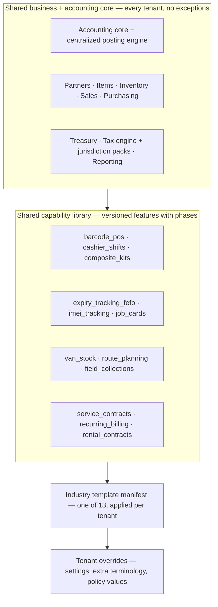
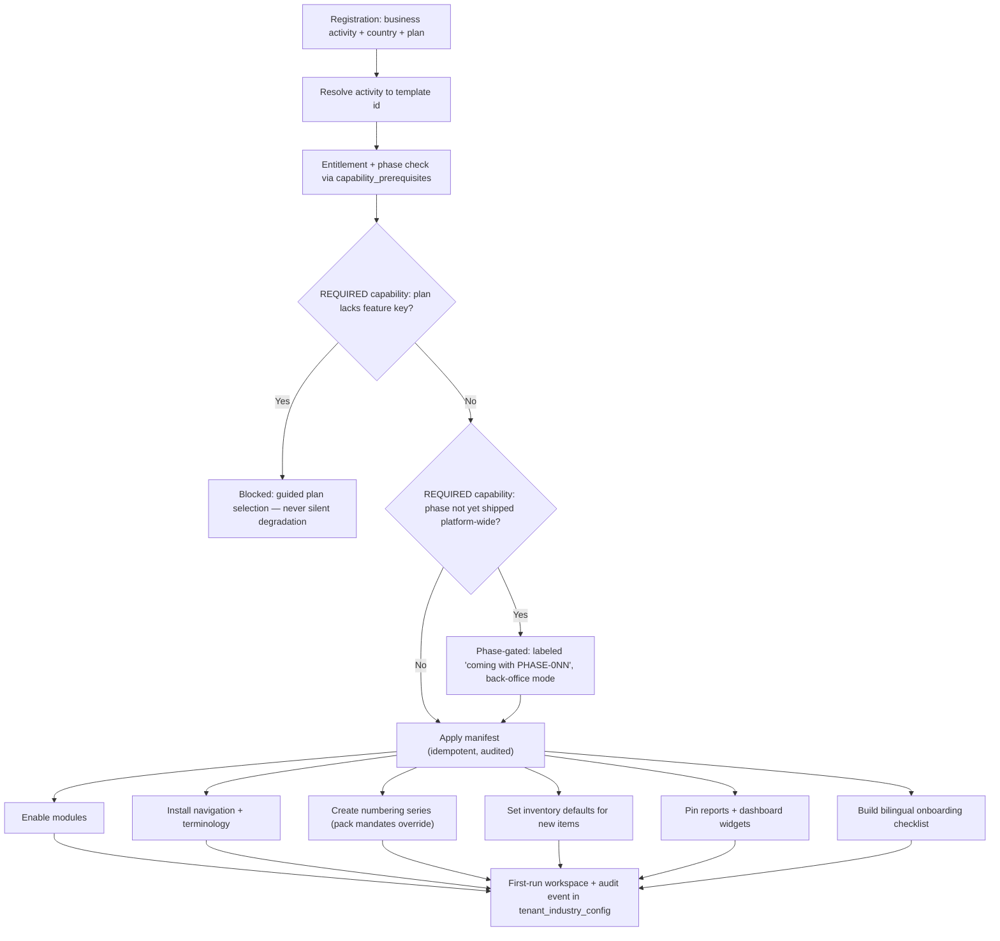
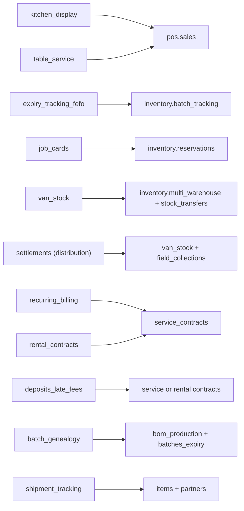

# Industry Capability Framework

> **Status:** STABLE · **Owner:** Industry Solutions Architecture · **Updated:** 2026-10-28

How the platform turns **one shared business + accounting core** into industry-specific
workspaces — restaurants, workshops, distributors, factories, law offices, rental fleets —
without forking code. This directory is normative for the industry framework delivered in
[PHASE-015](../planning/MASTER_ROADMAP.md) and extended through PHASE-019.

Related reading: [../GLOSSARY.md](../GLOSSARY.md) (controlled vocabulary),
[../architecture/MODULE_BOUNDARIES.md](../architecture/MODULE_BOUNDARIES.md) (module catalog),
[../accounting/POSTING_ENGINE.md](../accounting/POSTING_ENGINE.md) (how industry workflows
post), [../accounting/DOCUMENT_LIFECYCLE.md](../accounting/DOCUMENT_LIFECYCLE.md) (document
states), [../product/CONFIGURATION_ENGINE.md](../product/CONFIGURATION_ENGINE.md)
(configuration resolution layers).

## 1. The principle

> **Industries are configuration, never code forks.**

Every tenant runs the same modules, the same posting engine, the same accounting
invariants ([../accounting/ACCOUNTING_INVARIANTS.md](../accounting/ACCOUNTING_INVARIANTS.md)),
and the same document lifecycle. An "industry" is:

1. A **manifest** — a versioned JSON document that selects capabilities, enables modules,
   overrides terminology, installs navigation, sets workflow policies, proposes document
   numbering and inventory defaults, pins reports, and defines onboarding steps.
2. **Capability composition** — the manifest references capabilities from the shared
   capability library ([capabilities/CAPABILITY_MATRIX.md](capabilities/CAPABILITY_MATRIX.md));
   it never defines new business logic.
3. **Tenant overrides** — the tenant adjusts settings within the guardrails of the manifest.

There is no `restaurant` codebase and no `automotive` branch. Industry behavior that needs
new tables or new posting rules becomes a **module feature** (owned by a module in
[../architecture/MODULE_BOUNDARIES.md](../architecture/MODULE_BOUNDARIES.md)) that *any*
industry can then compose — e.g., `expiry_tracking_fefo` serves grocery stores, restaurants,
and food distributors alike.

## 2. Composition model



Resolution order (most specific wins, never weaker than the layer below):

`tenant explicit setting` → `industry template default` → `platform default` — except
accounting invariants, authorization, period locks, and jurisdiction-pack mandates, which
**no layer may weaken** (NFR-011 in [../PRODUCT_REQUIREMENTS.md](../PRODUCT_REQUIREMENTS.md)).

## 3. The industry template manifest schema

The manifest is the contract between product thinking and the configuration engine
(`configuration` module, PHASE-015). Manifests are stored in the platform template registry
(`industry_templates`), never edited per tenant; a tenant's applied template id + version +
local overrides live in `tenant_industry_config`.

The five v2.0 templates (wholesale, electronics, healthcare, education, agriculture —
PHASE-030…033) follow **the same manifest schema and the same seven governance tests**
(§8) as the v1.1 set ([../EXPANSION_REGISTER.md](../EXPANSION_REGISTER.md) ED-06…ED-09);
they may only compose cataloged feature keys and phase-gate anything not yet shipped.

```json
{
  "$schema": "https://json-schema.org/draft/2020-12/schema",
  "$id": "urn:erp-platform:schema:industry-template-manifest:v1",
  "title": "IndustryTemplateManifest",
  "type": "object",
  "additionalProperties": false,
  "required": ["id", "name", "name_ar", "version", "required_feature_keys",
    "default_modules_enabled", "terminology_overrides", "navigation_manifest",
    "workflow_policies", "document_numbering_defaults", "inventory_policy_defaults",
    "report_defaults", "onboarding_steps", "capability_prerequisites"],
  "properties": {
    "id": {
      "type": "string", "pattern": "^industry\\.[a-z][a-z0-9_]{2,30}$",
      "description": "Stable identifier following the `industry.<key>` naming rule of the feature catalog; equals the template id in product/INDUSTRY_CATALOG.md; never renamed after release. The <key> part maps to the template document file in templates/."
    },
    "name": { "type": "string", "minLength": 1, "maxLength": 80 },
    "name_ar": { "type": "string", "minLength": 1, "maxLength": 80 },
    "description": { "type": "string", "maxLength": 500 },
    "description_ar": { "type": "string", "maxLength": 500 },
    "version": { "type": "string", "pattern": "^\\d+\\.\\d+\\.\\d+$" },
    "inherits": {
      "type": "string", "pattern": "^industry\\.[a-z][a-z0-9_]{2,30}$",
      "description": "Optional base template id whose fields this manifest extends (single inheritance only)."
    },
    "required_feature_keys": {
      "type": "array", "minItems": 1, "uniqueItems": true,
      "items": { "$ref": "#/$defs/featureKey" },
      "description": "Feature keys that must resolve for the template to apply (see §5 entitlement rules)."
    },
    "default_modules_enabled": {
      "type": "array", "uniqueItems": true,
      "items": { "$ref": "#/$defs/moduleName" },
      "description": "Modules switched on at apply time; disabling later is governed by §5 additive rules."
    },
    "terminology_overrides": {
      "type": "object",
      "propertyNames": { "pattern": "^[a-z0-9_]+(\\.[a-z0-9_]+)*$" },
      "additionalProperties": { "$ref": "#/$defs/localizedText" },
      "description": "UI labels only — presentation layer, never data-model or posting semantics."
    },
    "navigation_manifest": { "$ref": "#/$defs/navigationManifest" },
    "workflow_policies": {
      "type": "object",
      "propertyNames": { "pattern": "^[a-z][a-z0-9_]*(\\.[a-z0-9_]+)?$" },
      "additionalProperties": { "type": ["string", "number", "boolean"] },
      "description": "Typed policy values validated against the platform policy registry; unknown keys are rejected at manifest validation."
    },
    "document_numbering_defaults": {
      "type": "object",
      "propertyNames": { "$ref": "#/$defs/documentType" },
      "additionalProperties": { "$ref": "#/$defs/numberingRule" },
      "description": "Proposed numbering series; jurisdiction-pack mandatory formats always take precedence."
    },
    "inventory_policy_defaults": { "$ref": "#/$defs/inventoryPolicyDefaults" },
    "report_defaults": {
      "type": "array", "uniqueItems": true,
      "items": {
        "type": "object", "additionalProperties": false,
        "required": ["report_key", "pinned"],
        "properties": {
          "report_key": { "type": "string", "pattern": "^[a-z][a-z0-9_]*\\.[a-z0-9_-]+$" },
          "pinned": { "type": "boolean" },
          "dashboard": { "type": "boolean", "default": false },
          "default_period": { "enum": ["today", "this_week", "this_month", "this_year", "custom"] }
        }
      }
    },
    "onboarding_steps": {
      "type": "array", "minItems": 3, "uniqueItems": true,
      "items": {
        "type": "object", "additionalProperties": false,
        "required": ["id", "title", "required"],
        "properties": {
          "id": { "type": "string", "pattern": "^[a-z][a-z0-9_]*$" },
          "title": { "$ref": "#/$defs/localizedText" },
          "required": { "type": "boolean" },
          "feature_key": { "$ref": "#/$defs/featureKey" },
          "hint": { "$ref": "#/$defs/localizedText" }
        }
      }
    },
    "capability_prerequisites": {
      "type": "object",
      "propertyNames": { "pattern": "^[a-z][a-z0-9_]*$" },
      "additionalProperties": {
        "type": "object", "additionalProperties": false,
        "required": ["level", "feature_keys", "available_from_phase"],
        "properties": {
          "level": { "enum": ["REQUIRED", "OPTIONAL"] },
          "feature_keys": { "type": "array", "minItems": 1, "items": { "$ref": "#/$defs/featureKey" } },
          "available_from_phase": { "type": "string", "pattern": "^PHASE-0[0-9]{2}$" }
        }
      },
      "description": "Capability ids from the shared capability matrix → how this template consumes them."
    }
  },
  "$defs": {
    "featureKey": {
      "type": "string",
      "pattern": "^(platform|accounting|partners|items|inventory|sales|purchasing|treasury|tax|reporting|crm|manufacturing|distribution|pos|offline|industry|fixed_assets|notes|installments|budgeting|payroll|consolidation)\\.[a-z0-9_]+$",
      "description": "module.feature_name convention (GLOSSARY + FEATURE_CATALOG §1); module segment = one of the catalog modules (16 at v1.1 GA + six stage-9 modules per EXPANSION_REGISTER §D); canonical registry: product/FEATURE_CATALOG.md. The declared intake set in capabilities/CAPABILITY_MATRIX.md §3 is the only tolerated not-yet-registered set, tracked to closure."
    },
    "moduleName": {
      "enum": ["accounting", "partners", "items", "inventory", "sales", "purchasing",
        "treasury", "tax", "reporting", "crm", "manufacturing", "pos", "distribution",
        "configuration", "fixed_assets", "notes", "installments", "budgeting",
        "payroll", "consolidation"],
      "description": "Runtime modules per MODULE_BOUNDARIES (`pos` operates the terminal layer over sales-module POS documents); v2.0 adds the six stage-9 runtime modules (EXPANSION_REGISTER §D)."
    },
    "documentType": {
      "enum": ["quotation", "sales_order", "delivery_note", "sales_invoice", "credit_note",
        "receipt", "purchase_order", "goods_receipt", "supplier_invoice", "debit_note",
        "payment", "stock_transfer", "stock_count", "production_order", "job_card",
        "settlement", "contract_invoice", "rental_contract", "shipment", "pos_sale",
        "stock_adjustment"],
      "description": "Document types that may carry a numbering series; `pos_sale` (POS channel invoice) and `stock_adjustment` (reason-coded adjustment) are series-bearing document kinds used by the shipped templates."
    },
    "localizedText": {
      "type": "object", "additionalProperties": false,
      "required": ["en", "ar"],
      "properties": { "en": { "type": "string" }, "ar": { "type": "string" } }
    },
    "navigationManifest": {
      "type": "object", "additionalProperties": false, "required": ["groups"],
      "properties": {
        "groups": {
          "type": "array", "minItems": 1,
          "items": {
            "type": "object", "additionalProperties": false,
            "required": ["id", "label", "items"],
            "properties": {
              "id": { "type": "string", "pattern": "^[a-z][a-z0-9_]*$" },
              "label": { "$ref": "#/$defs/localizedText" },
              "order": { "type": "integer", "minimum": 1 },
              "items": {
                "type": "array", "minItems": 1,
                "items": {
                  "type": "object", "additionalProperties": false,
                  "required": ["id", "label", "target"],
                  "properties": {
                    "id": { "type": "string", "pattern": "^[a-z][a-z0-9_]*$" },
                    "label": { "$ref": "#/$defs/localizedText" },
                    "target": { "type": "string", "description": "Route key or feature-key-prefixed route." },
                    "feature_key": { "$ref": "#/$defs/featureKey", "description": "Item hidden when key unentitled." }
                  }
                }
              }
            }
          }
        }
      }
    },
    "numberingRule": {
      "type": "object", "additionalProperties": false,
      "required": ["prefix", "format", "per_branch", "reserve_on_approval"],
      "properties": {
        "prefix": { "type": "string", "pattern": "^[A-Z0-9]{1,8}$" },
        "format": { "type": "string", "pattern": "^[A-Za-z0-9{}:\\-]{3,40}$",
          "description": "Tokens: {yyyy} {yy} {MM} {seq:n} {branch}. Example: 'POS-{branch}-{yy}{MM}-{seq:5}'. Lowercase token letters are part of the format string." },
        "per_branch": { "type": "boolean" },
        "reserve_on_approval": { "type": "boolean",
          "description": "Number reserved at APPROVED or assigned at POSTED (DOCUMENT_LIFECYCLE §2)." }
      }
    },
    "inventoryPolicyDefaults": {
      "type": "object", "additionalProperties": false,
      "required": ["costing_method", "default_track_batch", "default_track_expiry",
        "default_track_serial", "default_imei_tracking", "fefo_picking", "allow_negative_stock"],
      "properties": {
        "costing_method": { "enum": ["WAC", "FIFO"] },
        "default_track_batch": { "type": "boolean" },
        "default_track_expiry": { "type": "boolean" },
        "default_track_serial": { "type": "boolean" },
        "default_imei_tracking": { "type": "boolean" },
        "fefo_picking": { "type": "boolean" },
        "allow_negative_stock": { "const": false,
          "description": "Templates may never enable negative stock; tenant-level exception only, per INVENTORY_ACCOUNTING §1." }
      }
    }
  }
}
```

### Field summary

| Field | Purpose | Guardrail |
|--------|---------|-----------|
| `id`, `name`, `name_ar`, `version` | Identity + semantic versioning of the manifest | `id` is `industry.<key>` per the feature-catalog naming rule; immutable after release; `version` follows §8 |
| `required_feature_keys` | Keys that must resolve for the template to apply | Fail-closed resolution; see §5 |
| `default_modules_enabled` | Modules switched on at apply time | Only modules from [MODULE_BOUNDARIES](../architecture/MODULE_BOUNDARIES.md); additive disabling rules in §5 |
| `terminology_overrides` | Industry labels (EN/AR) for glossary term keys | Presentation only; glossary meanings never change |
| `navigation_manifest` | Menu groups + items with entitlement-aware visibility | One active navigation per tenant; archived groups retained read-only on switch |
| `workflow_policies` | Typed defaults for documented policies (e.g., `cash_sales_autopost`) | Validated against the policy registry; can never bypass invariants (NFR-011) |
| `document_numbering_defaults` | Proposed series per document type | Jurisdiction pack mandatory formats win; posted numbers immutable |
| `inventory_policy_defaults` | Costing method + batch/expiry/serial/IMEI/FEFO defaults | Apply to **newly created** items; existing items only via explicit conversion wizard (§5 R3) |
| `report_defaults` | Pinned reports + dashboard widgets | Report keys must exist in the shared report registry ([reports/README.md](reports/README.md)) |
| `onboarding_steps` | Ordered, bilingual onboarding checklist produced at apply time | Steps may be phase-gated via `feature_key` |
| `capability_prerequisites` | Capability ids → level (REQUIRED/OPTIONAL), feature keys, phase | Drives the "included / optional / coming soon" screen at onboarding; feature keys resolve in [../product/FEATURE_CATALOG.md](../product/FEATURE_CATALOG.md) or the tracked intake set in [capabilities/CAPABILITY_MATRIX.md](capabilities/CAPABILITY_MATRIX.md) §3 |

## 4. Applying a template at onboarding

Onboarding (registration wizard, [PHASE-004](../implementation/phases/PHASE-004.md) backend
+ [PHASE-014](../planning/MASTER_ROADMAP.md) UX + [PHASE-015](../planning/MASTER_ROADMAP.md)
industry awareness) maps the registrant's declared **business activity** to a template id,
then applies the manifest in one idempotent transaction:



The **phase-gated** path is a deliberate roadmap consequence: templates ship in
PHASE-015 while POS ships in PHASE-016, so a restaurant tenant in PHASE-015 gets the full
template (terminology, navigation, defaults, reports) with POS-flavored entries labeled
"coming with PHASE-016" and full back-office trading available immediately.

## 5. Changing a template later — additive-only, no data deletion

A tenant may **switch** or **extend** its template at any time (template switching rules are
a PHASE-015 deliverable). The engine is *additive-only*: a switch may add capabilities,
modules, navigation groups, terminology, numbering series, and report pins — it may never
delete tenant data or silently reshape posted history.

| # | Rule |
|---|------|
| R1 | **Additive application.** Applying/switching only enables or adds. Nothing is dropped, truncated, or re-posted. |
| R2 | **Terminology is presentation.** The previous template's overrides are archived in `tenant_industry_config` history; the active label set = active template + tenant additions. No data-model effect. |
| R3 | **Inventory defaults are for new items.** Existing items keep their tracking flags. Converting an existing item to batch/expiry/serial tracking requires an explicit per-item wizard with a stock count baseline and audit trail ([../accounting/INVENTORY_ACCOUNTING.md](../accounting/INVENTORY_ACCOUNTING.md) §1). |
| R4 | **Costing changes need a revaluation posting.** Switching WAC↔FIFO follows INV-017: no in-flight transactions, revaluation journal at switch date, no retroactive restatement. |
| R5 | **Numbering series are append-only.** New documents use the newly active series; posted documents keep their numbers forever; series are never reused ([../architecture/ADR/ADR-0006-identifiers.md](../architecture/ADR/ADR-0006-identifiers.md)). |
| R6 | **Archived capabilities, not deleted ones.** A capability the new template does not include but that has tenant data becomes *archived*: hidden from navigation, read-only, reversal documents still allowed, reports still runnable. |
| R7 | **Jurisdiction packs win.** Mandatory numbering formats, invoice fields, and e-invoicing behavior from the tenant's pack override any template default ([../localization/TAX_ENGINE.md](../localization/TAX_ENGINE.md)). |
| R8 | **Tenant settings win within guardrails.** Resolution: tenant setting > template default > platform default — never weaker than invariants/authorization/pack mandates. |
| R9 | **Switch is reviewed, then audited.** The UI presents a "what will change" diff (added capabilities, renamed labels, new series, archived capabilities) before confirmation; the apply writes an audit event with the diff. |
| R10 | **Entitlement gate on switch.** A switch whose REQUIRED capabilities are missing from the tenant's plan is blocked with guided plan guidance; missing OPTIONAL capabilities degrade to hidden (R6). |

## 6. Declaring and reusing capabilities

Capabilities are the reuse unit between industries. Full catalog:
[capabilities/CAPABILITY_MATRIX.md](capabilities/CAPABILITY_MATRIX.md).

- **Declared once, composed everywhere.** Each capability has one id, one definition, one
  providing module set, one feature-key list, one availability phase, and extension rules.
  Templates reference capabilities by id in `capability_prerequisites` — they never redefine
  behavior.
- **Shared by default.** A capability must be industry-neutral (e.g., `job_cards` is "work
  order combining service lines + parts", not "a car repair thing"). All 29 capabilities in
  the current matrix are shared; the closest to industry-specific (`rental_contracts`) is
  deliberately shared by car rental, equipment rental, and logistics tenants.
- **Industry-specific capabilities are a last resort.** If no shared composition works, the
  behavior becomes a module feature with its own feature key and matrix row; "industry-only
  logic hidden in a template" is an anti-pattern and a review blocker
  ([../implementation/templates/CODE_REVIEW_TEMPLATE.md](../implementation/templates/CODE_REVIEW_TEMPLATE.md)).
- **Intake checklist for a new capability:** module owner; feature key(s); phase; tests with
  expected journal entries; matrix row; impact review of all shipped templates; bilingual
  terminology keys; report needs.

## 7. Conflict and dependency rules

**Dependencies.** Capabilities declare prerequisites (matrix "extension rules" +
`capability_prerequisites`). The apply engine validates the dependency closure before
applying — every dependency must be present, or phase-gated, or the apply fails with a typed
error listing the missing chain. Key dependency edges:



**Conflicts.**

| Conflict | Resolution |
|----------|------------|
| Two capabilities want different values for the same policy (e.g., costing default) | Template declares one value; tenant overrides later; per-item consistency still enforced |
| Navigation item id collision | Ids are namespaced by template id; collision across templates impossible by construction |
| Terminology key overridden twice | Exactly one active template per tenant; tenant additions win over the template |
| Feature key shared by multiple capabilities | Allowed — capabilities are composition units, not exclusive owners of keys |
| Two numbering proposals for the same document type | One active series per (document type, branch scope); switch adds series, never mutates (§5 R5) |
| Template policy vs. accounting invariant / security control | Invariant always wins; policy registry rejects non-whitelisted keys at manifest validation (NFR-011) |

## 8. Governance — versioning, registry, testing

**Versioning.** Manifests are semantic-versioned rows in the platform registry
(`industry_templates`, owned by the `configuration` module):

| Change | Version bump | Tenant impact |
|--------|--------------|----------------|
| Label/wording/policy-value refinement, new optional capability | PATCH | Offered; tenants never auto-upgraded — drift detection notifies |
| New REQUIRED capability, new navigation group, new series, new onboarding step | MINOR | Offered with a "what changed" review (§5 R9 semantics) |
| Removed feature key, changed policy semantics, changed numbering format for future docs | MAJOR | Migration note mandatory; switch-in allowed, switch-out follows archive rules (R6) |

**Testing requirements per template** (a template cannot ship — or pass
[PHASE-015](../planning/MASTER_ROADMAP.md) acceptance — without all seven):

1. **Manifest schema validation** in CI (the JSON Schema above, no exceptions).
2. **Feature-key resolution test**: every `required_feature_keys` and prerequisite key
   resolves in the feature catalog and entitlement service (fail-closed).
3. **Golden onboarding fixture**: apply the manifest to a fresh tenant and snapshot-assert
   navigation tree, terminology resolution, numbering series, inventory defaults, report
   pins, and the onboarding checklist (AR + EN).
4. **Workflow smoke tests with expected journals**: each signature workflow runs end-to-end
   against the real posting engine with fixture-asserted journal lines
   ([workflows/industry-workflows.md](workflows/industry-workflows.md);
   [../testing/ACCOUNTING_TESTS.md](../testing/ACCOUNTING_TESTS.md)).
5. **Switch safety test**: apply template A → create items and post documents →
   switch/extend to template B → assert zero data loss, archived capabilities read-only,
   all accounting invariants hold.
6. **RTL visual set**: AR + EN screenshots of the industry home and signature screens pass
   the visual regression harness ([../ui/DESIGN_SYSTEM.md](../ui/DESIGN_SYSTEM.md)).
7. **Degraded entitlement test**: plan missing an OPTIONAL key hides cleanly; missing a
   REQUIRED key blocks onboarding with actionable guidance; phase-gated keys render as
   "coming with PHASE-0NN".

## 9. Directory map

| Path | Contents |
|------|----------|
| [capabilities/CAPABILITY_MATRIX.md](capabilities/CAPABILITY_MATRIX.md) | The shared capability library: 29 capabilities × 13 industries, with modules, feature keys, phases, extension rules |
| [templates/README.md](templates/README.md) | Index of the 13 template manifests |
| [templates/retail.md](templates/retail.md) · [templates/grocery-supermarket.md](templates/grocery-supermarket.md) · [templates/restaurant-cafe.md](templates/restaurant-cafe.md) | PHASE-015 templates |
| [templates/automotive-workshop.md](templates/automotive-workshop.md) · [templates/distribution-field-sales.md](templates/distribution-field-sales.md) | PHASE-017 templates |
| [templates/food-manufacturing.md](templates/food-manufacturing.md) | PHASE-018 template |
| [templates/professional-services.md](templates/professional-services.md) · [templates/rental-logistics.md](templates/rental-logistics.md) | PHASE-019 templates |
| [templates/wholesale.md](templates/wholesale.md) · [templates/electronics.md](templates/electronics.md) | PHASE-030 templates (v2.0) |
| [templates/healthcare.md](templates/healthcare.md) · [templates/education.md](templates/education.md) · [templates/agriculture.md](templates/agriculture.md) | PHASE-031…033 commercial shells (v2.0) |
| [workflows/README.md](workflows/README.md) · [workflows/industry-workflows.md](workflows/industry-workflows.md) | Six signature industry workflows with per-step accounting effects + the compact v2.0 template signature flows |
| [reports/README.md](reports/README.md) | Industry report catalog over the shared report contract |
