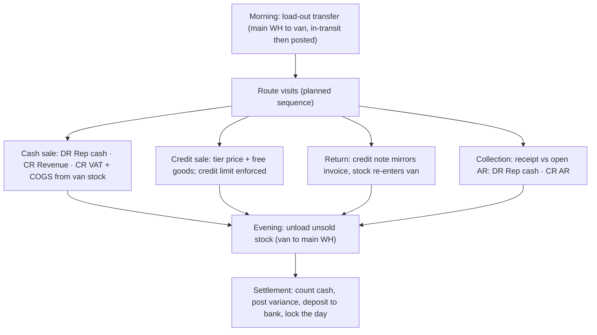

# Template: Distribution & Field Sales — `distribution_field_sales`

> **Status:** STABLE · **Owner:** Industry Solutions Architecture · **Updated:** 2026-10-27

Van-sales distribution: stock on wheels, planned **routes خط السير**, representative
accountability, and a hard money-and-stock **settlement تسوية المندوب** at day end. Ships
in PHASE-017. Manifest schema: [../README.md](../README.md) §3. Full van-sales day workflow
with accounting effects: [../workflows/industry-workflows.md](../workflows/industry-workflows.md) (c).

## Target businesses

- Beverage, snack, and foodstuff distributors running van routes.
- Consumer-goods wholesalers with field representatives carrying stock.
- Water/gas cylinder distributors (deposit-return flows compose with
  `rental_logistics` ideas in PHASE-019).
- Any wholesaler selling retail outlets on scheduled visits.

## Manifest

```json
{
  "id": "industry.distribution",
  "name": "Distribution & Field Sales",
  "name_ar": "التوزيع والمبيعات الميدانية",
  "version": "1.0.0",
  "required_feature_keys": [
    "industry.template_engine", "distribution.routes", "distribution.van_stock",
    "distribution.settlements", "treasury.receipts_disbursements", "distribution.customer_tiers",
    "sales.discount_management", "sales.reps", "sales.commissions", "inventory.multi_warehouse",
    "inventory.stock_transfers", "inventory.batch_tracking" ,
    "treasury.cashier_shifts"
  ],
  "default_modules_enabled": ["accounting", "partners", "items", "inventory", "sales",
    "purchasing", "treasury", "tax", "reporting", "distribution", "configuration"],
  "terminology_overrides": {
    "route.route": { "en": "Route", "ar": "خط السير" },
    "route.visit": { "en": "Visit", "ar": "الزيارة" },
    "van.van_stock": { "en": "Van stock", "ar": "مخزون السيارة" },
    "van.load_out": { "en": "Load-out", "ar": "التحميل الصباحي" },
    "van.unload": { "en": "Evening unload", "ar": "التنزيل المسائي" },
    "settlement.rep_settlement": { "en": "Rep settlement", "ar": "تسوية المندوب" },
    "settlement.variance": { "en": "Cash variance", "ar": "فرق الصندوق" },
    "billing.collection": { "en": "Collection", "ar": "التحصيل" },
    "price.tier": { "en": "Customer tier", "ar": "فئة العميل" },
    "promo.free_goods": { "en": "Free goods", "ar": "بضاعة مجانية" },
    "hr.field_rep": { "en": "Sales rep (van)", "ar": "مندوب التوزيع" }
  },
  "navigation_manifest": { "groups": [
    { "id": "field", "label": { "en": "Field operations", "ar": "العمليات الميدانية" }, "order": 1, "items": [
      { "id": "routes", "label": { "en": "Routes & visits", "ar": "خطوط السير والزيارات" }, "target": "distribution.routes" },
      { "id": "van_stock", "label": { "en": "Van stock", "ar": "مخزون السيارة" }, "target": "distribution.van_stock" },
      { "id": "collections", "label": { "en": "Collections", "ar": "التحصيل" }, "target": "distribution.collections" }
    ]},
    { "id": "settle", "label": { "en": "Settlements", "ar": "التسويات" }, "order": 2, "items": [
      { "id": "rep_settlements", "label": { "en": "Rep settlements", "ar": "تسويات المندوبين" }, "target": "distribution.settlements" },
      { "id": "commissions", "label": { "en": "Commissions", "ar": "العمولات" }, "target": "sales.commissions" }
    ]}
  ]},
  "workflow_policies": {
    "van_loadout_requires_transfer": true,
    "settlement_required_daily": true,
    "settlement_variance_approval_required": true,
    "collection_receipt_at_visit": true,
    "tier_price_automatic_by_partner": true,
    "credit_sale_credit_limit_enforced": true,
    "free_goods_require_reason_code": true
  },
  "document_numbering_defaults": {
    "stock_transfer": { "prefix": "LOD", "format": "LOD-{yyyy}-{seq:5}", "per_branch": false, "reserve_on_approval": false },
    "sales_invoice": { "prefix": "INV", "format": "INV-{yyyy}-{seq:6}", "per_branch": false, "reserve_on_approval": false },
    "credit_note": { "prefix": "CN", "format": "CN-{yyyy}-{seq:5}", "per_branch": false, "reserve_on_approval": false },
    "receipt": { "prefix": "RCP", "format": "RCP-{yyyy}-{seq:6}", "per_branch": false, "reserve_on_approval": false },
    "settlement": { "prefix": "STL", "format": "STL-{yyyy}-{seq:5}", "per_branch": false, "reserve_on_approval": false }
  },
  "inventory_policy_defaults": {
    "costing_method": "WAC", "default_track_batch": true, "default_track_expiry": true,
    "default_track_serial": false, "default_imei_tracking": false, "fefo_picking": true,
    "allow_negative_stock": false
  },
  "report_defaults": [
    { "report_key": "distribution.rep_settlement", "pinned": true, "dashboard": true, "default_period": "this_week" },
    { "report_key": "distribution.van_stock_balances", "pinned": true, "dashboard": true, "default_period": "today" },
    { "report_key": "distribution.route_visit_compliance", "pinned": true, "dashboard": true, "default_period": "this_month" },
    { "report_key": "sales.discount_management_effectiveness", "pinned": true, "dashboard": false, "default_period": "this_month" },
    { "report_key": "sales.commissions_due", "pinned": true, "dashboard": false, "default_period": "this_month" }
  ],
  "onboarding_steps": [
    { "id": "main_warehouse", "title": { "en": "Main warehouse & van fleet", "ar": "المستودع الرئيسي وأسطول السيارات" }, "required": true },
    { "id": "coa_confirm", "title": { "en": "Confirm chart of accounts (rep cash account)", "ar": "تأكيد دليل الحسابات (حساب نقديات المندوب)" }, "required": true },
    { "id": "reps_vans", "title": { "en": "Create reps, vans & assign routes", "ar": "إنشاء المندوبين والسيارات وإسناد خطوط السير" }, "required": true },
    { "id": "tiers", "title": { "en": "Customer tiers & price lists", "ar": "فئات العملاء وقوائم الأسعار" }, "required": true },
    { "id": "customers", "title": { "en": "Route customers with credit terms", "ar": "عملاء الخطوط وشروط الدفع" }, "required": true },
    { "id": "opening_stock", "title": { "en": "Opening stock with batches", "ar": "المخزون الافتتاحي مع الدفعات" }, "required": true },
    { "id": "first_day", "title": { "en": "Run first load-out → visits → settlement", "ar": "تنفيذ أول يوم: تحميل، زيارات، تسوية" }, "required": false }
  ],
  "capability_prerequisites": {
    "van_stock": { "level": "REQUIRED", "feature_keys": ["distribution.van_stock"], "available_from_phase": "PHASE-017" },
    "route_planning": { "level": "REQUIRED", "feature_keys": ["distribution.routes"], "available_from_phase": "PHASE-017" },
    "field_collections": { "level": "REQUIRED", "feature_keys": ["treasury.receipts_disbursements"], "available_from_phase": "PHASE-017" },
    "customer_price_tiers": { "level": "REQUIRED", "feature_keys": ["distribution.customer_tiers"], "available_from_phase": "PHASE-017" },
    "free_goods_promo": { "level": "REQUIRED", "feature_keys": ["sales.discount_management", "distribution.free_goods"], "available_from_phase": "PHASE-017" },
    "commissions": { "level": "REQUIRED", "feature_keys": ["sales.commissions"], "available_from_phase": "PHASE-017" },
    "cashier_shifts": { "level": "REQUIRED", "feature_keys": ["treasury.cashier_shifts"], "available_from_phase": "PHASE-016" },
    "expiry_tracking_fefo": { "level": "REQUIRED", "feature_keys": ["inventory.batch_tracking" ], "available_from_phase": "PHASE-010" },
    "landed_costs": { "level": "OPTIONAL", "feature_keys": ["purchasing.landed_costs"], "available_from_phase": "PHASE-011" }
  }
}
```

## Enabled features (exact keys)

| Feature key | Required? | Phase | Note |
|---|---|---|---|
| `distribution.routes` | Required | PHASE-017 | Route calendars + visit compliance |
| `distribution.van_stock` | Required | PHASE-017 | Van = warehouse type VAN; offline selling via Android app PHASE-022 |
| `distribution.settlements` | Required | PHASE-017 | Daily rep settlement with variance |
| `distribution.collections` | Required | PHASE-017 | Field receipts against open AR |
| `distribution.customer_tiers` | Required | PHASE-017 | Tier prices auto-resolve per customer |
| `sales.discount_management`, `distribution.free_goods` | Required | PHASE-012/017 | Reason-coded FOC lines; promotion engine |
| `sales.reps`, `sales.commissions` | Required | PHASE-012/017 | Attribution + commission rules |
| `treasury.cashier_shifts` | Required | PHASE-016 | Rep session = shift on wheels |
| `purchasing.landed_costs` | Optional | PHASE-011 | Importers' true cost |

## Terminology overrides (sample)

| Term key | English | العربية | Note |
|---|---|---|---|
| `route.route` | Route | خط السير | Planned visit sequence per day |
| `van.van_stock` | Van stock | مخزون السيارة | The rep's rolling warehouse |
| `van.load_out` | Load-out | التحميل الصباحي | Morning transfer WH → van |
| `van.unload` | Evening unload | التنزيل المسائي | Return of unsold stock |
| `settlement.rep_settlement` | Rep settlement | تسوية المندوب | Money + stock close per rep/day |
| `settlement.variance` | Cash variance | فرق الصندوق | Counted − expected; always posted |
| `billing.collection` | Collection | التحصيل | Receipt against open invoices on visit |
| `price.tier` | Customer tier | فئة العميل | Drives price list resolution |
| `promo.free_goods` | Free goods | بضاعة مجانية | FOC lines with reason codes |

## Default navigation (sample)

| EN | AR | Target |
|----|----|--------|
| Routes & visits | خطوط السير والزيارات | `distribution.routes` |
| Van stock | مخزون السيارة | `distribution.van_stock` |
| Collections | التحصيل | `distribution.collections` |
| Rep settlements | تسويات المندوبين | `distribution.settlements` |
| Commissions | العمولات | `sales.commissions` |

## Signature workflow — the van-sales day (compact)



Numbered steps and per-step journals:
[../workflows/industry-workflows.md](../workflows/industry-workflows.md) §c.

## Inventory behavior defaults

| Setting | Default | Notes |
|---|---|---|
| Costing method | WAC | Issues from the van price identically to the warehouse |
| Batch + expiry | On (food/beverage categories) | FEFO honored on the van |
| Van warehouses | Enabled | One VAN-type warehouse per rep vehicle; visible in-transit |
| Transfers | Two-leg with in-transit | Load-out/unload are stock transfers |
| Negative stock | Forbidden | Van stock cannot go below zero; counts reconcile |
| Rep cash account | Enabled (treasury) | Per-rep cash account swept to bank at settlement |

## Document types emphasized

| Document | Arabic | Numbering default | Policy |
|---|---|---|---|
| Load-out / unload transfer | تحميل / تنزيل المخزون | `LOD-{yyyy}-{seq:5}` | Two-leg; in-transit visible |
| Van sales invoice (cash/credit) | فاتورة بيع | `INV-{yyyy}-{seq:6}` | Tier pricing auto-resolves |
| Credit note (return) | إشعار دائن | `CN-{yyyy}-{seq:5}` | References original invoice |
| Collection receipt | سند قبض | `RCP-{yyyy}-{seq:6}` | Allocates to open invoices |
| Rep settlement | تسوية المندوب | `STL-{yyyy}-{seq:5}` | Posted → locks the rep/day |

## Reports emphasized

`distribution.rep_settlement` (dashboard), `distribution.van_stock_balances`,
`distribution.route_visit_compliance`, `sales.discount_management_effectiveness`,
`sales.commissions_due`, `inventory.expiry_list` — see
[../reports/README.md](../reports/README.md).

## Out of scope for this template

- Vehicle GPS/telematics tracking of vans.
- Optimized routing algorithms (routes are planned sequences, not TSP solutions).
- Merchandising/asset tracking at customer sites (fridges, stands).
- DSD store-delivery scheduling beyond visit plans.

## Known limitations

- **Offline van selling arrives with the Android field-sales app (PHASE-022)**; at
  PHASE-017 van operations require connectivity — the server is authoritative for posted
  money ([ADR-0012](../../architecture/ADR/ADR-0012-offline-sync.md)).
- Rep cash accountability is per-day settlement; multi-day float is possible but weakens
  the variance trail and is discouraged by onboarding.
- Free-goods budgets per supplier/period are tracked via reason codes and reports only;
  trade-spend accrual accounting is not modeled.
