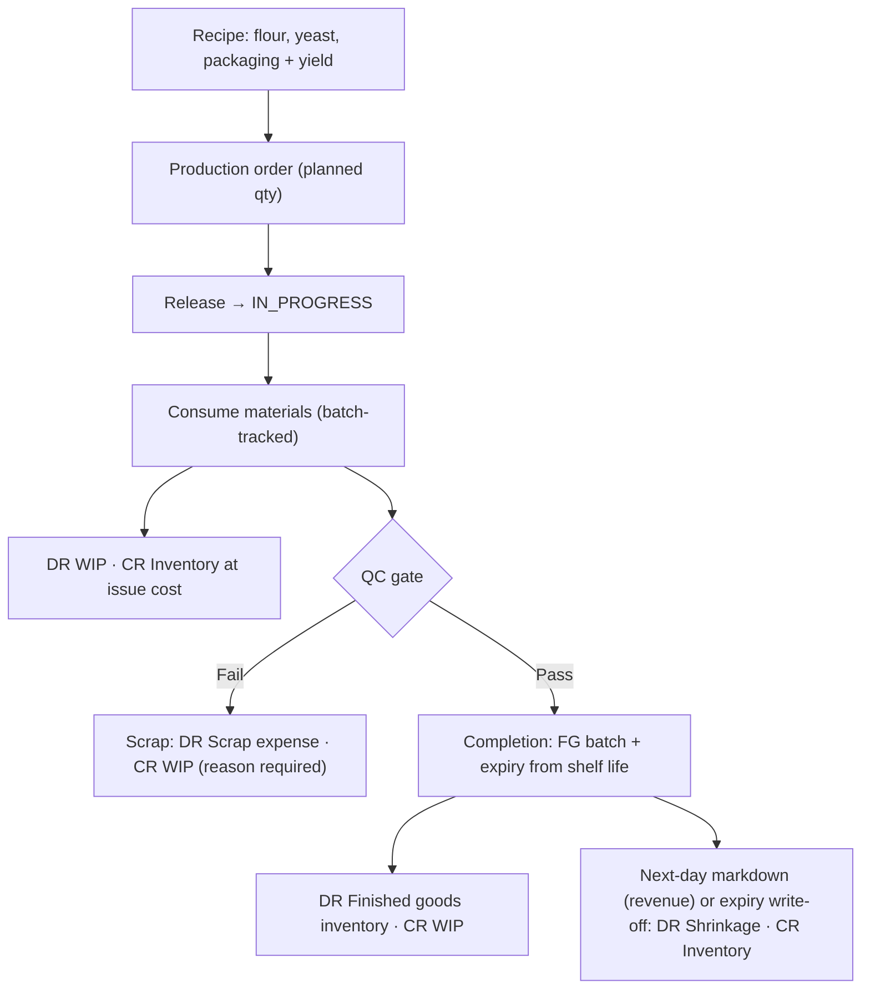

# Template: Food Manufacturing — `food_manufacturing`

> **Status:** STABLE · **Owner:** Industry Solutions Architecture · **Updated:** 2026-10-27

Production with a conscience: recipes (**BOM قائمة المواد**), batch-tracked materials, a
**QC gate فحص الجودة** before finished goods may sell, and shelf-life batches with
next-day markdown discipline. Ships in PHASE-018
([../../planning/MASTER_ROADMAP.md](../../planning/MASTER_ROADMAP.md)). Manifest schema:
[../README.md](../README.md) §3. Full bakery production workflow with accounting effects:
[../workflows/industry-workflows.md](../workflows/industry-workflows.md) (d).

## Target businesses

- Bakeries (industrial and semi-industrial).
- Food production lines (juice, dairy, confectionery, packaged foods).
- Packaging/repack operations (bulk → retail units).
- Central kitchens supplying retail branches (compose with `restaurant_cafe`).

## Manifest

```json
{
  "id": "industry.food_manufacturing",
  "name": "Food Manufacturing",
  "name_ar": "التصنيع الغذائي",
  "version": "1.0.0",
  "required_feature_keys": [
    "industry.template_engine", "manufacturing.bom",
    "manufacturing.production_orders", "manufacturing.qc",
    "manufacturing.batch_genealogy", "inventory.multi_warehouse",
    "inventory.batch_tracking" , "inventory.stock_counts",
    "items.price_lists", "purchasing.landed_costs"
  ],
  "default_modules_enabled": ["accounting", "partners", "items", "inventory", "sales",
    "purchasing", "treasury", "tax", "reporting", "manufacturing", "configuration"],
  "terminology_overrides": {
    "mfg.recipe": { "en": "Recipe (BOM)", "ar": "الوصفة (قائمة المواد)" },
    "mfg.production_order": { "en": "Production order", "ar": "أمر الإنتاج" },
    "mfg.yield": { "en": "Yield", "ar": "المردود" },
    "mfg.scrap": { "en": "Scrap", "ar": "الهالك" },
    "mfg.qc_gate": { "en": "QC gate", "ar": "بوابة فحص الجودة" },
    "mfg.batch_genealogy": { "en": "Batch genealogy", "ar": "شجرة الدفعات" },
    "mfg.semi_finished": { "en": "Semi-finished", "ar": "نصف مصنّع" },
    "item.shelf_life": { "en": "Shelf life (days)", "ar": "مدة الصلاحية (أيام)" },
    "mfg.production_line": { "en": "Production line", "ar": "خط الإنتاج" }
  },
  "navigation_manifest": { "groups": [
    { "id": "production", "label": { "en": "Production", "ar": "الإنتاج" }, "order": 1, "items": [
      { "id": "recipes", "label": { "en": "Recipes (BOM)", "ar": "الوصفات (قائمة المواد)" }, "target": "manufacturing.bom" },
      { "id": "orders", "label": { "en": "Production orders", "ar": "أوامر الإنتاج" }, "target": "manufacturing.orders" },
      { "id": "qc", "label": { "en": "QC inspections", "ar": "فحوصات الجودة" }, "target": "manufacturing.qc" }
    ]},
    { "id": "trace", "label": { "en": "Traceability", "ar": "التتبع" }, "order": 2, "items": [
      { "id": "genealogy", "label": { "en": "Batch genealogy", "ar": "شجرة الدفعات" }, "target": "manufacturing.genealogy" },
      { "id": "expiry", "label": { "en": "Expiry control", "ar": "الرقابة على الصلاحية" }, "target": "inventory.expiry_list" }
    ]}
  ]},
  "workflow_policies": {
    "production_qc_gate": "required",
    "fg_batch_expiry_from_shelf_life": true,
    "scrap_reason_required": true,
    "consumption_variance_threshold_pct": 5,
    "expiry_writeoff_requires_approval": true,
    "markdown_requires_approval": false
  },
  "document_numbering_defaults": {
    "production_order": { "prefix": "PRD", "format": "PRD-{yyyy}-{seq:5}", "per_branch": true, "reserve_on_approval": true },
    "goods_receipt": { "prefix": "GRN", "format": "GRN-{yyyy}-{seq:6}", "per_branch": false, "reserve_on_approval": false },
    "sales_invoice": { "prefix": "INV", "format": "INV-{yyyy}-{seq:6}", "per_branch": false, "reserve_on_approval": false },
    "delivery_note": { "prefix": "DLV", "format": "DLV-{yyyy}-{seq:5}", "per_branch": false, "reserve_on_approval": false },
    "stock_adjustment": { "prefix": "ADJ", "format": "ADJ-{yyyy}-{seq:5}", "per_branch": false, "reserve_on_approval": false }
  },
  "inventory_policy_defaults": {
    "costing_method": "WAC", "default_track_batch": true, "default_track_expiry": true,
    "default_track_serial": false, "default_imei_tracking": false, "fefo_picking": true,
    "allow_negative_stock": false
  },
  "report_defaults": [
    { "report_key": "manufacturing.production_cost", "pinned": true, "dashboard": true, "default_period": "this_month" },
    { "report_key": "manufacturing.batch_genealogy", "pinned": true, "dashboard": false, "default_period": "custom" },
    { "report_key": "manufacturing.qc_inspection_log", "pinned": true, "dashboard": false, "default_period": "this_month" },
    { "report_key": "inventory.expiry_list", "pinned": true, "dashboard": true, "default_period": "this_week" },
    { "report_key": "grocery.expiry_writeoff", "pinned": true, "dashboard": false, "default_period": "this_month" }
  ],
  "onboarding_steps": [
    { "id": "warehouses", "title": { "en": "Raw materials, WIP and finished-goods warehouses", "ar": "مستودعات المواد الخام والتشغيل والإنتاج التام" }, "required": true },
    { "id": "coa_confirm", "title": { "en": "Confirm chart of accounts (WIP, scrap accounts)", "ar": "تأكيد دليل الحسابات (حسابات تحت التشغيل والهالك)" }, "required": true },
    { "id": "recipes", "title": { "en": "Recipes with yield", "ar": "الوصفات مع المردود" }, "required": true },
    { "id": "materials", "title": { "en": "Materials with batches & suppliers", "ar": "المواد مع الدفعات والموردون" }, "required": true },
    { "id": "fg_shelf_life", "title": { "en": "Finished goods & shelf-life defaults", "ar": "المنتجات التامة ومدد الصلاحية" }, "required": true },
    { "id": "first_run", "title": { "en": "Run first production order end-to-end", "ar": "تنفيذ أول أمر إنتاج كامل" }, "required": false },
    { "id": "outlet", "title": { "en": "Optional factory outlet counter", "ar": "كاونتر منفذ بيع المصنع (اختياري)" }, "required": false, "feature_key": "pos.sales" }
  ],
  "capability_prerequisites": {
    "bom_production": { "level": "REQUIRED", "feature_keys": ["manufacturing.bom", "manufacturing.production_orders"], "available_from_phase": "PHASE-018" },
    "qc_inspections": { "level": "REQUIRED", "feature_keys": ["manufacturing.qc"], "available_from_phase": "PHASE-018" },
    "batch_genealogy": { "level": "REQUIRED", "feature_keys": ["manufacturing.batch_genealogy"], "available_from_phase": "PHASE-018" },
    "expiry_tracking_fefo": { "level": "REQUIRED", "feature_keys": ["inventory.batch_tracking" ], "available_from_phase": "PHASE-010" },
    "landed_costs": { "level": "REQUIRED", "feature_keys": ["purchasing.landed_costs"], "available_from_phase": "PHASE-011" },
    "barcode_pos": { "level": "OPTIONAL", "feature_keys": ["pos.terminals", "pos.sales", "pos.receipts"], "available_from_phase": "PHASE-016" },
    "cashier_shifts": { "level": "OPTIONAL", "feature_keys": ["treasury.cashier_shifts"], "available_from_phase": "PHASE-016" },
    "customer_price_tiers": { "level": "OPTIONAL", "feature_keys": ["distribution.customer_tiers"], "available_from_phase": "PHASE-017" }
  }
}
```

## Enabled features (exact keys)

| Feature key | Required? | Phase | Note |
|---|---|---|---|
| `manufacturing.bom` | Required | PHASE-018 | Recipes with yield %, version history |
| `manufacturing.production_orders` | Required | PHASE-018 | DRAFT→RELEASED→IN_PROGRESS→COMPLETED |
| `manufacturing.qc` | Required | PHASE-018 | Required gate at completion |
| `manufacturing.batch_genealogy` | Required | PHASE-018 | Material batches ↔ FG batch tree |
| `inventory.batch_tracking`, `inventory.fefo_picking` | Required | PHASE-010 | Materials and FG batches with shelf life |
| `purchasing.landed_costs` | Required | PHASE-011 | Imported ingredients (flour, cocoa, packaging) |
| `pos.sales`, `treasury.cashier_shifts` | Optional | PHASE-016 | Factory-outlet counter |
| `distribution.customer_tiers` | Optional | PHASE-017 | Wholesale vs retail pricing |

## Terminology overrides (sample)

| Term key | English | العربية | Note |
|---|---|---|---|
| `mfg.recipe` | Recipe (BOM) | الوصفة (قائمة المواد) | Food-friendly label for BOM |
| `mfg.production_order` | Production order | أمر الإنتاج | Execution document |
| `mfg.yield` | Yield | المردود | Expected output vs input |
| `mfg.scrap` | Scrap | الهالك | Reason-coded, posts to scrap expense |
| `mfg.qc_gate` | QC gate | بوابة فحص الجودة | FG quarantined until pass |
| `mfg.batch_genealogy` | Batch genealogy | شجرة الدفعات | Recall traceability |
| `mfg.semi_finished` | Semi-finished | نصف مصنّع | Sub-assembly batches (dough, base) |
| `item.shelf_life` | Shelf life | مدة الصلاحية | Default days → suggested FG expiry |

## Default navigation (sample)

| EN | AR | Target |
|----|----|--------|
| Recipes (BOM) | الوصفات (قائمة المواد) | `manufacturing.bom` |
| Production orders | أوامر الإنتاج | `manufacturing.orders` |
| QC inspections | فحوصات الجودة | `manufacturing.qc` |
| Batch genealogy | شجرة الدفعات | `manufacturing.genealogy` |
| Expiry control | الرقابة على الصلاحية | `inventory.expiry_list` |

## Signature workflow — bakery production (compact)



Numbered steps and per-step journals:
[../workflows/industry-workflows.md](../workflows/industry-workflows.md) §d.

## Inventory behavior defaults

| Setting | Default | Notes |
|---|---|---|
| Costing method | WAC | Materials and FG at moving average |
| Batch + expiry | On | Materials in; FG batches get expiry from shelf-life days |
| Semi-finished batches | Supported | Multi-level recipes consume semi-finished batches |
| FEFO picking | On | Materials and FG issues |
| QC quarantine | On at completion | FG not sellable until inspection passes |
| Negative stock | Forbidden | Consumption cannot exceed on-hand |

## Document types emphasized

| Document | Arabic | Numbering default | Policy |
|---|---|---|---|
| Production order | أمر الإنتاج | `PRD-{yyyy}-{seq:5}` | Number reserved at release |
| Goods receipt (materials) | سند استلام البضاعة | `GRN-{yyyy}-{seq:6}` | Batch/expiry capture; landed cost attachable |
| Delivery note / invoice | إشعار التسليم / فاتورة البيع | `DLV-` / `INV-` | Wholesale channel |
| Stock adjustment (scrap/expiry) | تسوية المخزون | `ADJ-{yyyy}-{seq:5}` | Reason-coded; approval for expiry |

## Reports emphasized

`manufacturing.production_cost` (planned vs actual, yield, scrap — dashboard),
`manufacturing.batch_genealogy`, `manufacturing.qc_inspection_log`,
`inventory.expiry_list`, `grocery.expiry_writeoff` — see
[../reports/README.md](../reports/README.md).

## Out of scope for this template

- MES/shop-floor IoT (machine telemetry, OEE dashboards).
- Allergen/nutrition labeling and regulatory specification management.
- HACCP document management (QC here is pass/fail/sampled inspection, not a documentation
  system).
- Capacity planning / finite scheduling (production orders carry dates, not a scheduler).

## Known limitations

- Labor and overhead absorption uses simple configured rates per production order — not
  shop-floor time capture (no payroll module; documented in
  [../../accounting/POSTING_ENGINE.md](../../accounting/POSTING_ENGINE.md) §4 as
  "material+labor+overhead absorbed").
- Consumption variance beyond threshold triggers review, not automatic backflush
  correction.
- Genealogy is one production level deep per order chain (multi-level supported by
  chaining orders through semi-finished batches — no simultaneous co-product split; a
  co-product produces at most one FG item per order line).
