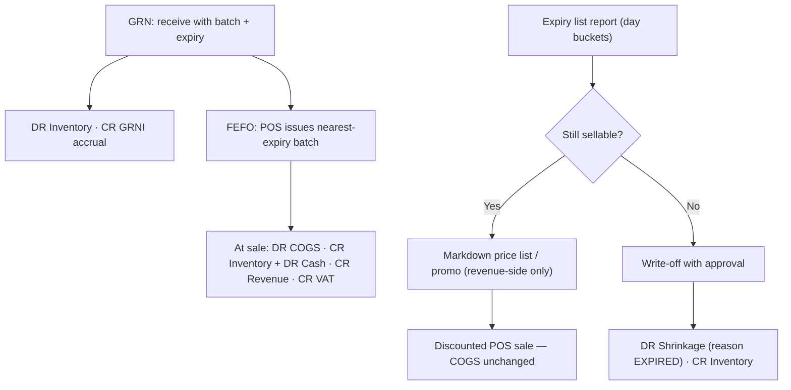

# Template: Grocery & Supermarket — `grocery_supermarket`

> **Status:** STABLE · **Owner:** Industry Solutions Architecture · **Updated:** 2026-10-27

High-volume, expiry-sensitive food retail: weighed scale items, batches with expiry, FEFO
picking, markdown discipline, and write-off governance. Ships in PHASE-015; POS capability
arrives with PHASE-016 (phase-gated until then). Manifest schema: [../README.md](../README.md) §3.

## Target businesses

- Neighborhood groceries and convenience stores.
- Supermarkets (single or multi-branch).
- Wholesale food retail (cash-and-carry) with customer price tiers.
- Bakeries/dairies selling their own and supplied goods over a retail counter (production
  needs layer on `food_manufacturing` in PHASE-018).

## Manifest

```json
{
  "id": "industry.grocery",
  "name": "Grocery & Supermarket",
  "name_ar": "البقالات والسوبرماركت",
  "version": "1.0.0",
  "required_feature_keys": [
    "industry.template_engine", "items.barcodes", "items.price_lists",
    "distribution.customer_tiers", "inventory.multi_warehouse", "inventory.batch_tracking"
    , "inventory.stock_counts", "pos.terminals", "pos.sales",
    "pos.offline_queue", "pos.barcode_scanning", "pos.receipts",
    "treasury.cashier_shifts"
  ],
  "default_modules_enabled": ["accounting", "partners", "items", "inventory", "sales",
    "purchasing", "treasury", "tax", "reporting", "pos", "configuration"],
  "terminology_overrides": {
    "item.scale_item": { "en": "Scale item", "ar": "صنف الميزان" },
    "batch.expiry": { "en": "Expiry date", "ar": "تاريخ الانتهاء" },
    "inventory.fefo": { "en": "FEFO (nearest expiry first)", "ar": "الأقرب انتهاءً يصدر أولاً" },
    "inventory.markdown": { "en": "Near-expiry markdown", "ar": "تخفيض قرب الانتهاء" },
    "inventory.writeoff": { "en": "Write-off", "ar": "الإعدام" },
    "item.shelf_life": { "en": "Shelf life", "ar": "مدة الصلاحية" },
    "purchasing.reorder": { "en": "Reorder level", "ar": "حد إعادة الطلب" }
  },
  "navigation_manifest": { "groups": [
    { "id": "selling", "label": { "en": "Selling", "ar": "البيع" }, "order": 1, "items": [
      { "id": "pos", "label": { "en": "Point of sale", "ar": "نقطة البيع" }, "target": "pos.counter", "feature_key": "pos.sales" },
      { "id": "tiers", "label": { "en": "Customer price tiers", "ar": "فئات أسعار العملاء" }, "target": "items.tiers" }
    ]},
    { "id": "expiry", "label": { "en": "Expiry control", "ar": "الرقابة على الصلاحية" }, "order": 2, "items": [
      { "id": "expiry_list", "label": { "en": "Expiry list", "ar": "قائمة الصلاحيات" }, "target": "inventory.expiry_list" },
      { "id": "writeoff", "label": { "en": "Write-off register", "ar": "سجل الإعدام" }, "target": "inventory.writeoff" },
      { "id": "counts", "label": { "en": "Stock counts", "ar": "جرد المخزون" }, "target": "inventory.counts" }
    ]}
  ]},
  "workflow_policies": {
    "cash_sales_autopost": true,
    "expiry_writeoff_requires_approval": true,
    "markdown_requires_approval": false,
    "batch_expiry_capture_required_on_grn": true,
    "scale_item_weighed_lines": true,
    "shift_variance_approval_required": true
  },
  "document_numbering_defaults": {
    "pos_sale": { "prefix": "POS", "format": "POS-{branch}-{yy}{MM}-{seq:5}", "per_branch": true, "reserve_on_approval": false },
    "sales_invoice": { "prefix": "INV", "format": "INV-{yyyy}-{seq:6}", "per_branch": false, "reserve_on_approval": false },
    "goods_receipt": { "prefix": "GRN", "format": "GRN-{yyyy}-{seq:6}", "per_branch": false, "reserve_on_approval": false },
    "credit_note": { "prefix": "CN", "format": "CN-{yyyy}-{seq:5}", "per_branch": false, "reserve_on_approval": false }
  },
  "inventory_policy_defaults": {
    "costing_method": "WAC", "default_track_batch": true, "default_track_expiry": true,
    "default_track_serial": false, "default_imei_tracking": false, "fefo_picking": true,
    "allow_negative_stock": false
  },
  "report_defaults": [
    { "report_key": "inventory.expiry_list", "pinned": true, "dashboard": true, "default_period": "this_week" },
    { "report_key": "grocery.expiry_writeoff", "pinned": true, "dashboard": true, "default_period": "this_month" },
    { "report_key": "pos.sales_by_hour", "pinned": true, "dashboard": true, "default_period": "this_week" },
    { "report_key": "inventory.stock_valuation", "pinned": true, "dashboard": false, "default_period": "custom" }
  ],
  "onboarding_steps": [
    { "id": "branch_warehouse", "title": { "en": "Create branch, shop floor and backroom", "ar": "إنشاء الفرع وصالة البيع والمستودع الخلفي" }, "required": true },
    { "id": "coa_confirm", "title": { "en": "Confirm chart of accounts", "ar": "تأكيد دليل الحسابات" }, "required": true },
    { "id": "categories", "title": { "en": "Food categories with batch/expiry defaults", "ar": "تصنيفات الأغذية مع خيارات الدفعة والصلاحية" }, "required": true },
    { "id": "scale_items", "title": { "en": "Set up scale items", "ar": "تهيئة أصناف الميزان" }, "required": false, "feature_key": "pos.barcode_scanning" },
    { "id": "suppliers", "title": { "en": "Suppliers & opening stock with batches", "ar": "الموردون والمخزون الافتتاحي مع الدفعات" }, "required": true },
    { "id": "tiers", "title": { "en": "Price tiers (retail / wholesale)", "ar": "فئات الأسعار (تجزئة / جملة)" }, "required": false },
    { "id": "terminals", "title": { "en": "Set up POS terminals & scales", "ar": "تهيئة أجهزة نقطة البيع والموازين" }, "required": true, "feature_key": "pos.terminals" },
    { "id": "first_count", "title": { "en": "Baseline count for expiry-sensitive stock", "ar": "جرد أساسي للأصناف الحساسة للصلاحية" }, "required": true }
  ],
  "capability_prerequisites": {
    "barcode_pos": { "level": "REQUIRED", "feature_keys": ["pos.terminals", "pos.sales", "pos.offline_queue", "pos.receipts"], "available_from_phase": "PHASE-016" },
    "scale_barcodes": { "level": "REQUIRED", "feature_keys": ["pos.barcode_scanning"], "available_from_phase": "PHASE-016" },
    "expiry_tracking_fefo": { "level": "REQUIRED", "feature_keys": ["inventory.batch_tracking" ], "available_from_phase": "PHASE-010" },
    "customer_price_tiers": { "level": "REQUIRED", "feature_keys": ["distribution.customer_tiers"], "available_from_phase": "PHASE-017" },
    "cashier_shifts": { "level": "REQUIRED", "feature_keys": ["treasury.cashier_shifts"], "available_from_phase": "PHASE-016" },
    "free_goods_promo": { "level": "OPTIONAL", "feature_keys": ["sales.discount_management", "distribution.free_goods"], "available_from_phase": "PHASE-017" },
    "composite_kits": { "level": "OPTIONAL", "feature_keys": ["items.composite_products"], "available_from_phase": "PHASE-016" },
    "qc_inspections": { "level": "OPTIONAL", "feature_keys": ["manufacturing.qc"], "available_from_phase": "PHASE-018" }
  }
}
```

## Enabled features (exact keys)

| Feature key | Required? | Phase | Note |
|---|---|---|---|
| `inventory.batch_tracking`, `inventory.fefo_picking` | Required | PHASE-010 | Expiry capture required at GRN; FEFO forced at issue |
| `pos.barcode_scanning` | Required | PHASE-016 | Weighed lines from scale labels |
| `distribution.customer_tiers` | Required | PHASE-017 | Retail vs wholesale tiers; phase-gated before 017 |
| `pos.terminals`, `pos.sales`, `pos.offline_queue`, `pos.receipts`, `treasury.cashier_shifts` | Required | PHASE-016 | Standard counter discipline |
| `sales.discount_management`, `distribution.free_goods` | Optional | PHASE-012/017 | Supplier-funded promos + FOC lines |
| `items.composite_products` | Optional | PHASE-016 | Repack bundles (e.g., water 6-packs) |
| `manufacturing.qc` | Optional | PHASE-018 | Receiving QC gate; before 018 use count/adjustment reason codes |

## Terminology overrides (sample)

| Term key | English | العربية | Note |
|---|---|---|---|
| `item.scale_item` | Scale item | صنف الميزان | Sold by weight; scale barcode carries weight/price |
| `batch.expiry` | Expiry date | تاريخ الانتهاء | Captured at GRN, printed on expiry reports |
| `inventory.fefo` | FEFO | الأقرب انتهاءً يصدر أولاً | Picking discipline |
| `inventory.markdown` | Near-expiry markdown | تخفيض قرب الانتهاء | Revenue-side discount; COGS untouched |
| `inventory.writeoff` | Write-off | الإعدام | Shrinkage with reason `EXPIRED` |
| `item.shelf_life` | Shelf life | مدة الصلاحية | Default days per item → suggested expiry |
| `purchasing.reorder` | Reorder level | حد إعادة الطلب | Below-reorder alerts |

## Default navigation (sample)

| EN | AR | Target |
|----|----|--------|
| Point of sale | نقطة البيع | `pos.counter` |
| Expiry list | قائمة الصلاحيات | `inventory.expiry_list` |
| Write-off register | سجل الإعدام | `inventory.writeoff` |
| Customer price tiers | فئات أسعار العملاء | `items.tiers` |
| Stock counts | جرد المخزون | `inventory.counts` |
| Purchasing & GRN | المشتريات والاستلام | `purchasing.goods_receipts` |

## Signature workflow — expiry lifecycle

1. Goods receipt captures batch number + expiry (and cost) → inventory value posts against
   GRNI accrual until the supplier invoice clears it.
2. POS and back-office issues pick the nearest-expiry batch (FEFO); each `stock_move`
   references the batch.
3. Weekly expiry list buckets batches by days-to-expiry with value-at-risk.
4. Near-expiry batches are marked down (temporary price list / promotion) — discount hits
   revenue only; COGS is untouched
   ([../../accounting/INVENTORY_ACCOUNTING.md](../../accounting/INVENTORY_ACCOUNTING.md) §4).
5. Unsold expired stock is written off behind approval: shrinkage posting with reason
   `EXPIRED`, tied to the batch and counted by the write-off register.



## Inventory behavior defaults

| Setting | Default | Notes |
|---|---|---|
| Costing method | WAC | High item counts favor WAC; per-item lock after transactions |
| Batch + expiry tracking | On (food categories mandatory) | Expiry required at GRN for flagged categories |
| FEFO picking | On | Enforced at POS and back-office issues |
| Serial / IMEI | Off | |
| Negative stock | Forbidden | Shrinkage discovered via counts, not negative balances |
| Scale items | Enabled | Weight UoM + scale barcode prefix per item |

## Document types emphasized

| Document | Arabic | Numbering default | Policy |
|---|---|---|---|
| POS sale | فاتورة نقطة البيع | `POS-{branch}-{yy}{MM}-{seq:5}` | Auto-post; simplified invoice where pack applies |
| Goods receipt (with batch/expiry) | سند استلام البضاعة | `GRN-{yyyy}-{seq:6}` | Expiry capture enforced for flagged categories |
| Stock adjustment (write-off) | تسوية مخزون / إعدام | `ADJ-{yyyy}-{seq:5}` | Approval + reason code (`EXPIRED`, `DAMAGED`) |
| Stock count | جرد المخزون | `CNT-{yyyy}-{seq:5}` | Variance review → posting |

## Reports emphasized

`inventory.expiry_list` (dashboard), `grocery.expiry_writeoff`, `pos.sales_by_hour`,
`inventory.stock_valuation`, `sales.discount_management_effectiveness` (with promotions) — see
[../reports/README.md](../reports/README.md).

## Out of scope for this template

- Cold-chain telematics and IoT temperature monitoring.
- Planogram/space planning optimization.
- Automated demand forecasting / ML replenishment (reorder levels are manual thresholds).
- In-store butchery/production costing (use `food_manufacturing`, PHASE-018).

## Known limitations

- Receiving QC gate is approximate (count + adjustment reason codes) until
  `qc_inspections` arrives in PHASE-018.
- Markdown automation (auto-discount at N days to expiry) is a roadmap idea; until then
  markdowns are manually applied price-list overrides.
- Supplier-collaborated promotions (invoice-backed funding) post as normal discounts;
  dedicated trade-spend accounting is not modeled.
