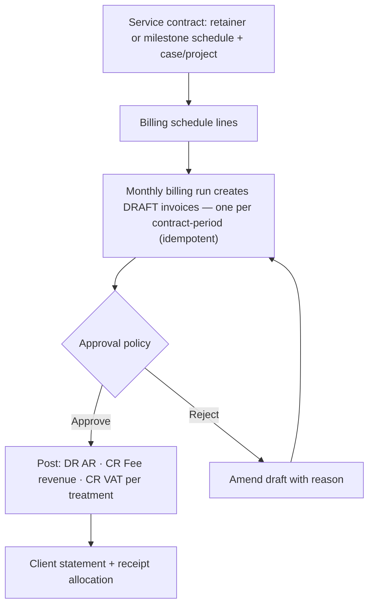

# Template: Professional Services — `professional_services`

> **Status:** STABLE · **Owner:** Industry Solutions Architecture · **Updated:** 2026-10-27`

Time-and-contract billing for knowledge businesses: cases, retainers, milestones, and
recurring invoices — with **no stock by default**. Ships in PHASE-019 with the CRM, service
contracts & projects phase ([../../planning/MASTER_ROADMAP.md](../../planning/MASTER_ROADMAP.md)).
Manifest schema: [../README.md](../README.md) §3. Full contract-billing workflow with
accounting effects: [../workflows/industry-workflows.md](../workflows/industry-workflows.md) (f).

## Target businesses

- Law offices (matters/cases, fixed-fee and hourly billing).
- Consulting firms.
- Accounting & bookkeeping offices.
- Engineering/architectural offices (milestone-based contracts).
- Marketing/design agencies (retainers + project billing).

## Manifest

```json
{
  "id": "industry.professional_services",
  "name": "Professional Services",
  "name_ar": "المكاتب المهنية",
  "version": "1.0.0",
  "required_feature_keys": [
    "industry.template_engine", "items.item_master", "crm.service_contracts",
    "crm.recurring_billing", "accounting.projects", "sales.invoices", "partners.statements"
  ],
  "default_modules_enabled": ["accounting", "partners", "items", "sales", "treasury",
    "tax", "reporting", "crm", "configuration"],
  "terminology_overrides": {
    "svc.case": { "en": "Case / Matter", "ar": "القضية / الملف" },
    "svc.time_entry": { "en": "Time entry", "ar": "تسجيل الوقت" },
    "svc.timesheet": { "en": "Timesheet", "ar": "كشف الساعات" },
    "svc.billable": { "en": "Billable", "ar": "قابل للفوترة" },
    "fee.fixed_fee": { "en": "Fixed fee", "ar": "أتعاب مقطوعة" },
    "fee.hourly": { "en": "Hourly fee", "ar": "أتعاب بالساعة" },
    "fee.retainer": { "en": "Retainer", "ar": "أتعاب دورية" },
    "billing.milestone": { "en": "Milestone", "ar": "دفعة مرحلية" },
    "doc.contract": { "en": "Service contract", "ar": "عقد الخدمات" },
    "acc.project": { "en": "Project", "ar": "المشروع" }
  },
  "navigation_manifest": { "groups": [
    { "id": "practice", "label": { "en": "Practice", "ar": "المكتب" }, "order": 1, "items": [
      { "id": "cases", "label": { "en": "Cases / Projects", "ar": "القضايا / المشاريع" }, "target": "accounting.projects" },
      { "id": "timesheets", "label": { "en": "Time & timesheets", "ar": "الوقت وكشوف الساعات" }, "target": "crm.time" },
      { "id": "contracts", "label": { "en": "Service contracts", "ar": "عقود الخدمات" }, "target": "crm.contracts" }
    ]},
    { "id": "billing", "label": { "en": "Billing", "ar": "الفوترة" }, "order": 2, "items": [
      { "id": "recurring", "label": { "en": "Recurring invoices", "ar": "الفواتير الدورية" }, "target": "crm.recurring_billing" },
      { "id": "invoices", "label": { "en": "Invoices", "ar": "الفواتير" }, "target": "sales.invoices" },
      { "id": "statements", "label": { "en": "Client statements", "ar": "كشوف حسابات العملاء" }, "target": "partners.statements" }
    ]}
  ]},
  "workflow_policies": {
    "contract_billing_mode": "retainer_or_milestones",
    "time_entries_require_case": true,
    "unbilled_time_review_before_invoice": true,
    "invoice_approval_required": true,
    "invoice_numbering_per_series": false,
    "narrative_required_on_time_billing": true
  },
  "document_numbering_defaults": {
    "contract_invoice": { "prefix": "INV", "format": "INV-{yyyy}-{seq:6}", "per_branch": false, "reserve_on_approval": false },
    "sales_invoice": { "prefix": "INV", "format": "INV-{yyyy}-{seq:6}", "per_branch": false, "reserve_on_approval": false },
    "receipt": { "prefix": "RCP", "format": "RCP-{yyyy}-{seq:6}", "per_branch": false, "reserve_on_approval": false },
    "credit_note": { "prefix": "CN", "format": "CN-{yyyy}-{seq:5}", "per_branch": false, "reserve_on_approval": false }
  },
  "inventory_policy_defaults": {
    "costing_method": "WAC", "default_track_batch": false, "default_track_expiry": false,
    "default_track_serial": false, "default_imei_tracking": false, "fefo_picking": false,
    "allow_negative_stock": false
  },
  "report_defaults": [
    { "report_key": "services.contract_revenue_schedule", "pinned": true, "dashboard": true, "default_period": "this_month" },
    { "report_key": "services.time_billing_summary", "pinned": true, "dashboard": true, "default_period": "this_month" },
    { "report_key": "partners.ar_aging", "pinned": true, "dashboard": false, "default_period": "this_month" },
    { "report_key": "sales.commissions_due", "pinned": true, "dashboard": false, "default_period": "this_month" }
  ],
  "onboarding_steps": [
    { "id": "coa_confirm", "title": { "en": "Confirm chart of accounts (fee revenue natures)", "ar": "تأكيد دليل الحسابات (طبيعة إيرادات الأتعاب)" }, "required": true },
    { "id": "clients", "title": { "en": "Clients & engagement contacts", "ar": "العملاء وجهات التعامل" }, "required": true },
    { "id": "fee_items", "title": { "en": "Fee items (hourly, fixed, disbursements)", "ar": "بنود الأتعاب (بالساعة، مقطوعة، مصروفات نائبة)" }, "required": true },
    { "id": "first_contract", "title": { "en": "First service contract", "ar": "أول عقد خدمات" }, "required": true },
    { "id": "billing_run", "title": { "en": "Run first recurring billing cycle", "ar": "تشغيل أول دورة فوترة دورية" }, "required": false },
    { "id": "projects", "title": { "en": "Open projects/cases", "ar": "فتح المشاريع/القضايا" }, "required": false }
  ],
  "capability_prerequisites": {
    "service_contracts": { "level": "REQUIRED", "feature_keys": ["crm.service_contracts"], "available_from_phase": "PHASE-019" },
    "recurring_billing": { "level": "REQUIRED", "feature_keys": ["crm.recurring_billing"], "available_from_phase": "PHASE-019" },
    "bom_production": { "level": "N/A", "feature_keys": [], "available_from_phase": "PHASE-018" },
    "deposits_late_fees": { "level": "OPTIONAL", "feature_keys": ["crm.contract_deposits", "crm.late_fees"], "available_from_phase": "PHASE-019" },
    "commissions": { "level": "OPTIONAL", "feature_keys": ["sales.commissions"], "available_from_phase": "PHASE-017" },
    "job_cards": { "level": "OPTIONAL", "feature_keys": ["sales.job_cards"], "available_from_phase": "PHASE-017" }
  }
}
```

*Note: `bom_production` is listed at N/A level in prerequisites for machine-readability of
the "not applicable" answer; it is not enabled, and the stock modules are absent from
`default_modules_enabled`.*

## Enabled features (exact keys)

| Feature key | Required? | Phase | Note |
|---|---|---|---|
| `crm.service_contracts` | Required | PHASE-019 | Scope, term, fee model, renewal |
| `crm.recurring_billing` | Required | PHASE-019 | Idempotent monthly/milestone drafts |
| `accounting.projects` | Required | PHASE-019 | Project/case analytical dimension |
| `items.item_master` | Required | PHASE-006 | Non-stock fee items (hourly, fixed, disbursement) |
| `partners.statements` | Required | PHASE-006/012 | Client statements |
| `crm.leads`, `crm.tasks_activities` | Optional | PHASE-019 | Intake pipeline for new engagements |
| `crm.service_orders` | Optional | PHASE-019 | Ad-hoc work orders outside contracts |
| `sales.commissions` | Optional | PHASE-017 | Fee-sharing schemes |
| `crm.contract_deposits`, `crm.late_fees` | Optional | PHASE-019 | Where engagement terms hold client funds or charge late fees |

## Terminology overrides (sample)

| Term key | English | العربية | Note |
|---|---|---|---|
| `svc.case` | Case / Matter | القضية / الملف | Label adapts per firm type (project for consultancies) |
| `svc.time_entry` | Time entry | تسجيل الوقت | Recorded against a case/project |
| `svc.timesheet` | Timesheet | كشف الساعات | Weekly review unit |
| `fee.fixed_fee` | Fixed fee | أتعاب مقطوعة | Milestone-driven |
| `fee.hourly` | Hourly fee | أتعاب بالساعة | Rate card per fee item |
| `fee.retainer` | Retainer | أتعاب دورية | Recurring monthly billing |
| `billing.milestone` | Milestone | دفعة مرحلية | Contract schedule line |
| `doc.contract` | Service contract | عقد الخدمات | Posts nothing itself |

## Default navigation (sample)

| EN | AR | Target |
|----|----|--------|
| Cases / Projects | القضايا / المشاريع | `accounting.projects` |
| Time & timesheets | الوقت وكشوف الساعات | `crm.time` |
| Service contracts | عقود الخدمات | `crm.contracts` |
| Recurring invoices | الفواتير الدورية | `crm.recurring_billing` |
| Client statements | كشوف حسابات العملاء | `partners.statements` |

## Signature workflow — contract billing cycle (compact)



Numbered steps and per-step journals:
[../workflows/industry-workflows.md](../workflows/industry-workflows.md) §f.

## Inventory behavior defaults

| Setting | Default | Notes |
|---|---|---|
| Stock modules | Not enabled | Inventory/purchasing absent from `default_modules_enabled` |
| Costing method | WAC (dormant) | Applies only if the tenant later enables stock (e.g., a firm selling printed materials) |
| All tracking flags | Off | |
| Service items | Default item type | Rate cards via price lists |

## Document types emphasized

| Document | Arabic | Numbering default | Policy |
|---|---|---|---|
| Service contract | عقد الخدمات | `CT-{yyyy}-{seq:5}` | No ledger effect; schedule source |
| Sales invoice (fee) | فاتورة الأتعاب | `INV-{yyyy}-{seq:6}` | Approval required before posting |
| Receipt | سند القبض | `RCP-{yyyy}-{seq:6}` | Allocations to invoices |
| Credit note | إشعار دائن | `CN-{yyyy}-{seq:5}` | Fee corrections/adjustments |

## Reports emphasized

`services.contract_revenue_schedule` (contracted vs invoiced vs backlog — dashboard),
`services.time_billing_summary` (recorded vs billable vs invoiced hours),
`partners.ar_aging`, `sales.commissions_due` — see [../reports/README.md](../reports/README.md).

## Out of scope for this template

- Court calendaring, litigation-deadline, or practice-management integrations.
- Trust/escrow accounting for client funds held under professional rules — the optional
  deposit capability holds funds as a plain liability and does **not** claim compliance
  with any profession-specific trust regime (no invented legal claims).
- Payroll/time-attendance for staff (platform non-goal).
- Document management beyond generic attachments (`files` module).

## Known limitations

- Time entries feed billing, not payroll: staff cost is not tracked; project profitability
  is fee-based only.
- Fee-splitting/commissions compute on collected or invoiced fees per rule — partnership
  profit-share distribution is out of scope.
- Client portal self-service is a PHASE-003-stage idea deferred to integrations
  (FR-PAS-004, priority 3); statements are PDF/push based at PHASE-019.
