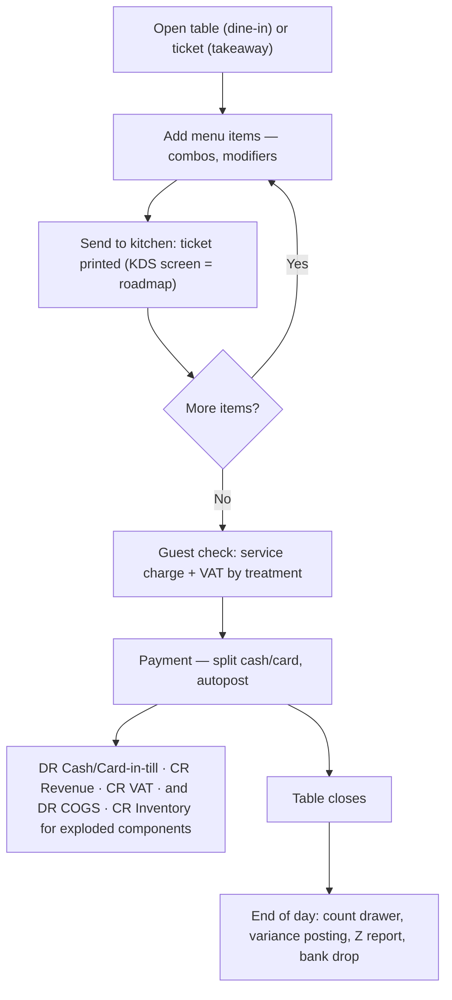

# Template: Restaurant & Café — `restaurant_cafe`

> **Status:** STABLE · **Owner:** Industry Solutions Architecture · **Updated:** 2026-10-27

Fast, table-driven food service: open table → kitchen → check → payment → daily Z close.
Ships in PHASE-015; POS (tables, fast check, shifts) arrives with PHASE-016 — until then
the template runs in back-office mode (invoices + expiry-sensitive stock). Manifest schema:
[../README.md](../README.md) §3. Full order-to-Z-close workflow with accounting effects:
[../workflows/industry-workflows.md](../workflows/industry-workflows.md) (a).

## Target businesses

- Full-service restaurants with dining rooms.
- Cafés and juice bars (counter + table mix).
- Buffets (fixed-price cover lines).
- Bakeries with a retail/seat-in counter (production layer comes from `food_manufacturing`,
  PHASE-018).

## Manifest

```json
{
  "id": "industry.restaurant",
  "name": "Restaurant & Café",
  "name_ar": "المطاعم والمقاهي",
  "version": "1.0.0",
  "required_feature_keys": [
    "industry.template_engine", "items.barcodes", "items.price_lists",
    "inventory.multi_warehouse", "inventory.batch_tracking" ,
    "items.composite_products", "inventory.stock_counts", "pos.terminals", "pos.sales",
    "pos.offline_queue", "pos.table_service", "pos.receipts",
    "treasury.cashier_shifts"
  ],
  "default_modules_enabled": ["accounting", "partners", "items", "inventory", "sales",
    "purchasing", "treasury", "tax", "reporting", "pos", "configuration"],
  "terminology_overrides": {
    "pos.table": { "en": "Table", "ar": "طاولة" },
    "pos.order": { "en": "Order", "ar": "طلب" },
    "pos.kitchen": { "en": "Kitchen", "ar": "المطبخ" },
    "pos.order_type": { "en": "Order type", "ar": "نوع الطلب" },
    "pos.dine_in": { "en": "Dine-in", "ar": "داخل المطعم" },
    "pos.takeaway": { "en": "Takeaway", "ar": "سفري" },
    "pos.delivery": { "en": "Delivery", "ar": "توصيل" },
    "pos.check": { "en": "Guest check", "ar": "الحساب" },
    "menu.combo": { "en": "Combo / set meal", "ar": "وجبة" },
    "menu.modifier": { "en": "Modifier (extra)", "ar": "إضافة" },
    "pos.z_close": { "en": "Z close (day end)", "ar": "الإغلاق اليومي" },
    "billing.service_charge": { "en": "Service charge", "ar": "رسوم الخدمة" }
  },
  "navigation_manifest": { "groups": [
    { "id": "floor", "label": { "en": "Floor", "ar": "صالة المطعم" }, "order": 1, "items": [
      { "id": "tables", "label": { "en": "Tables", "ar": "الطاولات" }, "target": "pos.floor", "feature_key": "pos.table_service" },
      { "id": "quick_sale", "label": { "en": "Quick sale", "ar": "بيع سريع" }, "target": "pos.counter", "feature_key": "pos.sales" },
      { "id": "kitchen", "label": { "en": "Kitchen tickets", "ar": "تذاكر المطبخ" }, "target": "pos.kitchen", "feature_key": "pos.kitchen_display" }
    ]},
    { "id": "day", "label": { "en": "Daily close", "ar": "الإغلاق اليومي" }, "order": 2, "items": [
      { "id": "shifts", "label": { "en": "Shifts", "ar": "الورديات" }, "target": "treasury.shifts" },
      { "id": "z_close", "label": { "en": "Z close report", "ar": "تقرير الإغلاق اليومي" }, "target": "pos.z_close" }
    ]}
  ]},
  "workflow_policies": {
    "cash_sales_autopost": true,
    "default_pos_order_type": "dine_in",
    "unpaid_table_holds_no_ledger": true,
    "combo_explosion_at_posting": true,
    "service_charge_default_rate": 0,
    "shift_variance_approval_required": true,
    "daily_waste_count_recommended": true
  },
  "document_numbering_defaults": {
    "pos_sale": { "prefix": "RC", "format": "RC-{branch}-{yy}{MM}-{seq:5}", "per_branch": true, "reserve_on_approval": false },
    "purchase_order": { "prefix": "PO", "format": "PO-{yyyy}-{seq:5}", "per_branch": false, "reserve_on_approval": true },
    "goods_receipt": { "prefix": "GRN", "format": "GRN-{yyyy}-{seq:5}", "per_branch": false, "reserve_on_approval": false },
    "stock_adjustment": { "prefix": "ADJ", "format": "ADJ-{yyyy}-{seq:5}", "per_branch": false, "reserve_on_approval": false }
  },
  "inventory_policy_defaults": {
    "costing_method": "WAC", "default_track_batch": true, "default_track_expiry": true,
    "default_track_serial": false, "default_imei_tracking": false, "fefo_picking": true,
    "allow_negative_stock": false
  },
  "report_defaults": [
    { "report_key": "restaurant.sales_by_table", "pinned": true, "dashboard": true, "default_period": "this_week" },
    { "report_key": "restaurant.order_type_mix", "pinned": true, "dashboard": true, "default_period": "this_week" },
    { "report_key": "pos.sales_by_hour", "pinned": true, "dashboard": true, "default_period": "this_week" },
    { "report_key": "treasury.shift_cash_reconciliation", "pinned": true, "dashboard": false, "default_period": "today" },
    { "report_key": "inventory.expiry_list", "pinned": true, "dashboard": true, "default_period": "this_week" }
  ],
  "onboarding_steps": [
    { "id": "branch_floors", "title": { "en": "Branch, kitchen & floor layout", "ar": "الفرع والمطبخ وتخطيط الصالة" }, "required": true },
    { "id": "coa_confirm", "title": { "en": "Confirm chart of accounts", "ar": "تأكيد دليل الحسابات" }, "required": true },
    { "id": "menu", "title": { "en": "Build menu (items, combos, modifiers)", "ar": "بناء قائمة الطعام (أصناف، وجبات، إضافات)" }, "required": true },
    { "id": "ingredients", "title": { "en": "Ingredient stock with expiry", "ar": "مخزون المكونات مع الصلاحية" }, "required": true },
    { "id": "suppliers", "title": { "en": "Suppliers & opening stock", "ar": "الموردون والمخزون الافتتاحي" }, "required": true },
    { "id": "terminals", "title": { "en": "Terminals & floor plan", "ar": "تهيئة الأجهزة وخريطة الطاولات" }, "required": true, "feature_key": "pos.table_service" },
    { "id": "first_day", "title": { "en": "Run first service day and Z close", "ar": "تشغيل أول يوم خدمة والإغلاق اليومي" }, "required": false, "feature_key": "pos.sales" }
  ],
  "capability_prerequisites": {
    "table_service": { "level": "REQUIRED", "feature_keys": ["pos.table_service"], "available_from_phase": "PHASE-016" },
    "barcode_pos": { "level": "REQUIRED", "feature_keys": ["pos.terminals", "pos.sales", "pos.offline_queue", "pos.receipts"], "available_from_phase": "PHASE-016" },
    "cashier_shifts": { "level": "REQUIRED", "feature_keys": ["treasury.cashier_shifts"], "available_from_phase": "PHASE-016" },
    "composite_kits": { "level": "REQUIRED", "feature_keys": ["items.composite_products"], "available_from_phase": "PHASE-016" },
    "expiry_tracking_fefo": { "level": "REQUIRED", "feature_keys": ["inventory.batch_tracking" ], "available_from_phase": "PHASE-010" },
    "kitchen_display": { "level": "OPTIONAL", "feature_keys": ["pos.kitchen_display"], "available_from_phase": "PHASE-016" },
    "bom_production": { "level": "OPTIONAL", "feature_keys": ["manufacturing.bom", "manufacturing.production_orders"], "available_from_phase": "PHASE-018" },
    "free_goods_promo": { "level": "OPTIONAL", "feature_keys": ["distribution.free_goods"], "available_from_phase": "PHASE-017" }
  }
}
```

## Enabled features (exact keys)

| Feature key | Required? | Phase | Note |
|---|---|---|---|
| `pos.table_service` | Required | PHASE-016 | Floor plan, order types, check transfer/split |
| `pos.sales`, `pos.terminals`, `pos.offline_queue`, `pos.receipts` | Required | PHASE-016 | Fast check flow; quick keys |
| `items.composite_products` | Required | PHASE-016 | Combos explode to component items at posting |
| `inventory.batch_tracking`, `inventory.fefo_picking` | Required | PHASE-010 | Ingredient freshness discipline |
| `treasury.cashier_shifts` | Required | PHASE-016 | Shift + Z close discipline |
| `pos.kitchen_display` | Optional | PHASE-016 (tickets) | Screen-based KDS = roadmap extension |
| `manufacturing.bom`, `manufacturing.production_orders` | Optional | PHASE-018 | Prep/semi-finished recipes (sauces, dough) |
| `distribution.free_goods` | Optional | PHASE-017 | Happy hours, meal deals |

## Terminology overrides (sample)

| Term key | English | العربية | Note |
|---|---|---|---|
| `pos.table` | Table | طاولة | Floor-plan unit |
| `pos.order` | Order | طلب | Lives unpaid with no ledger effect until payment |
| `pos.kitchen` | Kitchen | المطبخ | Ticket destination |
| `pos.order_type` | Order type | نوع الطلب | dine-in / takeaway / delivery |
| `menu.combo` | Combo / set meal | وجبة | Explodes to components at posting |
| `menu.modifier` | Modifier (extra) | إضافة | Priced add-on line |
| `pos.check` | Guest check | الحساب | Printed pre-payment bill |
| `pos.z_close` | Z close | الإغلاق اليومي | End-of-day shift/summary close |
| `billing.service_charge` | Service charge | رسوم الخدمة | Configurable charge line; any tax treatment resolves via the tenant's tax code |

## Default navigation (sample)

| EN | AR | Target |
|----|----|--------|
| Tables | الطاولات | `pos.floor` |
| Quick sale | بيع سريع | `pos.counter` |
| Kitchen tickets | تذاكر المطبخ | `pos.kitchen` |
| Shifts | الورديات | `treasury.shifts` |
| Z close | الإغلاق اليومي | `pos.z_close` |
| Menu & combos | القائمة والوجبات | `items.menu` |

## Signature workflow — table order to Z close (compact)



Numbered steps and per-step journals: [../workflows/industry-workflows.md](../workflows/industry-workflows.md) §a.

## Inventory behavior defaults

| Setting | Default | Notes |
|---|---|---|
| Costing method | WAC | Ingredients valued at moving average |
| Batch + expiry tracking | On | Ingredient categories (dairy, produce, proteins) |
| FEFO picking | On | Prep lists + issue screens propose nearest-expiry |
| Combos | Explode at posting | Components issue at their own cost |
| Negative stock | Forbidden | Daily waste counts recommended instead |
| Serial / IMEI | Off | |

## Document types emphasized

| Document | Arabic | Numbering default | Policy |
|---|---|---|---|
| POS sale (check) | فاتورة نقطة البيع | `RC-{branch}-{yy}{MM}-{seq:5}` | Auto-post at payment |
| Purchase order / GRN | أمر الشراء / سند الاستلام | `PO-` / `GRN-` | Ingredient receiving with expiry capture |
| Stock adjustment (waste) | تسوية الهالك | `ADJ-{yyyy}-{seq:5}` | Reason-coded waste; shrinkage posting |
| Z close summary | تقرير الإغلاق اليومي | `Z-{branch}-{yyyyMMdd}` | Shift-derived, read-only print |

## Reports emphasized

`restaurant.sales_by_table`, `restaurant.order_type_mix`, `pos.sales_by_hour`,
`treasury.shift_cash_reconciliation`, `inventory.expiry_list`, `grocery.expiry_writeoff`
(shared) — see [../reports/README.md](../reports/README.md).

## Out of scope for this template

- Delivery-platform integrations (aggregators) — external adapters only, PHASE-023.
- QR table-side self-ordering.
- Recipe nutrition/allergen labeling.
- Multi-branch central kitchen production planning (compose `food_manufacturing`).

## Known limitations

- Kitchen display is ticket-printing at PHASE-016; the screen-based KDS (bump statuses,
  prep timers) is a roadmap extension with no committed phase.
- Ingredient depletion for non-combo menu items is by stock counts/adjustments (waste
  counts), not automatic recipe explosion — full prep recipes arrive with
  `bom_production` in PHASE-018.
- Delivery orders are recorded as an order type with manual courier handling; no driver
  dispatch or courier accounting.
