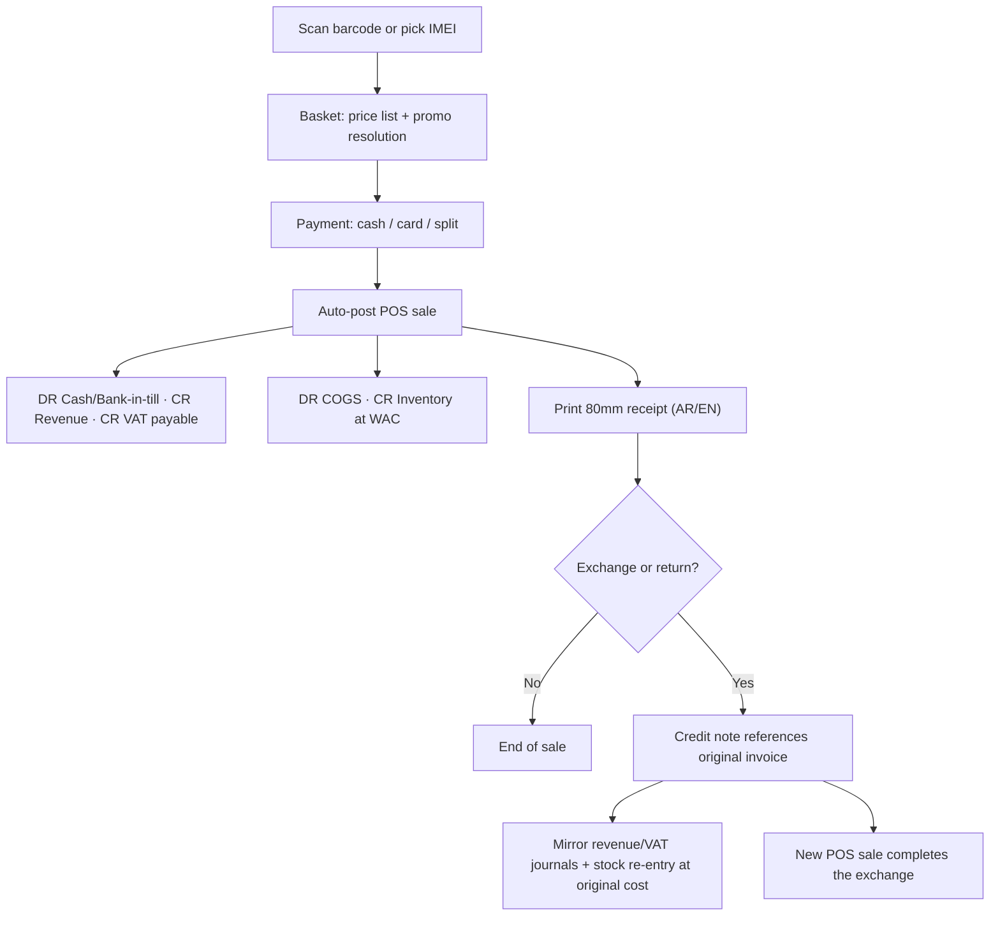

# Template: Retail — `retail`

> **Status:** STABLE · **Owner:** Industry Solutions Architecture · **Updated:** 2026-10-27

Counter retail: scan, sell, take payment, handle exchanges. Ships in PHASE-015; POS
capability arrives with PHASE-016 (entries are phase-gated until then — back-office
invoicing works immediately). Manifest schema: [../README.md](../README.md) §3.

## Target businesses

- Clothing, footwear, and accessories stores (size/color variants, seasonal collections).
- Electronics and appliance stores.
- Mobile-phone shops (per-device IMEI register).
- Cosmetics and perfume retail.
- Multi-branch retail groups needing branch-to-branch transfers.

## Manifest

```json
{
  "id": "industry.retail",
  "name": "Retail Stores",
  "name_ar": "متاجر التجزئة",
  "version": "1.0.0",
  "required_feature_keys": [
    "industry.template_engine", "items.barcodes", "items.price_lists",
    "inventory.multi_warehouse", "inventory.stock_transfers", "inventory.serial_tracking",
     "pos.terminals", "pos.sales", "pos.offline_queue",
    "pos.receipts", "treasury.cashier_shifts"
  ],
  "default_modules_enabled": ["accounting", "partners", "items", "inventory", "sales",
    "purchasing", "treasury", "tax", "reporting", "pos", "configuration"],
  "terminology_overrides": {
    "pos.terminal": { "en": "Terminal", "ar": "الطرفية" },
    "doc.sales_invoice_pos": { "en": "POS sale", "ar": "بيع نقطة البيع" },
    "item.exchange": { "en": "Exchange", "ar": "الاستبدال" },
    "item.variant": { "en": "Variant (size/color)", "ar": "المقاس / اللون" },
    "item.tag_price": { "en": "Tag price", "ar": "السعر المعلن" },
    "promo.season_sale": { "en": "Season sale", "ar": "تخفيضات الموسم" }
  },
  "navigation_manifest": { "groups": [
    { "id": "selling", "label": { "en": "Selling", "ar": "البيع" }, "order": 1, "items": [
      { "id": "pos", "label": { "en": "Point of sale", "ar": "نقطة البيع" }, "target": "pos.counter", "feature_key": "pos.sales" },
      { "id": "returns", "label": { "en": "Returns & exchanges", "ar": "المرتجعات والاستبدال" }, "target": "sales.credit_notes" },
      { "id": "receipts", "label": { "en": "Receipts", "ar": "سندات القبض" }, "target": "treasury.receipts" }
    ]},
    { "id": "stock", "label": { "en": "Stock", "ar": "المخزون" }, "order": 2, "items": [
      { "id": "transfers", "label": { "en": "Branch transfers", "ar": "تحويلات الفروع" }, "target": "inventory.transfers" },
      { "id": "imei", "label": { "en": "IMEI register", "ar": "سجل الأجهزة" }, "target": "inventory.imei", "feature_key": "inventory.serial_tracking" }
    ]}
  ]},
  "workflow_policies": {
    "cash_sales_autopost": true,
    "pos.return_requires_original_invoice": true,
    "exchange_same_value_only": false,
    "shift_variance_approval_required": true,
    "stock_transfer_in_transit_visible": true
  },
  "document_numbering_defaults": {
    "sales_invoice": { "prefix": "INV", "format": "INV-{yyyy}-{seq:6}", "per_branch": false, "reserve_on_approval": false },
    "pos_sale": { "prefix": "POS", "format": "POS-{branch}-{yy}{MM}-{seq:5}", "per_branch": true, "reserve_on_approval": false },
    "credit_note": { "prefix": "CN", "format": "CN-{yyyy}-{seq:5}", "per_branch": false, "reserve_on_approval": false },
    "stock_transfer": { "prefix": "TRF", "format": "TRF-{yyyy}-{seq:5}", "per_branch": false, "reserve_on_approval": false }
  },
  "inventory_policy_defaults": {
    "costing_method": "WAC", "default_track_batch": false, "default_track_expiry": false,
    "default_track_serial": false, "default_imei_tracking": false, "fefo_picking": false,
    "allow_negative_stock": false
  },
  "report_defaults": [
    { "report_key": "pos.sales_by_terminal", "pinned": true, "dashboard": true, "default_period": "today" },
    { "report_key": "pos.sales_by_hour", "pinned": true, "dashboard": true, "default_period": "this_week" },
    { "report_key": "retail.imei_register", "pinned": true, "dashboard": false, "default_period": "this_month" },
    { "report_key": "inventory.stock_valuation", "pinned": true, "dashboard": false, "default_period": "custom" }
  ],
  "onboarding_steps": [
    { "id": "branch_warehouse", "title": { "en": "Create branch and stockroom", "ar": "إنشاء الفرع والمستودع" }, "required": true },
    { "id": "coa_confirm", "title": { "en": "Confirm chart of accounts", "ar": "تأكيد دليل الحسابات" }, "required": true },
    { "id": "categories", "title": { "en": "Item categories & tracking flags", "ar": "تصنيفات الأصناف وخيارات التتبع" }, "required": true },
    { "id": "suppliers", "title": { "en": "Suppliers & opening stock", "ar": "الموردون ورصيد المخزون الافتتاحي" }, "required": true },
    { "id": "terminals", "title": { "en": "Set up POS terminals", "ar": "تهيئة أجهزة نقطة البيع" }, "required": true, "feature_key": "pos.terminals" },
    { "id": "first_shift", "title": { "en": "Open first shift and make a sale", "ar": "افتتاح أول وردية وإجراء أول عملية بيع" }, "required": false, "feature_key": "pos.sales" }
  ],
  "capability_prerequisites": {
    "barcode_pos": { "level": "REQUIRED", "feature_keys": ["pos.terminals", "pos.sales", "pos.offline_queue", "pos.receipts"], "available_from_phase": "PHASE-016" },
    "cashier_shifts": { "level": "REQUIRED", "feature_keys": ["treasury.cashier_shifts"], "available_from_phase": "PHASE-016" },
    "imei_tracking": { "level": "OPTIONAL", "feature_keys": ["inventory.serial_tracking"], "available_from_phase": "PHASE-010" },
    "composite_kits": { "level": "OPTIONAL", "feature_keys": ["items.composite_products"], "available_from_phase": "PHASE-016" },
    "free_goods_promo": { "level": "OPTIONAL", "feature_keys": ["distribution.free_goods"], "available_from_phase": "PHASE-017" },
    "landed_costs": { "level": "OPTIONAL", "feature_keys": ["purchasing.landed_costs"], "available_from_phase": "PHASE-011" }
  }
}
```

## Enabled features (exact keys)

| Feature key | Required? | Phase | Note |
|---|---|---|---|
| `pos.terminals`, `pos.sales`, `pos.offline_queue`, `pos.receipts` | Required | PHASE-016 | Counter selling; offline queue with `OFF-…` numbers |
| `treasury.cashier_shifts` | Required | PHASE-016 | Shift open/float/close/variance |
| `inventory.serial_tracking` | Required* | PHASE-010 | *Required as a key so phone categories can flag it; items opt in per category |
| `inventory.serial_tracking`, `inventory.multi_warehouse`, `inventory.stock_transfers` | Required | PHASE-010 | Branch-to-branch transfers with in-transit |
| `items.barcodes`, `items.price_lists` | Required | PHASE-006 | Tag prices, promotions via price lists |
| `distribution.free_goods`, `items.composite_products`, `purchasing.landed_costs`, `sales.reps` | Optional | PHASE-011/016/017 | Season sales, bundles, imports, staff attribution |

## Terminology overrides (sample)

| Term key | English | العربية | Note |
|---|---|---|---|
| `pos.terminal` | Terminal | الطرفية | Not "جهاز" — avoids confusion with Device (offline client) |
| `doc.sales_invoice_pos` | POS sale | بيع نقطة البيع | Printed as simplified invoice where the pack defines it |
| `item.exchange` | Exchange | الاستبدال | Return + new sale in one flow |
| `item.variant` | Size / Color | المقاس / اللون | Variant axes for fashion |
| `item.tag_price` | Tag price | السعر المعلن | Pre-promotion shelf price |
| `promo.season_sale` | Season sale | تخفيضات الموسم | Promotion type label |

## Default navigation (sample)

| EN | AR | Target |
|----|----|--------|
| Point of sale | نقطة البيع | `pos.counter` |
| Returns & exchanges | المرتجعات والاستبدال | `sales.credit_notes` |
| Branch transfers | تحويلات الفروع | `inventory.transfers` |
| IMEI register | سجل الأجهزة | `inventory.imei` |
| Shifts | الورديات | `treasury.shifts` |
| Daily sales | المبيعات اليومية | `pos.sales_by_terminal` |

## Signature workflow — counter sale with exchange

1. Cashier opens shift with opening float (treasury shift, no journal).
2. Scan barcode (or pick an IMEI for flagged phones) → basket builds with price list and
   promotion resolution.
3. Take payment (cash, card, split) → `cash_sales_autopost` posts immediately.
4. Print 80 mm receipt (AR/EN per tenant locale).
5. Exchange path: look up original invoice → credit note (return lines) + new POS sale in
   one guided flow; stock re-enters at original cost.



Accounting effects: sale → AR/cash + revenue + VAT journal and COGS journal
([../../accounting/POSTING_ENGINE.md](../../accounting/POSTING_ENGINE.md) §4); exchange
credit note mirrors both; shift close posts only if counted ≠ expected cash
(`cash_shortage` expense or overage income, approval-gated).

## Inventory behavior defaults

| Setting | Default | Notes |
|---|---|---|
| Costing method | WAC | FIFO acceptable for fashion at tenant choice; per-item consistency |
| Batch/expiry tracking | Off | Cosmetics tenants may enable per category |
| Serial tracking | Off (per-category opt-in) | High-value electronics |
| IMEI tracking | Per-category opt-in | Phone categories force IMEI capture at GRN and sale |
| FEFO picking | Off | |
| Negative stock | Forbidden | Template may not enable it |

## Document types emphasized

| Document | Arabic | Numbering default | Policy |
|---|---|---|---|
| POS sale (simplified invoice where pack applies) | فاتورة نقطة البيع | `POS-{branch}-{yy}{MM}-{seq:5}` | Auto-post on payment |
| Credit note (return/exchange) | إشعار دائن | `CN-{yyyy}-{seq:5}` | References original invoice |
| Branch stock transfer | تحويل مخزون | `TRF-{yyyy}-{seq:5}` | In-transit visible, not sellable |
| Goods receipt | سند استلام البضاعة | `GRN-{yyyy}-{seq:5}` | IMEI capture on flagged items |

## Reports emphasized

Pinned at apply time: `pos.sales_by_terminal`, `pos.sales_by_hour`, `retail.imei_register`,
`inventory.stock_valuation` — see [../reports/README.md](../reports/README.md).

## Out of scope for this template

- E-commerce storefront / marketplace integrations (external adapters only, PHASE-023).
- Loyalty points programs (not in the requirements baseline).
- CRM pipelines (compose `crm` capabilities in PHASE-019 if needed).
- Fashion-specific PLM (season planning, fabric BOMs).

## Known limitations

- Offline selling requires the PHASE-016 POS queue; the web back-office is online-only
  until the generalized sync of PHASE-020+.
- Variant modeling is flat (item per size/color combination with a parent style) — no
  matrix grid inventory planning.
- Promotion engine (buy-X-get-Y) lands PHASE-017; until then promotions are price-list
  overrides and discount lines.
