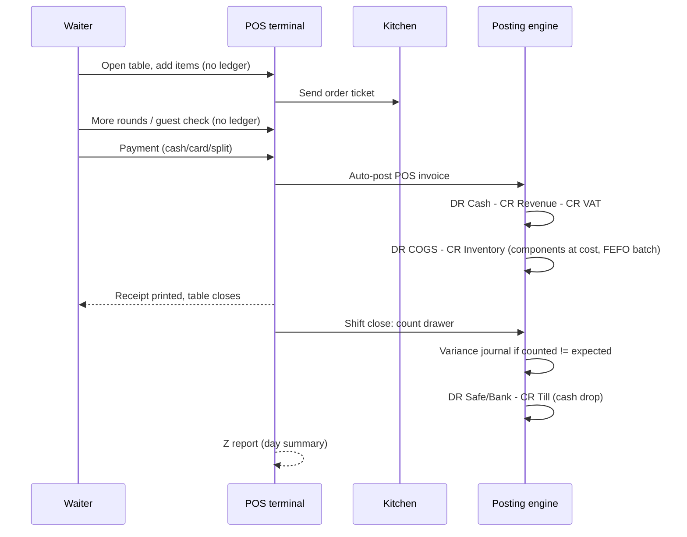
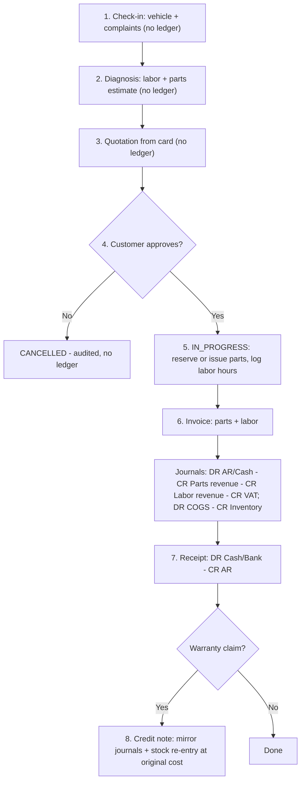
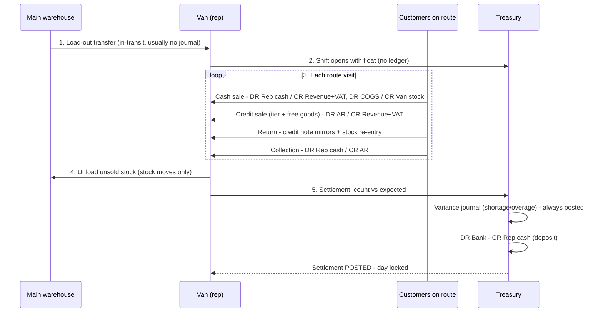
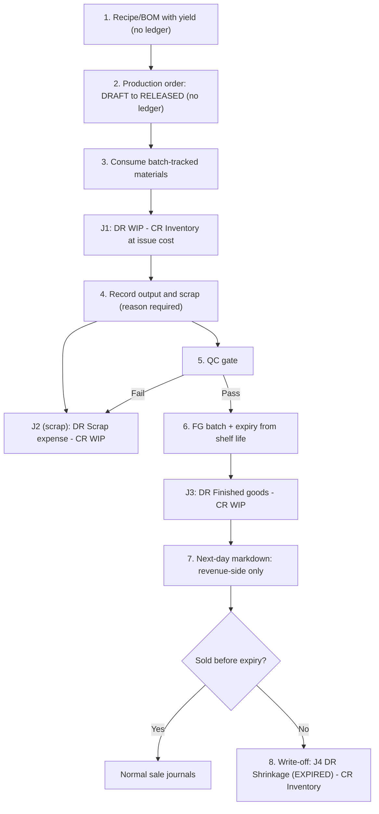
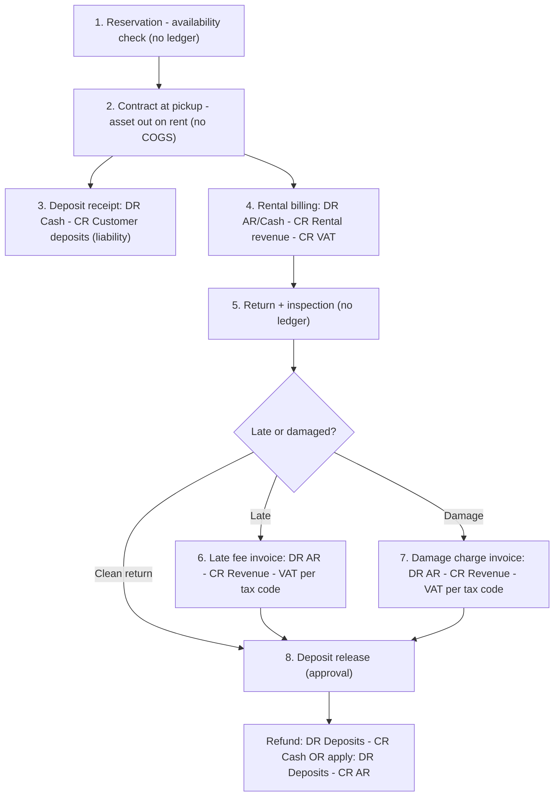
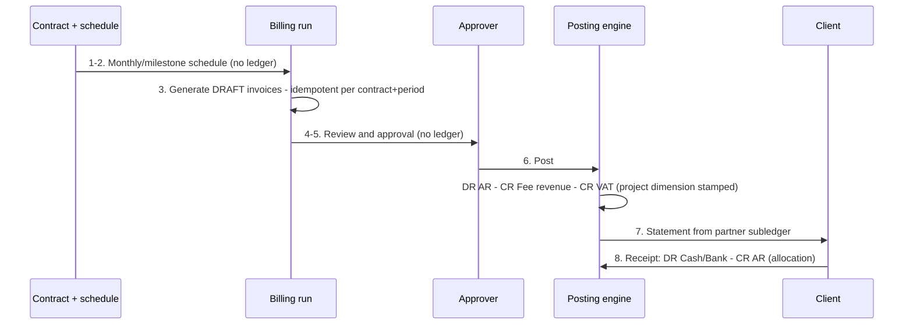

# Signature Industry Workflows

> **Status:** STABLE · **Owner:** Industry Solutions Architecture · **Updated:** 2026-10-27

Authoritative step lists, diagrams, and per-step accounting effects for the six signature
workflows (see [README.md](README.md) for conventions). Every journal below goes through the
central [posting engine](../../accounting/POSTING_ENGINE.md); stock effects go through the
[inventory module](../../accounting/INVENTORY_ACCOUNTING.md).

---

## (a) Restaurant: table order → kitchen → POS payment → Z close — PHASE-016

**Template:** [../templates/restaurant-cafe.md](../templates/restaurant-cafe.md)

1. **Open shift** — cashier/terminal opens with opening float. *No ledger effect* (treasury
   shift record only).
2. **Open table** — waiter selects table, order type (dine-in / takeaway سفري / delivery
   توصيل). *No ledger effect; floor-plan state only.*
3. **Add items** — menu items, combos (وجبات), modifiers (إضافات). *No ledger effect;
   basket is draft data.*
4. **Send to kitchen** — ticket printed (KDS screen on roadmap). *No ledger effect; kitchen
   queue only.*
5. **Repeat 3–4** for additional rounds; items merge on the same check.
6. **Print guest check (الحساب)** — pre-payment bill with optional service charge line
   (رسوم الخدمة, configurable rate, tax treatment via tenant tax code). *No ledger effect.*
7. **Payment** — cash, card, or split; `cash_sales_autopost` posts the POS invoice:
   - **Journal 1 (settlement):** DR cash/card-in-till · CR food & beverage revenue (net) ·
     CR VAT payable (per treatment).
   - **Journal 2 (COGS):** DR COGS · CR inventory — combo lines explode to components,
     each issued at its own cost from the FEFO-proposed batch
     ([../../accounting/INVENTORY_ACCOUNTING.md](../../accounting/INVENTORY_ACCOUNTING.md) §2).
   - Receipt prints (80/58 mm, AR/EN); table closes.
8. **End-of-day Z close (الإغلاق اليومي)** — shift closes blind-count:
   - Expected cash = opening float + cash sales + cash tips-like charges − refunds.
   - Variance: **Journal 3:** DR cash shortage expense (or CR cash overage income) vs the
     till cash account, approval-gated.
   - Bank drop / cash transfer to safe: **Journal 4:** DR safe/bank cash account · CR till
     cash account.
   - Z report prints (sales by order type, by tender, per shift).

---

## (b) Automotive: job card check-in → diagnosis → approval → work → invoice — PHASE-017

**Template:** [../templates/automotive-workshop.md](../templates/automotive-workshop.md)

1. **Check-in** — create job card (بطاقة عمل) linked to customer + vehicle (المركبة:
   make/model/VIN/odometer). *No ledger effect.*
2. **Diagnosis** — service advisor records complaints, adds estimated **labor lines
   (أجور العمل)** from the labor rate price list and **required parts lines**.
   *No ledger effect (draft).*
3. **Quotation** — generate a sales quotation (عرض التشخيص) from the card; validity
   policy (7 days default). *No ledger effect.*
4. **Customer approval** — accept converts the card to IN_PROGRESS:
   - Default policy `reserve`: parts are **reserved** against the card. *No ledger effect;
     availability hold only.*
   - Optional policy `issue_immediate`: parts issue now — **Journal 1:** DR COGS ·
     CR inventory at issue cost (WAC); the stock move references the job card.
5. **Work execution** — technicians log labor hours per line (billing data; actual labor
   cost is not tracked — no payroll). Parts consumption recorded against the card.
   *No additional ledger effect under `reserve` (stock already physically separated or
   still on shelf but reserved).*
6. **Invoice** — card completes into a sales invoice combining parts + labor:
   - **Journal 2 (revenue):** DR AR (credit customer) or cash · CR parts revenue ·
     CR labor/service revenue · CR VAT payable (per treatment).
   - Under `reserve`: **Journal 3 (COGS):** DR COGS · CR inventory for the issued parts.
   - Under `issue_immediate`: no second COGS (already posted at step 4).
7. **Payment** — receipt against the invoice: **Journal 4:** DR cash/bank · CR AR control
   (partner-tagged); FX difference rules apply if foreign currency.
8. **Warranty/return path (optional)** — warranty credit note references the original
   invoice: mirrors revenue/VAT journals; returned parts re-enter stock at **original
   issue cost**.

---

## (c) Distribution: van-sales day with settlement — PHASE-017 (offline at PHASE-022)

**Template:** [../templates/distribution-field-sales.md](../templates/distribution-field-sales.md)

1. **Morning load-out (التحميل الصباحي)** — stock transfer main warehouse → rep's van
   (VAN-type warehouse): two-leg transfer, in-transit visible. *No journal when valuation
   accounts are shared* (per
   [../../accounting/INVENTORY_ACCOUNTING.md](../../accounting/INVENTORY_ACCOUNTING.md) §2);
   branch-distinct accounts post DR van/branch inventory · CR main inventory.
2. **Rep shift opens** — the rep's session (a cashier shift on the rep cash account) with
   opening cash. *No ledger effect.*
3. **Route visits (خط السير)** — planned sequence of customers; each visit may include any
   of:
   - **Cash sale:** POS/field invoice, auto-posted — **Journal:** DR rep cash · CR revenue ·
     CR VAT payable; **COGS journal:** DR COGS · CR van stock inventory (FEFO batch for
     food items).
   - **Credit sale:** tier-resolved price (فئة العميل) + free goods (بضاعة مجانية, FOC
     lines issue stock and post COGS but zero revenue) — **Journal:** DR AR control
     (partner) · CR revenue · CR VAT; COGS as above. Credit limit enforced before save.
   - **Return:** credit note referencing the original invoice — mirrors revenue/VAT;
     stock re-enters the van at original cost; cash refund (if cash sale) credits rep cash.
   - **Collection (التحصيل):** receipt against open AR — **Journal:** DR rep cash ·
     CR AR control (partner) with allocation to invoices.
4. **Evening unload (التنزيل المسائي)** — transfer unsold stock van → main warehouse.
   *No journal (shared accounts); stock moves only.*
5. **Settlement (تسوية المندوب)** — rep counts cash; system computes expected:
   opening cash + cash sales + collections − cash refunds − approved rep expenses.
   - **Variance journal:** DR cash shortage expense · CR rep cash (shortage), or DR rep
     cash · CR overage income (surplus) — approval-gated, always posted, never netted.
   - **Bank deposit:** DR bank/main cash · CR rep cash.
   - Settlement document POSTED — locks the rep's day; later corrections are new
     documents.
6. **Commissions** — per rep per period from posted invoices/collections: accrual journal
   DR commission expense · CR commission accrual (payable) at run time, not per sale.

---

## (d) Bakery production: BOM → consume → finished goods + scrap → markdown — PHASE-018

**Template:** [../templates/food-manufacturing.md](../templates/food-manufacturing.md)

1. **Recipe (BOM الوصفة)** — define flour/yeast/packaging components with yield
   (المردود); versioned. *No ledger effect.*
2. **Production order (أمر الإنتاج)** — planned quantity of the finished good, planned
   date, line. DRAFT → RELEASED (number reserved). *No ledger effect yet.*
3. **Consume materials** — batch-tracked issue of flour etc.:
   - **Journal 1:** DR WIP · CR inventory (materials at issue cost, WAC/FIFO per item)
     ([../../accounting/POSTING_ENGINE.md](../../accounting/POSTING_ENGINE.md) §4).
   - Each consumption records the material batch id → genealogy edges.
4. **Record actual output & scrap (الهالك)**:
   - Scrap line with reason: **Journal 2:** DR production scrap expense · CR WIP.
   - Consumption variance beyond threshold (policy, default 5%) → review task; correction
     is an adjusted consumption, never a silent edit.
5. **QC gate (بوابة فحص الجودة)** — inspection on the FG batch; failed units → scrap
   (journal as step 4). *Passing inspection has no journal; it releases quarantine status.*
6. **Completion** — FG batch created with expiry = production date + shelf-life days:
   - **Journal 3:** DR finished goods inventory (at production cost) · CR WIP — WIP nets
     to zero for the order.
7. **Next-day expiry markdown** — near-expiry FG price-list override/promotion:
   *revenue-side only; COGS untouched.*
8. **Unsold expired write-off** — approval-gated adjustment:
   - **Journal 4:** DR shrinkage expense (reason `EXPIRED`) · CR inventory — batch retired.

---

## (e) Car rental: reservation → contract + deposit → return → charges → release — PHASE-019

**Template:** [../templates/rental-logistics.md](../templates/rental-logistics.md)

1. **Reservation (الحجز)** — pick asset (serial unit), dates, rate quote; availability
   calendar blocks overlapping rentals. *No ledger effect.*
2. **Contract at pickup (الاستلام)** — rental contract (عقد الإيجار) becomes active;
   number reserved at approval; asset status → "out on rent" (**stays in inventory value —
   no COGS at pickup**).
3. **Security deposit (مبلغ التأمين)** — receipt at pickup:
   - **Journal 1:** DR cash/bank · CR customer deposits (liability, partner-tagged).
   *Never revenue.*
4. **Rental billing** — daily-rate billing at return, or periodic invoices for long
   rentals (recurring billing, one invoice per contract-period):
   - **Journal 2:** DR AR (or cash) · CR rental revenue · CR VAT payable (per treatment).
5. **Return inspection (فحص الأضرار)** — odometer/fuel/damage checklist against the
   contract. *No ledger effect; findings feed charges.*
6. **Late fee (رسوم التأخير)** — after grace period (policy, e.g., 3 hours), late charge
   line/invoice: **Journal 3:** DR AR/cash · CR late-fee/other revenue · CR VAT per the
   tenant's tax code resolution.
7. **Damage charge** — inspection-backed charge invoice: **Journal 4:** DR AR/cash ·
   CR damage recovery revenue · CR VAT per tax-code resolution (the platform hard-codes no
   treatment for compensation-type charges).
8. **Deposit release** — manager approval (policy):
   - Full refund: **Journal 5a:** DR customer deposits · CR cash/bank.
   - Applied against charges: **Journal 5b:** DR customer deposits · CR AR control
     (partner, allocation to the charge invoices).
   - Deposit liability nets to zero; customer statement shows the full trail.

---

## (f) Service contract billing: milestone → draft invoice → approval → posting → statement — PHASE-019

**Template:** [../templates/professional-services.md](../templates/professional-services.md)
(also used by `rental_logistics` for periodic rental billing)

1. **Contract (عقد الخدمات)** — defines fee model: monthly retainer (أتعاب دورية), fixed
   fee milestones (دفعات مرحلية), or hourly billing against recorded time (تسجيل الوقت)
   with a case/project (القضية/المشروع) dimension. *No ledger effect.*
2. **Billing schedule** — contract lines expand into dated schedule entries (per month or
   milestone). *No ledger effect.*
3. **Billing run** — monthly job (or manual run) generates **DRAFT** invoices; idempotency
   guarantees one invoice per (contract, period) — re-runs never duplicate:
   - Retainer: fixed amount lines; hourly: unbilled time entries pulled into lines
     (narrative required by policy); milestone: the milestone amount.
4. **Review** — billing clerk reviews drafts (unbilled-time review policy; edits are
   draft-only and logged). *No ledger effect.*
5. **Approval** — invoice approval policy (required for this template):
   DRAFT → PENDING_APPROVAL → APPROVED. *No ledger effect.*
6. **Posting** — APPROVED → POSTED:
   - **Journal 1:** DR AR control (partner) · CR fee/service revenue (net) · CR VAT
     payable (per treatment); project/case cost-center dimension stamped on lines.
   - Partner subledger rows written in the same transaction
     ([../../accounting/POSTING_ENGINE.md](../../accounting/POSTING_ENGINE.md) §5).
7. **Customer statement (كشف الحساب)** — statement report from the partner subledger:
   invoices, receipts, outstanding; reconciles to AR control (INV-009/012).
8. **Receipt** — client pays: **Journal 2:** DR cash/bank · CR AR control (partner),
   allocation to invoices; late-fee terms (if contracted) generate charge lines the same
   way as workflow (e).

---

## Cross-workflow rules (normative)

- **Draft steps never post.** Anything before APPROVED/POSTED has zero ledger effect
  ([../../accounting/DOCUMENT_LIFECYCLE.md](../../accounting/DOCUMENT_LIFECYCLE.md) §2).
- **Corrections are new documents** — credit notes, reversals, adjustments — never edits
  of posted records (INV-003/006).
- **Every stock movement pairs with its journal in one transaction** (INV-018) — no
  workflow may stage one without the other.
- **Offline variants** (POS queue, PHASE-022 field sales) replay the same steps with
  client-generated UUIDs and offline numbers; the server performs approval, numbering, and
  posting on sync ([ADR-0012](../../architecture/ADR/ADR-0012-offline-sync.md)).
- Adding a step that posts something new to these workflows requires: posting-rule approval
  (accounting owner), expected-journal fixtures, and updates to this file and the relevant
  template — in that order.
