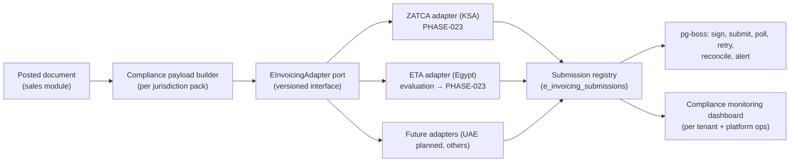

# E-Invoicing Architecture

> **Status:** STABLE (architecture) — implementations gated on verified official specifications · **Owner:** Tax & Compliance Architecture · **Updated:** 2026-10-27

Regulatory e-invoicing integration architecture. **Hard rule:** the Platform implements
no e-invoicing adapter against unverified assumptions, and never claims compliance or
certification without evidence (directive §6, §1.12–1.13). Implementation phase:
PHASE-023. Country statuses: [compliance-matrix/](compliance-matrix/README.md).

## 1. Isolation model

- The **core** (documents, posting, tax) never imports adapter details; adapters read
  documents and write submission records.
- Each adapter declares: supported document types, required fields, legal numbering
  interplay, cryptographic needs, submission modes, and a **verification checklist**
  (official specs used, version, dates, sandbox evidence).

## 2. Submission lifecycle (per document × adapter)

`PENDING` → `GENERATED` (payload built) → `SIGNED` (where applicable) → `SUBMITTED` →
`ACCEPTED` (reference/UUID stored) / `REJECTED` (reason codes; user action) →
`REPORTED` (for reporting-mode flows) — with retries (exponential, capped), dead-letter
alerting, and full audit. A document's **official validity never depends on local
state**: accepted-by-authority status is exactly what the registry says — nothing else
(directive §12).

## 3. ZATCA (Saudi Arabia) — architecture requirements

Scope per compliance matrix ([compliance-matrix/sa.md](compliance-matrix/sa.md)); the
adapter must support (as applicable to taxpayer segment and wave):

- **Generation phase features**: serialized invoices, QR (TLV-base64) encoding, invoice
  hash, anti-tampering, cryptographic stamp per official specifications.
- **Integration phase features**: standard invoices → **clearance**; simplified (B2C) →
  **reporting**; device/certificate enrollment; cryptographic signing with
  authority-issued certificates; submission APIs with UUIDs; handling of cleared
  XML/PDF requirements.
- **Numbering**: platform official numbers (ADR-0006) plus any authority-required
  counters (e.g., ICV) are stored as compliance payload fields — never replacing the
  platform's document identity.
- **Certificates/secrets**: highest-sensitivity handling per
  [../security/SECRETS_MANAGEMENT.md](../security/SECRETS_MANAGEMENT.md) — encrypted
  storage, signing-job-only access, usage audit, expiry monitoring.

**Verification gate (checklist before writing adapter code)**: official ZATCA
specifications/SDK version pinned; sandbox environment exercised; sample invoices
validated; legal review of invoice-content requirements per current official docs. Any
item that cannot be verified is implemented as an explicit `UNVERIFIED` stub that
refuses to submit — never guessed (RISK-005).

## 4. Egypt (ETA) — evaluation track

Egypt operates mandatory e-invoice (B2B) and e-receipt systems
([compliance-matrix/eg.md](compliance-matrix/eg.md)). The adapter follows the same port;
implementation begins only after: official API documentation review, certificate
enrollment process confirmation, and a decision record approving scope (RISK-007).

## 5. Other jurisdictions

- UAE: e-invoicing is planned (not yet mandatory as of the research date) — pack carries
  `VAT_PLANNED_EINVOICING` status and the adapter slot remains dormant until official
  specs exist ([compliance-matrix/ae.md](compliance-matrix/ae.md)).
- All packs without e-invoicing regimes: the payload builder still produces
  compliance-ready archives (signed PDFs locally, structured data) so tenants can export
  if regulators later require retroactive submission — clearly labeled non-authoritative.

## 6. Data model (summary)

`e_invoicing_submissions(tenant, doc_type, doc_id, adapter_id, payload_ref, status,
attempts, last_error, authority_refs JSONB, submitted_at, accepted_at, raw_response_ref,
created/updated...)` — full columns in [../database/TABLES/tax-compliance.md](../database/TABLES/tax-compliance.md).
Raw payloads/responses stored as encrypted files (tenant-scoped signed URLs) for audit;
retention per pack policy.

## 7. Monitoring & operations

- Dashboards: submission funnel (pending/failed/rejected by reason), latency, sandbox vs
  production health, certificate expiry countdowns.
- Runbook entries: rejection triage, certificate rotation, spec-version upgrades
  ([../operations/TROUBLESHOOTING.md](../operations/TROUBLESHOOTING.md) §e-invoicing).
- Any spec change by an authority → pack version bump + adapter release note + staged
  rollout (submission modes are versioned per ADR-0010).
