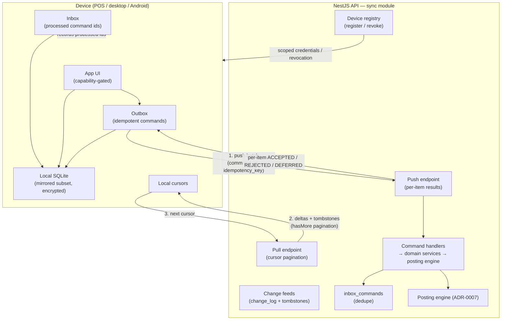

# Offline Architecture

> **Status:** STABLE · **Owner:** Offline & API Architecture · **Updated:** 2026-10-27

The architecture of offline capability for the Platform: what works without
connectivity, on which devices, against which local store, and how it reconciles with the
server-authoritative core. This document is the umbrella; the normative contracts live in
the companion documents below. Binding decisions:
[ADR-0012](../architecture/ADR/ADR-0012-offline-sync.md) (SQLite + outbox/inbox, no
replication, no last-write-wins for financial data),
[ADR-0007](../architecture/ADR/ADR-0007-centralized-posting-engine.md) (server-authoritative
posting), [ADR-0006](../architecture/ADR/ADR-0006-identifiers.md) (UUIDv7 client-generated
ids), [ADR-0009](../architecture/ADR/ADR-0009-money-precision.md) (decimal-string money).

**Phasing:** the POS offline sale queue ships a **scoped subset** in PHASE-016; the
**generalized sync foundation** lands in PHASE-020; the desktop (PHASE-021) and Android
(PHASE-022) clients consume the generalized foundation. MVP (PHASE-014) is online-only.

## 1. Goals

1. **Business continuity without connectivity.** A shop's POS keeps selling, a field rep
   keeps collecting and selling from a van, an owner keeps reading statements — through
   network outages, with zero data loss and zero double-counted money.
2. **Server remains authoritative.** Finalization (approval, posting, official numbering —
   [ADR-0007](../architecture/ADR/ADR-0007-centralized-posting-engine.md),
   [ADR-0006](../architecture/ADR/ADR-0006-identifiers.md)) happens ONLY on the server, in
   one transaction, at most once per operation.
3. **Honest local state.** What exists locally is labeled truthfully; nothing local ever
   implies official acceptance (§5, [../accounting/DOCUMENT_LIFECYCLE.md](../accounting/DOCUMENT_LIFECYCLE.md) §4).
4. **Exactly-once financial effects** across retries, duplicates, crashes, and device
   replacement (idempotency keys + inbox dedupe — [IDEMPOTENCY_AND_RETRIES.md](IDEMPOTENCY_AND_RETRIES.md)).
5. **Typed, actionable conflicts.** Rejections carry stable reason codes the UI can turn
   into specific user actions ([CONFLICT_RESOLUTION.md](CONFLICT_RESOLUTION.md)).
6. **Per-device minimal data.** Each device class mirrors only the subset of the server
   schema it needs ([LOCAL_DATABASE.md](LOCAL_DATABASE.md)) — attack surface and sync
   bandwidth stay proportional to the device's job.

## 2. Non-goals (explicit)

- **No database replication.** PostgreSQL-to-client replication of any form is forbidden
  (directive §1.18, ADR-0012). Sync is an application protocol over typed commands and
  ordered change feeds — never table dumps or log shipping.
- **No last-write-wins for financial data.** Documents, journals, stock, receipts, price
  changes are validated against server state; clients never overwrite server truth.
- **No offline general ledger.** Journal entries, approvals, posting, period operations,
  and administrative actions are online-only (§3).
- **No peer-to-peer collaboration.** Two offline devices never sync with each other; all
  convergence goes through the server.
- **No offline regulatory claims.** E-invoicing and other regulated submissions are
  online-only adapter flows ([../localization/E_INVOICING_ARCHITECTURE.md](../localization/E_INVOICING_ARCHITECTURE.md));
  local state NEVER implies authority acceptance.
- **No full back office offline.** The desktop app caches and drafts; it is not a
  disconnected replica of every module.

## 3. The capability model (normative classification)

Every offline-facing operation is classified into exactly one of four capability classes.
The authoritative per-operation assignment is the
[OFFLINE_CAPABILITIES_MATRIX.md](OFFLINE_CAPABILITIES_MATRIX.md); this section defines the
classes. Class assignment is a specification decision, not an implementation detail —
adding an operation to a class requires a decision record.

| Class | Definition | Server involvement | Local state shown | Examples |
|-------|-----------|--------------------|-------------------|----------|
| **OFFLINE-COMPLETE** | The operation fully completes locally; the business moment (goods handed over, cash in drawer) happens offline. Queued as an idempotent command; server replays it during sync and assigns official effects. | Replays + validates at sync; assigns official number + ledger effect at that point | `PENDING_SYNC` → `POSTED` (or `REJECTED` with typed reason) | POS sale with local receipt; POS cash collection; van stock issue |
| **OFFLINE-DRAFT** | The operation creates/edits a draft only. No local effect beyond the draft is ever claimed. | Creates the draft at sync; approval/posting strictly online | `DRAFT_LOCAL` → `DRAFT` (server-known) | Sales invoice draft, quotation draft, delivery note draft, stock count entry |
| **LOCALLY-VALIDATED-PENDING-SERVER** | Like OFFLINE-DRAFT, but the client runs local pre-validation (price list check, stock snapshot check, tax snapshot computation) so the user gets immediate feedback; the server decision is still final and may reject at sync. | Same as OFFLINE-DRAFT + server re-validates everything the client validated | `DRAFT_LOCAL (validated)` → `DRAFT` / `REJECTED` | Credit-limit-warned invoice draft on a field device; van-sale order against van stock snapshot |
| **ONLINE-ONLY** | The operation requires a live server connection; no offline path exists, none is simulated. | Live, transactional | n/a (UI disables it with a clear reason) | Posting, approval, period close/open, journal entries, admin actions, entitlement changes, regulated submissions |

**Rules:**

1. A capability class NEVER upgrades without a decision record; the matrix is the single
   source of truth consumed by UI gating and tests.
2. OFFLINE-COMPLETE is reserved for operations whose business moment is unavoidably local
   (cash-and-carry retail). It is not a convenience tier for back-office operations.
3. LOCALLY-VALIDATED is a UX tier, not a correctness tier: local validation output is
   advisory ("price OK against cached list"), never authoritative.
4. Every OFFLINE-COMPLETE / OFFLINE-DRAFT / LOCALLY-VALIDATED operation must declare, in
   the matrix: its conflict policy and its post-sync state machine.

## 4. Device classes

| Device class | Platform | Primary users | Offline posture | Typical connectivity |
|--------------|----------|---------------|-----------------|----------------------|
| **POS terminal** | Tauri desktop (PHASE-016/021) or browser on POS hardware; registered per `pos_terminals` row | Cashiers | OFFLINE-COMPLETE for sales/collections; must survive full-day outages | Store LAN/ADSL with frequent drops |
| **Desktop application** | Tauri, Windows-first ([ADR-0013](../architecture/ADR/ADR-0013-tauri-desktop.md)) | Owners, accountants, back office | OFFLINE-DRAFT + READ-CACHED; the web ERP rendered in the shell with local cache | Mostly online; offline is a degrade mode |
| **Android field app** | Expo / React Native ([ADR-0014](../architecture/ADR/ADR-0014-android-expo.md)) | Van-sales reps, collectors | OFFLINE-COMPLETE for van sales/collections; LOCALLY-VALIDATED drafts | Cellular; offline for hours on routes |
| **Personal-account mobile app** | Expo (same app, restricted role) | Tenants' customers/suppliers | READ-CACHED only (statements, invoices, balances); no offline writes | Consumer mobile |

The Android app serves both field users and personal accounts; the device class differs by
role scope granted at device registration, not by build.

## 5. State honesty principle (normative)

1. Local records that have not been accepted by the server carry explicit local statuses:
   `PENDING_SYNC`, `DRAFT_LOCAL`, `SYNC_FAILED`. These are rendered distinctly from server
   statuses and NEVER as `POSTED`/`APPROVED`-equivalent badges (directive §12; ADR-0012).
2. Documents printed offline (POS receipts) print the **offline receipt number**
   (`OFF-…`) plus a "pending synchronization" notice; the official invoice number is
   printed nowhere until the server assigns it
   ([../accounting/DOCUMENT_LIFECYCLE.md](../accounting/DOCUMENT_LIFECYCLE.md) §4).
3. Amounts shown from cached read models are labeled with their as-of cursor/timestamp
   ("balance as of last sync") — stale data is honest data when labeled.
4. A locally completed sale is a **business fact** (goods left, cash entered the drawer)
   but not yet an **accounting fact**; the UI copy distinguishes these.
5. Rejected commands return documents to editable state with typed reasons — never a
   silent merge, never a silent drop ([CONFLICT_RESOLUTION.md](CONFLICT_RESOLUTION.md) §3).

## 6. Local stack per platform

One logical local store (SQLite), one sync protocol, three physical stacks:

| Concern | Desktop / Tauri | Android (Expo) | Browser (web ERP) |
|---------|-----------------|----------------|-------------------|
| SQLite driver | `better-sqlite3` via Drizzle in the Tauri sidecar/plugin process | `expo-sqlite` via Drizzle adapter | none — the web app is online-only at MVP; no service-worker write cache |
| Encryption at rest | SQLCipher (Tauri SQL plugin) | SQLCipher via expo driver, or OS-encrypted app sandbox + SQLCipher | n/a (no local writes) |
| Credentials | OS keychain via Tauri plugin | Expo SecureStore (Android keystore) | httpOnly session cookie only |
| Sync engine | shared `packages/sync-core` (TypeScript) | same `packages/sync-core` | n/a |
| Migrations | `packages/sync-core/migrations` (SQLite dialect) | same, applied at app start | n/a |

`packages/sync-core` is shared TypeScript consumed identically by desktop and Android
([ADR-0002](../architecture/ADR/ADR-0002-typescript-monorepo.md)); only the driver adapter
and scheduling differ. Details: [LOCAL_DATABASE.md](LOCAL_DATABASE.md).

## 7. Server-side sync module

A `sync` module in the NestJS API (part of the modular monolith) owns the server half:

| Component | Responsibility | Storage (see [../database/ENTITY_CATALOG.md](../database/ENTITY_CATALOG.md)) |
|-----------|----------------|------------------------------------------------------------------------------|
| **Device registry** | Registration, attestation-lite, scoped credentials, revocation | `devices`, `sessions` (web), device tokens |
| **Change feeds** | Ordered, per-tenant log of entity changes for pull | `change_log` (seq), `tombstones` |
| **Cursors** | Per-device, per-entity-type pull positions | `sync_cursors` |
| **Push endpoint** | Batched command execution with per-item ACCEPTED / REJECTED / DEFERRED | `inbox_commands` (dedupe) |
| **Command handlers** | Module-owned executors that run domain services (never raw table writes) | module tables via posting engine where financial |
| **Maintenance jobs** | Tombstone cleanup, cursor compaction, inbox retention (pg-boss, [ADR-0008](../architecture/ADR/ADR-0008-jobs-redis.md)) | `boss` schema jobs |

The sync module never bypasses domain services: a pushed `pos.sale.create` command calls
the sales module service, which calls the posting engine — exactly like an online request
([../architecture/DATA_FLOW.md](../architecture/DATA_FLOW.md) §6). Sync adds transport, not
a second business-logic path.

## 8. Overview

Full connect → pull → push → ack sequence with failure paths:
[SYNC_PROTOCOL.md](SYNC_PROTOCOL.md) §9.

## 9. What is explicitly NOT supported

| Not supported | Rationale / instead |
|---------------|---------------------|
| Multi-user peer merge (two offline users co-editing, device-to-device sync) | All convergence is server-mediated; drafts have exactly one owner device ([CONFLICT_RESOLUTION.md](CONFLICT_RESOLUTION.md) §6) |
| Offline administration (user/role/entitlement/plan changes) | ONLINE-ONLY; permission snapshot is cached read-only ([SECURITY_AND_DEVICE_MANAGEMENT.md](SECURITY_AND_DEVICE_MANAGEMENT.md) §5) |
| Offline period close / open, fiscal-year operations | ONLINE-ONLY; period state gates posting server-side (INV-011) |
| Offline posting or journal entry | ONLINE-ONLY; the posting engine is the only GL writer and runs server-side ([../accounting/POSTING_ENGINE.md](../accounting/POSTING_ENGINE.md)) |
| Offline official numbering (except the documented POS offline receipt scheme) | Official numbers are assigned by server sequences at finalization (ADR-0006); POS `OFF-…` numbers reconcile 1:1 later |
| Offline e-invoicing / regulated submissions | ONLINE-ONLY adapter flows; authority acceptance is never inferred from local state |
| Field-level auto-merge of financial documents | Forbidden; financial documents use server-decision policy, never LWW (ADR-0012) |
| Reading another device's pending (unsynced) work | Impossible by construction: unsynced work exists only in the originating device's outbox |

## 10. Document map & phase mapping

| Document | Scope |
|----------|-------|
| [LOCAL_DATABASE.md](LOCAL_DATABASE.md) | Local schema strategy, migrations, encryption, retention, crash recovery |
| [SYNC_PROTOCOL.md](SYNC_PROTOCOL.md) | Registration, pull/push contracts, ordering, retries, triggers, POS subset boundary |
| [CONFLICT_RESOLUTION.md](CONFLICT_RESOLUTION.md) | Per-entity-type policies, rejection UX, stale versions, clock skew, draft ownership |
| [IDEMPOTENCY_AND_RETRIES.md](IDEMPOTENCY_AND_RETRIES.md) | End-to-end exactly-once model and duplicate-delivery scenarios |
| [SECURITY_AND_DEVICE_MANAGEMENT.md](SECURITY_AND_DEVICE_MANAGEMENT.md) | Device trust, credentials, revocation, permission snapshot, lost-device playbook |
| [OFFLINE_CAPABILITIES_MATRIX.md](OFFLINE_CAPABILITIES_MATRIX.md) | The authoritative operation × device-class matrix (directive §12) |
| [FAILURE_RECOVERY.md](FAILURE_RECOVERY.md) | Scenario playbook for crashes, corruption, revocation, contract skew |

| Phase | Offline scope |
|-------|---------------|
| PHASE-014 (MVP) | None — online-only web ERP |
| PHASE-016 (POS) | Scoped subset: offline sale queue, single-entity push, offline receipts (see [SYNC_PROTOCOL.md](SYNC_PROTOCOL.md) §11) |
| PHASE-020 (sync foundation) | Generalized protocol: device registry, change feeds, cursors, all conflict policies, chaos tests |
| PHASE-021 (desktop) | Tauri shell + local cache + draft sync |
| PHASE-022 (Android) | Field sales + personal accounts on the same foundation |
