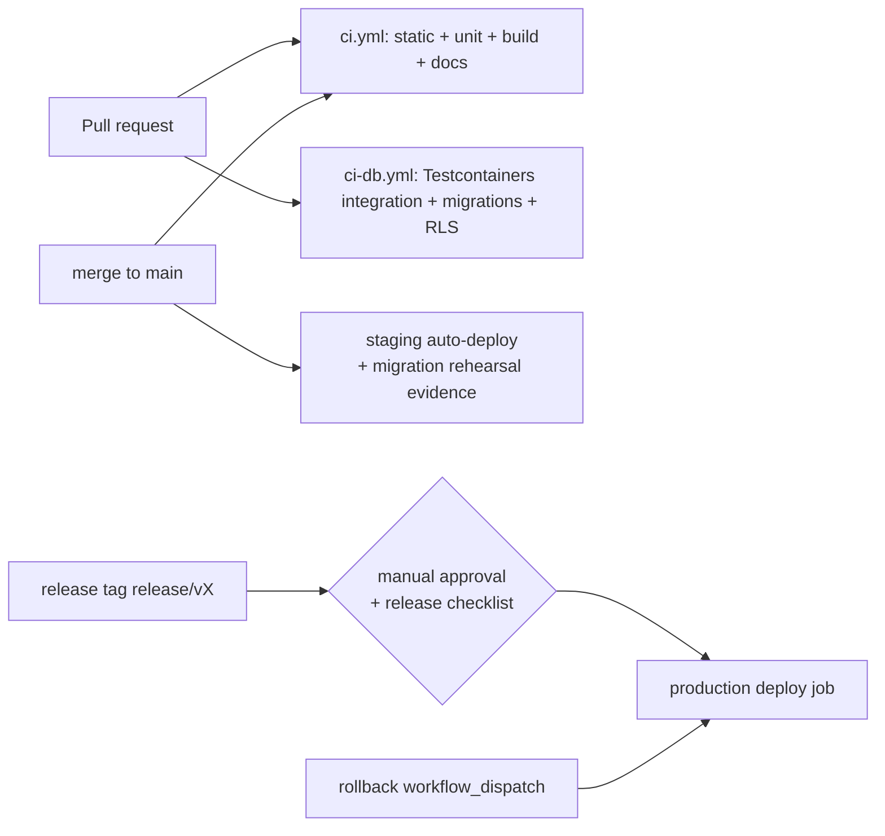

# CI/CD Pipeline

> **Status:** STABLE · **Owner:** Platform Operations · **Updated:** 2026-10-27

Specification of the GitHub Actions pipeline: jobs, gates, branch policies, artifacts,
deployment promotion, and rollback. Jobs land with PHASE-001/PHASE-002
([../implementation/phases/PHASE-001.md](../implementation/phases/PHASE-001.md),
[../implementation/phases/PHASE-002.md](../implementation/phases/PHASE-002.md)); later
gates attach as their phase ships. Release tiers and quality gates:
[../planning/RELEASE_STRATEGY.md](../planning/RELEASE_STRATEGY.md).

## 1. Pipeline shape

PR feedback budget: ≤ 8 min for `ci.yml`, ≤ 15 min for `ci-db.yml` (PHASE-001 §6 targets).
Both must be green before merge; neither may be skipped except via `docs-only` paths rules
(§6).

## 2. Job specification

| Job | Introduced | What it proves | Key details |
|-----|------------|----------------|-------------|
| `install` | PHASE-001 | Deterministic dependency install | pnpm fetch + frozen lockfile; store cache keyed by lockfile hash |
| `typecheck` | PHASE-001 | Strict TS compiles everywhere | `turbo typecheck`; no `any` escapes, strict base config |
| `lint` | PHASE-001 | Style + **boundaries** hold | ESLint (+ boundary rules + import rules) + Prettier + **dependency-cruiser** ([../architecture/DEPENDENCY_RULES.md](../architecture/DEPENDENCY_RULES.md)); includes the **negative meta-test**: a fixture importing across a forbidden boundary must fail lint — CI asserts the failure occurs |
| `unit` | PHASE-001 | Domain logic correct | `turbo test`; domain-core money/UUIDv7 property tests included |
| `docs-validation` | PHASE-001 | Blueprint integrity | `scripts/validate-docs.py`: markdown link checker, 29-section phase-heading check, roadmap↔phases table match, schema-catalog drift hook stub (PHASE-002 makes it real) |
| `gitleaks` | PHASE-001 | No secrets in repo | Full-history scan on PR diff + scheduled full scan; failure = hard fail, rotate-then-clean rule applies |
| `build` | PHASE-001 | All packages/apps build | `turbo build` |
| `integration` | PHASE-002 | Code works against real PostgreSQL | Testcontainers PG16 per job: repositories, posting-engine paths, RLS behavior |
| `migration-smoke` | PHASE-002 | Migrations are safe | (a) apply **all** migrations on a fresh PG16 from scratch; (b) apply new migrations on the **previous released schema** snapshot (regression); (c) assert sequential manifest order |
| `rls-catalog` | PHASE-002 | Isolation + docs stay honest | `scripts/check-rls.ts`: every tenant-owned table has RLS policy + composite tenant FK (negative probe required to fail); docs-schema check fails when a migration creates a tenant-owned table without an [ENTITY_CATALOG](../database/ENTITY_CATALOG.md) entry |
| `docker-build-scan` | PHASE-002 | Images are buildable & clean | Builds `api` image (= worker image, same artifact) and `web` image; SBOM generation + vulnerability scan; scan findings above policy block promotion |
| `openapi-diff` | PHASE-003 (first published spec) | API contract changes are deliberate | Regenerate OpenAPI from code; diff vs committed spec; breaking changes fail unless the PR carries a versioning decision per [../api/API_VERSIONING.md](../api/API_VERSIONING.md); spec artifact published for consumers |
| `e2e` | PHASE-005 onward | User flows work | Compose-based staging-like environment (Playwright): AR+EN visual runs, tenant-isolation suite, accounting invariants suite in later phases |

Notes:

- **Testcontainers jobs require Docker**; they run on runners with nested virtualization.
- `integration`, `migration-smoke`, `rls-catalog` live in `ci-db.yml` so the static loop
  stays fast.
- The `e2e` job grows per phase (visual regression at PHASE-005, posting golden datasets
  at PHASE-007, isolation attack suite at PHASE-003 as API-level tests).
- CI never talks to staging or production. Deployment is a separate workflow (§5).

## 3. Branch policies

| Policy | Rule |
|--------|------|
| Protected branch | `main` — no direct pushes, no force pushes, deletions blocked |
| PR requirement | All changes via PR; squash-merge only; linear history |
| Reviews | ≥ 1 approval **and** CODEOWNERS-required reviewers for touched paths (`apps/api`, `packages/domain-core`, `docs/database/`, `docs/accounting/`, `.github/` have owners) |
| Required checks | `install`, `typecheck`, `lint`, `unit`, `build`, `docs-validation`, `gitleaks`, and — once introduced — `integration`, `migration-smoke`, `rls-catalog`, `openapi-diff` |
| Concurrency | One deploy pipeline at a time per environment; PR runs cancel on new pushes |
| Tags | Every completed phase → `phase/NNN`; every release → `release/vX` (CalVer `v1.YY.MM.patch` per [../planning/RELEASE_STRATEGY.md](../planning/RELEASE_STRATEGY.md)); tags are protected |
| Merge queue | Adopt when PR volume makes `main` flaky; not before it's needed |

## 4. Artifacts

| Artifact | Naming / retention | Notes |
|----------|--------------------|-------|
| API/worker image | `erp-api:sha-<short>` (all pushes); `erp-api:v<CalVer>` (release tags) | **One image serves api + worker** (`WORKER_MODE=1` selects role); registry retention keeps every release tag + last 30 shas |
| Web image | `erp-web:sha-<short>` / `erp-web:v<CalVer>` | Same policy |
| SBOM | Attached to image; retained with image | Consumed by `docker-build-scan` and release checklist |
| OpenAPI spec | `openapi.json` committed at `apps/api/openapi.json` + workflow artifact | The committed file is the diff baseline; regenerated by `openapi-diff` job |
| Test reports | JUnit + coverage uploaded per run; 90-day retention | Coverage trends reviewed at phase boundaries, not gating MVP |
| Release bundle | Notes generated from `CHANGELOG.md` entries; bilingual (AR/EN) | Per release communication rules |

## 5. Staging auto-deploy (on `main`)

When the staging environment exists (provisioned ahead of the first production release —
MVP window, end of PHASE-014), every merge to `main` deploys to staging automatically:

1. Build images from the merged sha; push with `sha-<short>` tag.
2. Run the **staging migration job** (`erp_migrate` role) — this doubles as the **migration
   rehearsal** required before any production deploy; the run link is the evidence artifact.
3. Rolling restart `api` → `web` → `worker` with health gates
   ([DEPLOYMENT.md](DEPLOYMENT.md) §3).
4. Post-deploy smoke on staging (health endpoints, login, invoice draft).
5. Evidence stored: workflow run URL + migration job log — referenced by the next
   production promotion.

Until staging exists, `main` deploys nowhere: developer machines and CI are the only
runtime targets (PHASE-001/002 scope).

## 6. Production deploy gate

Production deploys are **manual, tagged, and evidenced**. The promotion workflow requires:

| Gate | Evidence |
|-----|----------|
| CI green on the exact release tag | All required checks green; no skipped security jobs |
| Migration rehearsal on staging | Successful staging migration run **≤ 7 days old**, same migration set (auto-verified by comparing migration manifest hashes) |
| Backups fresh | Last nightly backup < 24 h + last restore-smoke green ([BACKUP_RESTORE_RUNBOOK.md](BACKUP_RESTORE_RUNBOOK.md) §3) |
| Release checklist | Per [../planning/RELEASE_STRATEGY.md](../planning/RELEASE_STRATEGY.md) §Quality gates: security checklist, performance smoke, docs freeze (IMPLEMENTATION_STATUS + CHANGELOG updated) |
| Rollback identified | Previous release tag recorded in the deploy ticket |
| Approval | Human approval on the `production` GitHub environment (named approvers per CODEOWNERS; approval recorded in the run) |

Breaking-change rule: a release containing API breaking changes must show the deprecation
window and offline-client compatibility statement (never break offline clients
mid-rollout — RELEASE_STRATEGY §Rollout).

## 7. Rollback job (application-level)

`rollback` is a `workflow_dispatch` workflow with inputs `environment` and `image_tag`:

1. Guard: `image_tag` must be a previously released tag (registry-verified).
2. Redeploy that image to the target environment **without running migrations** — safe
   because migrations are forward-only expand-contract: the previous image is compatible
   with the current schema ([../database/MIGRATION_STRATEGY.md](../database/MIGRATION_STRATEGY.md) §4).
3. Health gates + smoke tests as in a normal deploy.
4. Contract-step migrations (drops) are never in the same release that serves traffic, so
   schema/app skew cannot block rollback.
5. Data-level problems are **not** rollback candidates — they route to the incident and
   PITR decision tree ([DEPLOYMENT.md](DEPLOYMENT.md) §5).

## 8. Secrets in CI

- **OIDC federation** to the cloud secret store, container registry, and deployment target;
  no long-lived personal access tokens, no deploy keys shared with humans.
- Environment-scoped secrets (`staging`, `production`) readable only by their workflows +
  approval gates.
- gitleaks guards the repo itself (PR diff + weekly full scan).
- CI logs are scrubbed: masked variable set maintained alongside the zod config schema;
  job summaries never echo env values.

## 9. Badge & status conventions

- Repository `README.md` carries: CI badge (`ci.yml`), DB-CI badge (`ci-db.yml`), docs
  badge (`docs-validation`), and — from MVP — a staging-deploy badge. Badge links point to
  the workflow, not a branch, so history is inspectable.
- Check names are part of the contract: branch protection references them exactly; renaming
  a check requires a paired branch-protection update in the same PR (callout in the PR
  template).
- Skips are visible: `paths-ignore` is limited to `docs/**` and markdown-only edits; any
  skipped security job (gitleaks, rls-catalog) shows as "expected — docs-only", not as a
  silent pass.
