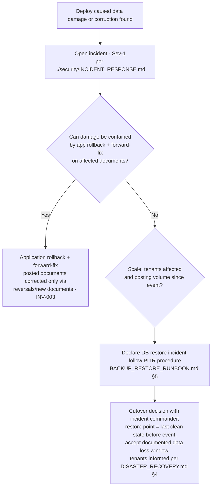

# Deployment Runbook

> **Status:** STABLE · **Owner:** Platform Operations · **Updated:** 2026-10-27

How the Platform is deployed to staging and production: pre-flight checks, the deploy
sequence, migration safety, rollback, and first-deploy bootstrap. Topology and release
policy: [../architecture/DEPLOYMENT_ARCHITECTURE.md](../architecture/DEPLOYMENT_ARCHITECTURE.md),
[../planning/RELEASE_STRATEGY.md](../planning/RELEASE_STRATEGY.md). Pipeline mechanics:
[CI_CD.md](CI_CD.md).

**Topology reminder:** LB → `web` (Next.js) ×N and `api` (NestJS) ×N → managed PostgreSQL
16; `worker` = the same image as `api` with `WORKER_MODE=1`. Migrations run as a pre-deploy
job under the `erp_migrate` role; **failed migration = abort, not rollback**
([../database/MIGRATION_STRATEGY.md](../database/MIGRATION_STRATEGY.md)).

> Command convention: the runbook uses `deploy/compose.prod.yml` (a compose file whose
> services `api`, `web`, `worker`, `migrate` reference the single release image with env
> injected from the secret store). If the hosting layer at MVP provisioning (PHASE-014
> window) uses instance templates or another orchestrator, only the *restart primitive*
> changes — the gates, order, and abort criteria below are the contract.

## 1. Pre-flight checklist

Every production deploy, no exceptions:

| # | Check | Evidence |
|---|-------|----------|
| 1 | CI green on the release tag (all required checks) | Workflow run link |
| 2 | Migration rehearsal on staging succeeded, same migration set, ≤ 7 days old | Staging deploy run link ([CI_CD.md](CI_CD.md) §5) |
| 3 | Backups fresh: last nightly dump < 24 h; last restore-smoke green; PITR window healthy | [BACKUP_RESTORE_RUNBOOK.md](BACKUP_RESTORE_RUNBOOK.md) §2–3 output |
| 4 | Rollback image identified (previous release tag) + rollback job dry-verified | Deploy ticket |
| 5 | Release checklist complete (security, perf smoke, docs freeze, CHANGELOG) | [../planning/RELEASE_STRATEGY.md](../planning/RELEASE_STRATEGY.md) §Quality gates |
| 6 | Comms drafted: deploy window notice + release notes (AR/EN) ready | Deploy ticket |
| 7 | On-call informed; deploy happens inside announced window | Ops channel message |
| 8 | Contract-step migrations in this release? If yes → **stop**: contract steps run only after two successful releases of the expand phase ([../database/MIGRATION_STRATEGY.md](../database/MIGRATION_STRATEGY.md) §3) | Migration manifest review |

## 2. Deploy sequence

```bash
# 0. Freeze: no other deploy in flight; announce start.
TAG=v1.26.10.0            # the approved release tag
PREV=$(<deploy/previous_release_tag)   # rollback target, recorded in ticket

# 1. Pull the release image on every node (LB still serves old pods).
docker compose -f deploy/compose.prod.yml pull api web worker

# 2. Run the migration job (one-off, erp_migrate role). THIS IS THE GATE:
#    non-zero exit = ABORT the deploy. Do not roll back the database.
docker compose -f deploy/compose.prod.yml run --rm migrate

# 3. Rolling-restart api nodes one at a time, health gate between each:
docker compose -f deploy/compose.prod.yml up -d --no-deps --scale api=2 api
for node in api_1 api_2; do
  curl -fsS "http://$node:3001/health/ready" || { echo "GATE FAILED: $node"; exit 1; }
done

# 4. Rolling-restart web behind the LB (LB health check drives readiness).
docker compose -f deploy/compose.prod.yml up -d --no-deps web

# 5. Restart the worker LAST (jobs resume after the data layer is stable).
docker compose -f deploy/compose.prod.yml up -d --no-deps worker

# 6. Verify: worker heartbeat fresh, queues draining, LB pools green.
curl -fsS http://api-node:3001/health/ready
docker compose -f deploy/compose.prod.yml exec postgres psql -U erp_readonly -d erp \
  -c "SELECT state, count(*) FROM boss.job GROUP BY state;"
```

Smoke tests (after step 6, before announcing success):

```bash
# a. Health endpoints from the LB (public path)
curl -fsS https://<host>/api/health/live && curl -fsS https://<host>/api/health/ready

# b. Login flow (test account from the deploy credentials entry)
curl -fsS -X POST https://<host>/api/v1/auth/login \
  -H 'content-type: application/json' -d '{"email":"…","password":"…"}'

# c. Tenant-scoped write path: create an invoice DRAFT (never post in smoke)
curl -fsS -X POST https://<host>/api/v1/sales/invoices \
  -H "authorization: Bearer $SMOKE_TOKEN" -H 'x-tenant-id: …' \
  -d '{"branch_id":"…","kind":"CREDIT"}'   # → id returned; status DRAFT expected

# d. Web renders (locale both directions)
curl -fsS https://<host>/ | grep -q 'dir="rtl"' || echo "CHECK RTL DEFAULT"
```

Announce completion (done + evidence links); record `PREV=$TAG` into
`deploy/previous_release_tag`; open the post-deploy watch window (60 min) with elevated
alert attention ([MONITORING.md](MONITORING.md) §3).

## 3. Database migration safety

- **Expand-contract always**: add nullable columns/new tables/`CREATE INDEX CONCURRENTLY`/
  `NOT VALID`→`VALIDATE` constraints in the expand step; dual-read code while both shapes
  exist; drops only in a later release ([../database/MIGRATION_STRATEGY.md](../database/MIGRATION_STRATEGY.md) §3).
- **Lock-time awareness for big tables** (any table projected > 1M rows by load-test
  baselines: `journal_lines`, `stock_moves`, `change_log`):
  - Indexes on hot tables: `CREATE INDEX CONCURRENTLY` (cannot run inside the migration
    transaction — the migration runner must support non-transactional steps; document each
    such step in the migration header).
  - Constraint additions: `NOT VALID` first, `VALIDATE` in a later step.
  - Backfills: batched (≤ 10k rows per batch with sleeps), resumable, run as a **post-deploy
    job**, never inline in the deploy-critical migration.
  - Never `ALTER TABLE … SET NOT NULL` / type-swap / precision-shrink on a hot table in a
    release deploy (add + backfill + swap per migration strategy).
- **Abort criteria** — any of these stops the deploy (app keeps running the previous
  image; the migration is fixed forward or the deploy is postponed):
  1. Migration job exits non-zero.
  2. Migration exceeds the time budget recorded in its PR (locking risk assessment —
     [../database/MIGRATION_STRATEGY.md](../database/MIGRATION_STRATEGY.md) §5).
  3. Lock waits observed on the hot tables:
     `SELECT pid, relation::regclass, wait_event_type FROM pg_stat_activity WHERE wait_event_type='Lock';`
  4. API error rate or readiness flaps during the rolling restart window.
- A partially applied **expand** migration is safe (old code ignores new shapes); a failed
  migration is analyzed, fixed forward, and re-run — never reverted with a hand-written
  down script.

## 4. Rollback procedure (application-level)

1. Declare intent in the ops channel; identify the trigger:
   - **Behavioral regression** (errors, latency, broken flows) → app-level rollback.
   - **Data integrity problem** (wrong ledger effects, corruption) → do NOT just roll the
     app; open an incident and go to §5.
2. Trigger the rollback workflow ([CI_CD.md](CI_CD.md) §7) with `image_tag=$PREV` — no
   migrations run.
3. Health gates + smoke tests as in a normal deploy.
4. Announce; schedule the forward fix; write the deploy-note retro entry.

## 5. Rollback decision tree — when DB PITR becomes the path



Rules: a PITR restore is an **incident-level decision** (never a deploy convenience); it
loses all writes after the restore point — weigh against the alternative of forward
corrections via reversals, which preserve the audit trail. Expansion of this tree:
[../security/INCIDENT_RESPONSE.md](../security/INCIDENT_RESPONSE.md) (severity ladder) and
[DISASTER_RECOVERY.md](DISASTER_RECOVERY.md) §2.

## 6. First-deploy bootstrap (new environment)

Run once per environment (staging first, then production at MVP):

1. **Provision managed PostgreSQL 16** with WAL archiving/PITR enabled and private network
   access only ([../database/BACKUP_AND_RECOVERY.md](../database/BACKUP_AND_RECOVERY.md)).
2. **Bootstrap roles**: run `0001_core_infra.sql` as the instance admin connection
   (recorded here — one-time superuser use), which creates `erp_migrate`, `erp_app`,
   `erp_readonly` with passwords from the secret store; from migration `0002` on, only
   `erp_migrate` is used ([../database/TENANT_ISOLATION.md](../database/TENANT_ISOLATION.md) §1).
3. **Apply all migrations**: `docker compose -f deploy/compose.prod.yml run --rm migrate`.
4. **Apply seeds** (reference data: currencies, countries, jurisdiction packs, permission
   catalog, plans, industry templates — [../database/SEEDS/README.md](../database/SEEDS/README.md)).
   Seed application is idempotent by natural keys; re-runnable.
5. **Provision object storage**: app bucket (versioning on) + backup bucket with
   **object-lock (WORM)** and versioning — verify lock config before the first backup job
   runs ([BACKUP_RESTORE_RUNBOOK.md](BACKUP_RESTORE_RUNBOOK.md) §2).
6. **Configure SMTP provider** + bounce handling; send a test mail.
7. **Bootstrap the initial platform admin** (audited, one-time):
   - Generate a one-time token out-of-band (secret store, single read); store only its
     hash in the invitations/bootstrap table; token expires ≤ 24 h.
   - First login forces password set + MFA enrollment before any access is granted.
   - The whole bootstrap writes `audit_events` (platform scope); the token is never logged
     and cannot be reissued silently — reissuance repeats this procedure with a second
     operator present.
8. **Verify**: health endpoints green, RLS sanity check (`SELECT count(*) FROM audit_events;`
   as `erp_app` without tenant GUC → 0 rows), queue liveness, first backup job scheduled.

## 7. Per-phase deployment additions

| Phase | Addition to this runbook |
|-------|---------------------------|
| PHASE-014 (MVP) | First production bootstrap executed from §6; staging auto-deploy live; subscription/billing provider credentials provisioned ([../decisions/product/DR-002-payment-provider-selection.md](../decisions/product/DR-002-payment-provider-selection.md)) |
| PHASE-016 (POS) | POS terminals are registered devices, not deployments — but deploys during POS pilots must announce terminal offline windows; offline sale queue (scoped sync) means **worker restarts drain in-flight reconciliation jobs first** (§2 step 5 checks queue depth) |
| PHASE-020 | `change_log` growth monitoring added to pre-flight (backup freshness includes change-feed retention) |
| PHASE-021/022 (desktop/Android) | **Server deploys precede client announcements**; client release channels: signed Tauri bundles + staged updater rollout (10%→50%→100% with crash-rate gates), Play Store staged rollout + minimum-version enforcement; breaking-change windows respect offline clients lagging behind ([../planning/RELEASE_STRATEGY.md](../planning/RELEASE_STRATEGY.md) §Rollout) |
| PHASE-023 | E-invoicing certificates provisioned per [../security/SECRETS_MANAGEMENT.md](../security/SECRETS_MANAGEMENT.md) **before** adapter enablement; adapter rollout flags default off per tenant jurisdiction; submission monitoring on the deploy watch list |
| PHASE-025 (GA) | DR drill evidence + restore test evidence are pre-flight inputs for the GA release; SLO dashboards and error-budget burn alerts active ([MONITORING.md](MONITORING.md) §5) |
