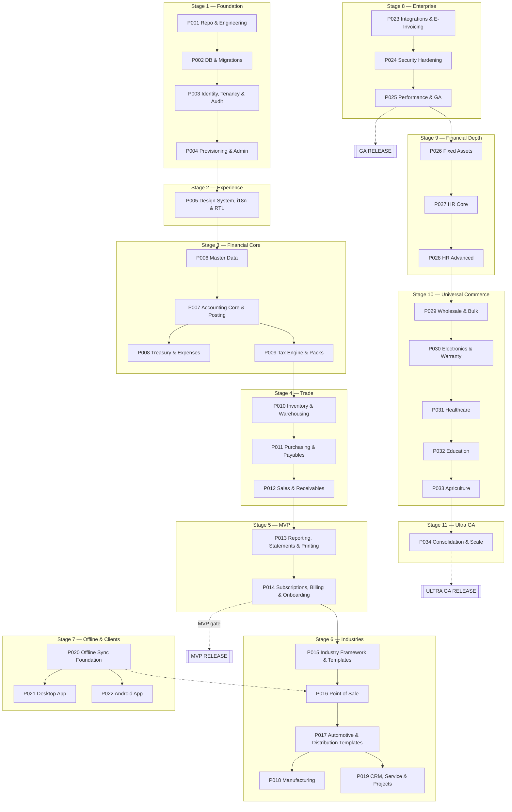

# Master Roadmap

> **Status:** STABLE · **Owner:** Platform Architecture · **Updated:** 2026-10-28 — EXP-001 Giant Expansion to 34 phases

The dependency-driven implementation roadmap: **34 phases in 11 stage groups** (EXP-001 Giant Expansion 2026-10-28). Detailed,
actionable phase documents (29 mandatory sections each) live in
[../implementation/phases/](../implementation/phases/). Every phase's full acceptance
criteria are consolidated in [PHASE_ACCEPTANCE_CRITERIA.md](PHASE_ACCEPTANCE_CRITERIA.md);
current progress in [IMPLEMENTATION_STATUS.md](IMPLEMENTATION_STATUS.md).

**Reading rule for implementers:** the phase document is authoritative; this roadmap is
the index. If they conflict, the phase document wins and this file must be corrected.

## Stage groups

| Stage | Name | Phases | Outcome |
|-------|------|--------|---------|
| 1 | Foundation & Platform | 001–004 | Repo, database infrastructure, identity/tenancy/audit, tenant provisioning + platform admin |
| 2 | Experience Layer | 005 | Design system, i18n/RTL foundation, app shell |
| 3 | Financial Core | 006–009 | Master data, accounting core + posting engine, treasury, tax engine + jurisdiction packs |
| 4 | Supply & Trade Operations | 010–012 | Inventory & warehousing, purchasing & payables, sales & receivables |
| 5 | Insight & Commercial Launch — **MVP** | 013–014 | Reporting/printing engine, subscriptions & billing & onboarding → **MVP release** |
| 6 | Industry Expansion | 015–019 | Industry framework + priority templates, POS, automotive/distribution templates, manufacturing, CRM |
| 7 | Offline & Multi-Platform | 020–022 | Sync foundation, desktop application, Android application |
| 8 | Integrations & Enterprise Readiness — **GA** | 023–025 | E-invoicing implementations + external adapters, security hardening, performance & GA readiness |
| 9 | Financial Depth & Workforce — **Giant Core** | 026–028 | Fixed assets/depreciation, HR/payroll/GOSI, budgeting/costing — full accounting cycle |
| 10 | Universal Commerce & Specialized Verticals | 029–033 | Wholesale/bulk, electronics/mobiles/warranty, healthcare, education, agriculture/livestock |
| 11 | Group & Hyperscale — **ULTRA GA** | 034 | Multi-entity consolidation, intercompany eliminations, group statements, hyperscale | E-invoicing implementations + external adapters, security hardening, performance & GA readiness |

## Dependency graph (summary)

Full graph: [PHASE_DEPENDENCY_GRAPH.md](PHASE_DEPENDENCY_GRAPH.md).

Critical path MVP: **P001 → P002 → P003 → P004 → P005 → P006 → P007 → {P008, P009} → P010 → P011 → P012 → P013 → P014 (MVP)**.
Full giant path: ... → P014 → P015 → P016 → P026 → P027 → P028 → P029 → P030 → P031 → P032 → P033 → P034 (ULTRA GA).

## Phase summary table

| Phase | Title | Prereqs | Key outcome |
|-------|-------|---------|-------------|
| [PHASE-001](../implementation/phases/PHASE-001.md) | Repository & Engineering Foundation | — | Monorepo, tooling, CI gates, dev environment; docs-in-repo workflow |
| [PHASE-002](../implementation/phases/PHASE-002.md) | Database & Migration Infrastructure | 001 | Drizzle + migrations, RLS helpers, audit trigger utilities, pg-boss, storage adapter, health checks |
| [PHASE-003](../implementation/phases/PHASE-003.md) | Identity, Multi-Tenancy & Audit Core | 002 | Auth, sessions, MFA, roles/permissions, RLS enforcement, audit events, tenant isolation attack tests |
| [PHASE-004](../implementation/phases/PHASE-004.md) | Tenant Provisioning & Platform Administration | 003 | Registration, onboarding wizard (backend), branches, entitlements service, admin console, support access |
| [PHASE-005](../implementation/phases/PHASE-005.md) | Design System, i18n & RTL Foundation | 004 | Tokens, core components, app shell, AR/EN locales, RTL rules, visual regression harness |
| [PHASE-006](../implementation/phases/PHASE-006.md) | Master Data | 005 | Partners, items, UoM, barcodes, price lists, opening-balance drafts, attachments, import/export |
| [PHASE-007](../implementation/phases/PHASE-007.md) | Accounting Core & Posting Engine | 006 | CoA, fiscal calendar, currencies/FX, journals, posting engine, GL, approvals, opening balances posting, invariant suite |
| [PHASE-008](../implementation/phases/PHASE-008.md) | Treasury: Cash, Banking & Expenses | 007 | Cash/bank accounts, receipts/disbursements, petty cash, transfers, expenses, shifts, bank reconciliation, FX differences |
| [PHASE-009](../implementation/phases/PHASE-009.md) | Tax Engine & Jurisdiction Packs | 007 | Treatments, tax codes, versioned rates, all country packs incl. no-VAT, tax summaries, VAT return report, adapter framework |
| [PHASE-010](../implementation/phases/PHASE-010.md) | Inventory & Warehousing | 009 | Stock ledger, WAC/FIFO valuation, opening stock, transfers, counts, batches/expiry/serials/IMEI, GL integration |
| [PHASE-011](../implementation/phases/PHASE-011.md) | Purchasing & Payables | 010 | PR/PO/GRN/supplier invoices/debit notes, three-way matching, payments, AP aging, statements |
| [PHASE-012](../implementation/phases/PHASE-012.md) | Sales & Receivables | 011 | Quote→order→delivery→invoice→credit note, receipts, allocations, credit limits, AR aging, statements |
| [PHASE-013](../implementation/phases/PHASE-013.md) | Reporting Engine, Financial Statements & Printing | 012 | Report contract, TB/IS/BS/CF, operational reports, print templates AR/EN, PDF/XLSX/CSV, drill-down |
| [PHASE-014](../implementation/phases/PHASE-014.md) | Subscription, Billing, Onboarding & Dashboards — **MVP** | 013 | Plans, entitlement enforcement, checkout (provider + manual), onboarding UX, dashboards, security/perf review → **MVP RELEASE** |
| [PHASE-015](../implementation/phases/PHASE-015.md) | Industry Framework & Priority Templates | 014 | Configuration engine, manifests, retail + grocery + restaurant templates, template switching rules |
| [PHASE-016](../implementation/phases/PHASE-016.md) | Point of Sale | 015 | Terminals, POS sales flow, shifts/drawer, receipts (80/58mm), barcode, offline sale queue (scoped sync) |
| [PHASE-017](../implementation/phases/PHASE-017.md) | Automotive & Distribution Templates | 016 | Job-card workflow template, van sales, routes, rep stock, settlements, customer tiers, free goods |
| [PHASE-018](../implementation/phases/PHASE-018.md) | Manufacturing & Production | 017 | BOM, production orders, consumption, WIP, finished goods, scrap, batch genealogy, production costing, QC basics |
| [PHASE-019](../implementation/phases/PHASE-019.md) | CRM, Service Contracts & Projects | 017 | Leads/tasks/activities, service contracts, recurring billing, service orders, project dimension |
| [PHASE-020](../implementation/phases/PHASE-020.md) | Offline Synchronization Foundation | 016 | Device registry, change feeds, pull/push contracts, conflict policies, local DB schema & migrations, sync tests |
| [PHASE-021](../implementation/phases/PHASE-021.md) | Desktop Application | 020 | Tauri shell, packaging, auto-update, offline web-ERP in shell, keychain, printer integration |
| [PHASE-022](../implementation/phases/PHASE-022.md) | Android Application | 020 | Expo app: personal accounts + field sales, offline cache, device registration, push notifications |
| [PHASE-023](../implementation/phases/PHASE-023.md) | External Integrations & E-Invoicing | 020 | ZATCA phase-2 adapter (verified specs), ETA evaluation, payment providers, e-commerce/shipping adapters |
| [PHASE-024](../implementation/phases/PHASE-024.md) | Security Hardening & Compliance Review | 023 | Pen test fixes, MFA policies, rate-limit hardening, audit review, dependency triage |
| [PHASE-025](../implementation/phases/PHASE-025.md) | Performance, Reliability & GA Readiness | 024 | Load tests, DR drill, restore tests, runbook validation, SLOs, GA release |
| [PHASE-026](../implementation/phases/PHASE-026.md) | Fixed Assets & Depreciation — Full Cycle | 007,025 | Asset register, categories, depreciation (straight-line/declining/units), posting via engine, disposal/revaluation, physical count |
| [PHASE-027](../implementation/phases/PHASE-027.md) | HR Core & Payroll Engine | 003,026 | Employees, contracts, departments, grades, payroll elements, payroll runs, posting, GOSI/social |
| [PHASE-028](../implementation/phases/PHASE-028.md) | Attendance, Leave & Advanced HR | 027 | Shifts, attendance, leave, EOS/gratuity, loans/advances, compliance |
| [PHASE-029](../implementation/phases/PHASE-029.md) | Wholesale & Bulk Commerce Pro | 006,012 | Tier pricing, bulk/multipack, promotions, credit wholesale workflows |
| [PHASE-030](../implementation/phases/PHASE-030.md) | Electronics, Mobiles & Warranty Service | 006,010,012 | Serial/IMEI warranty, RMA, repair tickets, spare parts, service contracts |
| [PHASE-031](../implementation/phases/PHASE-031.md) | Healthcare — Hospital/Clinic (HIS Lite) | 006,012 | Patients, appointments, encounters, billing, insurance, pharmacy linkage |
| [PHASE-032](../implementation/phases/PHASE-032.md) | Education — School/Institute (SIS Lite) | 006,012 | Students, classes, enrollments, fees, timetable, results |
| [PHASE-033](../implementation/phases/PHASE-033.md) | Agriculture, Livestock & Farm Management | 006,010 | Farms, crops, seasons, livestock, feed, harvest/yield, produce to inventory |
| [PHASE-034](../implementation/phases/PHASE-034.md) | Group Consolidation & Hyperscale | 026–033 | Multi-entity group, intercompany, eliminations, group TB/BS/PL, hyperscale |

## Release gates

### MVP gate (end of PHASE-014)

- A real business can: register → onboard → configure CoA → record opening balances →
  buy (PO→GRN→invoice) → sell (order→delivery→invoice→receipt) → count stock → close a
  period → print financial statements + VAT return — in Arabic and English.
- All accounting invariants tested; tenant isolation attack suite green; backups
  configured and a restore rehearsed once in staging; subscription billing operational
  (provider + manual fallback); security review of MVP surface complete.
- Exit evidence per [PHASE_ACCEPTANCE_CRITERIA.md](PHASE_ACCEPTANCE_CRITERIA.md) §14.

### GA gate (end of PHASE-025)

- Load tests at 10× projected traffic meet NFR-006; DR drill completed within RTO;
  restore-from-backup proven; pen-test findings closed; runbooks validated; error
  budget process live; ZATCA adapter (if in scope for KSA launch segment) certified per
  official requirements — or the launch segment explicitly excludes e-invoicing-requiring
  taxpayers (documented decision).

### ULTRA GA gate (end of PHASE-034) — Giant Parity

- Fixed assets register + depreciation posted and reconciled to GL (INV-010 extended); payroll posted per country and GOSI filed (where applicable); wholesale tier pricing and electronics warranty in production.
- At least one live tenant per new vertical (healthcare, education, agriculture) operating billing/fees/harvest-to-inventory with zero cross-tenant leaks.
- Group consolidation: 3-entity group with intercompany elimination producing balanced group statements.
- All 34 phases green, 110+ tables, 300+ screens, 55+ reports; load at 20× MVP projection within NFR-006.

## Sequencing rationale (key decisions)

1. **Tax engine (P-009) BEFORE purchasing/sales (P-011/012)**: invoices must carry tax
   treatments from their first version; retrofitting tax lines into posted documents is
   impossible (immutability).
2. **Treasury (P-008) before sales/purchasing**: receipts/payments are consumed by both
   trade modules; partners' opening balances need AR/AP subledger + control accounts
   which exist after P-007.
3. **Reporting engine (P-013) after trade modules**: statements must reconcile to real
   transactional data, not stubs; but report *contract* foundation is defined in docs now
   and consumed progressively (financial statement needs only P-007 data — PHASE-013
   builds the engine, with earlier phases providing data).
4. **POS (P-016) after MVP**: POS needs the industry framework and a scoped offline
   queue; forcing it into MVP would delay the commercial launch for a segment that can
   launch with back-office invoicing.
5. **Offline sync foundation (P-020) generalized AFTER POS**: POS ships a narrowly
   scoped, documented offline queue (P-016) as the first real consumer; the generalized
   protocol (P-020) then abstracts it — this avoids designing sync in the abstract.
6. **E-invoicing implementation (P-023) last**: requires verified official
   specifications, credentials, and certification paths that must not be fabricated;
   the architecture (adapters) is ready from P-009, so implementation is isolated.
7. **Fixed assets (P-026) after accounting core**: depreciation posts through the same posting engine (P-007); needs CoA purposes + fiscal periods.
8. **HR/payroll (P-027/028) after fixed assets**: payroll posts journals; GOSI/eos rules are per-country verified specs like tax packs.
9. **Wholesale/electronics (P-029/030) after trade ops**: they are pricing/warranty extensions on top of sales/inventory, not new ledgers.
10. **Healthcare/education/agriculture (P-031–033) last verticals**: they reuse patients/students/farms as partner extensions + billing through sales; avoid domain creep before core is solid.

## Scope discipline rules

- A phase may pull scope **forward** from a later phase only via a decision record that
  also moves the later phase's scope explicitly.
- No phase implements beyond its document; "while I'm here" changes are code-review
  blockers ([../implementation/templates/CODE_REVIEW_TEMPLATE.md](../implementation/templates/CODE_REVIEW_TEMPLATE.md)).
- Every phase ends with updated [IMPLEMENTATION_STATUS.md](IMPLEMENTATION_STATUS.md),
  a completion report with evidence, and `CHANGELOG.md` entries.
