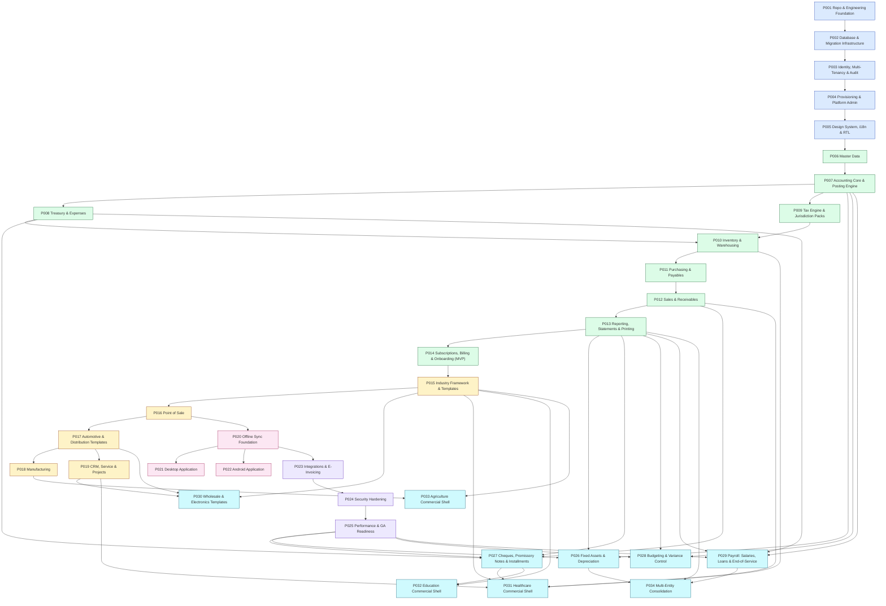

# Phase Dependency Graph

> **Status:** STABLE · **Owner:** Platform Architecture · **Updated:** 2026-10-28

Full dependency graph with edge semantics. Nodes: `Pxxx` phases; edges: `A --> B` means
"B requires A complete with evidence". The graph is validated acyclic by the
cross-document validation script (see [../handoff/VALIDATION_REPORT.md](../handoff/VALIDATION_REPORT.md)).
Phases P026…P034 (stages 9–11) are **post-GA additive releases** per
[../EXPANSION_REGISTER.md](../EXPANSION_REGISTER.md) (ED-01): the 025→{026…029} edges are
GA release-gate edges, and the MVP/GA gates are unchanged by the expansion.

## Edge semantics table

| Edge | Why B requires A |
|------|------------------|
| 001→002 | Migrations/conventions need repo, CI, tooling |
| 002→003 | Identity tables need migration framework + RLS helpers |
| 003→004 | Provisioning needs tenants/users/permissions/audit |
| 004→005 | App shell needs entitlement-driven navigation data model |
| 005→006 | Master data screens need design system + i18n |
| 006→007 | CoA/opening balances reference partners/items; account purposes need master data |
| 007→008 | Treasury posts through the posting engine |
| 007→009 | Tax engine posts VAT to GL accounts; document lifecycle defined |
| 008,009→010 | Opening stock posts through inventory accounting; stock moves carry tax context where applicable |
| 010→011 | GRN issues stock into warehouses |
| 011→012 | Sales reuses matching/payment/allocation patterns + AP/AR symmetry; invoice chain consumes items/inventory/tax |
| 012→013 | Statements/reports reconcile against real transactional data |
| 013→014 | Billing needs export/print + report contract for invoices/statements |
| 014→015 | Industry framework needs entitlements + configuration baseline |
| 015→016 | POS is delivered as an industry-driven configuration + POS module |
| 016→017 | Templates build on POS + sales flows; van sales consume POS/device patterns |
| 017→018 | Manufacturing template rides the industry framework maturity |
| 017→019 | CRM consumes partner/contract patterns stabilized by 017 |
| 016→020 | POS offline queue is the first concrete consumer to generalize |
| 020→021, 020→022 | Clients consume the sync protocol |
| 020→023 | External integrations ride device/adapter + job patterns |
| 023→024 | Hardening includes integration surface |
| 024→025 | GA readiness is final |
| 025→026…029 | Stage-9 phases are post-GA releases: the GA gate (025) must be complete with evidence; functional prereqs below (ED-01) |
| 007,013→026 | Depreciation/disposal/revaluation post through the engine into period-locked fiscal periods; asset register + depreciation reports ride the reporting engine |
| 008,012,013→027 | Notes settle AR/AP open items (dishonor restores AR exactly) on the treasury + trade chains; PDC calendar/aging reports via the reporting engine (ED-03 terminates the v1.1 `treasury.cheques` deferral chain) |
| 007,013→028 | Budgets are defined over CoA accounts and fiscal periods and read actuals through the reporting engine (budgets never post journals — BR-051) |
| 007,008,013→029 | Payroll runs post via the engine (INV-025); payouts go through treasury; payroll register/reports via the reporting engine |
| 015,017,019→030 | Wholesale & electronics templates are configuration over the industry framework + distribution features (qty-break price lists, routes) + service orders (repairs, trade-in) |
| 015,010,012,019,027→031 | Healthcare shell combines framework + pharmacy batch tracking + AR claim billing + service-order visits + notes (claims cheques) |
| 015,027→032 | Education shell: framework + installment plans (tuition), sibling discounts via pricing |
| 015,018→033 | Agriculture shell: framework + BOM/production costing (crop cycles), harvest batches |
| 013,026,029→034 | Consolidation reads member books via the reporting engine; requires fixed-asset and payroll data, and closed member periods (BR-056) — runs after the stage-9 modules it consumes |

## Parallelism notes (for planning, not for agents)

- P008 ∥ P009 may run in parallel (both depend on P007 only).
- P018 ∥ P019 may run in parallel (both depend on P017).
- P021 ∥ P022 may run in parallel (both depend on P020).
- P026 ∥ P027 ∥ P028 ∥ P029 may run in parallel after GA (all four depend on the 025 gate
  plus pre-GA functional prereqs only).
- P030 ∥ P031 ∥ P032 ∥ P033 may run in parallel once their dependencies are complete
  (031/032 additionally require P027; 033 additionally requires P018).
- P034 runs last of the expansion, after P026 and P029 (and P013) — consolidation closes
  stage 11.
- **However**: implementing agents execute one phase at a time to keep verification
  rigorous; parallelism is an option for human teams, not the default agent protocol.

## Change propagation

If a phase's scope changes after subsequent phases are complete: the phase document
lists "affected downstream phases" — re-run their review checklist
([../handoff/IMPLEMENTATION_PROTOCOL.md](../handoff/IMPLEMENTATION_PROTOCOL.md) §6).
Foundational phases (001–005) changes require full-roadmap review.
