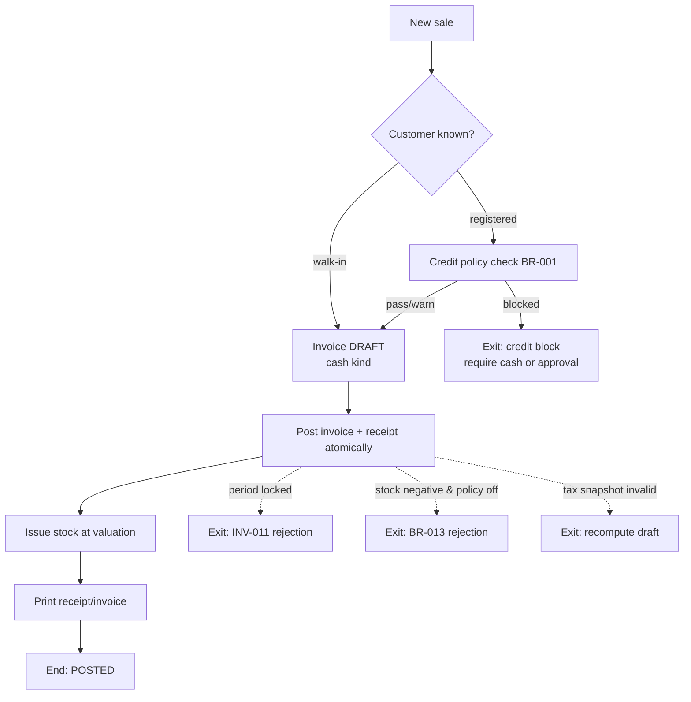
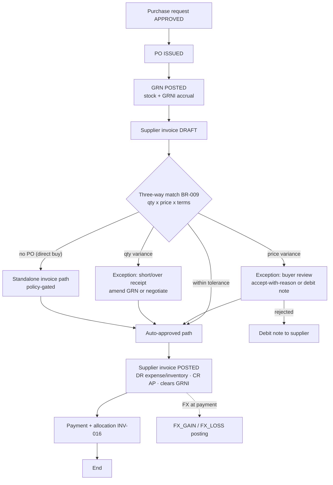
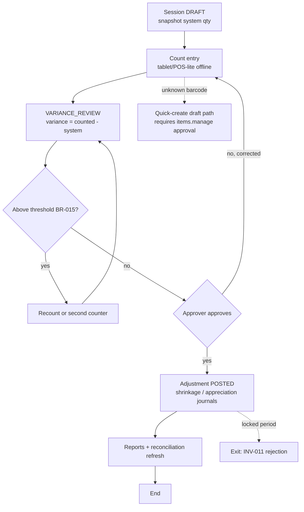
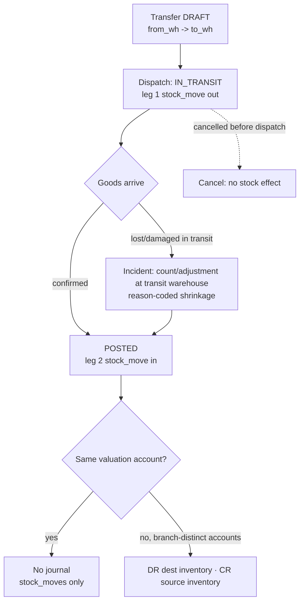
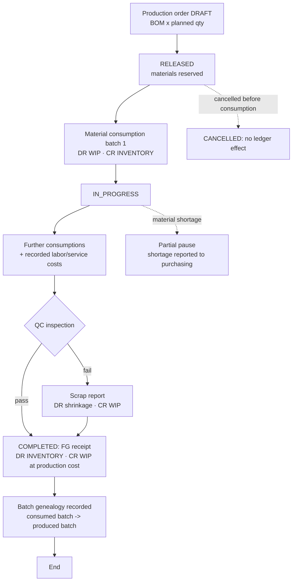
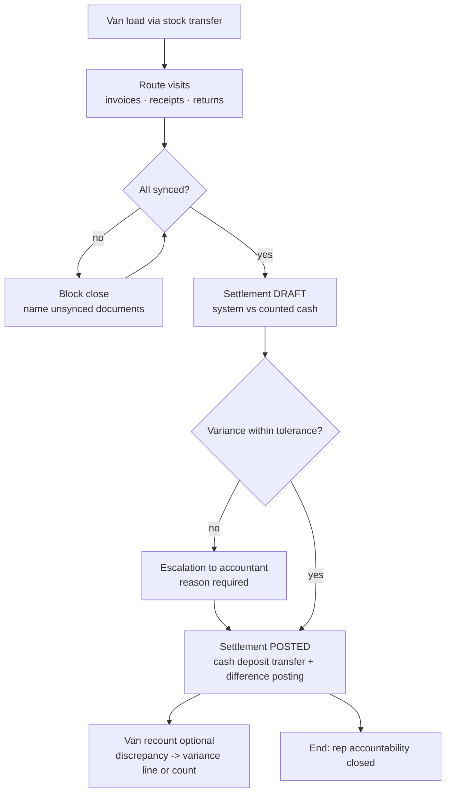
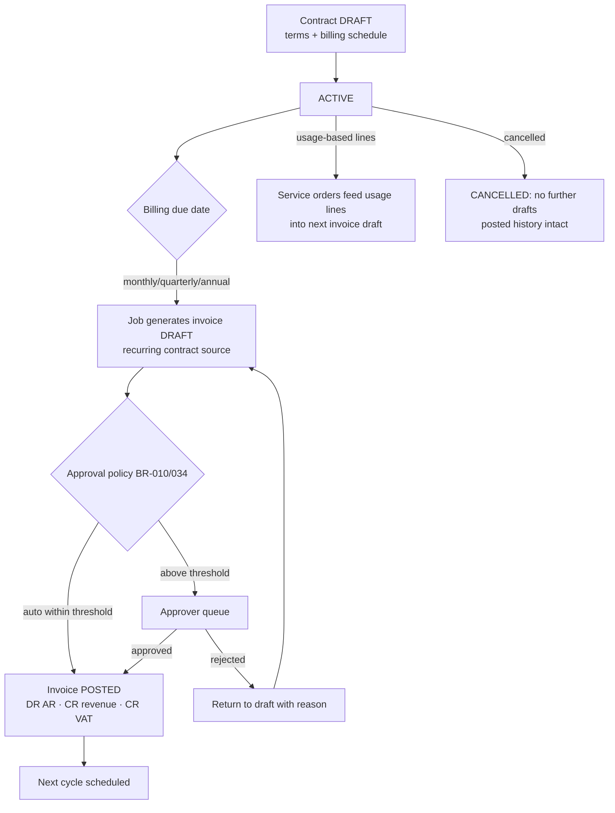
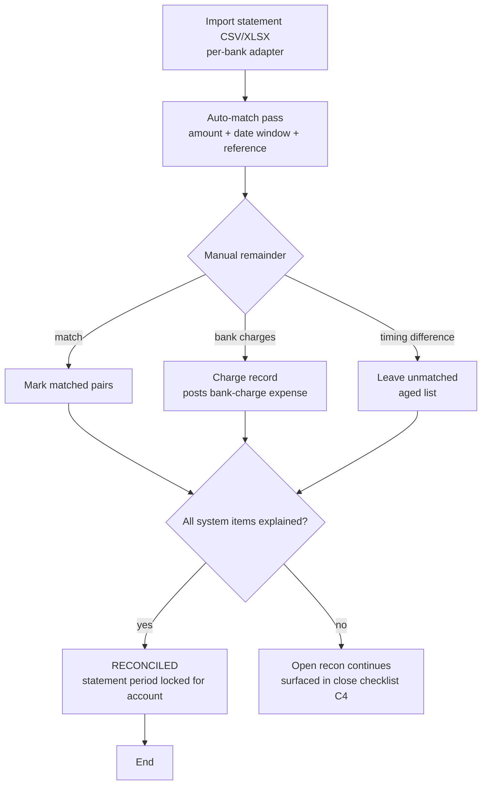

# Business Workflows

> **Status:** STABLE · **Owner:** Product & Platform Architecture · **Updated:** 2026-10-27

The canonical operational workflows, drawn as executable design references. Every workflow
states its **entry conditions**, the **document states traversed** (per
[../accounting/DOCUMENT_LIFECYCLE.md](../accounting/DOCUMENT_LIFECYCLE.md)), the **postings
generated** (accounts named by purpose — see [../accounting/CHART_OF_ACCOUNTS.md](../accounting/CHART_OF_ACCOUNTS.md)),
and its **failure exits**. Detailed user-level pacing lives in
[USER_JOURNEYS.md](USER_JOURNEYS.md); the rule catalog governing decisions is
[BUSINESS_RULES.md](BUSINESS_RULES.md).

## 1. Order-to-cash — cash variant (retail-style, PHASE-012; POS variant PHASE-016)

**Entry conditions.** Item exists with price and tax code; customer is walk-in or registered;
cash account configured; period OPEN.

**States traversed.** Sales invoice: DRAFT → (APPROVED) → POSTED. Delivery may be implicit
(counter sale issues stock directly with the invoice) per template. Receipt: DRAFT → POSTED.



**Postings (one transaction, INV-006/018).** DR cash account · CR revenue (net) · CR
`VAT_PAYABLE` (registered tenants); DR `COGS` · CR `INVENTORY` at issue cost; cash sales may
auto-post on save (`policy.sales.cash_autopost`, default ON for POS — BR-005).

**Failure exits.** Credit block (BR-001 blocked posture); negative stock (BR-013, default
off); locked period (INV-011); tax snapshot mismatch → draft recompute, never a silent
post; duplicate submit → idempotent no-op (INV-013).

## 2. Order-to-cash — credit variant (distribution-style, PHASE-012)

**Entry conditions.** Registered customer with credit terms and limit; stock available at
the issuing warehouse; approval thresholds configured (BR-010).

**States traversed.** Quotation: DRAFT → SENT → ACCEPTED. Sales order: DRAFT → CONFIRMED.
Delivery note: DRAFT → POSTED. Sales invoice: DRAFT → APPROVED → POSTED. Receipt: DRAFT →
POSTED with allocations.

```mermaid
flowchart TD
  Q[Quotation] -->|accepted| O[Sales order CONFIRMED]
  O --> DN[Delivery note POSTED<br/>stock issued, COGS posted]
  DN --> INV[Invoice DRAFT from DN]
  INV --> CHK{Credit limit check BR-001}
  CHK -- "block" --> AP1[Approval escalation or split shipment]
  AP1 --> INV
  CHK -- "pass/warn" --> APP{Amount threshold BR-010}
  APP -- above --> AP2[Owner/approver approves]
  AP2 --> P
  APP -- below --> P[Invoice POSTED<br/>AR + revenue + VAT]
  P --> REC[Receipt with allocations INV-016]
  REC --> AGE{Settled in terms?}
  AGE -- yes --> DONE[End]
  AGE -- no --> OD[Overdue notifications<br/>invoice.overdue]
  O -. amended --> O2[New revision linked<br/>original retained]
  INV -. correction --> CN[Credit note referencing invoice<br/>stock re-entry at original cost]
```

**Postings.** Delivery: DR `COGS` · CR `INVENTORY`. Invoice: DR `AR_CONTROL` (per partner,
INV-009) · CR revenue · CR `VAT_PAYABLE`. Receipt: DR cash/bank · CR `AR_CONTROL`; FX
difference at settlement → `FX_GAIN`/`FX_LOSS` (multi-currency). Credit note mirrors the
invoice and re-enters stock at **original issue cost**.

**Failure exits.** Credit block; threshold rejection with reason; period lock; partial
delivery allowed with open-balance tracking; corrections are always credit notes, never
edits (INV-003).

## 3. Procure-to-pay with three-way matching (PHASE-011)

**Entry conditions.** Supplier exists; PO issued; goods received into a warehouse;
matching tolerances configured (BR-009).

**States traversed.** Purchase request: DRAFT → APPROVED. Purchase order: DRAFT → ISSUED →
CLOSED. GRN: DRAFT → POSTED. Supplier invoice: DRAFT → (match outcome recorded) → APPROVED →
POSTED. Payment: DRAFT → POSTED with allocations.



**Postings.** GRN: DR `INVENTORY` · CR `GRNI`. Supplier invoice: DR `INVENTORY`/expense (+
`VAT_RECOVERABLE` where applicable) · CR `AP_CONTROL` · DR `GRNI` (clearing). Payment: DR
`AP_CONTROL` · CR bank; FX differences at settlement. Landed costs (PHASE-015 full flow)
revalue layers by value/quantity allocation before issues where possible.

**Failure exits.** Match exception without disposition → approval blocked (the match outcome
is recorded **before** approval, per lifecycle §3); duplicate supplier invoice number →
warning per BR-011; period lock; supplier credit-term breach is reported, not enforced.

## 4. Inventory count (PHASE-010)

**Entry conditions.** Warehouse active; count policy set (blind, threshold); counters
assigned. Detailed user pacing in [USER_JOURNEYS.md](USER_JOURNEYS.md) Journey D.

**States traversed.** Stock count: DRAFT → COUNTED → VARIANCE_REVIEW → POSTED.



**Postings.** Loss: DR `INVENTORY_SHRINKAGE` · CR `INVENTORY`. Gain: DR `INVENTORY` · CR
`INVENTORY_APPRECIATION`. Expiry write-offs post identically with reason `EXPIRED`.

**Failure exits.** Locked period; batch-tracked line without batch assignment; movements
after snapshot are surfaced (never silently absorbed into variance).

## 5. Stock transfer (PHASE-010)

**Entry conditions.** Source and destination warehouses active; item stocked at source.

**States traversed.** Stock transfer: DRAFT → IN_TRANSIT → POSTED.



**Postings.** Same-account transfer: none (moves only, INV-018 documents the no-journal
policy case). Branch-distinct accounts: inventory-to-inventory journal. In-transit stock is
visible but **not sellable** (BR-016).

**Failure exits.** Cancel after dispatch impossible — the correction is the arrival
confirmation plus an adjustment; negative stock at source blocked by default (BR-013).

## 6. Production run (PHASE-018)

**Entry conditions.** BOM versioned and approved; materials available at the production
warehouse; WIP purpose mapped.

**States traversed.** Production order: DRAFT → RELEASED → IN_PROGRESS → COMPLETED (or
CANCELLED before consumption).



**Postings.** Consumption: DR `WIP` · CR `INVENTORY` at issue cost. Completion: DR
`INVENTORY` (finished goods) · CR `WIP` at accumulated production cost. Scrap: DR
`INVENTORY_SHRINKAGE` · CR `WIP`. WIP per order reconciles to the `WIP` account (INV-010).

**Failure exits.** Negative material issue blocked (BR-013); BOM change mid-run → new BOM
version applies to new orders only; QC failure without disposition blocks completion.

## 7. Van-sales settlement (PHASE-017)

**Entry conditions.** Van warehouse per rep; route loaded; settlement tolerance configured
(BR-021 family); rep has the `sales` role.

**States traversed.** Load transfer: POSTED (Journey G). Sales documents: normal lifecycles
(offline-capable). Settlement: DRAFT → POSTED.



**Postings.** Document-level postings occurred at sync (invoice/receipt/credit note per
workflows 1–2). Settlement: cash transfer from rep accountability to main cash/bank
(DR cash/bank · CR rep cash account); variance → cash-difference accounts with the
settlement as source document.

**Failure exits.** Unsynced documents block close; cash variance above tolerance requires
accountant disposition; offline credit breach surfaces as actionable sync errors (BR-001).

## 8. Service contract billing (PHASE-019)

**Entry conditions.** Contract active with billing schedule; customer exists; revenue
purpose mapped.

**States traversed.** Service contract: DRAFT → ACTIVE → (SUSPENDED) → EXPIRED/CANCELLED.
Generated invoices: DRAFT → APPROVED → POSTED (normal invoice lifecycle).



**Postings.** Identical to a sales invoice (DR `AR_CONTROL` · CR revenue · CR `VAT_PAYABLE`)
with the contract as source reference; service orders consume parts (DR service COGS · CR
`INVENTORY`) and record labor lines to cost centers/projects.

**Failure exits.** Contract suspension stops generation (explicit, audited); customer credit
policy still applies to generated invoices; period lock rejects the generated draft's
posting like any other (INV-011).

## 9. Bank reconciliation (PHASE-008)

**Entry conditions.** Bank account configured; statement file available in a supported
per-bank format.

**States traversed.** Bank statement: IMPORTED → RECONCILING → RECONCILED (locks the
statement period for that account).



**Postings.** Bank charges: DR bank-charge expense · CR bank account. Corrections for
unrecorded movements discovered during matching are new treasury documents — the
reconciliation itself never edits movements (INV-019 internal consistency).

**Failure exits.** Import format failure (row-level errors listed, partial import rejected
as a unit); duplicate statement period import blocked; reconciliation cannot silently
absorb amounts — unmatched items stay honest and aged.

## Workflow ↔ module ownership

| Workflow | Owning modules ([../architecture/MODULE_BOUNDARIES.md](../architecture/MODULE_BOUNDARIES.md)) | Phase |
|---|---|---|
| O2C cash / credit | sales, partners, items, inventory, treasury, tax, accounting | 012 (POS 016) |
| P2P + matching | purchasing, inventory, partners, treasury, tax, accounting | 011 |
| Inventory count | inventory, accounting | 010 |
| Stock transfer | inventory, accounting | 010 |
| Production run | manufacturing, inventory, accounting | 018 |
| Van-sales settlement | distribution, sales, treasury, inventory, sync (020) | 017 |
| Service contract billing | crm, sales, tax, accounting | 019 |
| Bank reconciliation | treasury, accounting | 008 |
