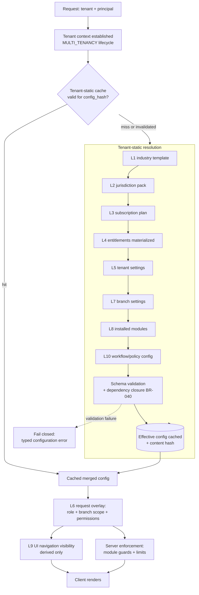

# Configuration Engine

> **Status:** STABLE · **Owner:** Product & Platform Architecture · **Updated:** 2026-10-27

The layered configuration resolution architecture. This is the mechanism behind
"configuration without chaos" ([../PROJECT_VISION.md](../PROJECT_VISION.md) pillar 2): ten
separate layers, one deterministic resolution algorithm, and hard safety boundaries. It is
implemented by the `configuration` module ([../architecture/MODULE_BOUNDARIES.md](../architecture/MODULE_BOUNDARIES.md))
publishing `resolveEffectiveConfig(tenant)`, first exercised in PHASE-004 (tenant settings,
entitlements) and completed in PHASE-015 (template engine, feature flags).

## 1. Principles

1. **Layers are separate by design** — industry defaults, legal packs, commercial plans,
   entitlements, tenant preferences, permissions, branch specifics, module opt-ins, UI
   presentation, and workflow policies are different lifecycles with different owners and
   different change cadences. Merging them is how ERPs become unmaintainable.
2. **Resolution is deterministic** — identical inputs always produce an identical effective
   config, with a content hash for debugging and test assertions.
3. **Configuration selects, never overrides** — it picks accounts, features, policies, and
   presentation. It can never alter accounting mathematics or authorization (INV-022,
   BR-037; NFR-011).
4. **The server resolves; clients consume** — UI visibility is derived from the server's
   answer, never a client-side decision (BR-039).

## 2. The ten layers

| # | Layer | Owner | Backing storage | Changes via | Phase |
|---|---|---|---|---|---|
| L1 | **Industry template** | Product (seeded) + tenant choice | `industry_templates` (manifest jsonb), `tenant_industry_config` | Template apply/switch (BR-038) | 004 (seed) / 015 (engine) |
| L2 | **Jurisdiction pack** | Compliance workstream (versioned seeds) | `jurisdictions`, `jurisdiction_tax_rates`, tenant `tax_registrations` | Pack upgrade (staged preview→apply, audited) | 009 |
| L3 | **Subscription plan** | Commercial (platform admin) | `plans` (limits jsonb, feature_keys[]) | Plan revision by platform staff (audited) | 004 / 014 |
| L4 | **Feature entitlement** | Entitlements service | `entitlements` (materialized: plan + add-ons + overrides) | Checkout, add-on activation, admin override (§9 of [SUBSCRIPTION_AND_ENTITLEMENTS.md](SUBSCRIPTION_AND_ENTITLEMENTS.md)) | 004 |
| L5 | **Tenant settings** | Tenant owner/admin | `tenant_settings` (typed keys) | Settings screens (validated against schema) | 004 |
| L6 | **User permissions** | Tenant owner/admin | `roles`, `role_permissions`, `memberships` (branch scope) | Role editor, invitations | 003 |
| L7 | **Branch settings** | Tenant admin | `branches` + branch-scoped settings (numbering series, default warehouse, cash accounts) | Branch editor | 004 |
| L8 | **Optional installed modules** | Entitlement-driven + tenant opt-in | `feature_flags`, add-on activation records | Add-on install/deactivation (dependency-checked) | 015 |
| L9 | **UI navigation visibility** | Derived (never stored as truth) | Computed from L1+L4+L8 (+ L6 for per-user pruning) | Automatic on any upstream change | 015 |
| L10 | **Workflow / policy config** | Tenant admin within rule defaults | `approval_policies`, numbering policies, policy keys in `tenant_settings` | Policy editors (bounded by [BUSINESS_RULES.md](BUSINESS_RULES.md)) | 007+ |

## 3. Resolution algorithm

**Inputs**: `tenantId`, and — for request-scoped resolution — the principal's membership
(user + role + branch scope). **Output**: the effective-config object (§5).

1. **Load tenant-static layers in order** L1 → L2 → L3 → L4 → L5 → L7 → L8 → L10, merging
   key-by-key: each later layer may only **refine** values the earlier layers published
   (see precedence table below). Later layers win for policy/presentation values; no layer
   can remove an invariant or an authorization rule.
2. **Validate the merged result** against the configuration schema (§4): unknown keys,
   type violations, or out-of-range values fail resolution loudly — resolution never
   silently drops keys (a failed resolution is a bug, not a degradation).
3. **Check feature dependency closure** (BR-040): every active feature key's `depends on`
   set (from [FEATURE_CATALOG.md](FEATURE_CATALOG.md)) must be active; unsatisfiable
   activations are rejected at *apply time*, so resolution can assume a valid closure.
4. **Overlay the request-scoped layer L6**: the effective config is intersected with the
   principal's permissions and branch scope — producing, per request, `actions` the user
   may perform and `branches` in scope. L6 never mutates tenant-level values.
5. **Derive L9** (navigation, menu emphasis, screen terminology) from the merged tenant
   config + the user's L6 prune.
6. **Cache**: the tenant-static merge (steps 1–3) is cached per tenant keyed by content
   hash; the request overlay (step 4) is computed per request and never cached across
   principals.

**Precedence table** (for values that appear in multiple layers — `>` means "wins for that
value class"):

| Value class | Precedence |
|---|---|
| Policy values (BR-configurable defaults) | L10 > L5 > L1 (template default) > platform default |
| Numbering series | L7 (branch) > L5 (tenant) > L1 default |
| Tax rates / treatments / invoice legal fields | **L2 only** — no other layer may touch these |
| Feature availability | L4 only (sourced from L3 + add-ons + overrides) |
| Screen terminology / menus | L1 > platform glossary; visibility pruned by L4/L8/L6 |
| Fiscal calendar structure | L5 (start month chosen at onboarding) within L2 display formats |

## 4. Configuration schema (`tenant_settings` typed keys)

Keys are dot-namespaced `<module>.<name>` with a versioned JSON schema per module; writes
are validated server-side. Unknown or unvalidated keys are rejected. Selected keys
(defaults shown; full registry grows per phase):

| Key | Type | Default | Layer origin | Backing rule |
|---|---|---|---|---|
| `general.default_locale` | enum `ar` \| `en` | `ar` | L5 | NFR-001 |
| `general.numeral_system` | enum `latn` \| `arab` | `arab` (display option) | L5 | — |
| `general.hijri_display` | bool | `true` (display only; fiscal years Gregorian, A-004) | L5 | — |
| `sales.credit_limit_action` | enum `block`\|`warn`\|`ignore` | `warn` | L1 default / L5 override | BR-001 |
| `sales.cash_autopost` | bool | `false` (back office) | L1/L5 | BR-005 |
| `pos.cash_autopost` | bool | `true` | L1 | BR-005 |
| `sales.return_window_days` | int ≥ 0 | `14` | L1/L5 | BR-004 |
| `inventory.allow_negative_stock` | bool | `false` | L5 | BR-013 |
| `inventory.count_variance_tolerance` | decimal ≥ 0 | `0` | L5 | BR-015 |
| `inventory.fefo_for_expiry_items` | bool | `true` | L1 | BR-017 |
| `treasury.shift_variance_tolerance` | decimal ≥ 0 | `0` | L5 | BR-021 |
| `treasury.petty_cash.single_tx_limit` | decimal | PLACEHOLDER (OQ-002 pass) | L5 | BR-020 |
| `purchasing.match.qty_tolerance_pct` | decimal ≥ 0 | `0` | L5 | BR-009 |
| `approvals.<doctype>.threshold` | decimal (base currency) | unset | L10 | BR-010/034 |
| `approvals.allow_self_approval` | bool | `false` | L10 (**cannot be enabled where INV guards apply**) | BR-034 |
| `numbering.<doctype>.assign_at` | enum `approval`\|`posting` | `posting` | L5/L7 | BR-029 |
| `tax.pricing_inclusive_default` | bool | `false` | L1/L5 | [../localization/TAX_ENGINE.md](../localization/TAX_ENGINE.md) §5 |
| `accounting.fx_revaluation_enabled` | bool | `false` | L5 | BR-036 |

Schema governance: each module ships its settings schema with its features; adding a key =
phase scope + schema version bump + migration default; removing/renaming a key requires a
decision record and a read-compat window (older clients reading a new config are warned by
the version field, not crashed).

## 5. Effective-config object shape

```json
{
  "config_version": 3,
  "resolved_hash": "sha256:9f2c…",
  "tenant": { "id": "0192…", "industry_template": "industry.retail", "jurisdiction": "SA", "base_currency": "SAR" },
  "layers": {
    "l1_template": { "key": "industry.retail", "version": "1.4.0", "terminology_overrides": 27 },
    "l2_jurisdiction_pack": { "country_code": "SA", "pack_version": "2026.10", "vat_status": "VAT_IN_FORCE", "tenant_registration": "REGISTERED" },
    "l3_plan": { "key": "business", "limits": { "users": 10, "branches": 3, "documents_per_month": 5000 } },
    "l4_entitlements": { "active": ["sales.invoices", "pos.sales", "inventory.multi_warehouse", "…"], "missing": [], "sources": { "pos.sales": "add_on:retail_pack" } },
    "l7_branch_defaults": { "BR1": { "numbering_series": "INV-BR1-", "default_warehouse": "WH1", "cash_account": "CASH1" } },
    "l8_installed": { "pos": true, "distribution": false }
  },
  "policies": {
    "sales.credit_limit_action": "warn",
    "sales.cash_autopost": false,
    "pos.cash_autopost": true,
    "inventory.allow_negative_stock": false,
    "numbering.sales_invoice.assign_at": "posting",
    "approvals.purchase_order.threshold": 5000.00
  },
  "ui": {
    "navigation": ["dashboard", "sales", "pos", "inventory", "purchasing", "treasury", "accounting", "reports", "settings"],
    "emphasis": ["pos", "sales"],
    "terminology": { "sales_invoice": "فاتورة البيع", "pos_sale": "بيع نقدي" }
  },
  "request_overlay": {
    "user_id": "0192…", "role": "cashier", "branch_scope": ["BR1"],
    "actions": ["pos.sales.sell", "pos.shifts.manage", "pos.receipts.print"]
  },
  "invariants_note": "INV-001…INV-022 are NOT part of config; they are enforced below it."
}
```

The `request_overlay` exists only in request-scoped resolution; the tenant-static portion
(layers + policies + ui) is what is cached and hashed.

## 6. Safety rules (non-negotiable)

1. **Invariants (INV-001…INV-021) sit below configuration.** No layer may disable, alter,
   or parameterize them — enforced by centralization in the posting engine and by the
   config-fuzz test suite (INV-022). Example: setting `inventory.allow_negative_stock=true`
   still yields balanced, atomic moves (BR-013); it changes *policy*, never mathematics.
2. **Authorization is not configurable away.** L6 defines who may do what; no template,
   plan, or setting can elevate a role beyond its permission set or bypass
   `accounting.periods.post_to_soft_closed`-style guards. Platform staff actions carry
   `via_platform_admin` and remain per-action audited.
3. **Jurisdiction pack values are read-only to tenants.** Rates, effective dates, legal
   invoice fields come only from L2 seeds; tenant layers see them as facts
   ([../localization/TAX_ENGINE.md](../localization/TAX_ENGINE.md) §5: treatment semantics,
   snapshots, GL mapping are not configurable — INV-022).
4. **Industry template switching is additive-only** (BR-038):
   - Applying or switching may: add menus/terminology, add policy *defaults* (only for keys
     the tenant has not explicitly set), add report packs, add document-type defaults.
   - It may never: delete or modify tenant data, remove a tenant's explicit setting,
     change accounts/purposes, or renumber documents.
   - Every switch runs a **migration compatibility check**: the new manifest declares
     `requires` (feature keys) and `conflicts`; incompatibilities (e.g., switching to
     `industry.food_manufacturing` without `manufacturing.*` entitlements) block with the
     specific missing pieces; the tenant may proceed in degraded mode (template applies,
     gated menus hidden) only by explicit acknowledgment.
   - The applied manifest hash is recorded on `tenant_industry_config`; switching back is
     always possible because nothing was destroyed.
5. **Feature flag hygiene** (L8): flags are for rollout control within the platform's own
   delivery (staged enabling), never for tenant-visible policy; a flag may not emulate an
   entitlement (L4 is the only source of feature truth).
6. **Failed resolution fails closed**: if any layer cannot load or validate, the request
   receives a typed configuration error rather than a partially-defaulted config. A
   partially-resolved config must never reach the posting engine.

## 7. Conflict and dependency rules between features

Activation (at checkout, add-on install, or admin override) runs the closure check against
[FEATURE_CATALOG.md](FEATURE_CATALOG.md) `depends on` edges. Representative rules:

| Rule | Statement |
|---|---|
| POS closure | `pos.sales`, `pos.shifts`, `pos.receipts`, `pos.offline_queue` require `sales.invoices` + `inventory.stock_ledger` + `treasury.cashier_shifts` + `items.barcodes` |
| Distribution closure | `distribution.settlements` requires `distribution.van_stock` + `sales.receipts` + `treasury.accounts`; `offline.android_app` (field mode) requires `offline.sync_protocol` |
| Manufacturing closure | `manufacturing.production_orders` requires `manufacturing.bom` + `inventory.stock_ledger`; `manufacturing.batch_genealogy` requires `inventory.batch_tracking` |
| CRM billing closure | `crm.recurring_billing` requires `crm.service_contracts` + `sales.invoices` |
| Offline clients | `offline.desktop_app` / `offline.android_app` require `offline.sync_protocol` + `offline.device_management` |
| Template-vs-features | Applying a template without its emphasized features degrades gracefully (menus hidden, defaults queued) — never a broken screen; the tenant sees "الميزة غير مفعّلة في خطتك" (feature not in your plan) with an upgrade path |
| Additive multi-templates | Up to the plan's add-on limit (⚠ [SUBSCRIPTION_AND_ENTITLEMENTS.md](SUBSCRIPTION_AND_ENTITLEMENTS.md)), templates stack additively; when two templates set different defaults for the same unset key, the most recently applied template wins and the conflict is recorded in the applied manifest |
| Never co-active | Nothing in the launch set is mutually exclusive by data model; exclusions can only arise from *limits* (plan counts), not from resolution |

## 8. Resolution flow



## 9. Cache invalidation events

| Event | Emitted by | Invalidates |
|---|---|---|
| `tenant.updated` | tenancy | Full tenant-static config |
| `template.applied` / `template.switched` | configuration (L1) | L1 + L9-derived values |
| `pack.upgraded` | tax (L2) | L2 (staged preview→apply; packs warn drafts spanning rate changes) |
| `plan.changed` / `entitlements.changed` | tenancy / billing | L3 + L4 (+ L8 activation states) |
| `settings.changed` | tenancy (L5) | L5 (+ targeted dependents, e.g., numbering displays) |
| `branch.updated` | tenancy (L7) | L7 scope |
| `module.installed` / `module.deactivated` | configuration (L8) | L8 + L9 |
| `policy.changed` | accounting/purchasing policy editors (L10) | L10 |
| `role.updated` / `membership.updated` | identity (L6) | Request overlay only (never cached tenant-static) |

Invalidation is event-driven in-process (and via pg-boss for job-driven changes); the cache
key includes the content hash so a slow invalidation cannot serve stale-but-wrong data — a
hash mismatch forces re-resolution.

## 10. Testing and maintenance

1. **Config-fuzz suite** (part of INV-022 coverage): generated configurations (random layer
   combinations, adversarial values) are resolved and then used to drive posting attempts;
   the suite asserts no invariant or authorization is bypassable through any layer
   combination.
2. **Golden effective-configs**: one pinned, hashed effective config per shipped template ×
   plan × jurisdiction example; resolution changes that alter a golden hash fail CI unless
   the change is a reviewed decision.
3. **Layer unit tests**: every layer's merge behavior (refine-only, precedence table) is
   tested in isolation before integration.
4. **Maintenance protocol**: adding a layer requires an ADR (the ten-layer model is
   deliberately fixed); adding keys follows §4 governance; every change updates this file's
   layer table, the schema registry, and `CHANGELOG.md` per the change-control process.
