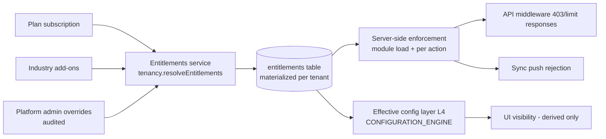

# Subscription and Entitlements

> **Status:** STABLE · **Owner:** Product & Platform Architecture · **Updated:** 2026-10-27

How tenants pay for and receive capabilities. **All prices and numeric limits in this file
are PLACEHOLDERS pending product-owner decision [OQ-002](../ASSUMPTIONS_AND_OPEN_QUESTIONS.md)**
— the mechanism below is normative; every number marked ⚠ may change without an architecture
change (RISK-003 mitigation: the entitlement engine is decoupled from plan data, so plan
changes are configuration).

The entitlement model implements `platform.entitlements` and `platform.subscriptions`
([FEATURE_CATALOG.md](FEATURE_CATALOG.md) §3) over the `plans`, `subscriptions`, and
`entitlements` entities ([../database/ENTITY_CATALOG.md](../database/ENTITY_CATALOG.md)).

## 1. Plans

Three self-serve plans plus Enterprise agreements. Every plan includes the financial core —
accounting correctness is never a upsell (pillar: one rigorous core for everyone).

| Plan | Positioning (EN · AR) | Monthly price ⚠ | Annual price ⚠ | Billing |
|---|---|---|---|---|
| **Starter** | البداية — micro shops, 1–3 people, phone-first | PLACEHOLDER | PLACEHOLDER | Card via provider adapter; manual invoicing fallback (A-009) |
| **Business** | الأعمال — SMBs needing trade + POS + templates | PLACEHOLDER | PLACEHOLDER | Same |
| **Enterprise** | المؤسسات — multi-branch, manufacturing/distribution, API volume | PLACEHOLDER (contract) | PLACEHOLDER | Invoice-based with contract terms |

## 2. Plan matrix (limits are PLACEHOLDER ⚠ pending OQ-002)

| Limit / capability | Starter ⚠ | Business ⚠ | Enterprise ⚠ |
|---|---|---|---|
| Users | 3 | 10 | 50 |
| Branches | 1 | 3 | Unlimited |
| Warehouses | 2 | 6 | Unlimited |
| Documents / month (posting documents) | 500 | 5,000 | 250,000 |
| POS terminals | 0 (not included) | 3 | Unlimited |
| Offline devices (sync-capable) | 0 | 5 | 100 |
| Industry add-ons included | 0 | 1 | 3 |
| Support access | Standard | Standard | Priority SLA (OQ-008) |
| Data export | Included | Included | Included |
| Audit retention | Full | Full | Full |

**Feature keys per plan** (references [FEATURE_CATALOG.md](FEATURE_CATALOG.md); `+` = plan
includes everything of the plan to its left):

| Module area | Starter | Business adds | Enterprise adds |
|---|---|---|---|
| platform | `platform.registration`, `platform.onboarding`, `platform.branches`, `platform.users_roles`, `platform.audit_trail`, `platform.data_export` | `platform.notifications` (in-app) | — |
| accounting | `accounting.chart_of_accounts`, `accounting.fiscal_calendar`, `accounting.journal_entries`, `accounting.approvals`, `accounting.general_ledger`, `accounting.opening_balances`, `accounting.period_close`, `accounting.year_end_close`, `accounting.reconciliation` | `accounting.multi_currency`, `accounting.cost_centers` | `accounting.projects` |
| master data & trade | `partners.*` (directory, credit_terms, statements), `items.*` (core), `inventory.stock_ledger`, `inventory.valuation`, `inventory.multi_warehouse`, `sales.quotations`…`sales.receivables_aging` core chain, `purchasing.requests`…`purchasing.three_way_matching` | `inventory.batch_tracking`, `inventory.serial_tracking`, `inventory.stock_counts`, `inventory.stock_transfers`, `sales.credit_limits`, `partners.credit_management`, `purchasing.landed_costs` | `inventory.reservations`, `inventory.reorder_levels`, `sales.commissions` |
| treasury & tax | `treasury.accounts`, `treasury.receipts_disbursements`, `treasury.expenses`, `treasury.expense_categories`, `tax.engine`, `tax.codes`, `tax.registrations`, `tax.jurisdiction_packs`, `tax.vat_return` | `treasury.petty_cash`, `treasury.cash_transfers`, `treasury.bank_reconciliation`, `treasury.cashier_shifts`, `treasury.cheques` | `tax.einvoicing_framework` (adapters per jurisdiction add-on) |
| reporting | `reporting.engine`, `reporting.financial_statements`, `reporting.operational_reports` (core), `reporting.print_templates`, `reporting.exports` | `reporting.dashboards` | `reporting.scheduled_reports` |
| growth tier | — | `pos.terminals`, `pos.sales`, `pos.shifts`, `pos.receipts`, `pos.barcode_scanning`, `pos.offline_queue`, `industry.template_engine`, `industry.terminology`, one industry add-on of choice | `crm.*`, `manufacturing.*`, `distribution.*`, `industry.addons` (3), `offline.desktop_app`, `offline.android_app`, `offline.mobile_accounts`, `offline.device_management` |

## 3. Industry add-ons (PLACEHOLDER pricing ⚠)

Add-ons bundle a template + the feature keys that template emphasizes
([INDUSTRY_CATALOG.md](INDUSTRY_CATALOG.md)):

| Add-on | Template | Feature keys bundled |
|---|---|---|
| Retail pack | `industry.retail` | `pos.*` set, `items.barcodes`, `treasury.cashier_shifts` |
| Grocery pack | `industry.grocery` | Retail pack + `inventory.batch_tracking`, `items.units_of_measure` |
| Restaurant pack | `industry.restaurant` | Retail pack + `items.composite_products` |
| Automotive pack | `industry.automotive` | `crm.service_orders`, `inventory.serial_tracking`, `accounting.cost_centers` |
| Distribution pack | `industry.distribution` | `distribution.*`, `sales.commissions`, `offline.android_app` |
| Food manufacturing pack | `industry.food_manufacturing` | `manufacturing.*`, `inventory.batch_tracking` |
| Professional services pack | `industry.professional_services` | `crm.service_contracts`, `crm.recurring_billing`, `accounting.projects` |
| Rental / logistics pack | `industry.rental_logistics` | `crm.service_contracts`, `inventory.serial_tracking`, `crm.recurring_billing` |

Rules: an add-on may not be activated if its dependency closure is unsatisfiable (BR-040);
add-on activation is additive (menus appear, nothing is removed); removing an add-on moves
its features to **read-only historical access** (documents stay readable/posted; new
creation blocked).

## 4. Entitlement resolution pipeline

1. **Resolve**: plan feature keys ∪ add-on keys ∪ overrides → materialized `entitlements`
   rows with `source` (plan / add_on / override) and `expires_at`.
2. **Enforce server-side** (BR-039): module guards check the feature key at load and per
   action; a missing key yields a typed error (`feature_not_entitled`), never a crash.
3. **UI is derived-only**: the client renders from the same resolved set — hiding a button
   is presentation, not protection.
4. **Offline clients** cache the entitlement snapshot at sync; sync-time revalidation
   rejects pushes for features the tenant lost (typed error, actionable per
   [ADR-0012](../architecture/ADR/ADR-0012-offline-sync.md)).

## 5. Enforcement points

| Point | What is checked | Behavior on failure |
|---|---|---|
| API middleware (tenant context validation, [../architecture/MULTI_TENANCY.md](../architecture/MULTI_TENANCY.md) §2) | Session/membership ACTIVE; tenant ACTIVE; feature key present for the route's module | `401` inactive session · `403 tenant_suspended` · `403 feature_not_entitled` |
| Module services (action level) | Feature key + permission key (e.g., `sales.invoices.post`) | Typed domain error; never partial writes (unit-of-work) |
| Limit counters (documents/month, users, branches, warehouses, terminals, devices) | Soft limits warn ahead (see §6); hard limits block the creating action | `429`/`422` with `limit_exceeded` detail naming the limit and current usage |
| Sync (push/pull) | Entitlement snapshot + tenant status | Push rejected (`tenant_suspended`, `feature_not_entitled`) — returned as actionable device errors, never silently merged |
| Report/print jobs | Report key permission + feature key | Job rejected with the same typed errors; quotas per tenant prevent noisy-neighbor runs |
| Checkout/billing | Plan change validity (limits fit current usage) | Downgrade blocked while usage exceeds target plan limits (see §8) |

## 6. Limit behaviors — soft warnings vs hard blocks

| Limit type | Pre-warning (soft) | Block (hard) | Rationale |
|---|---|---|---|
| Users | At 80% ⚠ and 100% of plan limit: in-app + email to owner | New invitations blocked; existing users keep working | People are never locked out of the product they paid for |
| Branches / warehouses | Same 80% pattern | New branch/warehouse creation blocked | Creation-time check is safe; nothing existing breaks |
| Documents / month | 80% ⚠ and 100%: dashboard banner + email; usage report linked | **No hard block**: posting continues; overage either bills per the plan or triggers a plan-change conversation (⚠ OQ-002) | Blocking a cash sale because of a billing counter is unacceptable for a POS-bearing product; billing pressure uses notifications + billing, not ledger locks |
| POS terminals / devices | At limit: next activation warns | Activation blocked (device can be deactivated to free the slot) | Slots are enforceable without hurting live sessions |
| Feature entitlements | Grace period on downgrade (see §8) | New-document creation blocked after grace; history stays readable | Protects the ledger, not the billing pressure |

**Invariant boundary**: no limit behavior may affect posted data or reconciliation
(INV-022) — limits gate *new* actions only.

## 7. Trial behavior (parameters ⚠ pending OQ-002 refinement)

1. New tenants receive a trial of the **Business** plan — duration PLACEHOLDER ⚠ (default
   proposal: 14 days) with no card required unless the tenant opts into paid earlier.
2. Trial entitlements are materialized exactly like paid ones (`source: trial`,
   `expires_at` set) — no parallel code path, no trial-mode feature flags inside modules.
3. At expiry without payment: tenant enters the downgrade path (§8) — read-only grace
   first, never an immediate data freeze.
4. Trial limits: full Business limits ⚠; document counter visible to set expectations.
5. No trial data is ever deleted at expiry before the offboarding retention window (Journey H).

## 8. Suspension, downgrade, and read-only mode

| Scenario | Trigger | Grace behavior ⚠ | End state |
|---|---|---|---|
| Payment failure | Provider dunning steps (adapter-defined) | Read-only period — PLACEHOLDER duration (proposal: 14 days): all users keep **read** access + exports; postings blocked with `subscription_read_only` errors | Suspension on grace expiry |
| Manual suspension | Platform admin (billing or security), audited | None (immediate, reason recorded) | Sessions invalidated; device pushes rejected; sync pulls return `tenant_suspended` (MULTI_TENANCY §6) |
| Suspension lift | Payment received / admin restore | — | Tenant ACTIVE; sessions re-established by re-login; sync resumes from cursors |
| Plan downgrade | Tenant-initiated or expiry to a lower tier | Grace until period end ⚠ (proposal: end of current billing period) for features lost | Downgrade blocked while *usage* (open documents, active branches, stored batches) exceeds the target plan's limits — the tenant is told exactly what blocks it (e.g., "3 branches exist; Business allows 3 — deactivate 1") |
| Add-on removal | Tenant or plan change | Same grace | Feature's documents stay readable (read-only historical access); new creation blocked |
| Offboarding | Owner request (Journey H in [USER_JOURNEYS.md](USER_JOURNEYS.md)) | Read-only grace ⚠ → data export → suspension → retention window (OQ-009) → purge | Deleted with audit certificate |

Read-only mode is a **first-class product state**, not an error page: dashboards, reports,
exports, and printing continue to work; only state-changing actions fail with typed errors
naming the reason and the resolving action (pay / upgrade / contact admin).

## 9. Manual overrides (platform administrators)

1. Who: platform staff with `platform.entitlements.manage`, acting in the admin console
   (persona P-07); every operation is tenant-scoped, reason-required, and audit-logged as
   `via_platform_admin` ([../architecture/MULTI_TENANCY.md](../architecture/MULTI_TENANCY.md)).
2. What can be overridden: grant or revoke feature keys (`source: override`), raise limits
   (e.g., documents/month headroom during a migration), extend trial/grace, force plan.
3. Override fields (mandatory): feature key or limit, new value, `expires_at` (overrides
   **must** expire or be renewed deliberately), free-text reason, correlation id.
4. What can never be overridden: invariants (INV-022), authorization checks, posted data,
   jurisdiction pack contents, and plan *prices* (billing corrections happen in the billing
   system, not in entitlements).
5. Tenant visibility: the owner sees active overrides (feature keys "مُمَكَّنة بواسطة المنصة"
   — granted by the platform) and their expiry in settings; overrides are not secret.
6. Review cadence: the admin console surfaces overrides older than their typical lifetime ⚠
   for review; the platform audit trail (P-07 workflow) includes an override aging report.

## 10. Checkout and billing mechanics (PHASE-014)

1. Payment-provider adapter (provider choice = [OQ-003](../ASSUMPTIONS_AND_OPEN_QUESTIONS.md))
   with a mandatory **manual invoicing fallback** for markets without card adoption (A-009).
2. Plan changes take effect per billing policy (immediate upgrade with proration ⚠;
   downgrade at period end ⚠); entitlements re-materialize transactionally with the
   subscription record so the system is never mid-state.
3. Every entitlement change (grant, revoke, expiry) emits a cache-invalidation event consumed
   by the configuration engine ([CONFIGURATION_ENGINE.md](CONFIGURATION_ENGINE.md) §4).
4. Billing history is visible to the tenant owner; disputes route to support with the
   subscription/entitlement event ids — never by editing entitlements ad hoc.
