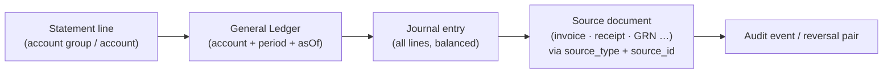

# Financial Report Rules

> **Status:** STABLE · **Owner:** Reporting Architecture · **Updated:** 2026-10-27

Normative derivation rules for the financial statements
([REPORT_CATALOG.md](REPORT_CATALOG.md) §1). All statements derive **exclusively from
posted journal lines** (`journal_entries` + `journal_lines`) joined to the chart of
accounts and fiscal calendar — never from document tables, never from cached balances
used as source ([../accounting/ACCOUNTING_PRINCIPLES.md](../accounting/ACCOUNTING_PRINCIPLES.md) §1.3,
§3). Every rule here is implemented by the accounting module's statement query services
consumed through the report contracts
([REPORTING_ARCHITECTURE.md](REPORTING_ARCHITECTURE.md) §1) and each report self-checks
the assertions of §9–10 ([REPORT_RECONCILIATION.md](REPORT_RECONCILIATION.md)).

## 1. Common foundations

- **Inclusion:** a journal line enters a statement iff its entry is `POSTED` (not
  reversed-away — reversals are themselves posted counter-lines that net naturally),
  `entry_date` falls in the period range, and the entry's tenant/branch scope matches.
- **Period mapping** uses the fiscal calendar ([../accounting/CHART_OF_ACCOUNTS.md](../accounting/CHART_OF_ACCOUNTS.md)
  / fiscal_periods), not raw month arithmetic — custom periods are respected.
- **Sign convention:** account balance = Σ(debit) − Σ(credit); presentation per account
  type normal balance ([../accounting/ACCOUNTING_PRINCIPLES.md](../accounting/ACCOUNTING_PRINCIPLES.md)
  §1.4). Amounts are exact decimals; presentation rounding per §8 only.
- **Branch scoping:** statements accept branch subsets; multi-branch consolidation is
  additive over the same posted lines (no elimination entries at MVP — single-legal-
  entity assumption, [../GLOSSARY.md](../GLOSSARY.md) Tenant).

## 2. Trial Balance (ميزان المراجعة)

Per leaf account **a** in scope:

```
openingDebit(a)  / openingCredit(a)   = balance side of Σ lines before dateFrom
                                          (period-0 through dateFrom−1; includes
                                          opening-balance entries, which are ordinary
                                          posted journal entries)
periodDebit(a)   = Σ debit  of lines in [dateFrom, dateTo]
periodCredit(a)  = Σ credit of lines in [dateFrom, dateTo]
closingDebit(a)  / closingCredit(a)   = side of (opening ± period movement)
```

- A balance is shown on **one side only** (its normal side; a contra balance shows on
  the abnormal side — e.g., accumulated depreciation shown as debit-negative is
  forbidden; it appears on the credit side with its account, per contra rules §4).
- Rows with zero opening, zero movement, and zero closing are suppressed by default
  (`zeroSuppression: rows`, §8).
- Grouping default: by account type with subtotals; drill: account row → General Ledger
  filtered by account + period + asOf.

## 3. Income Statement (قائمة الدخل)

- Universe: accounts of type REVENUE and EXPENSE (including contra accounts:
  sales discounts, sales returns — presented as deductions from gross revenue, not as
  expenses; cost accounts COGS presented as its own section).
- For period P: `line amount = Σ period movement (Σ debit − Σ credit)`; presented value
  flips sign for REVENUE (credit-normal → positive = income).
- **Contra account handling (binding):** accounts flagged contra (e.g., sales-discount
  purpose, sales-returns purpose, purchase-discount purpose) aggregate *into their
  parent presentation line* with opposite sign — gross revenue − discounts − returns =
  net revenue. The CoA purpose mapping
  ([../accounting/CHART_OF_ACCOUNTS.md](../accounting/CHART_OF_ACCOUNTS.md)) declares
  the parent line; statements never guess by name.
- Sections: الإيرادات Revenue → تكلفة المبيعات COGS → مجمل الربح Gross profit →
  المصروفات Expenses (by account group) → صافي الدخل Net income.
- Fiscal-year boundary: revenue/expense accounts are **not** zeroed mid-year; the
  statement subtracts period-start YTD balances when showing a sub-year period
  (period movement only) and uses the year-end closing entry
  ([../accounting/PERIOD_CLOSING.md](../accounting/PERIOD_CLOSING.md)) for "after close"
  views.

## 4. Balance Sheet (قائمة المركز المالي)

- Universe: ASSET, LIABILITY, EQUITY accounts — **as of a date** (no period movement
  columns), grouped by the CoA tree order (account groups → accounts), assets first.
- Balance as-of = Σ all posted lines up to `asOf` on the account, presented on the
  normal side; contra assets (accumulated depreciation, allowance for doubtful AR)
  display as negative within their parent group (parentheses forbidden — minus sign,
  [../ui/RTL_DESIGN_RULES.md](../ui/RTL_DESIGN_RULES.md) §8).
- **Retained earnings line composition (binding):**

```
retainedEarningsLine =
    balance(RE purpose: RETAINED_EARNINGS)          // prior years, closed
  + balance(RE purpose: CURRENT_YEAR_RESULT, if a closing entry exists for
    a completed earlier fiscal year within the same asOf scope)
  + (−IS net income for the CURRENT, not-yet-closed fiscal year,
     = −Σ revenue + Σ expenses of YTD period)        // live P&L into equity
```

  i.e., BS balances **iff** the current-year result is folded into equity as the "net
  income – current year" (صافي دخل السنة الجارية) line. If the year-end closing entry
  exists, that line equals the closed amount and the YTD component is zero — the two
  states must never double count (assertion `bs-current-year-once`, §9).
- Comparative mode adds a prior-year-asOf column when enabled
  (§6), labeled with its own date.

## 5. Cash Flow Statement (قائمة التدفقات النقدية)

- **MVP method: indirect**, derived from IS + balance deltas — no direct-method cash
  tagging exists yet:

```
netIncome (from §3, same scope/period)
± Δ non-cash working capital  (Δ AR, Δ inventory, Δ GRNI, Δ prepayments/accruals,
                               Δ AP, Δ VAT payable/recoverable, Δ other current)
± Δ non-cash P&L-adjacent items where identifiable (depreciation/amortization,
   FX differences, provisions) — via account purpose tags
− investments in / proceeds from non-current assets (by account group)
± Δ financing items (equity movements, loans) (by account group)
= net change in cash + cash equivalents
check: net change == Δ(cash & bank account balances over the period)
```

- **Documented limitation (displayed on the report itself):** indirect derivation
  attributes deltas by account groups and purpose tags; categories with untagged
  accounts aggregate into "أخرى / Other" — the reconciliation check against actual
  cash movements is therefore the report's binding assertion (`cf-cash-tie`, §9).
  Direct-method classification is a post-MVP enhancement, not a fix of a bug.
- Cash & cash equivalents scope: accounts mapped to cash/bank purposes (incl. petty
  cash); restricted accounts excluded by configuration flag.

## 6. Comparative periods & prior-year rules

- IS and CF accept one comparative period (previous fiscal period or same period prior
  year — parameter `comparative`), rendered as a paired column with its own date label;
  BS accepts a prior-year asOf column.
- Comparatives re-derive from posted lines at their own dates — **never** stored
  snapshots; a corrected past (via credit notes/reversals) reflects honestly in
  comparatives ([../accounting/ACCOUNTING_PRINCIPLES.md](../accounting/ACCOUNTING_PRINCIPLES.md)
  §3 — additive corrections only).
- Percent-change columns are computed only when the comparative base ≠ 0; "n/a"
  otherwise (bilingual).

## 7. As-of determinism (re-run identity)

- Statements run in as-of mode by default: `asOf` (datetime) or fiscal period end.
  Because posted lines are immutable and reversals are additive
  ([../accounting/DOCUMENT_LIFECYCLE.md](../accounting/DOCUMENT_LIFECYCLE.md) §2), the
  same `(scope, dates, asOf)` yields **byte-identical results** on every re-run — this
  is a CI-tested property ([REPORT_RECONCILIATION.md](REPORT_RECONCILIATION.md) §3),
  and cache entries keyed by asOf are therefore sound
  ([REPORTING_ARCHITECTURE.md](REPORTING_ARCHITECTURE.md) §6).
- "Current" mode (asOf = now) is allowed only with the freshness stamp rendered
  ([REPORTING_ARCHITECTURE.md](REPORTING_ARCHITECTURE.md) §10) and is never used for
  archived/period-close outputs.

## 8. Rounding & zero suppression

- All internal math is exact decimal (NUMERIC(19,4),
  [../architecture/ADR/ADR-0009-money-precision.md](../architecture/ADR/ADR-0009-money-precision.md)).
- **Presentation rounding happens once, at the display boundary**: base-currency minor
  units (default 2dp), half-up. Totals are computed on exact values then rounded —
  the sum of displayed rows may differ from the displayed total by ≤ rounding residual;
  when it would, the report displays the exact-decimal total (money rules:
  totals are truth, [../accounting/JOURNAL_RULES.md](../accounting/JOURNAL_RULES.md)
  rounding discipline).
- Zero suppression: rows with all-zero measures are hidden by default (toggle in
  params); suppressed rows still count for assertion math (suppression is display-only).
- Grand totals marked `kind: 'check'` render with a lock glyph and the assertion status
  in the viewer footer ([../ui/COMPONENT_CATALOG.md](../ui/COMPONENT_CATALOG.md) §6.5).

## 9. Multi-currency presentation (binding)

- **Statements are base-currency only.** All lines use the base amounts frozen at
  posting (INV-008: base = document × stored rate, exactly as posted — reports never
  re-convert and never use current rates).
- Document-currency detail lives in the drill-down chain (GL line shows document
  currency, rate, and document amounts); TB/IS/BS/CF never mix currencies.
- FX gain/loss (realized) posts post to FX-difference purposes and appears in IS
  income/expense lines like any other account; unrealized revaluation is post-MVP and
  never silently included ([../accounting/ACCOUNTING_PRINCIPLES.md](../accounting/ACCOUNTING_PRINCIPLES.md)
  §5.3).

## 10. Drill-down chain (statement line → source document)



- Every hop preserves the scope (asOf, branch) in the deep link
  ([../ui/NAVIGATION_MODEL.md](../ui/NAVIGATION_MODEL.md) §4) and requires the
  corresponding read permission at each hop
  ([REPORTING_ARCHITECTURE.md](REPORTING_ARCHITECTURE.md) §4).
- The chain is complete **by construction** (posting writes the full provenance,
  [../accounting/ACCOUNTING_PRINCIPLES.md](../accounting/ACCOUNTING_PRINCIPLES.md) §3.3);
  a statement line that cannot drill to source documents is a defect.

## 11. Required self-check assertions per financial report

| Report | Assertion id | Check | Invariant link |
|--------|--------------|-------|----------------|
| Trial Balance | `tb-debits-equal-credits` | ΣperiodDebit == ΣperiodCredit (exact) | INV-001 |
| Trial Balance | `tb-closing-net-zero` | ΣclosingDebit == ΣclosingCredit | INV-001/002 |
| General Ledger | `gl-entry-balance` | every included entry is balanced (document & base) | INV-001/002 |
| Income Statement | `is-tb-tie` | IS lines == TB revenue/expense period movements (same scope) | — |
| Balance Sheet | `bs-tb-tie` | BS closing balances == TB closing balances | — |
| Balance Sheet | `bs-current-year-once` | YTD result counted exactly once (no double count with closing entry) | — |
| Cross-statement | `is-net-equals-bs-current-result` | IS net income == BS current-year result line (same scope/asOf) | — |
| Cash Flow | `cf-cash-tie` | computed net change == Δ cash+equivalents balances | INV-019 |

All financial assertions run with **exact-decimal comparison, tolerance 0**; any FAIL
blocks export/print and renders the bilingual failure banner
([REPORT_CONTRACT.md](REPORT_CONTRACT.md) §1,
[REPORT_RECONCILIATION.md](REPORT_RECONCILIATION.md) §1). This table is the minimum set
— contracts may add checks but never drop these.
