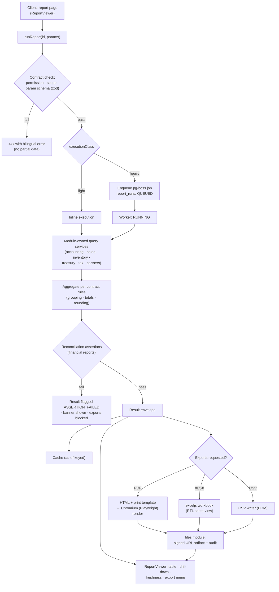

# Reporting Architecture

> **Status:** STABLE · **Owner:** Reporting Architecture · **Updated:** 2026-10-27

Engine architecture for all reporting, printing, and exports, implementing
[ADR-0011](../architecture/ADR/ADR-0011-reporting-printing.md) in **PHASE-013**
([../planning/MASTER_ROADMAP.md](../planning/MASTER_ROADMAP.md)). Normative contract:
[REPORT_CONTRACT.md](REPORT_CONTRACT.md). Inventory of reports:
[REPORT_CATALOG.md](REPORT_CATALOG.md). Statement derivation math:
[FINANCIAL_REPORT_RULES.md](FINANCIAL_REPORT_RULES.md).

## 1. Non-negotiable principles

1. **The reporting module owns no business data.** It owns the report contract registry,
   execution orchestration, rendering, export, print templates, and run history
   (`reports`, `report_runs`, `print_templates` — see
   [../architecture/MODULE_BOUNDARIES.md](../architecture/MODULE_BOUNDARIES.md)).
   All business truth is queried through **module-owned authorized query services**
   (accounting GL queries, sales AR queries, inventory valuation queries, …). No report
   ever issues raw cross-module SQL; no report bypasses tenant scoping (directive §11).
2. **One contract per report** — registered, versioned, permission-checked
   ([REPORT_CONTRACT.md](REPORT_CONTRACT.md)); no per-screen report logic, ever.
3. **Statements derive exclusively from posted journal data** plus documented rules
   ([FINANCIAL_REPORT_RULES.md](FINANCIAL_REPORT_RULES.md)); every financial report
   self-checks reconciliation assertions
   ([REPORT_RECONCILIATION.md](REPORT_RECONCILIATION.md)) and refuses to export on a
   failed check.
4. **As-of determinism**: identical parameters against immutable posted data produce
   byte-identical results on re-run
   ([../accounting/ACCOUNTING_PRINCIPLES.md](../accounting/ACCOUNTING_PRINCIPLES.md) §3).

## 2. Report definition registry

Reports are **code-defined contracts** (TypeScript modules in
`apps/api/src/modules/reporting/registry/`), not database rows tenants can invent —
tenants get saved *parameter sets*, not new report logic. At boot, the registry:

1. Parses and validates every contract against the contract schema (zod —
   [REPORT_CONTRACT.md](REPORT_CONTRACT.md) §schema); a malformed contract fails startup.
2. Enforces unique `id` + monotonic `version`; indexes reports for the command menu and
   the report navigation page.
3. Publishes the registry snapshot (id, title bilingual, category, permissions) to the
   web app — this drives [../ui/PAGE_ARCHETYPES.md](../ui/PAGE_ARCHETYPES.md) §7
   (Report Page) navigation, so a report with no registry entry is invisible by
   construction.

Industry templates (PHASE-015) may **register additional reports** into their own
namespaced catalog (`industries/<template>/reports/`, pointer in
[REPORT_CATALOG.md](REPORT_CATALOG.md) §8) following the same contract; they may not
modify or shadow core reports.

## 3. Execution paths

| Path | Criteria (declared per contract `executionClass`) | Behavior |
|------|---------------------------------------------------|----------|
| **Inline** | Light: bounded rows (≤ ~5,000 result cells), no PDF render, index-friendly queries | Synchronous request → result envelope; p50 target < 500ms ([../architecture/OBSERVABILITY.md](../architecture/OBSERVABILITY.md) budgets) |
| **pg-boss job** | Heavy: large scans, multi-branch consolidation, PDF/XLSX generation, scheduled runs | `reporting.report.run` job; client polls `report_runs` status (queued → running → succeeded/failed) with progress stage; results stored as artifacts |

Job execution detail (ADR-0008 patterns): one job = one run row; worker picks up,
re-resolves permissions **at execution time** (a grant revoked mid-queue kills the run —
no TOCTOU leaks), streams module query results, aggregates, runs assertions, renders
exports, writes artifacts to the `files` module (signed URLs for download), and marks
the run. Failed jobs retry per pg-boss policy; a run is idempotent by
`(report_id, params_hash)` — re-running replaces its own artifacts, never duplicates.

## 4. Permission enforcement (contract level, binding)

- Every contract declares `requiredPermission` (e.g., `reports.financial.tb.read`); the
  runner checks it *before* parameter binding and again at job execution.
- **Scope rules cannot widen permissions**: a user with branch-scoped grants cannot run
  a report with `scope: 'all-branches'`; the contract's `scopeRules` define allowed
  scope dimensions (tenant / branch subset / warehouse subset / dates / as-of), and the
  effective scope is the intersection of requested scope and the user's grants — never
  the requested scope alone.
- Drill-down links carry the same permission checks — clicking a TB line into the GL
  requires the GL permission, else the link renders disabled with a bilingual reason
  tooltip (no silent 403s in the money path).

## 5. Tenant & branch scoping

- Tenant isolation is enforced twice: RLS on every queried table
  ([../database/TENANT_ISOLATION.md](../database/TENANT_ISOLATION.md)) and explicit
  `tenant_id` in every module query service call — the reporting layer composes scoped
  service calls, it does not "trust" the query.
- Branch/warehouse scoping: parameters accept branch/warehouse ID lists; contracts
  declare which dimensions apply (a VAT return is jurisdiction-scoped, a stock count
  report is warehouse-scoped). Consolidation (all branches) is itself a declared
  contract capability, audited per run.

## 6. Caching policy (no stale financial data)

1. Cache key = `(tenant, report_id, contract_version, params_hash)`; params **include
   as-of semantics** (as-of date/time or "current"), so a "current" run and an as-of
   run never share entries.
2. Financial reports run in **as-of mode by default** (period end or explicit timestamp
   from the parameters): deterministic and safely cacheable until data changes.
3. Invalidation: `invoice.posted` / reversal / period-lock events invalidate the
   tenant's affected cache entries ([../architecture/MODULE_BOUNDARIES.md](../architecture/MODULE_BOUNDARIES.md)
   §events) — a cached financial result can never outlive a posting that changes it.
4. "Current" (non-as-of) runs are cached ≤ 60s and always display the computed-at
   timestamp; UI renders freshness as "كما في … / as of …" with a stale badge if an
   invalidation occurred during viewing ([COMPONENT_CATALOG.md](../ui/COMPONENT_CATALOG.md) §6.5).
5. Exports always render from the stored result envelope of a run — the PDF you print is
   the result you saw (assertions included).

## 7. Export pipeline

- **PDF**: HTML from the versioned print templates + result envelope → Chromium
  (Playwright) headless render → standard PDF; PDF/A-2b for archive-class artifacts
  (e.g., period-close statement pack) — full rules:
  [PRINTING_AND_EXPORT.md](PRINTING_AND_EXPORT.md).
- **XLSX**: exceljs workbooks — RTL sheet views when the run locale is Arabic, typed
  columns, number formats, styled headers, **values only (no formulas)** for
  auditability (ADR-0011).
- **CSV**: direct writer — UTF-8 **BOM**, ISO-8601 dates, decimal strings preserving
  minor units.
- All artifacts go through the `files` module: signed URLs (short-lived), retention
  policy, and an audit event per download (who, which run, when).

## 8. Print templates & versioning

The four versioned base templates (`A4Document`, `A4Report`, `Receipt80`, `Receipt58`)
live in `packages/ui/print` and are consumed by web preview and the server renderer
identically — screen preview and paper cannot diverge. Template versions are recorded
on each `report_run` and stored PDF artifact; an invoice re-printed later re-renders
with the *template version marked at posting time* when the jurisdiction requires it
(e.g., e-invoicing reprint rules), else the current version — the choice is a per-pack
configuration, documented in [PRINTING_AND_EXPORT.md](PRINTING_AND_EXPORT.md) §6.

## 9. Drill-down link generation

- Result rows and totals carry `drillLinks` produced by the contract's declared
  `drillTargets` (e.g., TB account row → GL filtered by account+period; GL line →
  journal entry → source document). Links are deep URLs
  ([../ui/NAVIGATION_MODEL.md](../ui/NAVIGATION_MODEL.md) §4) preserving filter state.
- The chain is complete because posting writes `source_type`+`source_id` on every
  journal entry ([../accounting/ACCOUNTING_PRINCIPLES.md](../accounting/ACCOUNTING_PRINCIPLES.md)
  §3) — no report may link to something without provenance.

## 10. Data freshness indicators

- Every result envelope carries `computedAt`, `asOf`, and `cacheState` (fresh/stale/
  recomputed); ReportViewer renders them bilingually; PDF/XLSX headers embed the same
  stamps. Operational dashboards may show "live" deltas, but financial statements never
  pretend to be live — they state their as-of truth.

## 11. Module interfaces (summary)

| Interface | Provided by | Used by |
|-----------|-------------|---------|
| `runReport(contractId, params, ctx)` | reporting | web app controllers |
| `getRunStatus(runId)` / `listRuns()` | reporting | web app (polling, history) |
| `downloadArtifact(runId, format)` | reporting → files | web app |
| Authorized query services (per module) | accounting, sales, purchasing, inventory, treasury, tax, partners, audit | reporting executor |
| `print(templateId, payload)` | reporting (Chromium pool) | sales/purchasing/treasury (document PDF), reporting (report PDF) |
| Cache invalidation events | posting engine / modules | reporting cache |

## 12. Failure modes & guarantees

| Failure | Behavior |
|---------|----------|
| Permission revoked mid-queue | Run fails with `FORBIDDEN_AT_RUN`; no partial artifacts |
| Assertion failure | Result stored with `ASSERTION_FAILED` + failed check detail; export/print blocked; banner in viewer ([REPORT_RECONCILIATION.md](REPORT_RECONCILIATION.md) §1) |
| Worker crash | pg-boss retry; run marked `FAILED` with correlation id for [../architecture/OBSERVABILITY.md](../architecture/OBSERVABILITY.md) tracing |
| Chromium pool saturation | Queue (no unbounded concurrency); light inline results unaffected — reports never degrade transactional paths |
| Storage failure | Run marked failed; user told to retry; no "half exports" (artifacts written transactionally with the run status) |
