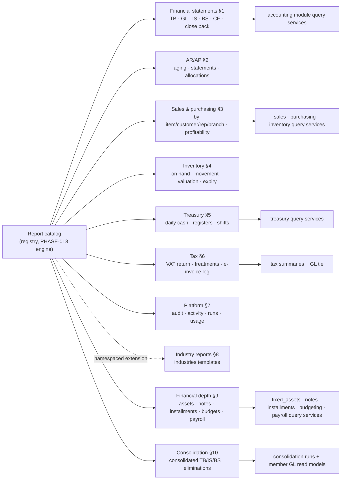

# Report Catalog

> **Status:** STABLE · **Owner:** Reporting Architecture · **Updated:** 2026-10-28

Inventory of every core report, grouped by domain, with **provenance** (source of truth:
module service + owned tables), key parameters, required permission, export formats, and
the phase that delivers it. Directive STEP 9 rule: **a report without a declared source of
truth cannot exist** — the registry boot-check enforces it
([REPORTING_ARCHITECTURE.md](REPORTING_ARCHITECTURE.md) §2), and each contract is fully
specified per [REPORT_CONTRACT.md](REPORT_CONTRACT.md).

Conventions: **Perms** are minimum read permissions (branch-scoped grants intersect —
[REPORTING_ARCHITECTURE.md](REPORTING_ARCHITECTURE.md) §4). **Exports** lists formats;
PDF uses the `a4-report` template unless noted. **Phase** = delivery phase
([../planning/MASTER_ROADMAP.md](../planning/MASTER_ROADMAP.md)); reports registered
earlier than their data phases do not exist — reporting needs real data
(PHASE-013 rationale).

## 0. Catalog map

All arrows to modules mean *authorized query service calls* — the reporting module owns
no business tables ([REPORTING_ARCHITECTURE.md](REPORTING_ARCHITECTURE.md) §1).

## 1. Financial statements (المحاسبة — القوائم المالية)

Derived exclusively from posted journal lines + documented rules
([FINANCIAL_REPORT_RULES.md](FINANCIAL_REPORT_RULES.md)); all run **as-of** with
block-on-fail assertions ([REPORT_RECONCILIATION.md](REPORT_RECONCILIATION.md)).

| Report key | Title (EN / AR) | Source of truth (module · service · tables) | Key parameters | Perm | Exports | Phase |
|------------|------------------|---------------------------------------------|----------------|------|---------|-------|
| `financial.trial-balance` | Trial Balance / ميزان المراجعة | accounting · `glQueries.periodMovementAndBalances` · journal_entries, journal_lines, accounts | dateFrom/To, asOf, branches, grouping (type), zero-suppression, opening balances | `reports.financial.tb.read` | PDF · XLSX · CSV | PHASE-013 |
| `financial.general-ledger` | General Ledger / دفتر الأستاذ العام | accounting · `glQueries.accountLedger` · journal_entries, journal_lines, accounts, cost_centers | account(s), dateFrom/To, asOf, branches, cost-center filter | `reports.financial.gl.read` | PDF · XLSX · CSV | PHASE-013 |
| `financial.income-statement` | Income Statement / قائمة الدخل | accounting · `statementQueries.incomeStatement` · journal_lines, accounts, fiscal_periods | period (fiscal month/quarter/year), asOf, branches, comparative period toggle | `reports.financial.is.read` | PDF · XLSX · CSV | PHASE-013 |
| `financial.balance-sheet` | Balance Sheet / قائمة المركز المالي | accounting · `statementQueries.balanceSheet` · journal_lines, accounts, fiscal_periods | asOf date, branches, comparative prior year toggle | `reports.financial.bs.read` | PDF · XLSX · CSV | PHASE-013 |
| `financial.cash-flow` | Cash Flow Statement / قائمة التدفقات النقدية | accounting · `statementQueries.cashFlow` (indirect) · journal_lines, accounts, fiscal_periods | period, asOf, branches | `reports.financial.cf.read` | PDF · XLSX · CSV | PHASE-013 |
| `financial.fiscal-close-pack` | Period Close Pack / حزمة إقفال الفترة | accounting+reporting · renders the five above for a locked period | fiscal period, branches | `reports.financial.close.read` | PDF (PDF/A) · XLSX | PHASE-013 |
| `accounting.journal-register` | Journal Register / دفتر اليومية | accounting · `glQueries.journalRegister` · journal_entries, journal_lines | dateFrom/To, branches, entry-type filter, source-type filter | `accounting.journals.read` | PDF · XLSX · CSV | PHASE-007 |
| `accounting.cost-centers` | Cost Center Analysis / تحليل مراكز التكلفة | accounting · `glQueries.costCenterBreakdown` · journal_lines, cost_centers | period, branches, cost centers | `reports.accounting.cost-centers.read` | PDF · XLSX · CSV | PHASE-013 |

## 2. AR / AP (الذمم — العملاء والموردون)

| Report key | Title (EN / AR) | Source of truth | Key parameters | Perm | Exports | Phase |
|------------|------------------|-----------------|----------------|------|---------|-------|
| `ar.aging` | AR Aging / أعمار المدينين | sales · `arQueries.aging` · sales_invoices, credit_notes, receipts, allocations (with partners subledger) | asOf, buckets (30/60/90/120 default), branches, partner filter | `reports.ar.aging.read` | PDF · XLSX · CSV | PHASE-012 |
| `ap.aging` | AP Aging / أعمار الدائنين | purchasing · `apQueries.aging` · supplier_invoices, debit_notes, payments, allocations | asOf, buckets, branches, partner filter | `reports.ap.aging.read` | PDF · XLSX · CSV | PHASE-011 |
| `partner.statement` | Customer Statement / كشف حساب العميل | sales+partners · `arQueries.partnerStatement` · AR documents + allocations | partnerId, dateFrom/To, asOf, aging summary toggle | `sales.statements.read` | PDF (`a4-document`) · XLSX · CSV | PHASE-012 |
| `supplier.statement` | Supplier Statement / كشف حساب المورد | purchasing+partners · `apQueries.partnerStatement` · AP documents + allocations | partnerId, dateFrom/To, asOf | `purchasing.statements.read` | PDF (`a4-document`) · XLSX · CSV | PHASE-011 |
| `ar.allocations` | Allocations Report / التخصيصات | sales · `arQueries.allocations` + purchasing `apQueries.allocations` · receipts, payments, allocations | dateFrom/To, partner, document | `reports.ar-alloc.read` | XLSX · CSV | PHASE-012 |
| `partner.balances` | Partner Balances / أرصدة الجهات | partners · `partnerQueries.balances` (subledger sums) · partner_balances, journal-derived | asOf, role (customer/supplier), branch, credit-limit flag | `partners.balances.read` | XLSX · CSV | PHASE-006 |

Notes: aging and statements **recompute from immutable entries at the as-of date**
(deterministic re-runs, [../accounting/RECONCILIATION.md](../accounting/RECONCILIATION.md)
§2); statement rows drill to source documents; `partner.balances` ties to AR/AP control
accounts via INV-009 assertion displayed as a footer badge.

## 3. Sales & purchasing (المبيعات والمشتريات)

| Report key | Title (EN / AR) | Source of truth | Key parameters | Perm | Exports | Phase |
|------------|------------------|-----------------|----------------|------|---------|-------|
| `sales.by-item` | Sales by Item / المبيعات حسب الصنف | sales · `salesAnalytics.itemRevenue` + inventory `valuationQueries.cogsByItem` | period, branches, warehouses, category, reps, currency(base/doc) | `reports.sales.by-item.read` | PDF · XLSX · CSV | PHASE-013 |
| `sales.by-customer` | Sales by Customer / المبيعات حسب العميل | sales · `salesAnalytics.customerRevenue` + partners lookup | period, branches, customer tiers (PHASE-017), reps | `reports.sales.by-customer.read` | PDF · XLSX · CSV | PHASE-013 |
| `sales.by-rep` | Sales by Rep / المبيعات حسب المندوب | sales · `salesAnalytics.repRevenue` · sales invoices + rep attribution | period, branches, reps | `reports.sales.by-rep.read` | PDF · XLSX · CSV | PHASE-013 |
| `sales.by-payment-method` | Sales by Payment Method / المبيعات حسب طريقة الدفع | sales+treasury · `salesAnalytics.paymentMethodSplit` · sales_invoices, receipts | period, branches, methods (cash/card/transfer) | `reports.sales.by-paymethod.read` | PDF · XLSX · CSV | PHASE-013 |
| `sales.document-flow` | Sales Document Flow / حركة مستندات البيع | sales · `salesAnalytics.pipelineConversion` · quotations, sales_orders, delivery_notes, sales_invoices | period, branches, rep, conversion stage filter | `reports.sales.pipeline.read` | XLSX · CSV | PHASE-013 |
| `sales.by-branch` | Sales by Branch / المبيعات حسب الفرع | sales · `salesAnalytics.branchRevenue` | period, branch consolidation | `reports.sales.by-branch.read` | PDF · XLSX · CSV | PHASE-013 |
| `sales.profitability` | Profitability / الربحية | sales + inventory · revenue minus COGS by item/customer/rep/branch | period, dimension, branches | `reports.sales.profitability.read` | PDF · XLSX · CSV | PHASE-013 |
| `sales.commissions` | Rep Commissions / عمولات المندوبين | sales · `commissionQueries.periodCommissions` · invoices + commission scheme (PHASE-017) | period, reps, scheme | `reports.sales.commissions.read` | PDF · XLSX · CSV | PHASE-017 |
| `purchasing.by-supplier` | Purchases by Supplier / المشتريات حسب المورد | purchasing · `apAnalytics.supplierSpend` · supplier_invoices + lines | period, branches, suppliers | `reports.purchasing.by-supplier.read` | PDF · XLSX · CSV | PHASE-013 |
| `purchasing.by-item` | Purchases by Item / المشتريات حسب الصنف | purchasing · `apAnalytics.itemSpend` | period, branches, categories | `reports.purchasing.by-item.read` | PDF · XLSX · CSV | PHASE-013 |
| `purchasing.grni` | GRNI Register / سجل المستلم غير المفوتر | purchasing · `matchingQueries.grniRegister` · goods_receipts vs supplier_invoices | asOf, branches, suppliers | `reports.purchasing.grni.read` | XLSX · CSV | PHASE-011 |
| `purchasing.po-status` | Purchase Order Status / حالة أوامر الشراء | purchasing · `poQueries.statusBoard` · purchase_orders, goods_receipts, supplier_invoices | dateFrom/To, branches, suppliers, open-only | `purchasing.po.read` | XLSX · CSV | PHASE-011 |
| `purchasing.matching-exceptions` | Three-Way Match Exceptions / استثناءات المطابقة الثلاثية | purchasing · `matchingQueries.exceptions` · order/receipt/invoice comparison results | dateFrom/To, branches, exception type (price/qty/missing) | `reports.purchasing.matching.read` | XLSX · CSV | PHASE-011 |

Operational revenue reports carry a `sales-gl-tie` assertion (net+tax vs GL revenue/VAT
movements for the same scope) — see worked example in
[REPORT_CONTRACT.md](REPORT_CONTRACT.md) §4.

## 4. Inventory (المخزون)

| Report key | Title (EN / AR) | Source of truth | Key parameters | Perm | Exports | Phase |
|------------|------------------|-----------------|----------------|------|---------|-------|
| `inventory.stock-on-hand` | Stock on Hand / المخزون المتوفر | inventory · `stockQueries.onHand` · stock_moves, stock_layers, warehouses | asOf, branches, warehouses, category, only-negative, valuation method view | `inventory.stock.read` | PDF · XLSX · CSV | PHASE-010 |
| `inventory.movement` | Stock Movement / حركة المخزون | inventory · `stockQueries.movement` · stock_moves (+ sources via provenance) | dateFrom/To, warehouses, items, move reasons, batch filter | `inventory.moves.read` | PDF · XLSX · CSV | PHASE-010 |
| `inventory.valuation` | Inventory Valuation / تقييم المخزون | inventory · `valuationQueries.itemValuation` · stock_layers (WAC/FIFO) | asOf, warehouses, method, include WIP | `inventory.valuation.read` | PDF · XLSX · CSV | PHASE-010 |
| `inventory.expiry` | Expiry Report / تقرير الانتهاء (الصلاحية) | inventory · `batchQueries.expiry` · item_batches | asOf, warehouses, days-to-expiry buckets, category | `inventory.batches.read` | PDF · XLSX · CSV | PHASE-010 |
| `inventory.count-variance` | Count Variance / فروقات الجرد | inventory · `countQueries.variance` · stock_counts (+ adjustment journals via provenance) | count session, warehouse, variance threshold | `inventory.counts.read` | PDF · XLSX · CSV | PHASE-010 |
| `inventory.slow-moving` | Slow-Moving Stock / المخزون الراكد | inventory · `stockQueries.turnover` | asOf, no-sale days threshold, warehouses | `inventory.stock.read` | XLSX · CSV | PHASE-013 |
| `inventory.transfer-log` | Stock Transfer Log / سجل التحويلات | inventory · `stockQueries.transferLog` · stock_transfers, stock_moves | dateFrom/To, from/to warehouses, status (in-transit/posted) | `inventory.moves.read` | PDF · XLSX · CSV | PHASE-010 |
| `inventory.serial-tracking` | Serial / IMEI Tracking / تتبع المسلسلات و IMEI | inventory · `serialQueries.tracking` · item_serials (+ sale/purchase provenance) | serial/IMEI exact match or item+date range | `inventory.serials.read` | XLSX · CSV | PHASE-010 |

Valuation and stock-on-hand reports assert INV-010 (Σ qty×valuation = inventory account)
and display the check result in the footer ([REPORT_RECONCILIATION.md](REPORT_RECONCILIATION.md)).

## 5. Treasury (الخزينة)

| Report key | Title (EN / AR) | Source of truth | Key parameters | Perm | Exports | Phase |
|------------|------------------|-----------------|----------------|------|---------|-------|
| `treasury.daily-cash` | Daily Cash Flow / الحركة النقدية اليومية | treasury · `cashQueries.dailyFlow` · cash_accounts movements (+ posted journals) | date, branch, account(s), opening/closing toggle | `treasury.cash.read` | PDF · XLSX · CSV | PHASE-008 |
| `treasury.receipts-register` | Receipts Register / سجل سندات القبض | treasury+sales · `cashQueries.receiptsRegister` · receipts (+ allocations) | dateFrom/To, branches, cashiers, payment methods, partner | `treasury.receipts.read` | PDF · XLSX · CSV | PHASE-008 |
| `treasury.payments-register` | Payments Register / سجل سندات الصرف | treasury+purchasing · `cashQueries.paymentsRegister` · payments (+ allocations) | dateFrom/To, branches, payees, accounts | `treasury.payments.read` | PDF · XLSX · CSV | PHASE-008 |
| `treasury.petty-cash` | Petty Cash Analysis / تحليل الصندوق الصغير | treasury · `expenseQueries.pettyCash` · expenses, cash_transfers (petty fund scope) | period, branches, funds, expense categories | `treasury.petty.read` | PDF · XLSX · CSV | PHASE-008 |
| `treasury.fx-differences` | FX Differences / فروق العملات | accounting+treasury · `glQueries.fxDifferenceLines` · journal_lines (FX purposes) | period, branches, currencies | `reports.treasury.fx.read` | PDF · XLSX · CSV | PHASE-008 |
| `treasury.expenses` | Expenses Analysis / تحليل المصروفات | treasury · `expenseQueries.analysis` · expenses (+ GL expense accounts) | period, branches, expense categories, cost centers | `treasury.expenses.read` | PDF · XLSX · CSV | PHASE-008 |
| `treasury.shifts` | Shifts Report / تقرير الورديات | treasury · `shiftQueries.history` · cashier_shifts (+ receipts/payments) | dateFrom/To, branches, cashiers, variance filter | `treasury.shifts.read` | PDF · XLSX · CSV | PHASE-008 |
| `treasury.bank-recon` | Bank Reconciliation Status / حالة التسوية البنكية | treasury · `bankRecQueries.status` · bank_reconciliations | period, bank account, matched/unmatched filter | `treasury.bankrec.read` | XLSX · CSV | PHASE-008 |

Cash reports assert INV-019 (account balance = Σ movements) per account in scope.

## 6. Tax (الضرائب — per jurisdiction)

| Report key | Title (EN / AR) | Source of truth | Key parameters | Perm | Exports | Phase |
|------------|------------------|-----------------|----------------|------|---------|-------|
| `tax.vat-return` | VAT Return / الإقرار الضريبي | tax · `returnQueries.vatReturn` · document tax summaries + GL tax accounts (INV-012 tie) | jurisdiction, period, registration, output/input breakdown by treatment | `reports.tax.vat-return.read` | PDF · XLSX · CSV | PHASE-009 |
| `tax.summary-by-treatment` | Sales/Purchases by Tax Treatment / الملخص حسب المعاملة الضريبية | tax · `taxQueries.byTreatment` + sales/purchasing analytics | period, branches, direction (sales/purchases) | `reports.tax.summary.read` | XLSX · CSV | PHASE-009 |
| `tax.e-invoicing-log` | E-Invoicing Submission Log / سجل الفوترة الإلكترونية | tax · `eInvoicingQueries.submissions` · e_invoicing_submissions | period, status (cleared/reported/failed), adapter | `reports.tax.einvoice-log.read` | XLSX · CSV | PHASE-023 |

The VAT return renders both sides (document summaries vs GL movements) side-by-side; a
mismatch marks the draft "unfileable" ([../accounting/RECONCILIATION.md](../accounting/RECONCILIATION.md)
§5) — the platform reports; humans file.

## 7. Platform administration (المنصة)

| Report key | Title (EN / AR) | Source of truth | Key parameters | Perm | Exports | Phase |
|------------|------------------|-----------------|----------------|------|---------|-------|
| `platform.audit-trail` | Audit Trail / سجل التدقيق | audit · `auditQueries.search` · audit_events | dateFrom/To, actor, entity type/id, correlation id | `platform.audit.read` | XLSX · CSV | PHASE-003 |
| `platform.user-activity` | User Activity / نشاط المستخدمين | identity+audit · `userQueries.activity` · sessions, audit_events | period, users, branch | `platform.users.read` | XLSX · CSV | PHASE-003 |
| `platform.report-runs` | Report Runs History / سجل تشغيل التقارير | reporting · `runQueries.history` · report_runs | period, user, report, status | `platform.reporting.read` | XLSX · CSV | PHASE-013 |
| `platform.subscription-usage` | Subscription Usage / استخدام الاشتراك | tenancy · `subscriptionQueries.usage` · subscriptions, entitlements | period, tenant (platform admin scope) | `platform.tenants.read` | XLSX · CSV | PHASE-004/014 |

## 8. Industry reports (extension point)

Industry templates add template-namespaced reports under
`industries/<template>/reports/` (PHASE-015+), following the same contract and registry
rules ([REPORTING_ARCHITECTURE.md](REPORTING_ARCHITECTURE.md) §2) — e.g., restaurant
day-part sales, automotive job-card margin, distribution route productivity,
manufacturing batch costing (PHASE-018). Pointer:
[../industries/reports/](../industries/reports/) (maintained by the industry templates
phase; contracts land with their templates). Core modules remain the source of truth —
industry reports may only query through the same module query services plus their own
industry tables.

## 9. Financial depth (v2.0 — fixed assets, notes, installments, budgeting, payroll)

Added by Blueprint v2.0 ([../EXPANSION_REGISTER.md](../EXPANSION_REGISTER.md) §J —
catalog 50 → 67). Provenance = owning module + owned tables (rule §16); permissions per
[AUTHORIZATION_MATRIX.md](../security/AUTHORIZATION_MATRIX.md) §3.11–§3.14; registers
reuse module read permissions per §12.

| Report key | Title (EN / AR) | Source of truth | Key parameters | Perm | Exports | Phase |
|------------|------------------|-----------------|----------------|------|---------|-------|
| `fixed_assets.asset-register` | Asset Register / سجل الأصول الثابتة | fixed_assets · assets, asset_categories, depreciation_lines (NBV as-of) | asOf, branches, category, status, custodian | `fixed_assets.reports.view` | PDF · XLSX · CSV | PHASE-026 |
| `fixed_assets.depreciation-schedule` | Depreciation Schedule / جدول الإهلاك | fixed_assets · assets, depreciation_runs, depreciation_lines | fiscal period, asOf, category, method | `fixed_assets.reports.view` | PDF · XLSX · CSV | PHASE-026 |
| `fixed_assets.movements` | Asset Movements / حركة الأصول | fixed_assets · depreciation_runs, asset_disposals, asset_revaluations (+ journal provenance via the engine) | dateFrom/To, branches, movement kind | `fixed_assets.reports.view` | PDF · XLSX · CSV | PHASE-026 |
| `notes.maturity-calendar` | Maturity Calendar / تقويم الاستحقاق | notes · notes, note_events (PDC calendar auto-derived — BR-045) | dateFrom/To, direction, status, bank, partner | `notes.notes.view` | PDF · XLSX · CSV | PHASE-027 |
| `notes.aging` | Notes Aging / أعمار الأوراق التجارية | notes · notes (maturity buckets vs as-of) | asOf, buckets, direction, partner | `notes.notes.view` | PDF · XLSX · CSV | PHASE-027 |
| `notes.dishonored-register` | Dishonored Notes Register / سجل الأوراق المرتجعة | notes · note_events (DISHONOR events; AR restoration journals via provenance) | dateFrom/To, partner, reason | `notes.notes.view` | XLSX · CSV | PHASE-027 |
| `installments.schedule` | Installment Schedule / جدول الأقساط | installments · installment_plans, installment_lines | planId, asOf, line status | `installments.plans.view` | PDF (`a4-document`) · XLSX · CSV | PHASE-027 |
| `installments.aging` | Installments Aging / أعمار الأقساط | installments · installment_lines (overdue buckets; late-fee policy per plan — BR-049) | asOf, buckets, partner | `installments.plans.view` | PDF · XLSX · CSV | PHASE-027 |
| `budgeting.budget-vs-actual` | Budget vs Actual / الموازنة مقابل الفعلي | budgeting · budgets, budget_lines + GL read model (posted journal lines via accounting queries) | fiscal period/year, scope, branches, dimension (account/cost center/project/branch) | `budgeting.reports.view` | PDF · XLSX · CSV | PHASE-028 |
| `budgeting.variance-analysis` | Variance Analysis / تحليل الانحرافات | budgeting · budgets, budget_lines + GL read model | period, scope, variance threshold, grouping | `budgeting.reports.view` | PDF · XLSX · CSV | PHASE-028 |
| `payroll.register` | Payroll Register / سجل الرواتب | payroll · payroll_runs, payroll_run_lines, employees (component snapshots) | fiscal period, branch, run | `payroll.reports.view` | PDF · XLSX · CSV | PHASE-029 |
| `payroll.cost-summary` | Payroll Cost Summary / ملخص تكاليف الرواتب | payroll · payroll_run_lines + GL expense provenance (cost allocation by branch/cost center) | period, branch, cost center, component kind | `payroll.reports.view` | PDF · XLSX · CSV | PHASE-029 |
| `payroll.eos-provision` | EOS Provision / مخصص نهاية الخدمة | payroll · employees, salary_structures (EOS-base components), payroll_runs + provision journal provenance | asOf, branch, tenure buckets | `payroll.reports.view` | PDF · XLSX · CSV | PHASE-029 |

Notes: `fixed_assets.asset-register` asserts INV-023 in the footer (NBV = cost −
accumulated depreciation ≥ salvage floor); `notes.maturity-calendar` and `notes.aging`
assert INV-024 (custody equals journal effects — COLLECTED/DISCOUNTED/RETURNED notes carry
zero `NOTES_RECEIVABLE` balance); `payroll.register` shows employee-level amounts — every
run is audited and the permission is not granted to `viewer`-derived templates by default
([AUTHORIZATION_MATRIX.md](../security/AUTHORIZATION_MATRIX.md) §3.14).

## 10. Consolidation (v2.0 — multi-entity)

Delivered by PHASE-034. A legal entity = a tenant: consolidated statements are read-runs
over member books plus eliminations posted in the parent's consolidation books
([ADR-0018](../architecture/ADR/ADR-0018-multi-entity-consolidation.md)); member books are
never written (INV-026).

| Report key | Title (EN / AR) | Source of truth | Key parameters | Perm | Exports | Phase |
|------------|------------------|-----------------|----------------|------|---------|-------|
| `consolidation.consolidated-tb` | Consolidated Trial Balance / ميزان المراجعة الموحد | consolidation · consolidation_runs + member GL read models (read-only cross-tenant service — ADR-0018) | fiscal period, group, elimination toggle | `consolidation.reports.view` | PDF · XLSX · CSV | PHASE-034 |
| `consolidation.consolidated-is` | Consolidated Income Statement / قائمة الدخل الموحدة | consolidation · consolidation_runs + member GL read models | period, comparative, FX rate date | `consolidation.reports.view` | PDF · XLSX · CSV | PHASE-034 |
| `consolidation.consolidated-bs` | Consolidated Balance Sheet / قائمة المركز المالي الموحدة | consolidation · consolidation_runs + member GL read models | asOf, FX rate date, elimination toggle | `consolidation.reports.view` | PDF · XLSX · CSV | PHASE-034 |
| `consolidation.eliminations-log` | Eliminations Log / سجل قيود الاستبعاد | consolidation · elimination_entries, consolidation_runs (+ journals in the parent's consolidation books via provenance) | fiscal period, group, status | `consolidation.reports.view` | XLSX · CSV | PHASE-034 |

Notes: every consolidated statement asserts INV-026 in the footer — consolidated =
Σ member statements (group currency, dated FX) − eliminations; `consolidation.eliminations-log`
drills only to journals in the parent's consolidation books; members with open fiscal
periods cannot be consolidated (BR-056).

## 11. Standard parameter reference

Parameters are declarative ([REPORT_CONTRACT.md](REPORT_CONTRACT.md) §5) and render from
the schema in the FilterBar ([../ui/COMPONENT_CATALOG.md](../ui/COMPONENT_CATALOG.md) §3).
Standard parameters and their widgets:

| Parameter | Type / widget | Notes |
|-----------|---------------|-------|
| `dateFrom` / `dateTo` | `DateRangePicker` (Gregorian+Hijri display) | Fiscal-calendar aware; presets map to fiscal periods |
| `asOf` | `DatePicker` + time (optional on financial reports) | Enables determinism (§[FINANCIAL_REPORT_RULES.md](FINANCIAL_REPORT_RULES.md) §7) |
| `period` | Fiscal period picker | Used by IS/CF/VAT instead of raw dates |
| `branchIds` | Branch multi-select (chips) | Options limited to user's branch grants |
| `warehouseIds` | `WarehousePicker` | Only where scope applies |
| `partnerId(s)` / `itemId(s)` / `repIds` | `Combobox` (async) | Debounced search, 200ms |
| `currency` | `Select`: base / document | Only contracts with `presentation: 'both'` |
| `grouping` | `Select` (contract-declared options only) | e.g., by type / category |
| `zeroSuppression` | `Switch` (default on) | Display-only; assertions unaffected |
| `comparative` | `Select`: none / prior period / prior year | IS/BS/CF |
| `locale` | Run locale (`ar` / `en`) | Drives direction of exports and labels |

## 12. Permission naming convention

- Statement & analytics reports: `reports.<group>.<report>.read` (e.g.,
  `reports.financial.tb.read`, `reports.sales.by-item.read`).
- Module operational registers reuse the module's own read permission (e.g.,
  `accounting.journals.read`, `inventory.moves.read`, `treasury.cash.read`) — a register
  is a module surface exposed through the reporting engine, not a new privilege.
- Platform reports: `platform.<area>.read` — granted only to platform/tenant admins.
- v2.0 module report keys live in their owning module's section of
  [AUTHORIZATION_MATRIX.md](../security/AUTHORIZATION_MATRIX.md) (§3.11–§3.15):
  `fixed_assets.reports.view`, `budgeting.reports.view`, `payroll.reports.view`,
  `consolidation.reports.view`; notes and installment operational registers reuse the
  module read permissions `notes.notes.view` and `installments.plans.view`.
- Every permission must exist in the role matrix before the report's phase completes
  ([../security/AUTHORIZATION_MATRIX.md](../security/AUTHORIZATION_MATRIX.md)).

## 13. Data readiness & phase matrix

A report cannot be registered before its data phase — the registry cross-checks
`dataSources[].module` against the module's delivery phase:

| Data phase | Registers then |
|------------|----------------|
| PHASE-003 | platform.audit-trail, platform.user-activity |
| PHASE-004 | platform.subscription-usage |
| PHASE-006 | partner.balances |
| PHASE-007 | accounting.journal-register, TB/GL (engine data ready; statements render from PHASE-013) |
| PHASE-008 | treasury registers (daily cash, receipts/payments, expenses, petty cash, FX differences, shifts, bank rec) |
| PHASE-009 | tax.vat-return, tax.summary-by-treatment |
| PHASE-010 | inventory reports (on hand, movement, valuation, expiry, counts, transfers, serials) |
| PHASE-011 | AP aging, supplier statements, GRNI, PO status, matching exceptions |
| PHASE-012 | AR aging, customer statements, allocations |
| PHASE-013 | **Reporting engine**: all statement/analytics reports, close pack, slow-moving, report-run history |
| PHASE-017+ | commissions, industry reports (see §8) |
| PHASE-023 | e-invoicing log |
| PHASE-026 | fixed-asset reports (asset register, depreciation schedule, movements) |
| PHASE-027 | notes reports (maturity calendar, aging, dishonored register) + installment reports (schedule, aging) |
| PHASE-028 | budgeting reports (budget vs actual, variance analysis) |
| PHASE-029 | payroll reports (register, cost summary, EOS provision) |
| PHASE-034 | consolidation reports (consolidated TB/IS/BS, eliminations log) |

## 14. Saved views, dashboard widgets, and subscriptions

- **Saved views**: users save named parameter sets (key + version + params + label
  bilingual); shared views are tenant-scoped, personal views user-scoped. Saved views
  appear in FilterBar's "saved views" menu and in the Reports group landing list.
- **Dashboard widgets** (PHASE-014): `KPIStatCard`/`ChartCard` widgets bind to report
  contracts in `current` freshness mode with pinned parameters (e.g., "this month cash
  in"); clicking a widget opens the underlying report with those parameters — widgets
  are links, not parallel implementations ([../ui/PAGE_ARCHETYPES.md](../ui/PAGE_ARCHETYPES.md) §1).
- **Subscriptions (post-MVP seam)**: scheduled runs land through the pg-boss schedule +
  notification email adapter described in [PRINTING_AND_EXPORT.md](PRINTING_AND_EXPORT.md)
  §7; contracts need no changes.

## 15. Cross-catalog consistency rules

1. **One number, one truth**: any amount appearing in multiple reports (e.g., the AR
   balance in aging vs partner statement vs the BS receivable line) derives from the
   same posted lines under the same scope — the golden-dataset suite pins cross-report
   equality ([REPORT_RECONCILIATION.md](REPORT_RECONCILIATION.md) §3).
2. **Naming**: report keys are `<domain>.<subject>` kebab-case; titles follow the
   canonical Arabic terms of [../GLOSSARY.md](../GLOSSARY.md).
3. **Exports**: every report supports at least XLSX and CSV; PDF requires pagination
   review against the `a4-report` template ([PRINTING_AND_EXPORT.md](PRINTING_AND_EXPORT.md)).
4. **Locale parity**: parameters, labels, empty states, and assertion messages exist
   in AR and EN at contract level — no report ships EN-only strings.
5. **Permission breadth**: a report may span modules only via declared multi-module
   sources — never via undeclared joins.

## 16. Provenance audit checklist (per report, enforced at registry boot)

- [ ] `dataSources` names at least one module and one authorized query service.
- [ ] `tables[]` lists only tables owned by that module
      ([../architecture/MODULE_BOUNDARIES.md](../architecture/MODULE_BOUNDARIES.md)) —
      cross-module *reads* happen only through the named services; cross-module writes
      are impossible by construction.
- [ ] Each source has a bilingual `purpose` (rendered in the UI as "مصدر البيانات /
      source of truth").
- [ ] Permission exists in the role matrix; phase readiness matches §13.
- [ ] Financial reports carry the [FINANCIAL_REPORT_RULES.md](FINANCIAL_REPORT_RULES.md)
      §11 assertion set; operational reports carry a ledger-tie where applicable
      ([REPORT_RECONCILIATION.md](REPORT_RECONCILIATION.md) §1.4).
- [ ] Drill links resolve only to routes the target user can open (checked at link
      generation, [REPORTING_ARCHITECTURE.md](REPORTING_ARCHITECTURE.md) §9).

## 17. Catalog governance

1. Adding a report: contract (per [REPORT_CONTRACT.md](REPORT_CONTRACT.md)) + row here
   with provenance + permission naming under `reports.*` (or module read perms for
   operational lists) + phase acceptance criteria update.
2. Removing/renaming a report key: deprecation period (key still resolves with a
   "moved/renamed" notice for one release) because saved views and dashboards reference
   keys.
3. Saved views (user-saved parameter sets) reference `report key + version`; contract
   version bumps re-validate saved views on open.
4. Every report appears in the command menu index with its bilingual title
   ([../ui/NAVIGATION_MODEL.md](../ui/NAVIGATION_MODEL.md) §3).
