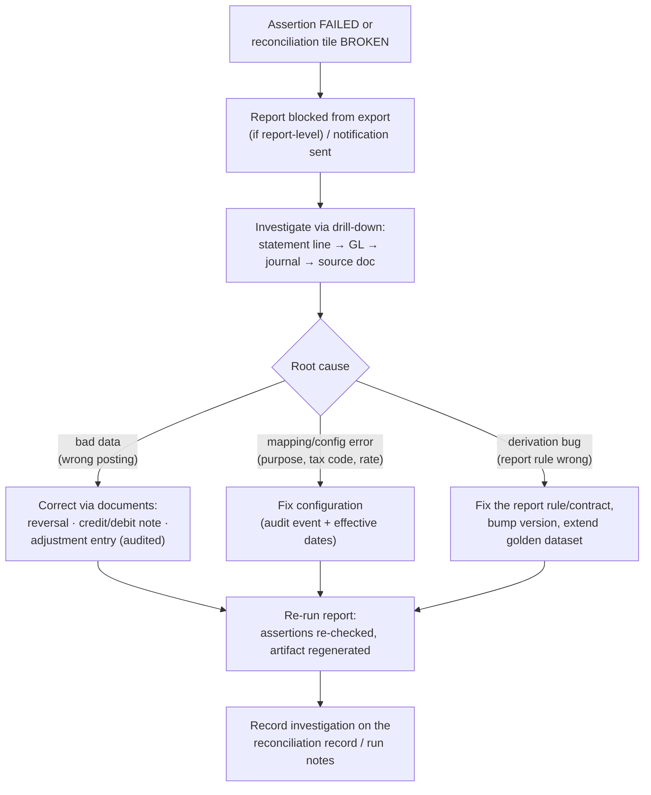

# Report Reconciliation

> **Status:** STABLE · **Owner:** Reporting Architecture · **Updated:** 2026-10-27

How reports stay trustworthy: built-in assertions cross-checked against the GL,
report-vs-subledger consistency, the "report equals ledger" golden-dataset test suite,
as-of reproducibility tests, and the discrepancy investigation workflow. The reporting
engine's core promise: **a number on a report is never an orphan — it either ties to the
ledger and subledgers or the report refuses to ship** ([ADR-0011](../architecture/ADR/ADR-0011-reporting-printing.md)).
Continuous reconciliation mechanics (jobs, drift workflow) are
[../accounting/RECONCILIATION.md](../accounting/RECONCILIATION.md); this file is the
report-layer contract.

## 1. Built-in assertions (cross-checks vs GL)

1. Every financial report contract MUST carry the minimum assertion set of
   [FINANCIAL_REPORT_RULES.md](FINANCIAL_REPORT_RULES.md) §11 (e.g., Trial Balance
   `tb-debits-equal-credits` ↔ INV-001; cross-statement
   `is-net-equals-bs-current-result`). Assertions are **executable checks inside the
   report executor**, not documentation.
2. Comparisons are **exact-decimal, tolerance 0** ([../accounting/RECONCILIATION.md](../accounting/RECONCILIATION.md)
   §2 — tolerance fudging is forbidden in accounting checks).
3. On FAIL: the result is stored with `ASSERTION_FAILED` + failed-check detail; the
   ReportViewer renders a danger banner ("فشل التحقق: … / Check failed: …") and
   **export/print are blocked server-side** ([PRINTING_AND_EXPORT.md](PRINTING_AND_EXPORT.md)
   §8) — the block is not a hidden button.
4. Operational reports whose totals intersect GL accounts (sales, purchasing, treasury,
   tax) carry at least one ledger-tie assertion (worked example:
   [REPORT_CONTRACT.md](REPORT_CONTRACT.md) §4 `sales-gl-tie`) — trust is not
   financial-report-only.
5. Assertion results are persisted per run (with the exact values compared) so an audit
   reviewer can see *what* was checked and *what it equalled, historically.

## 2. Report vs subledger consistency

Statements/aging reports are **recomputations from immutable entries at the as-of
date** ([../accounting/RECONCILIATION.md](../accounting/RECONCILIATION.md) §2) — the
same property the nightly jobs verify continuously. Report-level consistency contract:

| Report | Subledger tie | Invariant |
|--------|----------------|-----------|
| Partner statements & AR/AP aging | Σ open+settled subledger entries per partner == AR/AP control account balance (as-of, scope-matched) | INV-009 |
| Inventory valuation / stock on hand | Σ(qty × valuation) == inventory/WIP accounts (as-of, warehouse scope) | INV-010 |
| VAT return | Σ document tax summaries by treatment == GL tax account movements | INV-012 |
| Cash reports | Cash/bank account balance == Σ movements | INV-019 |
| GRNI register | GRNI register total == GRNI account balance | INV-010 |

Scope rule: ties are computed on the **same scope as the run** (branch/warehouse
subset) and additionally on full-tenant scope for the control check — a branch-subset
report shows the subset footer tie; the tenant-level tie result is shown in the
run's assertion detail.

## 3. The "report equals ledger" test suite (golden datasets, CI)

1. **Golden datasets**: fixture journal sets (JSON, committed in
   `apps/api/src/modules/reporting/testing/golden/`) with hand-verified expected
   outputs — covering: opening balances, sales+VAT+receipt cycles, FX entries,
   reversals/credit notes, period close + year-end closing entry, multi-branch scope.
2. Expected outputs are **full result envelopes** (columns/rows/totals/assertions) —
   a change in any derivation rule must visibly update a golden file, which makes
   silent drift impossible in review ([../testing/ACCOUNTING_TESTS.md](../testing/ACCOUNTING_TESTS.md)
   discipline).
3. The suite runs TB, GL, IS, BS, CF, aging, and VAT return against every golden
   dataset in CI; zero suppression/rounding/comparative modes have dedicated cases.
4. Property tests add randomized-but-invariant-holding journal sets (balanced entries
   only) asserting statement identities: BS balances, IS net = BS current-year line,
   CF ties to cash deltas — across many scopes and periods.
5. Golden dataset additions are required whenever a new financial report or a derivation
   rule change lands (phase acceptance criterion, PHASE-013+).

## 4. As-of reproducibility tests

- For every financial report: run at `asOf = T`, snapshot; then insert later-dated (but
  pre-T-posted... impossible — entries are dated) — the precise test: post additional
  entries dated **after** `asOf`, plus reversals dated **before** `asOf` created
  **after** the first run; re-run at the same `asOf` → **byte-identical envelope**.
  This proves the as-of freeze ([FINANCIAL_REPORT_RULES.md](FINANCIAL_REPORT_RULES.md)
  §7): reports read posted-line history, not mutable "current state".
- Cache invalidation correctness: post a new entry dated *within* a cached as-of period
  (via period reopen, INV-020) → the affected cache entry is invalidated and re-runs
  recompute ([REPORTING_ARCHITECTURE.md](REPORTING_ARCHITECTURE.md) §6).
- Export identity: the PDF/XLSX/CSV of a given run id are stable across regenerations
  (template version pinned in metadata); re-render produces identical content hashes
  modulo the stored template version ([PRINTING_AND_EXPORT.md](PRINTING_AND_EXPORT.md)
  §6).

## 5. Discrepancy investigation workflow

**Never hand-edit a report. Reports are views; only data or rules change.**

1. A failed financial assertion is **Sev-1 visible**: banner blocks export, the run is
   recorded, and the accountant role is notified
   ([../accounting/RECONCILIATION.md](../accounting/RECONCILIATION.md) §3 — RISK-009
   discipline).
2. Corrections are **always additive documents** (reversals, notes, adjustments) or
   audited configuration fixes — a report is never patched, a balance is never
   force-updated, a golden expected-output is never edited to match a bug.
3. After the fix, re-run and archive: the failed run stays in history with its failure
   detail — the audit trail shows the problem *and* the resolution
   ([../accounting/ACCOUNTING_PRINCIPLES.md](../accounting/ACCOUNTING_PRINCIPLES.md)
   §10).
4. If the discrepancy stems from a genuine gray area (e.g., untagged account in CF
   "Other"), the outcome is a rule/mapping improvement with a design note — never a
   per-tenant manual override.

## 6. Trust surfaces in the UI

- Assertion status renders in the ReportViewer footer (PASS badge with check ids, or
  the failure banner) and in print/PDF/XLSX footers — the artifact self-declares
  "reconciled" ([../ui/COMPONENT_CATALOG.md](../ui/COMPONENT_CATALOG.md) §6.5,
  [PRINTING_AND_EXPORT.md](PRINTING_AND_EXPORT.md) §8).
- The reconciliation health center
  ([../ui/PAGE_ARCHETYPES.md](../ui/PAGE_ARCHETYPES.md) §11) tiles link directly into
  the tied reports, pre-filtered to the failing scope.
