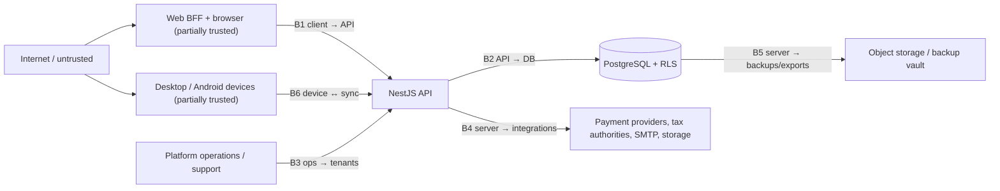

# Threat Model

> **Status:** STABLE · **Owner:** Security Architecture · **Updated:** 2026-10-27

STRIDE-based threat model for the Universal Business ERP Platform (multi-tenant SaaS,
Arabic-first, MENA/GCC). This is the planning-level security baseline: it inventories
assets, defines trust boundaries, enumerates threats per boundary with existing controls,
and works the highest-priority scenarios in detail. Operational security testing is
specified in [SECURITY_TEST_PLAN.md](SECURITY_TEST_PLAN.md); incident handling in
[INCIDENT_RESPONSE.md](INCIDENT_RESPONSE.md). Architectural decisions:
[ADR-0005](../architecture/ADR/ADR-0005-multi-tenancy.md) (tenancy),
[ADR-0015](../architecture/ADR/ADR-0015-authentication.md) (auth),
[ADR-0012](../architecture/ADR/ADR-0012-offline-sync.md) (offline).

## 1. Method and scope

- **Method**: STRIDE (Spoofing, Tampering, Repudiation, Information disclosure, Denial of
  service, Elevation of privilege) applied per trust boundary, then per-asset.
- **Scope**: web app (Next.js BFF), API (NestJS modular monolith), PostgreSQL, jobs
  (pg-boss), object storage, desktop (Tauri) and Android (Expo) clients with SQLite
  offline sync, external integrations (payment providers, tax authorities).
- **System state**: PLANNED — controls cited are the *specified* controls from this
  blueprint; residual risk is assessed assuming those controls are implemented as
  documented and proven by the test suites they link to.
- **Risk rating**: L/M/H per `likelihood × impact` with rationale in §5; anything that
  breaks tenant isolation or ledger integrity is H by definition (see
  [../planning/RISK_REGISTER.md](../planning/RISK_REGISTER.md) RISK-010, RISK-009).

## 2. Asset inventory

| # | Asset | Examples | Primary security properties | Impact if compromised |
|---|-------|----------|------------------------------|----------------------|
| AS-1 | Financial data | journal entries/lines, GL balances, invoices, receipts, payments, subledgers, stock valuation | **Integrity** first (immutability, INV-003), confidentiality second | H — corrupted books destroy the product's core promise (RISK-009) |
| AS-2 | Credentials & session material | argon2id password hashes, session records, device refresh tokens, TOTP secrets, recovery codes | Confidentiality + revocability | H — account takeover, tenant-wide fraud |
| AS-3 | Tax authority certificates & keys | ZATCA signing certificates/private keys, ETA credentials (PHASE-023) | Confidentiality (HIGHEST sensitivity class — [SECRETS_MANAGEMENT.md](SECRETS_MANAGEMENT.md)) | H — forged legally-valid invoices; regulatory exposure (RISK-005) |
| AS-4 | PII | partner contacts, addresses, tax registration numbers, national IDs (only where a jurisdiction pack requires for e-invoicing), user emails/phones | Confidentiality, minimization | M–H — regulatory/privacy exposure, spam/enrichment value |
| AS-5 | Audit trail | `audit_events` (append-only, integrity-chained) | Integrity, non-repudiation | H — erases forensic ability; compliance breach |
| AS-6 | Platform control data | tenants, plans, subscriptions, entitlements, feature flags | Integrity (a suspended tenant must stay suspended) | M — entitlement theft, suspension evasion |
| AS-7 | Documents & files | attachments, PDF/Excel exports, e-invoicing payloads | Confidentiality (tenant-scoped), availability | M–H — bulk exfiltration surface |
| AS-8 | Backups & exports | nightly dumps (encrypted, WORM-object-locked), offboarding export packages | Confidentiality, immutability (anti-ransomware) | H — full-platform data loss event |
| AS-9 | Offline device data | encrypted SQLite store, device keys in OS keychain, permission snapshots | Confidentiality (at rest), revocability | M — a stolen device must yield nothing useful |
| AS-10 | Service availability | API, DB, job queue, sync endpoints | Availability (NFR-007: 99.5% monthly) | M — business downtime for all tenants; DoS is per-boundary concern |
| AS-11 | Source & supply chain | npm dependencies, Docker images, CI pipelines, Tauri/Expo build toolchains | Integrity | H — malicious update = universal compromise |

## 3. Trust boundaries

| ID | Boundary | Crosses from → to | Key trust rule |
|----|----------|-------------------|----------------|
| B0 | Internet → client | untrusted users/devices → browser/app shell | All client input is hostile; client is never authoritative (server-authoritative posting, ADR-0012) |
| B1 | Client → API | browser BFF / device tokens → API | Tenant context derives ONLY from the authenticated session/membership — never from client input (ADR-0005) |
| B2 | API → DB | app code (may contain bugs) → data | RLS as the safety net under scoped queries; app role is not table owner |
| B3 | Ops → tenants | platform staff → tenant data | Every access is permissioned, time-boxed, and audited; no standing access |
| B4 | Server → integrations | API/adapters → third parties | Keys never touch code; egress allow-listed per adapter; callbacks verified by signature |
| B5 | Server → backups/exports | data at rest leaving the hot path | Encrypted, WORM-locked, tenant-scoped signed URLs, audited |
| B6 | Server ↔ offline devices | sync endpoints ↔ registered devices | Devices hold scoped, revocable credentials; pushes are idempotent commands, never replication |

## 4. Threats per boundary (STRIDE)

### B0 — Internet → client

| Threat | STRIDE | Attack examples | Existing controls | Residual | Detection |
|--------|--------|-----------------|-------------------|----------|-----------|
| XSS in user-rendered content | Tampering / Info disclosure | Arabic/English product descriptions, partner names, print templates containing `<script>` or `javascript:` URLs | CSP + Trusted Types posture, React/Next auto-escaping, no `dangerouslySetInnerHTML` on user data, SRI for third-party assets ([../architecture/SECURITY_ARCHITECTURE.md](../architecture/SECURITY_ARCHITECTURE.md)) | L | CSP violation reports; anomaly in audit (unexpected session IPs) |
| CSRF on state-changing actions | Spoofing / Tampering | forged third-party page posting an approval | double-submit CSRF token + `SameSite=Lax` httpOnly cookies (ADR-0015); approval routes re-authenticate permission server-side | L | CSRF token failures counter; audit event correlation |
| Clickjacking / tabnabbing | Spoofing | overlay attack on approval screens | `X-Frame-Options: DENY` + frame-ancestors CSP; `rel=noopener` | L | header verification test in CI |
| Malicious client tampering | Tampering | modified desktop APK/Tauri bundle posting fake "posted" state | server-authoritative finalization; local records stay `PENDING_SYNC`; official numbers only from server (ADR-0012, A-010) | L (integrity of server data unaffected) | sync rejection events |

### B1 — Client → API

| Threat | STRIDE | Attack examples | Existing controls | Residual | Detection |
|--------|--------|-----------------|-------------------|----------|-----------|
| Credential stuffing / brute force | Spoofing | password spraying against `/auth/login` | argon2id, progressive lockout, rate limiting, breached-password rejection, login notifications (ADR-0015) | L–M | failed-login spike metric (OBSERVABILITY.md business SLO set) |
| Stolen session cookie | Spoofing | XSS elsewhere / network sniff / device theft | httpOnly+Secure cookies, 12h absolute / 30min idle timeout, server-side revocation, MFA step-up possible per policy | M (session theft before rotation window closes) | impossible-travel / new-device audit events |
| Tenant spoofing via body/header | Elevation | `tenant_id` override in JSON body, forged membership cookie | context from session only (MULTI_TENANCY.md §2 rule 1); spoof tests A6/A7 | L | RLS denial counter (must stay 0) + API 404-on-foreign-id alerts |
| Injection (SQL/command) | Tampering / Info disclosure | malformed filters, ids, search params | parameterized queries via Drizzle, zod validation at edge, typed errors | L | slow-query log; WAF-lite rules on edge |
| Mass assignment | Elevation | extra fields (`role`, `postedJournalId`, `status`) in payloads | zod strict schemas generated from `packages/contracts`; allow-list serialization | L | contract schema tests (TEST_STRATEGY.md) |
| Rate-limit evasion / noisy neighbor | DoS | distributed slow attacks, huge report requests, sync hammering | per-tenant rate limits, statement timeouts, report concurrency quotas (MULTI_TENANCY.md §5) | M | 429/timeout dashboards; per-tenant throttle counters |

### B2 — API → DB

| Threat | STRIDE | Attack examples | Existing controls | Residual | Detection |
|--------|--------|-----------------|-------------------|----------|-----------|
| Cross-tenant read/write via buggy query | Info disclosure / Tampering | forgotten `WHERE tenant_id`, JOIN leak | RLS `USING`+`WITH CHECK` on every tenant-owned table, `FORCE RLS`, non-owner app role, transaction-local GUC (TENANT_ISOLATION.md §2) | L (design) — this is why attack tests A1–A11 are CI-mandatory | **RLS denial counter > 0 → immediate investigation** (RISK-010) |
| Posted-journal tampering | Tampering | direct UPDATE/DELETE on `journal_entries` | INV-003: DB triggers + no UPDATE/DELETE grants + posting engine sole writer ([../accounting/ACCOUNTING_INVARIANTS.md](../accounting/ACCOUNTING_INVARIANTS.md)) | L | integrity checks in nightly restore smoke; reconciliation jobs |
| Audit trail tampering/erasure | Repudiation / Tampering | deleting audit rows to hide actions | append-only grants (no UPDATE/DELETE to app role), same-transaction writes, retention chain | L | audit row-count anomalies in backup verification |
| Privilege escalation via role confusion | Elevation | app connecting as `erp_migrate` at runtime | role separation (TENANT_ISOLATION.md §1); migrations only in deploy job | L | connection-role monitoring |

### B3 — Ops → tenants (insider)

| Threat | STRIDE | Attack examples | Existing controls | Residual | Detection |
|--------|--------|-----------------|-------------------|----------|-----------|
| Support-access abuse | Info disclosure | browsing tenant books without cause | time-boxed audited support access, tenant opt-in or declared incident, `via_platform_admin` audit flag (ADR-0015; matrix §support) | M (trusted insiders remain a risk) | every support session audited + reviewable by tenant; anomaly review weekly |
| Platform-admin misuse | Elevation / Repudiation | silent tenant suspension, entitlement theft, offboarding abuse | least-privilege platform roles, approval flows for destructive actions, platform audit trail (FR-PLT-008) | M | platform audit review; reconciliation of entitlement changes |
| Backup/operator exfiltration | Info disclosure | copying dumps, ad-hoc `psql` exports | encrypted backups, KMS keys not exposed to operators, WORM object-lock, `erp_readonly` still behind RLS | M | backup access logs; DLP-lite export audit |

### B4 — Server → integrations

| Threat | STRIDE | Attack examples | Existing controls | Residual | Detection |
|--------|--------|-----------------|-------------------|----------|-----------|
| Outbound key leakage | Info disclosure | secret printed in logs from an adapter | pino redaction allow-list (OBSERVABILITY.md), gitleaks, secrets store | L | secret-pattern alerts in log pipeline |
| Callback/webhook spoofing | Spoofing | fake "payment succeeded" callback | signature verification per provider, replay protection, idempotent handling | L | webhook signature failure counter |
| E-invoicing certificate theft | Spoofing / Tampering | extracting ZATCA private key to forge invoices | HIGHEST-sensitivity handling: encrypted at rest, signing-job-only access, usage audit, expiry monitoring ([../localization/E_INVOICING_ARCHITECTURE.md](../localization/E_INVOICING_ARCHITECTURE.md) §3, [SECRETS_MANAGEMENT.md](SECRETS_MANAGEMENT.md) §6) | M (concentrated high-value target) | signing-job audit; unexpected access path alert; cert usage volume |
| Malformed/failed authority responses | Tampering | treating "rejected" as "accepted" | submission registry is the only truth of acceptance state (E_INVOICING §2); UNVERIFIED stubs refuse to submit | L | submission funnel dashboard |

### B5 — Server → backups/exports

| Threat | STRIDE | Attack examples | Existing controls | Residual | Detection |
|--------|--------|-----------------|-------------------|----------|-----------|
| Backup exfiltration | Info disclosure | stolen dump from storage | client-side AES-256 before upload, KMS, versioned WORM bucket ([../database/BACKUP_AND_RECOVERY.md](../database/BACKUP_AND_RECOVERY.md)) | L–M | object-access audit; approval-gated deletion |
| Ransomware / destructive wipe | DoS / Tampering | encrypting DB + deleting backups | WORM object-lock (deletion requires ops approval), 7-day PITR window, cross-region backup replication | M | backup job health alerts (RISK-018); restore drills prove recoverability |
| Export/signed-URL scope escape | Info disclosure | tenant A fetching tenant B's export | keys prefixed with tenant id; issuance bound to session tenant (A11); expiry + audit | L | export audit events; 404-on-foreign-key logging |

### B6 — Server ↔ offline devices

| Threat | STRIDE | Attack examples | Existing controls | Residual | Detection |
|--------|--------|-----------------|-------------------|----------|-----------|
| Device theft / loss | Info disclosure | reading SQLite store off a stolen POS/phone | encrypted local DB (SQLCipher/OS-level), keys in OS keychain, remote revocation, offline permission snapshot expires (ADR-0012) | M (revocation latency while offline) | revocation events; device-heartbeat gap alerts |
| Cloned/tampered local DB | Tampering | editing local sale records before push | server re-validates every command (stock, price, period, credit); per-item results; posting only server-side (ADR-0012) | L | sync rejection dashboard; per-device anomaly counters |
| Revoked device pushing | Spoofing | ex-device replaying outbox commands | device token revocation → push rejected (`DEVICE_REVOKED`), pulls stop | L | `sync.push.rejected` events (MODULE_BOUNDARIES.md events table) |
| Duplicate/replayed pushes | Tampering (ledger double-post) | network retry re-delivering a sale | idempotency keys + inbox dedupe + posting-operation keys (INV-013) | L (chaos-tested: [../testing/SYNC_TESTS.md](../testing/SYNC_TESTS.md)) | duplicate-dedupe counters |

## 5. Worked scenarios (high-priority detail)

### S-01 Cross-tenant data access attempt (RISK-010 — any anomaly is SEV-1)

- **Kill chain**: attacker (or a buggy client) obtains a valid session for tenant A, then
  tries to reach tenant B's invoice `id` via `GET /api/v1/sales-invoices/:id`, or attempts
  `tenant_id` override in a create body, or a JOIN with a foreign partner id.
- **Controls that must stop it, in order**: (1) route resolves tenant context from
  session/membership only; (2) repository query is tenant-scoped by construction;
  (3) RLS `USING`/`WITH CHECK` returns zero rows / rejects the write; (4) API layer maps
  foreign ids to **404** (no existence leak — attack A7).
- **Expected observable outcome**: zero data returned, RLS denial counter increments only
  if raw SQL slipped past layer 1–2 (that itself is a bug to fix), audit event records the
  denied attempt.
- **Residual risk**: L with all three layers tested (A1–A11 in CI per
  [../testing/TENANT_ISOLATION_TESTS.md](../testing/TENANT_ISOLATION_TESTS.md)); H if the
  attack suite is ever skipped — which is why it is a release gate.
- **Detection**: RLS denial metric (must stay 0 in normal traffic — anything > 0 is
  investigated immediately), 404-on-cross-tenant-id pattern alert.

### S-02 Stolen session token

- **Scenario**: attacker exfiltrates a session cookie via a compromised endpoint, or
  picks up an active device refresh token.
- **Controls**: cookie is httpOnly+Secure+SameSite (no JS access); 30-min idle / 12h
  absolute expiry; user/session revocation lists; MFA (TOTP) gates sensitive role actions
  when policy enables it; login notification emails surface anomalous access; support can
  force-terminate sessions; device tokens are one-time-use rotating refresh (replay
  detection: a reused refresh token revokes the device — ADR-0015).
- **Residual**: M until passkeys/WebAuthn land (PHASE-024+ decision record) — a live
  cookie inside its idle window is usable; scope of damage is one user's permissions.
- **Detection**: impossible-travel/velocity audit checks, new-device events, reused-refresh
  alarms.

### S-03 XSS in product descriptions (stored, bilingual surface)

- **Scenario**: partner name or item description contains `` or
  RTL-directionality tricks (`RLI`/`PDI` abuse) to hide the payload from review.
- **Controls**: output encoding by framework; CSP restricting script sources; no inline
  event handlers; user content never rendered as HTML (print templates escape data);
  sanitizer on rich-text fields if any (none planned at MVP — plain text only).
- **Bilingual twist**: tests must include Arabic-script payloads and bidi-override
  characters — covered in the UI security checklist (PHASE-005) and
  [SECURITY_TEST_PLAN.md](SECURITY_TEST_PLAN.md) §CSP.
- **Residual**: L. **Detection**: CSP report-only channel in staging → enforcing in prod.

### S-04 CSRF on approvals

- **Scenario**: attacker page auto-submits `POST /api/v1/sales-invoices/:id/approve`
  riding an open session.
- **Controls**: double-submit CSRF token checked on every unsafe method at the BFF;
  SameSite=Lax; approval requires `sales.invoices.approve` permission the victim may not
  have; approval actions are audited (actor + before/after), giving repudiation cover.
- **Residual**: L. **Detection**: CSRF failure counter; unusual approve-from-origin
  patterns.

### S-05 Support-access abuse

- **Scenario**: a support engineer opens a tenant's ledgers "to check something" without
  a ticket, or extends a session beyond the approved window.
- **Controls**: support access is time-boxed (default ≤ 4h), requires tenant opt-in or a
  declared incident, every action executes with `via_platform_admin` audit flag, and the
  tenant can review the audit trail of the session; access grants themselves are audited.
- **Residual**: M — insiders with legitimate need remain a concentrated risk; mitigated
  by review cadence, least privilege, and background-check/onboarding policy (org control,
  documented in operations onboarding).
- **Detection**: weekly support-access report; alert on access without a linked ticket.

### S-06 Insider platform-admin misuse

- **Scenario**: a platform admin suspends a competitor tenant, or edits entitlements to
  grant themselves paid features, or reads cross-tenant data outside a support session.
- **Controls**: platform admin actions require per-action permissions
  (`platform.tenants.suspend` etc.), destructive actions are approval-separated, all
  platform actions append to the platform audit trail, cross-tenant reads happen only via
  `PlatformScope`-marked services with audit per use (MULTI_TENANCY.md rule 3).
- **Residual**: M — two-person integrity on destructive actions reduces single-actor risk.
- **Detection**: platform audit review; entitlement-change reconciliation job.

### S-07 E-invoicing certificate theft (highest-value asset)

- **Scenario**: compromise of the signing job's environment or the secret store to
  exfiltrate a tenant's ZATCA private key/certificate.
- **Controls**: certificates stored encrypted (KMS), readable only by the signing job's
  scoped credential, every decrypt/use is audited, expiry monitored; submission registry
  records signing events; adapter sandbox isolated.
- **Impact if stolen**: forged invoices in the tenant's name — regulatory + reputational
  catastrophe; hence revoke-and-notify playbook in
  [INCIDENT_RESPONSE.md](INCIDENT_RESPONSE.md) §P-04 (no legal conclusions made by the
  platform — posture only).
- **Residual**: M — a determined attacker targeting the most valuable secret; reduced by
  signing-job blast-radius (single purpose, no other privileges).
- **Detection**: certificate usage audit volume, out-of-window decrypt alerts, expiry
  countdown dashboard.

### S-08 Offline device theft

- **Scenario**: a van-sales phone or POS terminal is stolen with queued, unsynced sales.
- **Controls**: local SQLite encrypted at rest; keys in OS keychain (not in the DB file);
  device revocation kills pull + rejects push on next contact; offline permission
  snapshot carries an expiry watermark (default 7 days,
  [../offline/SECURITY_AND_DEVICE_MANAGEMENT.md](../offline/SECURITY_AND_DEVICE_MANAGEMENT.md)
  §5) and cached tenant data is remote-purged via the required-online watermark; server
  re-validates all queued commands on drain, so any local tampering fails server checks.
- **Unsynced-data nuance**: the queued sales on the stolen device are lost business data
  unless recovered — documented in the capabilities matrix, surfaced to users
  (honest-state rule, directive §12).
- **Residual**: M. **Detection**: device heartbeat gap; revocation audit; failed
  revoked-device push attempts.

### S-09 Backup exfiltration

- **Scenario**: object-storage credentials leak and an actor downloads nightly dumps.
- **Controls**: dumps encrypted client-side AES-256 before leaving the DB host; bucket is
  versioned + object-locked (WORM); KMS keys are not readable by the storage-credential
  principal; bucket access is audited; cross-region replica is equally locked.
- **Residual**: L–M (depends on provider account compromise — an org-level risk tracked
  with the sub-processor review in [DATA_PROTECTION.md](DATA_PROTECTION.md) §7).
- **Detection**: object-access audit alerts on bulk reads.

### S-10 Invoice tampering attempt (must fail via posting immutability)

- **Scenario**: a tenant user (or an attacker with their session) tries to edit a posted
  invoice: `PATCH /sales-invoices/:id` with a new total, or direct SQL against
  `journal_lines` to "fix" an amount, or delete the invoice to hide a sale.
- **Controls**: posted documents are immutable by state machine (corrections =
  credit notes/reversals only, INV-014); journal lines have no UPDATE/DELETE path —
  engine-only writes (INV-003), DB triggers double-check; audit events capture attempts.
- **Expected observable outcome**: typed error (`ALREADY_POSTED` class), zero ledger
  effect, audit event; a credit note is the only legal correction and it is itself posted
  through the engine and fully visible.
- **Residual**: L. **Detection**: reconciliation jobs would surface any drift that
  somehow succeeded — drift is SEV-1 (RISK-009).

### S-11 Permission elevation attempt

- **Scenario**: a `cashier` role user calls `POST /api/v1/accounting/journal-entries`
  directly, or a `sales` user attempts `accounting.periods.lock`, or a membership update
  tries to self-assign the `owner` role.
- **Controls**: route-level permission decorators on every route (generated checklist
  against [AUTHORIZATION_MATRIX.md](AUTHORIZATION_MATRIX.md)); role assignment is itself
  permissioned (`identity.roles.assign`, owner-only by default); UI hiding is cosmetic
  only; RLS is not a permission substitute but bounds damage.
- **Residual**: L. **Detection**: 403 audit events; permission-denied metric by route.

### S-12 Rate-limit evasion

- **Scenario**: distributed login attempts under per-IP limits; sync client retry storms;
  one tenant requesting ten heavy reports to starve others.
- **Controls**: limits are **per-tenant AND per-IP** (login additionally), progressive
  lockout, exponential capped retries on clients, statement timeouts, report concurrency
  quotas per tenant (MULTI_TENANCY.md §5).
- **Residual**: M — determined distributed attacks degrade but may not be fully stopped;
  login lockout protects accounts even when limits saturate.
- **Detection**: 429 dashboards, queue-depth alerts, login-failure spikes.

### S-13 Supply-chain compromise (npm dependency)

- **Scenario**: a transitive dependency of the web or API (or a Tauri/Expo build plugin)
  turns malicious: steals env secrets at build/runtime or ships a backdoor.
- **Controls**: lockfiles committed + lockfile lint; `pnpm audit`/dependency-audit gate
  from PHASE-001; pinned versions; minimal dependency budget per package (reviewed in code
  review); CI uses OIDC/scoped tokens, never broad secrets; images scanned (OS + package
  manifest); auto-update channels sign desktop/mobile artifacts and enforce
  minimum-version ([../planning/RELEASE_STRATEGY.md](../planning/RELEASE_STRATEGY.md)).
- **Residual**: M — the modern npm graph cannot be fully trusted; blast radius reduced by
  secret hygiene (no secrets available to build workers), egress allow-lists, and
  runtime least privilege.
- **Detection**: dependency-diff review on lockfile changes; scanner alerts; behavioral
  egress monitoring (unexpected outbound connections).

## 6. Risk ratings and rationale (summary)

| Rating | Meaning for this platform | Items |
|--------|--------------------------|-------|
| **H** | Existential: breaks tenant isolation, ledger integrity, or legal-invoice authenticity | Successful cross-tenant access (if controls fail — hence CI-mandatory attack suite); ledger/subledger drift; certificate theft materialized; backup exfiltration at scale |
| **M** | Serious: single-tenant security/compliance impact or concentrated insider risk | Stolen live session; support/insider misuse; rate-limit evasion; ransomware (recoverable via WORM + drills — impact contained); device theft with unsynced data; supply-chain compromise (blast-radius reduced) |
| **L** | Contained: blocked by design, detected fast, or low-value asset | CSRF/XSS/injection/spoofing against specified controls; permission elevation against decorators; audit tampering; webhook spoofing |

Rationale rules: likelihood is judged against the *attack suite-backed* controls (a control
without a linked test is treated as absent); impact uses the asset table §2. Any risk whose
control set is not yet implemented in the current phase keeps its target rating and appears
on the watchlist until the implementing phase completes.

## 7. Top-risks watchlist (reviewed every phase boundary)

| Watch item | Maps to | Current posture | Review trigger |
|------------|---------|-----------------|----------------|
| Cross-tenant leak | [RISK-010](../planning/RISK_REGISTER.md) | Attack suite A1–A11 CI-mandatory from PHASE-003; RLS denial counter watched | Any RLS denial in prod traffic → SEV-1 investigation |
| Accounting correctness | [RISK-009](../planning/RISK_REGISTER.md) | Invariant suite INV-001..INV-022; golden posting tests; reconciliation jobs | Any invariant failure in prod → SEV-1 |
| ZATCA compliance / cert security | [RISK-005](../planning/RISK_REGISTER.md) | Verified-specs-only adapter (PHASE-023); HIGHEST-sensitivity secret handling | Any spec mismatch or cert-access anomaly |
| Sync double-posting / lost sales | [RISK-011](../planning/RISK_REGISTER.md) | Idempotency at three layers; chaos suite PHASE-016/020 | Any duplicate journal effect from sync |
| Performance collapse under load | [RISK-014](../planning/RISK_REGISTER.md) | NFR-006 budgets; k6 smoke per phase; load at PHASE-025 | p95 breach in staging load |
| Unproven restores | [RISK-018](../planning/RISK_REGISTER.md) | Nightly restore + invariant smoke; quarterly cold drills | Any drill failure |

## 8. Maintenance protocol

1. **New module/phase**: extend §2 (assets) and §4 (boundary table) in the same phase;
   the threat model update is part of the phase's security checklist
   ([../planning/PHASE_ACCEPTANCE_CRITERIA.md](../planning/PHASE_ACCEPTANCE_CRITERIA.md)).
2. **New external integration**: add a B4 row + a worked scenario if the integration
   carries credentials or legal weight (e-invoicing, payments).
3. **New offline capability**: add B6 scenarios to [../testing/SYNC_TESTS.md](../testing/SYNC_TESTS.md)
   and revisit S-08.
4. **Incident learnings**: postmortems may add scenarios; they never *remove* controls
   without a decision record under [../decisions/](../decisions/README.md).
5. Residual-risk changes of H items require Security Architecture review before the next
   release.
