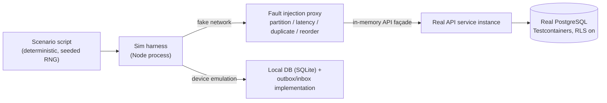

# Sync Tests — The Chaos Suite

> **Status:** STABLE · **Owner:** Quality Engineering & Sync/Offline Architecture · **Updated:** 2026-10-27

The chaos-test suite for the offline synchronization protocol (directive §12): duplicate
delivery, reordering, partial failure, crashes, revocation, clock skew, contract skew,
and queue-drain reconciliation must all produce **exactly-once, server-authoritative
ledger effects** and honest user states. Protocol: [ADR-0012](../architecture/ADR/ADR-0012-offline-sync.md);
protocol docs [../offline/SYNC_PROTOCOL.md](../offline/SYNC_PROTOCOL.md),
conflict rules [../offline/CONFLICT_RESOLUTION.md](../offline/CONFLICT_RESOLUTION.md),
capabilities [../offline/OFFLINE_CAPABILITIES_MATRIX.md](../offline/OFFLINE_CAPABILITIES_MATRIX.md),
local schema [../offline/LOCAL_DATABASE.md](../offline/LOCAL_DATABASE.md),
device security [../offline/SECURITY_AND_DEVICE_MANAGEMENT.md](../offline/SECURITY_AND_DEVICE_MANAGEMENT.md).
Financial correctness hooks: INV-013/014/018 ([../accounting/ACCOUNTING_INVARIANTS.md](../accounting/ACCOUNTING_INVARIANTS.md)).

## 1. Test harness architecture

- **Deterministic sim harness**: a Node process orchestrates simulated devices (POS
  terminal, field-sales phone, desktop) against the real API instance. Randomness comes
  from a **seeded RNG logged per run** — a failed scenario replays byte-identically
  (`SEED=12345 pnpm test:sync-chaos`).
- **Fake network** between devices and API injects faults on chosen connections and
  windows: **partition** (drop/silence), **latency** (delay N ms), **duplication**
  (deliver same request k times), **reorder** (hold + release out of order), **half-close**
  (connection dies mid-response). Faults are scripted per scenario, never ambient.
- **In-memory API façade**: the real NestJS app mounted in-process (supertest-style) so
  scenario code can also call internals for seeding/inspection; **no mocks of domain
  services** — posting must hit the real posting engine and real PostgreSQL
  (Testcontainers, migrations + RLS applied). SQLite devices use the real local-store
  code (better-sqlite3 in CI; SQLCipher builds run in nightly on the platform matrix).
- **Time control**: the harness owns a virtual clock injected into clients; the SERVER
  uses its real clock (server-authoritative — by design, see C-07).
- **Ledger oracle**: after every scenario, the harness asserts the global ledger state:
  expected journal entries (by source key), balances, subledger rows, stock moves —
  computed from the script. This is the directive §17 rule: assert data, not response
  codes.

## 2. Scenario catalog (named, with expected outcomes)

| ID | Scenario (given/when/then) | Expected outcome |
|----|---------------------------|------------------|
| C-01 **Duplicate push** | Device posts batch B; network duplicates the batch 3× with retries. | Inbox dedupe: every command id processed **once**; exactly-one journal effect per command (INV-013); all 4 deliveries return the same per-item results (first real result replayed); ledger oracle equality. |
| C-02 **Reorder** | Transport reorders batch deliveries: the batch containing a dependent command (e.g., receipt allocating to a same-batch invoice) arrives before its predecessor batch. | Command-ordering rules ([../offline/SYNC_PROTOCOL.md](../offline/SYNC_PROTOCOL.md) §6) hold: within a batch, array order is preserved (causality safe); across batches, the premature dependent is rejected `VALIDATION_ERROR` referencing the missing dependency — **no orphan effects**; resubmission after the predecessor lands succeeds; same-entity commands execute serially in received order. |
| C-03 **Partial batch failure** | Batch of 5 commands where #3 fails validation (stock insufficient, period locked). | **Per-item results**: 1,2,4,5 committed, 3 rejected with structured reason; NO partial ledger for #3 (zero residue); client inbox records all five outcomes; user sees #3 in reconciliation state. |
| C-04 **Crash between journal write and ack** | Harness kills the API process after the posting transaction commits but before the HTTP response. | Device sees timeout; retrying the same idempotent command returns the original result (idempotent resume); no second journal entry (INV-013); outbox entry resolves to `CONFIRMED`. |
| C-05 **Connectivity flap mid-sync** | Network partitions during a pull with cursor N; returns; partial page delivered. | Client detects truncated response; re-pulls from cursor N; **no cursor advancement without full page commit**; no duplicates applied (inbox dedupe); eventually-consistent state equals oracle. |
| C-06 **Revoked device push** | Device is revoked (tenant action) while its outbox still holds commands; device pushes. | Server rejects with `DEVICE_REVOKED`; **zero effects** on ledger/stock; pulls refused; `sync.push.rejected` event; client marks queue as unresolvable and surfaces to user (no silent loss). |
| C-07 **Clock skew** | Device clock offset +6h / −2h; commands carry client timestamps. | Server-authoritative times: document/entry dates derived from server clock; skewed client times recorded only as metadata; no future-dated postings created by skew (INV-011 respected); duplicate same-second commands still deduped by id. |
| C-08 **Stale contract version** | Device runs sync contract v(n−1) after server upgraded to v(n). | Graceful update path: server responds `422 CONTRACT_VERSION_UNSUPPORTED` with instructions; device enters update flow (desktop auto-update / store rollout); **no data corruption**, no half-accepted batches; documented minimum-version enforcement kicks in after grace window. |
| C-09 **Offline POS queue drain with server rejects** | POS terminal queued 20 offline sales; 2 rejected on drain (e.g., item price changed beyond tolerance, stock gone). | 18 post normally (official numbers assigned server-side, A-010); 2 return per-item rejections; terminal shows explicit **user reconciliation flows** (resolve/edit/void with reason); local receipts were labeled `PENDING_SYNC` throughout — never displayed as official (honest-state rule). |
| C-10 **Two devices same draft** | Terminal-1 and Desktop both edit draft document D offline. | Ownership rules: draft edits by non-owner are rebased or rejected per entity policy ([../offline/CONFLICT_RESOLUTION.md](../offline/CONFLICT_RESOLUTION.md)); financial fields never last-write-wins; the losing device receives `STALE_VERSION` with the fresh row for user reconciliation ([../offline/CONFLICT_RESOLUTION.md](../offline/CONFLICT_RESOLUTION.md) §3); final ledger state matches exactly one resolution path. |
| C-11 **Tombstone propagation** | Item/partner deleted on server while devices are offline. | Tombstone flows via change feed; on pull, deleted entity **disappears from clients** (local rows removed, references marked dangling per policy); no resurrection by stale device pushes referencing the tombstoned id (`ITEM_INACTIVE`/`PARTNER_INACTIVE` rejections, resubmittable=false paths per policy); a tombstone for a row the device never had is a no-op (idempotent). |
| C-12 **Cursor regression** | Client sends cursor newer than server's feed head for that device (e.g., after restore, clock rollback, or support-driven reset). | Server detects **change-feed gap**: responds with a resync directive (bounded full-delta or restart token), never silently returns "no changes"; client rebuilds local state; ledger untouched (pull-only path). |
| C-13 **Membership/tenant switch on device** (extends [TENANT_ISOLATION_TESTS.md](TENANT_ISOLATION_TESTS.md) §7) | Device user switches tenant membership mid-queue. | Device pushes route to the active membership's tenant only; queued commands for the other tenant are never delivered under the wrong context — cross-tenant/foreign references reject `VALIDATION_ERROR`-class **without existence disclosure** (404-equivalent semantics, [../architecture/MULTI_TENANCY.md](../architecture/MULTI_TENANCY.md) rule 1); zero effects. |
| C-14 **Suspension mid-sync** | Tenant suspended during an active sync session. | Pulls return `tenant_suspended`; pushes rejected; device surfaces suspension state; on restore, protocol resumes cleanly from last cursor; no duplicate effects after resume. |
| C-15 **Local store tampering** | Device SQLite rows edited out-of-band (simulated theft/tamper, [../security/SECURITY_TEST_PLAN.md](../security/SECURITY_TEST_PLAN.md) D-03) before push. | Server re-validation (stock, price, period, credit, idempotency) rejects inconsistent commands with typed reasons; **no partial ledger** (INV-013/018); device receives per-item rejections; honest-state labels survive (tampered `PENDING_SYNC` never reads as posted). |
| C-16 **Storage-full during offline capture** | Local DB hits quota mid-shift with outbox entries pending. | Capture fails loudly (no silent drop); queued commands persist; after space recovery the queue drains per C-09 semantics; ledger oracle unaffected. |

## 3. Fault injection vocabulary (the fake network's controls)

| Fault | Parameters (scripted per scenario) | Used by |
|-------|-------------------------------------|---------|
| Partition | connection ids, start/end (virtual time), direction (up/down/both) | C-05, C-14, soak |
| Latency | delay ms distribution per connection | C-04 (delayed ack), soak |
| Duplication | delivery count k, which requests | C-01, nightly fuzz |
| Reorder | hold window + release order | C-02, nightly fuzz |
| Half-close | kill point (pre-commit / post-commit pre-ack / mid-body) | C-04 (post-commit pre-ack) |
| Process crash | kill API/device sim at a scripted point | C-04 crash matrix |
| Clock skew | client offset (+/−, minutes…hours) | C-07 |
| Contract downgrade | device pinned to protocol v(n−k) | C-08 |
| Storage/event injection | corrupt local row, quota exhaustion | C-15, C-16 |

Rule: faults are **deterministic inputs**, not ambient randomness — every fault event is
logged to the run transcript so a failure replays exactly (§1 seeded RNG).

## 4. Per-item result contract (codes every scenario asserts)

Statuses and reason codes are the protocol's stable registry
([../offline/SYNC_PROTOCOL.md](../offline/SYNC_PROTOCOL.md) §3.4,
[../api/ERROR_MODEL.md](../api/ERROR_MODEL.md) §4) — the chaos suite asserts exact codes,
never prose:

| Status | Reason codes asserted | Scenario usage |
|--------|------------------------|----------------|
| `ACCEPTED` (with `duplicate: true` meta when replayed) | — command applied; effect idempotency recorded; official numbers/journal ids returned | all happy paths; C-01/C-04 replays must return the ORIGINAL result with `duplicate: true` and **no new effects** |
| `REJECTED` | `PERIOD_LOCKED` · `INSUFFICIENT_STOCK` · `PRICE_CHANGED` · `CREDIT_LIMIT_EXCEEDED` · `STALE_VERSION` · `VALIDATION_ERROR` (incl. missing dependency / foreign id without existence disclosure) · `ITEM_INACTIVE` · `PARTNER_INACTIVE` · `DUPLICATE_COMMAND` · `DEVICE_REVOKED` · `TENANT_SUSPENDED` · `CONTRACT_VERSION_UNSUPPORTED` | C-02, C-03, C-06, C-08, C-09, C-10, C-11, C-13, C-14, C-15 |
| `DEFERRED` | `reason: TRANSIENT` or `RATE_LIMITED` with `retryAfterMs` — NOT executed, NOT recorded in inbox | spike/rate-limit scenarios ([PERFORMANCE_TEST_PLAN.md](PERFORMANCE_TEST_PLAN.md) §2 report hammer); never used for business-rule failures |

Every `REJECTED` item must carry `resubmittable` + machine-readable `details` (e.g.
`currentPrice`, `availableQty`, `currentVersion`) so the UI can offer exact actions
([../offline/CONFLICT_RESOLUTION.md](../offline/CONFLICT_RESOLUTION.md) §3).

Batch responses are **per-item, never all-or-nothing**: a batch never fails atomically
when only some commands are invalid (C-03), and never partially applies a single command
(zero-residue rule per command — protocol §3.3).

## 5. Device matrix (which real client code each scenario drives)

| Simulated client | Local store implementation | Scenarios emphasized | Notes |
|------------------|----------------------------|----------------------|-------|
| POS terminal (Tauri desktop, PHASE-021) | better-sqlite3 + SQLCipher profile | C-01, C-03, C-04, C-09, C-16 | the PHASE-016 scoped queue uses the same harness in slice mode |
| Field-sales phone (Expo Android, PHASE-022) | expo SQLite | C-02, C-05, C-06, C-07, C-13 | battery/connectivity fault profiles |
| Desktop back-office (PHASE-021) | better-sqlite3 | C-08, C-10, C-12 | contract-update path exercised with real signed updates |
| Harness-native reference device | in-memory + real local-store code | all (oracle cross-check) | validates that the client SDK, not just the harness, implements outbox/inbox correctly |

## 6. Determinism and oracle rules

1. Every scenario is a script: seeds, fault schedule, command timeline, and **expected
   final ledger state** — the oracle is part of the test, not post-hoc inspection.
2. The ledger oracle always asserts: per-source journal uniqueness (INV-013), balance
   integrity (INV-001/002), stock-move/journal atomicity (INV-018), subledger equality
   (INV-009/010), and honest-state markers (`PENDING_SYNC` never rendered as posted).
3. Any nondeterminism discovered (e.g., ordering dependence) is a **finding** against
   [../offline/SYNC_PROTOCOL.md](../offline/SYNC_PROTOCOL.md), fixed in protocol docs
   first, then tests.

## 7. CI staging (per-phase cadence)

| Phase | Suite slice | Gate |
|-------|-------------|------|
| PHASE-016 (POS offline queue) | C-01, C-03, C-04, C-07, C-09, C-16 (POS-scoped subset on the narrow queue protocol) | blocking for POS release |
| PHASE-020 (sync foundation) | **Full matrix C-01..C-16** on the generalized protocol + cross-tenant slices C-13, isolation Y-series | blocking — the protocol cannot ship without this |
| PHASE-021 (desktop) | Full matrix against Tauri shell local store; C-08 (auto-update path) with real signed updates | blocking |
| PHASE-022 (Android) | Full matrix against Expo/SQLite store; battery/connectivity realism via fault profiles; C-06/C-07/C-13 on-device | blocking |
| PHASE-023 (integrations) | Re-run C-01..C-04 with e-invoicing submission jobs in the loop (duplicate submission attempts → registry idempotency, no double-clearance) | blocking for adapter release |
| Every push after PHASE-020 | Full matrix (≤ 15 min budget, [TEST_STRATEGY.md](TEST_STRATEGY.md) §6); long-fuzz variants (random fault soup, 30 min) nightly | blocking / nightly |
| PHASE-024/025 | Chaos suite is a hardening + GA gate input; findings feed the security review ([../security/SECURITY_TEST_PLAN.md](../security/SECURITY_TEST_PLAN.md) §10) | release gate |

## 8. Long-run and soak variants

- **Random fault soup** (nightly): seeded random combinations of all fault types across
  3 simulated devices for 30+ simulated hours; asserts the same oracles — catches
  interleavings hand-written scripts miss.
- **Soak with volume**: 10k-command outboxes drain across partitions; asserts memory
  stability of the harness, per-item result completeness, and posting-engine throughput
  sanity (feeds [PERFORMANCE_TEST_PLAN.md](PERFORMANCE_TEST_PLAN.md) sync scenarios).
- **Multi-device POS fleet**: 5 terminals, overlapping shifts, one suspension event —
  the classic van-sales/retail worst case; asserts numbering uniqueness after
  reconciliation (INV-021 across offline sequences per A-010/A-011).

## 9. Findings protocol

1. Any oracle mismatch = release blocker until triaged; severity per
   [../security/INCIDENT_RESPONSE.md](../security/INCIDENT_RESPONSE.md) ladder (ledger
   effects = SEV-1 class, RISK-011).
2. Every fix ships with the failing scenario (kept green) + a regression named after the
   ticket ([REGRESSION_STRATEGY.md](REGRESSION_STRATEGY.md) §5).
3. Protocol-behavior changes update [../offline/SYNC_PROTOCOL.md](../offline/SYNC_PROTOCOL.md)
   **in the same PR** — the chaos suite is the executable spec of that document
   (docs-drift rule).
4. Quarterly review: which real-world failure modes shipped devices have hit that the
   suite didn't model → new scenarios (device telemetry + support tickets are inputs).
