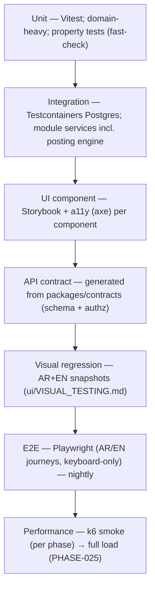

# Test Strategy

> **Status:** STABLE · **Owner:** Quality Engineering · **Updated:** 2026-10-27

The testing architecture for the whole platform, the non-negotiables that make financial
software trustworthy, and the CI budgets that keep it sustainable. Deep-dive suites:
[ACCOUNTING_TESTS.md](ACCOUNTING_TESTS.md) (ledger),
[TENANT_ISOLATION_TESTS.md](TENANT_ISOLATION_TESTS.md) (isolation),
[SYNC_TESTS.md](SYNC_TESTS.md) (offline chaos),
[PERFORMANCE_TEST_PLAN.md](PERFORMANCE_TEST_PLAN.md) (load),
[REGRESSION_STRATEGY.md](REGRESSION_STRATEGY.md) (release safety). Security testing:
[../security/SECURITY_TEST_PLAN.md](../security/SECURITY_TEST_PLAN.md).

## 1. Principles

1. **The ledger is sacred**: financial correctness tests outrank feature tests; an
   invariant failure blocks any release regardless of feature pressure (RISK-009).
2. **Assert data, not pixels**: for financial flows, the expected journal entries and
   balances are the assertion; screenshots are never sufficient evidence (directive §17).
3. **Test against the real thing**: integration tiers run against real PostgreSQL
   (Testcontainers) — no mocked databases for anything that touches SQL, RLS, or
   transactions.
4. **Bilingual by default**: every UI test surface exercises AR (RTL) and EN (LTR); the
   product is Arabic-first, so RTL is never an afterthought in tests.
5. **Deterministic over flaky**: sim clocks, seeded data, no sleep-based waits; flakes are
   quarantined and fixed, never deleted (§7).

## 2. The test pyramid

### 2.1 Unit (Vitest)

- **What**: domain logic with no I/O — money/value objects (`domain-core`), tax math,
  rounding, valuation functions, allocation algorithms, state machines, permission
  evaluation, serializer redaction.
- **Property tests via fast-check** where exhaustive cases are impossible:
  - Money: add/sub/multiply/round — associativity, identity, no float drift
    (`NUMERIC(19,4)` semantics, ADR-0009).
  - UoM conversions: conversion chains compose exactly (no accumulating error within
    6-decimal quantity precision).
  - Valuation: WAC/FIFO properties ([ACCOUNTING_TESTS.md](ACCOUNTING_TESTS.md) §c).
  - Rounding: monotonic + residual conservation (INV-007).
- **Budget discipline**: pure functions, no DB, no network; run in `pnpm test` per
  package with Turborepo caching.

### 2.2 Integration (Testcontainers, real PostgreSQL)

- **What**: module service tests against a real Postgres per suite: posting engine posts
  real journal entries; repository contract tests (tenant scoping by construction);
  migration tests (apply-on-fresh + apply-on-previous-snapshot,
  [../database/MIGRATION_STRATEGY.md](../database/MIGRATION_STRATEGY.md) §2); RLS attack
  tests connect as `erp_app` with wrong/missing GUC.
- **Harness**: one Postgres container per suite (parallel suites get their own);
  migrations applied via the real runner; seed via fixture builders (§5). SQLite (for
  offline schema) gets its own mirror suite where local DB behavior matters
  ([SYNC_TESTS.md](SYNC_TESTS.md) harness).
- **In-scope always**: anything that writes `journal_entries`, `stock_moves`,
  `audit_events`, or runs RLS.

### 2.3 API contract tests (generated from `packages/contracts`)

- **What**: every endpoint is exercised through its published zod/OpenAPI contract:
  request schema acceptance/rejection, response schema conformance, error-model
  conformance (typed codes, correlation id present —
  [../api/ERROR_MODEL.md](../api/ERROR_MODEL.md)), idempotency-key semantics, cursor
  pagination shape.
- **Authz assertions baked in**: each contract test asserts the permission required —
  success with it, 403 without it, 404 for other-tenant ids — generated from the
  [../security/AUTHORIZATION_MATRIX.md](../security/AUTHORIZATION_MATRIX.md)-linked route
  registry (never hand-maintained).
- **Negative schema tests**: unknown fields rejected (mass assignment guard), enum
  boundaries, max-length Arabic strings (not just ASCII).

### 2.4 UI component tests (Storybook + a11y)

- Every shared component ships with stories in **both directions**; axe (WCAG 2.1 AA —
  NFR-002) runs per story; interaction tests (click/type/keyboard) via Playwright
  component runner.
- Keyboard-complete accounting entry is a first-class story set (tab-order, focus traps,
  number formatting in AR/EN).

### 2.5 E2E (Playwright)

- **Journeys, not page screenshots**: register→onboard→configure CoA→opening
  balances→purchase (PO→GRN→invoice)→sell (order→delivery→invoice→receipt)→count
  stock→close period→print statements — the MVP gate journey, run in AR and EN.
- **Keyboard-only variants**: the full invoicing journey executed without a mouse.
- **Failure journeys**: period locked mid-entry, credit-limit block, sync rejection
  surfacing — users must see honest states (directive §12).
- Nightly cadence + release-triggered full run ([../planning/RELEASE_STRATEGY.md](../planning/RELEASE_STRATEGY.md)).

### 2.6 Visual regression (AR+EN)

- Snapshot both directions for every page archetype and print template; thresholds and
  the harness are owned by [../ui/VISUAL_TESTING.md](../ui/VISUAL_TESTING.md) (harness
  lands PHASE-005). Bidi/numeral rendering (Arabic-Indic vs Western digits) is asserted,
  not eyeballed (RISK-015).

### 2.7 Performance smoke (k6)

- Per-phase smoke from PHASE-007 (posting p95) and MVP-phase smoke vs NFR-006 budgets;
  full load testing at PHASE-025 — scenarios, mixes, and pass/fail in
  [PERFORMANCE_TEST_PLAN.md](PERFORMANCE_TEST_PLAN.md).

## 3. THE NON-NEGOTIABLES

1. **Financial operations must assert expected journal entries + balances.** Every
   posting operation test compares the **actual persisted journal lines** (account
   purpose, direction, amount, base amount) against the expected fixture, then asserts
   resulting GL/subledger balances. Screenshots and HTTP 200s are never sufficient
   evidence (directive §17).
2. **Failure-case tests are mandatory for important accounting workflows**: every posting
   rule has at minimum: period locked (`PERIOD_LOCKED`), unbalanced
   (`ENTRY_NOT_BALANCED`), unmapped purpose (`PURPOSE_NOT_MAPPED`), already-posted
   (`ALREADY_POSTED`), and each failure must prove **zero ledger residue** (no rows, no
   subledger changes, source document unchanged).
3. **Retry / timeout / duplicate / concurrency scenarios are required where applicable:**
   - duplicate posting of the same document (retry storm, INV-013),
   - concurrent posting of the same invoice (parallel transactions),
   - concurrent receipt allocation to the same invoice (INV-016),
   - concurrent sequence numbering (parallel invoices, INV-021),
   - job retries with partial failure (no partial ledger, resumable),
   - timeout mid-transaction (rollback, no residue),
   - sync duplicate delivery (inbox dedupe — [SYNC_TESTS.md](SYNC_TESTS.md)).
4. **Invariant coverage mapping is tracked** (§4): an invariant without a green test is a
   release blocker; coverage is listed in every phase completion report.

## 4. Invariant coverage mapping (INV-xxx → test names)

Canonical invariant definitions: [../accounting/ACCOUNTING_INVARIANTS.md](../accounting/ACCOUNTING_INVARIANTS.md).
The full test-matrix with given/when/then per invariant lives in
[ACCOUNTING_TESTS.md](ACCOUNTING_TESTS.md) §a; the mapping rule there assigns each
`INV-xxx` a named suite `invariants/INV-xxx.spec.ts` plus scenario entries in the golden
posting tests. Summary ownership:

| Invariant group | IDs | Primary suites |
|-----------------|-----|----------------|
| Ledger integrity | INV-001..INV-007 | `posting-engine.spec` (balance doc+base, immutability attacks, account/currency validation, source chain, rounding residual) |
| Idempotency/correction | INV-013, INV-014 | `posting-idempotency.spec`, `reversals.spec`, [SYNC_TESTS.md](SYNC_TESTS.md) duplicates |
| Period integrity | INV-011, INV-020 | `period-lock.spec`, `period-reopen-audit.spec`, `year-end.spec` |
| Subledger integrity | INV-009, INV-010, INV-012, INV-016, INV-019 | `reconciliation.spec` (seeded drift), `allocations.spec` (boundaries) |
| Inventory consistency | INV-017, INV-018 | `valuation-method-switch.spec`, `stock-move-atomicity.spec` |
| Document lifecycle | INV-008, INV-015, INV-021 | `fx-entry.spec`, `coa-guards.spec`, `numbering-races.spec` |
| Configuration cannot override | INV-022 | `config-fuzz.spec` (template/entitlement flips must not alter math) |

Every completion report lists which invariants gained **new** coverage in that phase
(protocol in ACCOUNTING_INVARIANTS.md §maintenance).

## 5. Test data strategy

| Dataset | What | Where used |
|---------|-----|-----------|
| **Golden accounting dataset** | Seeded journal set (opening balances → purchases → sales → receipts → adjustments) with **expected statements attached** (TB, IS, BS per period) | Posting golden tests, report regression packs ([REGRESSION_STRATEGY.md](REGRESSION_STRATEGY.md) §2), reconciliation tests |
| **Per-pack tax fixtures** | One fixture set per jurisdiction pack (KSA 15%, Egypt 14%, zero-rated, exempt, no-VAT) with expected tax summaries and VAT-return numbers | Tax engine tests, golden posting tests per pack, report regression |
| **Tenant isolation fixtures** | Twin tenants (A/B) with mirrored entity ids where possible + cross-referencing ids | All attack tests A1–A11 ([TENANT_ISOLATION_TESTS.md](TENANT_ISOLATION_TESTS.md)) |
| **Sync chaos fixtures** | Outbox command scripts (POS sales, field-sales ops) + network fault scripts | [SYNC_TESTS.md](SYNC_TESTS.md) harness |
| **Permission fixtures** | One user per role template + platform_admin + portal identity | Matrix-driven route tests ([../security/SECURITY_TEST_PLAN.md](../security/SECURITY_TEST_PLAN.md) §4) |
| **Performance dataset** | Volume-generated (100k docs/tenant profiles, mixed tenants) | [PERFORMANCE_TEST_PLAN.md](PERFORMANCE_TEST_PLAN.md) |

Rules: fixtures are **builders, not static dumps** (compose via factories so schema
changes don't rot them); no fixture contains real personal or business data; every
fixture carries its expected-output counterpart (data without expectations is not a
regression asset).

## 6. CI wiring and budgets

| Suite | Trigger | Budget (hard) | Notes |
|-------|---------|---------------|-------|
| Unit + property | every push/PR | **≤ 3 min** | Turborepo cache; sharded if budget breached (never "move to nightly" silently) |
| Integration (Testcontainers) | every push/PR | **≤ 10 min** | Suite-per-container parallelism; containers pre-pulled |
| API contract | every push/PR | within unit budget | generated, no manual upkeep |
| UI component + a11y | every push/PR | ≤ 5 min | per-package |
| Tenant isolation attack suite | every push/PR | within integration budget | blocking (RISK-010) |
| Accounting invariants + golden | every push/PR | within integration budget | blocking (RISK-009) |
| E2E bilingual | **nightly** + release | **≤ 25 min** | sharded journeys; failure page → same-day triage |
| Visual regression (AR+EN) | every push (touched stories) | ≤ 10 min | baseline update is a reviewed PR action |
| Sync chaos | per relevant phase (016/020+) then every push | ≤ 15 min full matrix | [SYNC_TESTS.md](SYNC_TESTS.md) staging |
| Performance smoke | per phase ≥ PHASE-007 | ≤ 20 min | [PERFORMANCE_TEST_PLAN.md](PERFORMANCE_TEST_PLAN.md) |
| Security gates (audit/gitleaks/SAST) | every push | ≤ 5 min | [../security/SECURITY_TEST_PLAN.md](../security/SECURITY_TEST_PLAN.md) §1 |

Budget breaches are treated as defects: optimize or shard, never silently skip.

## 7. Flake policy

1. A test that fails intermittently is **quarantined** the same day: moved to a
   quarantine list with an open ticket (severity: tech-debt, must-fix **within one
   week**).
2. Quarantined tests still run (reported separately); three consecutive green runs on the
   fix branch re-opens them.
3. **Never delete a failing test** to get a green build; never `skip()` without a ticket
   reference; both are code-review blockers.
4. Root causes feed the harness: sleep-based waits, time-of-day, locale-default, ordering
   assumptions — fix the harness, not just the test.
5. Flake rate is a tracked metric per suite; > 1% weekly triggers a harness review.

## 8. Coverage policy

- **No vanity line-percentage targets.** What is gated instead:
  - **Invariant coverage**: 100% of INV-001..INV-022 with at least one positive and one
    violation test each (mapping §4; enforced by a checklist query against
    ACCOUNTING_INVARIANTS.md IDs — docs-drift aware).
  - **Service coverage**: every module service method has at least: happy path + one
    failure path + authorization-relevant assertions (if it touches permissions).
  - **Route coverage**: every published route has contract + permission tests
    (generated checklist makes this mechanical).
  - **Posting-rule coverage**: every canonical rule in
    [../accounting/POSTING_ENGINE.md](../accounting/POSTING_ENGINE.md) §4 has a golden
    test — a new rule without its golden test cannot merge.
- Line coverage is still collected and trended (to spot dead code and untested
  domains), but a specific % never gates a release.

## 9. Environments & ownership

| Layer | Environment | Owner |
|-------|-------------|-------|
| Unit/property/contract/component | dev machines + CI | package owners |
| Integration + isolation + invariants | CI (Testcontainers) | module owners + Quality Engineering |
| E2E + visual | CI with staging URL (nightly) | Quality Engineering |
| Sync chaos (full matrix) | CI at PHASE-020+; staging soak for long runs | sync + Quality Engineering |
| Performance | staging-class hardware (see [PERFORMANCE_TEST_PLAN.md](PERFORMANCE_TEST_PLAN.md) §6) | Performance owner |
| Restore/DR drills | staging + ephemeral infra | Operations |

## 10. Phase wiring summary

| Phase | Testing milestones |
|-------|--------------------|
| PHASE-001 | CI pipeline; domain-core property tests; negative boundary meta-test; docs validation |
| PHASE-002 | Testcontainers harness; migration tests; RLS catalog assertions; files upload tests |
| PHASE-003 | Isolation attack suite A1–A11; permission matrix tests; rate-limit/lockout; session/MFA |
| PHASE-005 | Storybook + axe; visual harness (AR+EN); CSP verification |
| PHASE-006 | Master-data contract suites; import/export edge tests |
| PHASE-007 | **Posting engine golden suite + invariants suite live**; k6 posting smoke |
| PHASE-008–009 | Treasury/tax golden tests; per-pack fixtures; reconciliation tests |
| PHASE-010–012 | Trade-module golden tests; concurrency suites; allocation boundaries |
| PHASE-013 | Report contract tests; export leakage tests; golden report regression packs |
| PHASE-014 | MVP-gate E2E journey both languages; full security review per [../security/SECURITY_TEST_PLAN.md](../security/SECURITY_TEST_PLAN.md) |
| PHASE-016 | POS-scoped chaos suite (offline queue) |
| PHASE-020 | Full sync chaos matrix ([SYNC_TESTS.md](SYNC_TESTS.md)) |
| PHASE-024 | Pen-test findings retests; hardening regressions |
| PHASE-025 | Full load; DR drill; release-candidate regression ([REGRESSION_STRATEGY.md](REGRESSION_STRATEGY.md) §4) |

## 11. Maintenance protocol

1. New module → new rows in §4/§10 + suite skeleton in the same phase.
2. New invariant → test-first, then enforcement (ACCOUNTING_INVARIANTS.md protocol).
3. Budget breaches → re-shard or re-scope with a decision record; budgets are contracts,
   not vibes.
4. Quarterly: review flake rate, quarantine age, invariant mapping freshness.
