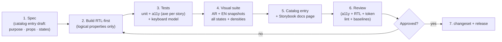

# Design System

> **Status:** STABLE · **Owner:** Design System Architecture · **Updated:** 2026-10-27

System architecture of the custom ERP design system (`packages/ui`), built per
[ADR-0016](../architecture/ADR/ADR-0016-ui-tailwind-radix.md): Tailwind CSS v4 tokens +
unstyled Radix primitives + our ERP components. The design system is a first-class product
surface implemented in **PHASE-005** ([../planning/MASTER_ROADMAP.md](../planning/MASTER_ROADMAP.md))
and extended by every feature phase. Philosophy: [DESIGN_PRINCIPLES.md](DESIGN_PRINCIPLES.md).
Catalog of components: [COMPONENT_CATALOG.md](COMPONENT_CATALOG.md).

## 1. Why a custom system (decision recap)

Dense financial grids, bilingual RTL-first rendering, tabular money, document lifecycles,
and agent-implementable explicitness dominate the requirements; generic libraries treat
all of these as add-ons. We adopt the shadcn/ui *pattern* — Radix + Tailwind, code owned
in-repo — with our own ERP component set. Nothing is imported from a component library at
runtime except Radix primitives (behavior/a11y only, unstyled) and Lucide (icons).

## 2. Package structure

```text
packages/ui/
├── src/
│   ├── tokens/            # Canonical design tokens (this is the ONLY place with raw values)
│   │   ├── tokens.css     # --erp-* custom properties + @theme mapping
│   │   ├── tokens.ts      # TS mirror (RN/Android theme, charts, print CSS build)
│   │   └── density.css    # compact/comfortable measurement maps
│   ├── primitives/        # Thin Radix wrappers — the only legal Radix import site
│   │   ├── dialog/  drawer/  popover/  dropdown/  tooltip/  tabs/
│   │   ├── combobox/  select/  checkbox/  radio/  switch/
│   │   └── _shared/       # Shared Radix context helpers (portal, collision padding)
│   ├── components/        # Catalog components (Button, DataTable, MoneyInput, …)
│   │   └── <component>/   #   index.ts + <Component>.tsx + <Component>.test.tsx + .stories.tsx
│   ├── patterns/          # Composed domain patterns (JournalEntryGrid, …)
│   ├── print/             # Print CSS + template shells shared web↔server (PHASE-013)
│   │   ├── a4-document.css  a4-report.css  receipt-80.css  receipt-58.css
│   │   └── templates.tsx   # Headless shells rendering to static HTML for Chromium
│   ├── theme.css          # Tailwind v4 @theme + layer ordering + focus ring base
│   ├── utils/             # cn(), densityCx(), money format hooks, bidi isolate helpers
│   └── index.ts           # Public API — the ONLY import path for apps
├── lint/                  # Local lint rules (no-raw-radix, no-physical-direction, …)
└── package.json           # name: @erp/ui — semver, changesets-managed
```

**Import rule:** apps import from `@erp/ui` (and `@erp/ui/tokens` where needed). Deep
imports, raw `radix-ui` imports in app code, and ad-hoc Tailwind-only interactive
patterns are lint-banned (see §4).

## 3. Layers and their contracts

| Layer | Contents | May import | Must not |
|-------|----------|------------|----------|
| `tokens/` | Raw values, @theme mapping | — | Reference components |
| `primitives/` | Unstyled Radix wrappers applying tokens (radius, shadow, focus) | tokens, Radix | Business vocabulary, layouts |
| `components/` | Catalog components (generic, domain-agnostic) | primitives, tokens, utils | Module services, API calls |
| `patterns/` | Domain compositions (JournalEntryGrid, ReportViewer…) | components, primitives | Direct fetch — data comes via props/headless hooks |
| `print/` | Print CSS + template shells (shared with server renderer) | tokens, components (static render only) | Browser-only APIs |

Patterns receive data exclusively through props or headless hook contracts defined beside
them — the design system never owns business state. This keeps `packages/ui` buildable
and testable in isolation and reusable by web, desktop shell, and (tokens only) Android.

## 4. Composition rules (binding)

1. **Screens compose catalog components.** A screen's job is data fetching + layout +
   wiring; interaction patterns (combobox with async search, resizable tables, drawers)
   already exist as components/patterns.
2. **Forbidden in app code:** raw Radix imports; copying a catalog component's internals;
   "utility soup" re-implementations of interactive patterns (a div + 40 Tailwind classes
   that is secretly a dropdown); hard-coded colors/px values that exist as tokens.
3. **Extending a component:** if two screens need the same variation, the variation moves
   into `packages/ui` as a prop or a new catalog entry — never duplicated per screen.
4. **Industry modules assemble, never recreate** (directive §10): a restaurant menu grid
   is a configured DataTable + POS archetype; automotive job cards reuse
   DocumentDetail. New industry-specific *patterns* are added to `packages/ui/patterns/`
   with a catalog entry when shared, or to the industry package as pure composition when
   not.
5. **Escape hatch:** if a catalog component genuinely cannot serve a screen, the correct
   path is a design-system decision record → catalog addition → all screens benefit. The
   wrong path is a private fork.

Lint enforcement (PHASE-005 CI): `erp/no-raw-radix` (app code), `erp/no-physical-direction`
(shared components), `erp/no-raw-design-values` (outside tokens/), `erp/import-path`
(`@erp/ui` surface only).

## 5. Versioning & release discipline

- **Semver** via changesets, published as `@erp/ui` to the private registry (apps pin
  exact versions; no floating ranges).
- **Patch:** bug fixes, a11y fixes — no visual diffs.
- **Minor:** new components, new props, additive tokens — visual diffs allowed only for
  components listed in the changeset; existing baselines must stay green.
- **Major:** token value changes, prop removals, RTL behavior changes — requires a design
  decision record + migration note.
- **Visual regression gate:** every `@erp/ui` PR runs the AR+EN Storybook snapshot suite
  ([VISUAL_TESTING.md](VISUAL_TESTING.md)); intentional changes ship updated baselines in
  the same PR with justification in the changeset. A PR that changes snapshots without a
  changeset entry fails CI.
- Docs stay in lockstep: a component without a [COMPONENT_CATALOG.md](COMPONENT_CATALOG.md)
  entry cannot ship; CI checks catalog coverage by export name.

## 6. Theming

**MVP: one brand theme** (the light teal token set,
[DESIGN_TOKENS.md](DESIGN_TOKENS.md)). Theming exists as *structure*, not as a feature:

1. Components reference semantic tokens (`--erp-surface-card`,
   `--erp-color-finance-negative`) — never palette stops — so a future theme swap is a
   token-file change.
2. **Tenant accent injection point (documented, PHASE-014+):** tenants may set a logo
   (image URL, up to 2 pieces of artwork: light panel + print) and an **accent color**
   that must pass the same contrast gates. The accent maps *only* to:
   `--erp-color-primary-600/700` (buttons/links/active nav). Semantic colors (success,
   warning, danger, info, finance-negative) are **never tenant-themable** — accounting
   semantics must look identical on every tenant. Invalid accents (contrast fail against
   white text) are rejected at upload with an inline preview + suggested alternatives.
3. Print templates accept tenant logo + accent with the same constraint
   ([../reporting/PRINTING_AND_EXPORT.md](../reporting/PRINTING_AND_EXPORT.md)).
4. Dark mode: out of MVP scope; tokens are structured (semantic indirection) so a later
   dark set is additive, not a rewrite.

## 7. Density & locale as first-class props

Every interactive component accepts:

```tsx
density?: 'compact' | 'comfortable';   // default: compact (32px controls/rows)
```

- Density comes from app shell context (`<DensityProvider>`, persisted per user); screens
  may pin density (POS forces comfortable-style ≥44px touch targets regardless).
- **Locale:** components never read global state for language/direction — the app shell
  sets `lang` and `dir` on `<html>`; components inherit. Components DO accept a
  `locale` prop where formatting is intrinsic: `MoneyInput`/`MoneySummaryBar` (currency +
  minor units), `DatePicker` (calendar system: gregory | islamic-umalqura display),
  `DocumentStatusBadge` (bilingual labels resolved via the app's i18n bundle; the
  component only maps state → token).
- Bilingual labels are passed as `{ ar: string; en: string }` display objects by the app
  layer from the controlled [../GLOSSARY.md](../GLOSSARY.md) vocabulary; `packages/ui`
  ships no business terminology of its own except the status token map.

This split keeps `packages/ui` pure (no tenant data, no i18n bundle coupling) while
guaranteeing bilingual + RTL correctness at composition time.

## 8. Component development workflow (definition of done)



1. **Spec:** a short entry describing purpose, props, states (hover/focus/disabled/
   loading/error/empty), keyboard model, RTL considerations. Written *before* code — it
   is the review contract.
2. **Build RTL-first:** develop with `dir="rtl"` as the default Storybook canvas
   direction; LTR is the mirrored verification pass.
3. **Tests:** unit (behavior), axe per story (0 violations), keyboard traversal test
   (Tab/Shift-Tab/Escape/Enter per [ACCESSIBILITY.md](ACCESSIBILITY.md)), density test
   (compact + comfortable).
4. **Visual:** AR + EN snapshots for every state, both densities
   ([VISUAL_TESTING.md](VISUAL_TESTING.md)).
5. **Catalog:** [COMPONENT_CATALOG.md](COMPONENT_CATALOG.md) row/section + Storybook docs
   page with a live AR example first.
6. **Review checklist:** tokens only (no raw values), logical properties only, focus
   ring spec met, motion within budget, a11y semantics correct, baselines updated with
   changeset. One reviewer must approve the RTL notes explicitly.

## 9. Documentation map

| Question | Document |
|----------|----------|
| Why does it look/act this way? | [DESIGN_PRINCIPLES.md](DESIGN_PRINCIPLES.md) |
| What are the exact values? | [DESIGN_TOKENS.md](DESIGN_TOKENS.md) |
| What components exist and their APIs? | [COMPONENT_CATALOG.md](COMPONENT_CATALOG.md) |
| How do I lay out a screen? | [PAGE_ARCHETYPES.md](PAGE_ARCHETYPES.md) |
| Where do navigation items come from? | [NAVIGATION_MODEL.md](NAVIGATION_MODEL.md) |
| How do I handle direction? | [RTL_DESIGN_RULES.md](RTL_DESIGN_RULES.md) · [../localization/RTL_AND_LTR.md](../localization/RTL_AND_LTR.md) |
| What a11y bar must I meet? | [ACCESSIBILITY.md](ACCESSIBILITY.md) |
| Can this animate? | [MOTION_GUIDELINES.md](MOTION_GUIDELINES.md) |
| How are visual regressions caught? | [VISUAL_TESTING.md](VISUAL_TESTING.md) |
| How does printing reuse this system? | [../reporting/PRINTING_AND_EXPORT.md](../reporting/PRINTING_AND_EXPORT.md) |

## 10. Platform reach

| Platform | Consumes | Mechanism |
|----------|----------|-----------|
| Web app (Next.js) | Full component set | `@erp/ui` import, `dir`/`lang` from session |
| Desktop (Tauri, PHASE-021) | Full component set | Same web bundle in shell (ADR-0013) |
| Android (Expo, PHASE-022) | Tokens only | `tokens.ts` → RN theme object; native components follow the same measurements (ADR-0014) |
| Server print (PHASE-013) | `print/` CSS + components rendered headless | Static HTML → Chromium PDF (ADR-0011) |
| Email (notifications) | `print/` CSS subset | Bilingual plain-first templates, token colors |

The token file is the cross-platform contract: if Android and web disagree visually, the
token file wins and both are corrected from it.
